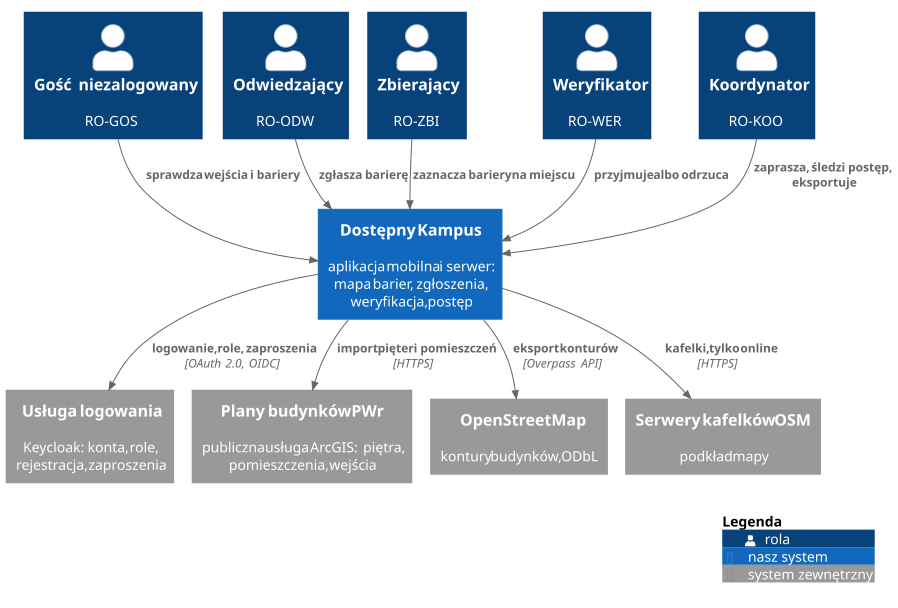

# Kontekst systemu

| Element | Rodzaj | Co wymienia z systemem |
| --- | --- | --- |
| RO-GOS, RO-ODW, RO-ZBI, RO-WER, RO-KOO | role | uprawnienia opisuje strona [Role i uprawnienia](../biznes/role.md) |
| Usługa logowania (Keycloak) | system zewnętrzny | logowanie, rejestracja, role w tokenie, konta z zaproszenia ([ADR-0003](decyzje/0003-keycloak.md)) |
| Plany budynków PWr | system zewnętrzny | piętra, pomieszczenia i wejścia z publicznej usługi ArcGIS [1] ([ADR-0006](decyzje/0006-dane-pwr-o-pomieszczeniach.md)) |
| OpenStreetMap | system zewnętrzny | kontury budynków, eksportowane raz na licencji ODbL [2] ([ADR-0005](decyzje/0005-mapa-offline.md)) |
| Serwery kafelków OSM | system zewnętrzny | podkład mapy, tylko online (NFR-39) |

Usługa logowania jest jedynym systemem zewnętrznym, który występuje jako aktor w przypadkach użycia. Pozostałe tylko dostarczają dane, a ich awaria nie może zatrzymać aplikacji (NFR-50).

USOS jest poza MVP (decyzja projektu nr 35), dlatego nie ma go na diagramie. QGIS też go nie ma: Koordynator otwiera w nim pobrany plik eksportu, a QGIS nie łączy się z systemem.

## Źródła

1. [Usługi ArcGIS PWr (katalog REST)](https://services3.arcgis.com/rrLByHvJ7zuJQDVw/arcgis/rest/services)
2. [OpenStreetMap: prawa autorskie i licencja](https://www.openstreetmap.org/copyright)
