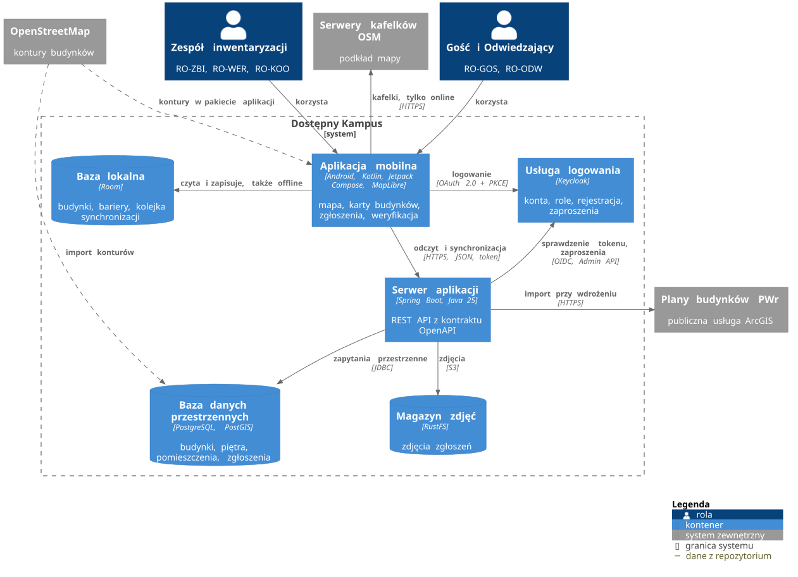

# Kontenery

| Kontener | Technologia | Odpowiada za |
| --- | --- | --- |
| Aplikacja mobilna | Android 8.0+, Kotlin, Jetpack Compose, MapLibre, WorkManager | ekrany według roli, pomiar pozycji, mapa także bez sieci; wysyłka kolejki po powrocie sieci (NFR-6) |
| Baza lokalna | Room | budynki, bariery i zgłoszenia czekające na synchronizację, także po restarcie telefonu (NFR-5) |
| Serwer aplikacji | Spring Boot, Java 25, Spring Modulith | REST API z kontraktu `api/openapi.yaml`, sprawdzanie roli przy każdym żądaniu (NFR-33) |
| Baza danych przestrzennych | PostgreSQL, PostGIS, Flyway | budynek dla punktu, podobne zgłoszenia w promieniu, przeliczenie na PUWG 1992 |
| Magazyn zdjęć | RustFS, zgodny z S3 ([ADR-0009](decyzje/0009-magazyn-zdjec.md)) | zdjęcia zgłoszeń bez metadanych (NFR-26) |
| Usługa logowania | Keycloak | hasła i e-maile; serwer zna tylko identyfikator konta, nazwę i rolę (NFR-28) |

Moduły serwera i aplikacji, ich zależności i kontrole granic opisuje [Struktura modułów](moduly.md).

Limit żądań bez logowania z NFR-34 (60 na minutę z jednego adresu, potem 429 z `Retry-After`) liczy serwer aplikacji, w pamięci jednej instancji (Bucket4j). Za serwerem pośredniczącym adres klienta bierze się z nagłówka `X-Forwarded-For` tylko wtedy, gdy serwer ma włączone `server.forward-headers-strategy`; inaczej wszyscy klienci dzielą adres pośrednika. Adresy bez limitu (np. monitoring) podaje `DK_RATE_LIMIT_UNLIMITED`.

Zapisy zalogowanego konta (POST, PUT, PATCH, DELETE) mają osobny limit na identyfikator konta z tokenu: 120 na minutę, ustawienie `DK_WRITES_RATE_LIMIT`.

Na diagramie kontekstu Usługa logowania jest systemem zewnętrznym, bo to gotowy produkt z własnymi danymi. Tu leży w granicy systemu, bo uruchamiamy ją sami z konfiguracją z repozytorium ([ADR-0003](decyzje/0003-keycloak.md)).

Linia przerywana oznacza dane, których system nie pobiera w czasie pracy. Skrypt eksportuje kontury z OpenStreetMap do repozytorium, skąd trafiają do pakietu aplikacji i do bazy serwera ([ADR-0005](decyzje/0005-mapa-offline.md)).
