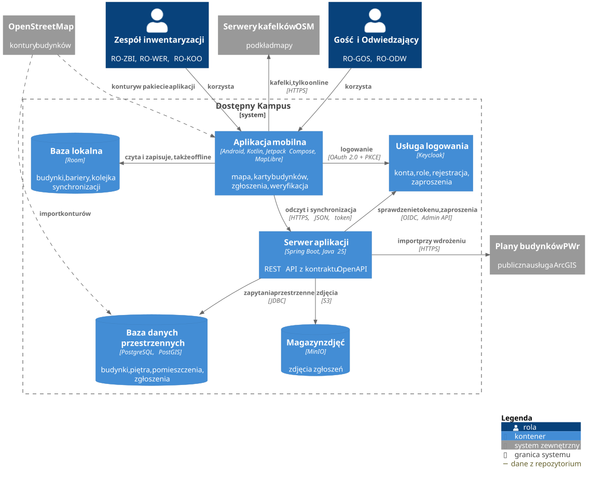

# Kontenery

| Kontener | Technologia | Odpowiada za |
| --- | --- | --- |
| Aplikacja mobilna | Android 8.0+, Kotlin, Jetpack Compose, MapLibre | ekrany według roli, pomiar pozycji, mapa także bez sieci |
| Baza lokalna | Room, WorkManager | budynki, bariery i zgłoszenia czekające na synchronizację; wysyłka po powrocie sieci (NFR-5, NFR-6) |
| Serwer aplikacji | Spring Boot, Java 25, Spring Modulith | REST API z kontraktu `api/openapi.yaml`, sprawdzanie roli przy każdym żądaniu (NFR-33) |
| Baza danych przestrzennych | PostgreSQL, PostGIS, Flyway | budynek dla punktu, podobne zgłoszenia w promieniu, przeliczenie na PUWG 1992 |
| Magazyn zdjęć | MinIO, zgodny z S3 | zdjęcia zgłoszeń bez metadanych (NFR-26) |
| Usługa logowania | Keycloak | hasła i e-maile; serwer zna tylko identyfikator konta, nazwę i rolę (NFR-28) |

Serwer ma moduły `identity`, `building`, `barrier`, `review`, `sync` i `export`. Moduł sięga do innego tylko przez jego publiczny pakiet, co sprawdzają testy architektury.

Na diagramie kontekstu Usługa logowania jest systemem zewnętrznym, bo to gotowy produkt z własnymi danymi. Tu leży w granicy systemu, bo uruchamiamy ją sami z konfiguracją z repozytorium ([ADR-0003](decyzje/0003-keycloak.md)).

Linia przerywana oznacza dane, których system nie pobiera w czasie pracy. Skrypt eksportuje kontury z OpenStreetMap do repozytorium, skąd trafiają do pakietu aplikacji i do bazy serwera ([ADR-0005](decyzje/0005-mapa-offline.md)).
