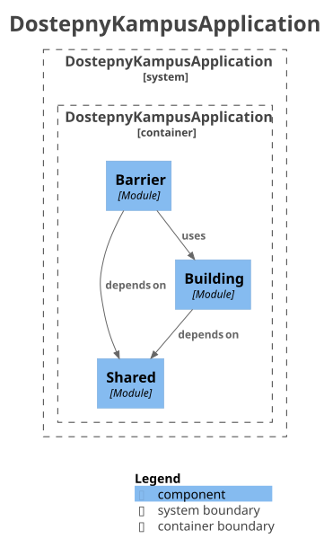

# Struktura modułów

Moduł działa jak mała usługa: ma jedno zadanie, jawne API i jawne zależności. Moduły dzielimy według
dziedziny (bariery, budynki, konta), a nie według warstw technicznych; warstwy są wewnątrz modułu.
Reguł pilnują testy architektury i kompilator.

Strona opisuje stan docelowy. Kod dochodzi do niego w epiku #1335; odstępstwa, które jeszcze istnieją,
są wymienione w części „Stan dziś” razem z issue, które je usuwa. Ta część jest przejściowa
i zniknie w #1445.

## Serwer

Moduł to pakiet najwyższego poziomu pod `io.github.dostepnykampus`. Wszystkie działają w jednym procesie,
granice sprawdza Spring Modulith.

Schemat zależności modułów powstaje z kodu (`ModularityTest` porównuje go z plikiem `moduly-serwera.iuml`).
Moduł bez zależności, dziś `identity`, nie ma na nim strzałek i generator go pomija. Zadanie, API i
zależności każdego modułu opisuje jego `package-info.java`.



Układ modułu na przykładzie `barrier`:

```text
barrier/
  package-info.java   opis modułu i lista zależności
  (korzeń)            tylko typy wołane przez inne moduły
  domain/             model i reguły, bez frameworków
    content/          podpakiet tematyczny warstwy
  application/        usługi z transakcją
  web/                kontrolery, żądania, odpowiedzi
  persistence/        JDBC, PostGIS, import danych do bazy
  json/               treść zapisywana w kolumnach JSON
  photo/              podpakiet tematyczny modułu
```

- Korzeń pakietu modułu zawiera tylko `package-info.java` i typy wołane przez inne moduły, także
  w małym module.
- Warstwy mają stałe nazwy: `domain`, `application`, `web`, `persistence`, `json`. Warstwa powstaje,
  gdy ma choć jeden plik. Kierunek zależności: `web` → `application` → `domain`, a `web` może też wołać
  `domain`; `persistence` → `domain`; `web` i `persistence` → `json` → `domain`; `domain` nie zależy
  od innych warstw ani od frameworków.
- Podpakiet tematyczny powstaje, gdy temat ma co najmniej pięć plików. Wewnątrz warstwy
  (`barrier.domain.content`) podlega regułom swojej warstwy; na poziomie modułu (`barrier.photo`) jest
  adapterem jak `persistence`: zależy od `domain`, `domain` od niego nie zależy.
- Zależności modułu są zapisane w `@ApplicationModule(allowedDependencies = …)` w `package-info.java`.
  Nowa zależność to zmiana tej linii, widoczna w PR.
- `shared` jest modułem otwartym (`Type.OPEN`): inne moduły widzą wszystkie jego typy. Ma tylko
  podpakiety `error`, `json`, `geo`, nie zależy od innych modułów i nie podlega regułom warstw.
  Nowy podpakiet wymaga zmiany testu, który pilnuje tej listy.

## Android

Moduł to moduł Gradle. Granicę wyznacza kompilator: moduł widzi tylko to, co deklaruje.

| Moduł | Zadanie | Zależy od (kod produkcyjny) |
| --- | --- | --- |
| `:app` | składa ekrany, nawigację i zależności Hilt | moduły funkcji, `:core:data`, `:core:database`, `:core:designsystem`, `:core:model` |
| `:feature:map` | mapa kampusu, karta budynku, bariery na mapie | `:core:model`, `:core:data`, `:core:geo`, `:core:designsystem` |
| `:feature:capture` | zgłaszanie barier i moje zgłoszenia | jak `:feature:map` oraz `:core:location` |
| `:feature:help` | pomoc i pierwsze uruchomienie | `:core:model`, `:core:data`, `:core:designsystem` |
| `:core:data` | repozytoria, kolejka wysyłki, synchronizacja | `:core:model`, `:core:database`, `:core:network`, `:core:geo` |
| `:core:database` | baza Room | — |
| `:core:network` | klient HTTP serwera | `:core:model`, `:core:geo` |
| `:core:geo`, `:core:location`, `:core:designsystem` | geometria, pozycja GNSS, wygląd | `:core:model` |
| `:core:model` | typy dziedziny wspólne dla modułów | — |

`core:data.photos` udostępnia kontrakt `PhotoCapture`: żądanie zdjęcia oraz wynik z plikiem,
rezygnacją albo powodem błędu. Implementacja aparatu należy do warstwy składającej ścieżkę użytkownika.

- Moduł funkcji nie zależy od innego modułu funkcji ani od `:core:database` i `:core:network`, także
  pośrednio przez `api(...)` i w testach. Testy dostają repozytoria z `testFixtures` modułu `:core:data`.
- Tylko `:core:data` i `:app` zależą od `:core:database` i `:core:network`.
- W modułach `core` działa `explicitApi()`; deklaracja nieużywana poza modułem jest `internal`.
- Pakiety modułu funkcji dzielimy według ścieżki użytkownika albo tematu, np. `capture.quick`,
  `capture.report`, `map.style`, `map.area`. W korzeniu zostaje ekran wejścia do funkcji; podpakiety
  nie importują korzenia. To, co wspólne kilku podpakietom, leży w podpakiecie, od którego zależą
  pozostałe (np. `map.data`, `map.controls`).

## Wspólne

- Nowy moduł zakładamy, gdy naraz: ma kod już teraz; jego zadanie da się opisać jednym zdaniem bez „i”;
  ma własne dane albo własną ścieżkę użytkownika; jego API to kilka typów. Pustych modułów nie ma.
- Pakiet ma najwyżej 15 plików produkcyjnych (w Javie klas najwyższego poziomu), bez
  `package-info.java`. Moduł poniżej trzech plików z jednym odbiorcą łączymy z odbiorcą.
- Lista wyjątków reguły struktury może tylko maleć, a każdy wpis ma otwarte issue.

## Stan dziś

| Odstępstwo | Issue |
| --- | --- |
| `barrier.domain` ma 22 pliki | #1439 |
| podpakiety `feature.capture` importują korzeń modułu; brak reguły dla `feature/*` | #1634, #1635 |

## Co pilnuje zasady

| Punkt zasady | Kontrola |
| --- | --- |
| brak cykli i dostępu do wnętrza cudzego modułu serwera | `ModularityTest.infraVerifiesModuleBoundaries` |
| moduł serwera ma kod i opis, bez stałej listy nazw | `ModularityTest.modulesHaveClassesAndDescription` |
| pakiet główny i lista podpakietów `shared` | `ModularityTest` (`basePackageHoldsOnlyApplication`, `sharedHasOnlyErrorJsonAndGeo`) |
| jawna lista zależności modułu serwera | `ModularityTest` (`modulesDeclareAllowedDependencies`, `infraVerifiesModuleBoundaries`) |
| korzeń modułu serwera zawiera tylko API | #1443 |
| `domain` bez frameworków, na `persistence` zależy tylko `persistence` | `BarrierArchitectureTest` (A-1…A-9), dziś tylko `barrier` |
| kierunek i nazwy warstw w każdym module serwera | #1325 |
| najwyżej 15 plików w pakiecie | #1326 (serwer), #1332 (Android) |
| moduł Androida ma kod produkcyjny | `ModuleContentArchitectureTest` |
| moduł funkcji nie widzi bazy i sieci | kompilator: moduł funkcji nie ma ich w zależnościach, także w testach; Konsist `infra_a1_ui_no_network_or_db` |
| tylko `:core:data`, `:core:data-testing` i `:app` zależą od bazy i sieci (sieci także `:systemtest`), nigdy przez `api` | `StorageDependencyArchitectureTest` |
| moduł funkcji nie importuje innego modułu funkcji | Konsist `infra_a1_feature_not_on_other` |
| moduł `core` nie importuje modułu funkcji | Konsist `infra_a1_core_not_on_feature` |
| jawna widoczność w modułach `core` | #1329 |
| zadeklarowane zależności Gradle są używane i mają właściwy zakres | `buildHealth` (#894), poprawki: #1398 |
| opis modułu przy kodzie | #1333 (serwer); Android: `ModuleReadmeArchitectureTest` (`README.md` modułu, zebrane na stronie [Moduły aplikacji Android](moduly-android.md)) |
| kryteria nowego modułu, łączenie małych modułów, próg pięciu plików podpakietu, podział pakietów funkcji według ścieżki | przegląd PR |
