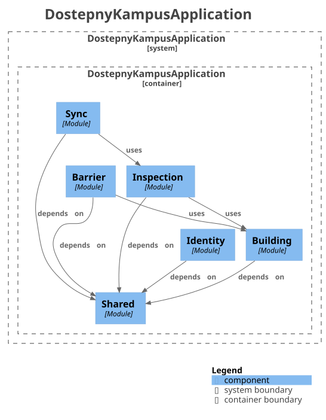

# Struktura modułów

Moduł działa jak mała usługa: ma jedno zadanie, jawne API, jawne zależności, własne dane i opis przy
kodzie. Moduły dzielimy według dziedziny (bariery, budynki, konta), wnętrze modułu według tematów,
a warstwy leżą w temacie. Uzasadnienie: [ADR-0011](decyzje/0011-modularny-monolit.md). Reguł pilnują
testy architektury i kompilator.

## Zasady pakietów

1. **Jeden temat na pakiet.** Temat to agregat, zdolność albo ścieżka użytkownika. Opis pakietu to
   jedno zdanie bez „i”; klasy zmieniane razem leżą razem.
2. **Moduł z jednym tematem** ma warstwy pod korzeniem (`building/domain`, `identity/web`).
   **Moduł z kilkoma tematami** ma tematy, a w nich warstwy (`barrier/submission/web`).
   Temat, od którego moduł ma nazwę, zostaje w warstwach pod korzeniem; każdy kolejny temat ma
   podpakiet z warstwami (`building/domain`, `building/room/json`).
3. **Stałe nazwy warstw.** Serwer: `api`, `application`, `web`, `persistence`, `json`, `storage`.
   Android: `navigation` (trasy), `di`. Warstwa powstaje od jednego pliku.
4. **Słownik tematów.** Nazwy tematów i ścieżek użytkownika pochodzą z
   [jednego słownika](../_generated/slownik-tematow.md) (źródło `tematy.tsv`), są takie same w każdym
   module i stoją w liczbie pojedynczej (`submission`, nie `submissions`). Moduł nazwany od tematu nie
   powtarza go w pakiecie.
5. **Zakazane nazwy pakietów:** `util`, `utils`, `common`, `helper`, `misc`, `base`, `impl`.
6. **Podpakiet tematu** powstaje od trzech plików albo wtedy, gdy temat o tej nazwie istnieje w innym
   module. Mniejszy temat zostaje w pakiecie nadrzędnym.
7. **Głębokość:** najwyżej trzy segmenty pod korzeniem modułu (`barrier.submission.content`).
8. **Brak cykli** między pakietami modułu. Podpakiet nie importuje korzenia modułu, adapter nie woła
   innego adaptera. Gdy temat A musiałby wołać temat B, który zależy od A, łączy je zdarzenie.
9. **Sygnał rozmiaru:** pakiet ponad 15 plików produkcyjnych (w Javie klas najwyższego poziomu, bez
   `package-info.java`) jest błędem CI. Liczba nie zastępuje zasad 1–8.
10. **Interfejs** powstaje tylko w `api` modułu albo jako port dziedziny, który implementuje adapter.
    Kontrakt w Javadoc/KDoc mają typy `api`, porty i publiczne interfejsy `:core:data`.

## Serwer

Moduł to pakiet najwyższego poziomu pod `io.github.dostepnykampus`. Wszystkie działają w jednym procesie,
granice sprawdza Spring Modulith. Schemat zależności modułów powstaje z kodu (`ModularityIT` porównuje
go z plikiem `moduly-serwera.iuml`). Każdy moduł zależy od `shared`; `identity` poza nim od nikogo.



Moduł z kilkoma tematami, na przykładzie `barrier`:

```text
barrier/
  package-info.java      opis modułu i lista zależności
  api/                   zgłoszenia zmienione od kursora dla innych modułów
  submission/            zgłoszenie (agregat); dziedzina i porty
    content/             treść zgłoszenia: typ, grupa, miejsce, piętro
      json/              treść w kolumnie JSON
    application/         przypadki użycia z transakcją
    web/                 kontroler, żądania, odpowiedzi
    persistence/         JDBC
  review/                weryfikacja: decyzja, podobne zgłoszenia; port weryfikacji
    application/  web/  persistence/
  photo/                 zdjęcia zgłoszenia; port magazynu
    application/  storage/  web/
```

Moduł z jednym tematem, na przykładzie `building`: `api/`, `domain/`, `web/`, `persistence/` pod korzeniem.
Gdy dochodzi drugi temat, budynek zostaje pod korzeniem, a nowy temat dostaje podpakiet:

```text
building/
  api/  domain/  web/  persistence/   budynek, temat od nazwy modułu
  room/                               pomieszczenie piętra
    json/  persistence/  web/
```

- **API modułu** leży w pakiecie `api` z `@NamedInterface("api")`: interfejsy, rekordy danych,
  identyfikatory, wyjątki kontraktu, zdarzenia. Typy `api` zależą tylko od `api`, `shared` i `java`.
  Agregaty, encje, repozytoria i klasy Springa nie wychodzą poza moduł. Pakiet `api` ma moduł, z którego
  korzysta inny moduł.
- **Korzeń modułu** zawiera tylko `package-info.java`, `api` i tematy albo warstwy.
- **Kierunek warstw:** `web` → `application` → dziedzina; adaptery (`persistence`, `json`, `storage`)
  → dziedzina; dziedzina nie zależy od warstw ani od frameworków.
- **Zależności modułu** są w `@ApplicationModule(allowedDependencies = "building :: api")`
  w `package-info.java`. Nowa zależność to zmiana tej linii, widoczna w PR.
- **Zdarzenia między modułami** wprowadza pierwszy przypadek, razem z rejestrem publikacji Spring
  Modulith, odbiorcą odpornym na powtórzenie i testem scenariusza. Zdarzenie w `api` zmienia się tylko
  zgodnie wstecz.
- **Dane:** moduł jest właścicielem swoich tabel. Nowe migracje leżą w `db/migration/<moduł>/`,
  migracje sprzed podziału w `db/migration/__root`. Powtarzalny import budynków i wejść z OSM
  jest wykonywany wyłącznie w głównej historii Flyway. Nowych kluczy obcych i złączeń między tabelami
  różnych modułów nie ma; odwołanie przez identyfikator.
- **Moduł działa sam:** test uruchamia tylko jego kontekst, a `api` sąsiadów zastępuje.
- `shared` jest modułem otwartym (`Type.OPEN`): inne moduły widzą wszystkie jego typy. Ma tylko
  podpakiety `error`, `json`, `geo`, nie zależy od innych modułów i nie podlega regułom warstw.

## Android

Moduł to moduł Gradle. Granicę wyznacza kompilator: moduł widzi tylko to, co deklaruje.

| Moduł | Zadanie | Zależy od (kod produkcyjny) |
| --- | --- | --- |
| `:app` | składa ekrany, nawigację i zależności Hilt | moduły funkcji, `:core:data`, `:core:database`, `:core:designsystem`, `:core:model` |
| `:feature:map` | mapa kampusu, karta budynku, bariery na mapie | `:core:model`, `:core:data`, `:core:geo`, `:core:designsystem` |
| `:feature:capture` | zgłaszanie barier i moje zgłoszenia | jak `:feature:map` oraz `:core:location` |
| `:feature:help` | pomoc i pierwsze uruchomienie | `:core:model`, `:core:data`, `:core:designsystem` |
| `:feature:inspection` | postęp inwentaryzacji Koordynatora: lista budynków i znaczniki do cofnięcia | `:core:model`, `:core:data`, `:core:designsystem` |
| `:feature:review` | sprawdzanie zgłoszeń przez Weryfikatora: kolejka weryfikacji | `:core:model`, `:core:data`, `:core:designsystem` |
| `:feature:auth` | konto: logowanie i rejestracja | `:core:data`, `:core:designsystem` |
| `:core:data` | repozytoria, kolejka wysyłki, synchronizacja | `:core:model`, `:core:database`, `:core:network`, `:core:geo` |
| `:core:database` | baza Room | — |
| `:core:network` | klient HTTP serwera | `:core:model`, `:core:geo` |
| `:core:geo`, `:core:location`, `:core:designsystem` | geometria, pozycja GNSS, wygląd | `:core:model` |
| `:core:model` | typy dziedziny wspólne dla modułów | — |

`core:data.photo` udostępnia kontrakt `PhotoCapture`: żądanie zdjęcia oraz wynik z plikiem,
rezygnacją albo powodem błędu. Implementacja aparatu należy do warstwy składającej ścieżkę użytkownika.

- Moduł funkcji nie zależy od innego modułu funkcji ani od `:core:database` i `:core:network`, także
  pośrednio przez `api(...)` i w testach. Tylko `:core:data` i `:app` zależą od bazy i sieci.
- W modułach `core` działa `explicitApi()`. Implementacje repozytoriów `:core:data` są `internal`
  i wiązane w module Hilt; publiczne API nie zawiera typów `:core:database` ani `:core:network`.
- Pakiety modułu funkcji dzielimy według ścieżki użytkownika albo tematu (`capture.quick`,
  `capture.report.form`, `map.style`); pakiety `core` według tematów ze słownika (`core.model.building`,
  `core.database.submission`). W korzeniu zostaje punkt wejścia modułu i typy wspólne kilku tematom.
- Pakietów w module Kotlina nie da się ukryć przed sobą; granice tematów pilnuje Konsist.
- `README.md` modułu ma część „Pakiety”: jedna linia i jedno zdanie na pakiet.

## Wspólne

- Nowy moduł zakładamy, gdy naraz: ma kod już teraz; jego zadanie da się opisać jednym zdaniem bez „i”;
  ma własne dane albo własną ścieżkę użytkownika; jego API to kilka typów. Pustych modułów nie ma.
  Moduł poniżej trzech plików z jednym odbiorcą łączymy z odbiorcą.
- Lista wyjątków reguły struktury może tylko maleć, a każdy wpis ma otwarte issue.

## Co pilnuje zasady

| Punkt zasady | Kontrola |
| --- | --- |
| brak cykli i dostępu do wnętrza cudzego modułu serwera | `ModularityIT.infraVerifiesModuleBoundaries` |
| moduł serwera ma kod i opis, bez stałej listy nazw | `ModularityIT.modulesHaveClassesAndDescription` |
| pakiet główny i lista podpakietów `shared` | `ModularityIT` (`basePackageHoldsOnlyApplication`, `sharedHasOnlyErrorJsonAndGeo`) |
| jawna lista zależności modułu serwera | `ModularityIT` (`modulesDeclareAllowedDependencies`, `infraVerifiesModuleBoundaries`) |
| korzeń modułu: `package-info.java`, `api`, tematy albo warstwy; typy `api` bez typów wnętrza; zależność od `api` zapisana jako `moduł :: api` | `ModuleRootArchitectureIT` |
| kierunek warstw w obu układach modułu | `LayerDirectionArchitectureIT` (#1668) |
| dziedzina bez frameworków, adapter nie woła adaptera | `LayerDirectionArchitectureIT` w każdym module |
| technologia w warstwach: JDBC, `JsonNode`, porty, API innego modułu, wyjątki HTTP, typy błędów | `TechnologyArchitectureIT` (A-2, A-3, A-4, A-6, A-7) w każdym module, `ArchitectureIT` (A-9) |
| nazwy pakietów ze słownika, zakazane nazwy, głębokość | serwer #1665, Android #1672 |
| opis każdego pakietu | serwer `PackageDescriptionArchitectureIT`, Android #1673 |
| brak cykli między pakietami modułu | serwer #1667; Android: podpakiet nie importuje korzenia (poza `R`), Konsist `keepsPartsOffRoot` |
| moduł serwera uruchamia się sam | #1670 |
| migracje modułu w jego katalogu, brak kluczy obcych między modułami | #1671 |
| najwyżej 15 plików w pakiecie | `PackageSizeArchitectureIT` (serwer), `PackageSizeArchitectureTest` (Android) |
| moduł Androida ma kod produkcyjny | `ModuleContentArchitectureTest` |
| moduł funkcji nie widzi bazy i sieci | kompilator: moduł funkcji nie ma ich w zależnościach, także w testach; Konsist `keepsUiOffNetworkAndDb`; Module Graph Assert: #1674 |
| tylko `:core:data` i `:app` zależą od bazy i sieci (sieci także `:systemtest`), nigdy przez `api` | `StorageDependencyArchitectureTest` |
| moduł funkcji nie importuje innego modułu funkcji | Konsist `keepsFeatureOffOther` |
| publiczne API `:core:data` (poza `di`) bez typów `:core:network` | Konsist `keepsNetworkOutOfDataApi` |
| moduł `core` nie importuje modułu funkcji | Konsist `keepsCoreOffFeature` |
| jawna widoczność w modułach `core` | `explicitApi()`; `:core:data`: #1625 |
| kontrakt publicznych interfejsów `:core:data` | #1675 |
| zadeklarowane zależności Gradle są używane i mają właściwy zakres | `buildHealth` |
| opis modułu przy kodzie | `ModuleDescriptionArchitectureIT` (serwer); `ModuleReadmeArchitectureTest` (Android, zebrane na stronie [Moduły aplikacji Android](moduly-android.md)) |
| jeden temat na pakiet, kryteria nowego modułu, łączenie małych modułów | przegląd PR |
