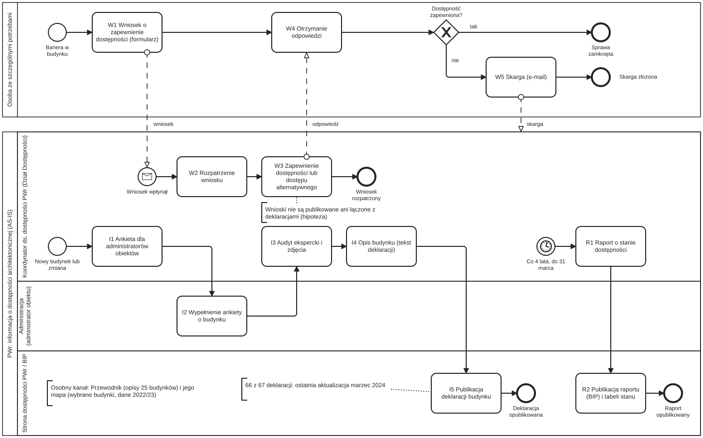

# Proces AS-IS: informacja o dostępności budynków PWr

!!! note "Rekonstrukcja na podstawie publicznych źródeł; do potwierdzenia"
    Opis oparto na stronach PWr i ustawach, stan na 27 października 2026. Kroki bez źródła mają dopisek „(hipoteza)”.

Strona pokazuje, jak dziś PWr sprawdza i publikuje informację o dostępności architektonicznej budynków. Problemy P-1…P-9 są punktem wyjścia dla procesu TO-BE.

## Diagram

Osoba ze szczególnymi potrzebami ma osobną pulę i wymienia z PWr wiadomości: wniosek, odpowiedź, skargę. Diagram ma trzy niezależne ścieżki:

- **I** — ankieta, audyt ekspercki i deklaracja dostępności budynku;
- **R** — ustawowy raport o stanie zapewniania dostępności co 4 lata;
- **W** — wniosek osoby, która napotkała barierę.

Kolejność kroków I1–I5 to hipoteza. Plan [13] wymienia ankiety, audyty i deklaracje jako osobne działania ciągłe.

## Kanały informacji

| Kanał | Zasięg | Forma | Ostatnia widoczna data | Źródło |
| --- | --- | --- | --- | --- |
| Deklaracje dostępności budynków na dostepnosc.pwr.edu.pl | 67 budynków | tekst, bez zdjęć i map | marzec 2024 (66 z 67), A-2 bez daty | [3], [4] |
| Tabela „Stan dostosowania obiektów PWr na dzień 01.01.2025” | 44 budynki kampusu głównego | tabela: 4 kryteria i uwagi | 01.01.2025 | [10] |
| Raport o stanie zapewniania dostępności w BIP | 77 budynków | formularz ustawowy, PDF | stan na 1.01.2025 | [11], [12] |
| Cyfrowy Przewodnik PWr (projekt „Politechnika Nowych Szans”, 2019–2023) | 25 budynków, w tym A-1, B-1, C-13, D-1, D-2 | opisy wejść, wind, toalet, zdjęcia | istotna aktualizacja serwisu: 11.12.2023 | [18], [19], [21], [23] |
| Interaktywna Mapa Kampusu, część Przewodnika | położenie wszystkich budynków, plany pięter wybranych | mapa i plany pięter | dane z semestru zimowego 2022/2023; aktualizuje koło naukowe GIS | [22] |

Deklaracja dostępności strony musi zawierać informację lub link o dostępności architektonicznej siedziby (art. 10 ust. 4 pkt 6) [2]. Deklaracje stron PWr spełniają to linkiem do deklaracji budynków, np. deklaracja Przewodnika [23]. Deklarację strony przegląda się co roku do 31 marca (art. 11) [2].

## Kroki procesu

| Krok | Kto | Co | Źródło / (hipoteza) |
| --- | --- | --- | --- |
| I0 | Koordynator ds. dostępności | Start: nowy budynek, remont albo inna zmiana. Plan zakłada pracę „w trybie ciągłym, w zależności od potrzeb” | [13] tab. 1 poz. 4; wyzwalacze (hipoteza) |
| I0a | Koordynator ds. dostępności | Opiniuje remonty i budowy z planu robót budowlanych. Standard architektoniczny PWr obowiązuje przy wszystkich remontach | [13] tab. 1 poz. 5; [15]; wpływ na deklarację (hipoteza); poza diagramem |
| I1 | Koordynator ds. dostępności (Dział Dostępności) | Zbiera dane o budynkach przez ankiety dla administratorów obiektów | [13] tab. 1 poz. 2; [14]; kto rozsyła ankietę (hipoteza) |
| I2 | Administrator obiektu | Wypełnia ankietę o budynku. Administrator to wyznaczona osoba z Działu Zarządzania Obiektami lub Działu Domów Studenckich | [13] słownik i tab. 1 poz. 2; forma ankiety (do potwierdzenia w wywiadach) |
| I3 | Koordynator ds. dostępności | Przeprowadza audyt ekspercki; plan wymienia „inwentaryzacje, dokumentacja fotograficzna” | [13] tab. 1 poz. 3; zapis z obchodu na papierze (hipoteza) |
| I4 | Koordynator ds. dostępności | Opisuje budynek tekstem w stałych sekcjach: teren, wejście, budynek, dodatkowe informacje | [4], [5] |
| I5 | Strona dostępności PWr | Publikuje deklarację na osobnej podstronie z datą „Ostatnia aktualizacja” (miesiąc i rok) | [3], [4]; [13] tab. 1 poz. 4 |
| R1 | Koordynator ds. dostępności | Co 4 lata, do 31 marca, sporządza raport o spełnianiu wymagań z art. 6 | [1] art. 11; [13] tab. 1 poz. 1 |
| R2 | Redaktor BIP, strona dostępności | Publikuje raport w BIP. Na stronie dostępności pojawia się tabela stanu na ten sam dzień | [11], [10]; raport odsyła do tabeli i deklaracji [12] |
| W1 | Osoba ze szczególnymi potrzebami | Składa wniosek przez formularz online: kontakt, bariera, sposób kontaktu, preferowane rozwiązanie | [1] art. 30; [16] |
| W2 | Koordynator ds. dostępności | Rozpatruje wniosek według regulacji wewnętrznych. Potwierdzenie przyjęcia przychodzi e-mailem | [13] tab. 1 poz. 7; [16] |
| W3 | Koordynator ds. dostępności | Zapewnia dostępność w 14 dni. Jeśli to niemożliwe, podaje nowy termin do 2 miesięcy albo dostęp alternatywny | [1] art. 7 i 31; [16]; kto usuwa barierę fizycznie (hipoteza: administracja) |
| W4 | Osoba ze szczególnymi potrzebami | Dostaje odpowiedź | forma odpowiedzi (hipoteza: e-mail) |
| W5 | Osoba ze szczególnymi potrzebami | Jeśli dostępności nie zapewniono, składa skargę e-mailem. Bez wcześniejszego wniosku skarga nie przysługuje | [1] art. 32; [16] |
| W6 | Każdy | Poza diagramem: informuje o zmianie przez formularz w Przewodniku albo formularz kontaktowy strony dostępności | [1] art. 29; [13] tab. 1 poz. 6; [17], [19] |

Adresat skargi się różni. Ustawa (art. 32 ust. 2) wskazuje Prezesa Zarządu PFRON i termin 30 dni [1].

Strona Działu Dostępności kieruje skargę e-mailem do Rektora PWr i nie wspomina o PFRON [16]. Czy to wewnętrzny etap przed skargą ustawową, pozostaje do wyjaśnienia.

Koordynator ds. dostępności to stanowisko na PWr, kierownik Działu Dostępności [13]. To nie rola Koordynator w aplikacji.

## Problemy AS-IS

| ID | Problem | Dowód | Źródło | Potrzeba |
| --- | --- | --- | --- | --- |
| P-1 | Informacja tylko tekstowa | Żadna z 67 deklaracji nie ma zdjęcia, planu ani mapy (przegląd 27.10.2026). Audyt robi zdjęcia, ale nie trafiają do deklaracji | [3], [13] tab. 1 poz. 3 | N1, N2 |
| P-2 | Brak mapy przy deklaracjach | Deklaracje nie odsyłają do mapy ani do Przewodnika. Przewodnik opisuje 25 budynków, deklaracje 67, raport 77 | [3], [12], [22] | N1 |
| P-3 | Rzadkie aktualizacje | 63 deklaracje: „marzec 2024”, 3: „marzec 2024 (deklaracja dodana)”, A-2 bez daty. Na 27.10.2026 to ponad 2,5 roku | [3], [4], [6] | N2 |
| P-4 | Data bez szczegółów | Jedna data (miesiąc i rok) na całą deklarację. Brak informacji, kto i kiedy sprawdził wejście czy windę | [4], [5] | N2 |
| P-5 | Brak informacji o bieżących awariach | Deklaracje opisują windy i podnośniki bez stanu działania. Podnośniki w D-1 i D-2 uruchamia portier. Aktualności Przewodnika: 0 wpisów, C-13: „brak danych” | [8], [9], [19], [20] | N1, N2 |
| P-6 | Wniosek formalny, a jego los niewidoczny | Wniosek wymaga interesu faktycznego i czterech elementów. Wniosek idzie formularzem online, skarga e-mailem, uwaga do Przewodnika formularzem. Nie znaleźliśmy publicznego rejestru wniosków ani ich statusu | [1] art. 30; [16], [17], [19] | N3 |
| P-7 | Wniosek nie aktualizuje deklaracji | Plan opisuje deklaracje i wnioski jako osobne działania. Nie znaleźliśmy kroku, który po wniosku poprawia deklarację (hipoteza) | [13] tab. 1 poz. 4 i 7 | N2 |
| P-8 | Niespójne i rozproszone dane | Tabela 2025 wymienia A-6, C-8, C-11, C-15 i D-3, które nie mają deklaracji. Deklaracja A-7 mówi o braku miejsc parkingowych przy budynku i o trzech takich miejscach. A-2 pisze „po trwającym remoncie” bez daty | [3], [6], [7], [10] | N2, N8 |
| P-9 | Lokalizacja bariery tylko słowami | Deklaracje opisują położenie słownie, np. dostępne wejście do A-1 „bramą od strony K.C. Norwida”. Brak współrzędnych i piętra na planie | [5] | N1, N5 |

## Źródła

1. Ustawa z dnia 19 lipca 2019 r. o zapewnianiu dostępności osobom ze szczególnymi potrzebami, tekst jednolity Dz.U. 2024 poz. 1411 (art. 6, 7, 11, 14, 29–32): <https://api.sejm.gov.pl/eli/acts/DU/2024/1411/text.html>; metryka aktu: <https://api.sejm.gov.pl/eli/acts/DU/2019/1696>
2. Ustawa z dnia 4 kwietnia 2019 r. o dostępności cyfrowej stron internetowych i aplikacji mobilnych podmiotów publicznych, tekst jednolity Dz.U. 2023 poz. 1440 (art. 10, 11 — deklaracja dostępności strony): <https://api.sejm.gov.pl/eli/acts/DU/2023/1440/text.html>
3. Deklaracje dostępności budynków PWr (lista 67 podstron): <https://dostepnosc.pwr.edu.pl/dostepnosc-architektoniczna/deklaracje-dostepnosci-budynkow>
4. Deklaracja dostępności budynku C-13: <https://dostepnosc.pwr.edu.pl/dostepnosc-architektoniczna/deklaracje-dostepnosci-budynkow/budynki-c/c13>
5. Deklaracja dostępności budynku A-1: <https://dostepnosc.pwr.edu.pl/dostepnosc-architektoniczna/deklaracje-dostepnosci-budynkow/budynki-a/a1>
6. Deklaracja dostępności budynku A-2: <https://dostepnosc.pwr.edu.pl/dostepnosc-architektoniczna/deklaracje-dostepnosci-budynkow/budynki-a/a2>
7. Deklaracja dostępności budynku A-7: <https://dostepnosc.pwr.edu.pl/dostepnosc-architektoniczna/deklaracje-dostepnosci-budynkow/budynki-a/a7>
8. Deklaracja dostępności budynku D-1: <https://dostepnosc.pwr.edu.pl/dostepnosc-architektoniczna/deklaracje-dostepnosci-budynkow/budynki-d/d1>
9. Deklaracja dostępności budynku D-2: <https://dostepnosc.pwr.edu.pl/dostepnosc-architektoniczna/deklaracje-dostepnosci-budynkow/budynki-d/d2>
10. Stan dostosowania obiektów PWr na dzień 01.01.2025, kampus główny: <https://dostepnosc.pwr.edu.pl/dostepnosc-architektoniczna/stan-dostosowania-obiektow-pwr-na-dzien-01-01-2025/kampus-glowny-pwr-na-dzien-01-01-2025>
11. BIP PWr, Raport o stanie zapewniania dostępności: <https://bip.pwr.edu.pl/strona-glowna/raport-o-stanie-zapewniania-dostepnosci>
12. Raport o stanie zapewniania dostępności podmiotu publicznego, stan na 1.01.2025, PWr: <https://bip.pwr.edu.pl/d/iGBUKOTtQKxVvBFh6GDxYBxZIQX14QU8OS39DQQpVVm8QRQxpXhsJFXkSGQcBBxNZBUREenpdWB8/raport_o_stanie_zapewniania_dostepnosci__politechnika_wroclawska.pdf>
13. Plan działania na rzecz poprawy dostępności osobom ze szczególnymi potrzebami na lata 2025–2028, PWr, marzec 2025 (słownik, tabela 1): <https://bip.pwr.edu.pl/d/gGBUKOTtQKxVvBFh6GDxYBxZIQX14QU8OS39DQQpVVm8QRQxpXhsJFXkSGQcBBxNZBUREenlUWx8/plan_poprawy_dostepnosci_2025-28.pdf>
14. Plan poprawy dostępności (dostępność architektoniczna): <https://dostepnosc.pwr.edu.pl/dostepnosc-architektoniczna/plan-poprawy-dostepnosci-arch>
15. Standard dostępności architektonicznej i urbanistycznej PWr: <https://dostepnosc.pwr.edu.pl/baza-wiedzy/standardy-dostepnosci-pwr/standard-dostepnosci-architektonicznej-i-urbanistycznej>
16. Dział Dostępności PWr, Zgłoszenia w sprawie zapewniania dostępności: <https://dzd.pwr.edu.pl/pl/dostepnosc-pwr/wnioskowanie-o-dostepnosc>
17. Strona dostępności PWr, Kontakt: <https://dostepnosc.pwr.edu.pl/kontakt>
18. Cyfrowy Przewodnik PWr: <https://przewodnik.pwr.edu.pl/pl/>; lista 25 budynków: <https://przewodnik.pwr.edu.pl/pl/budynki>
19. Cyfrowy Przewodnik PWr, budynek C-13 (aktualności, windy, formularz „Coś uległo zmianie?”): <https://przewodnik.pwr.edu.pl/pl/budynek/313/aktualnosci>
20. Cyfrowy Przewodnik PWr, Aktualności: <https://przewodnik.pwr.edu.pl/pl/aktualnosci>
21. Cyfrowy Przewodnik PWr, O projekcie: <https://przewodnik.pwr.edu.pl/pl/o-projekcie>
22. Interaktywna Mapa Kampusu PWr: <https://mapakampusu.pwr.edu.pl/>
23. Deklaracja dostępności serwisu przewodnik.pwr.edu.pl: <https://dostepnosc.pwr.edu.pl/dostepnosc_cyfrowa/deklaracje-dostepnosci/dd-przewodnikpwredupl>

Dostęp do źródeł: 27.10.2026.
