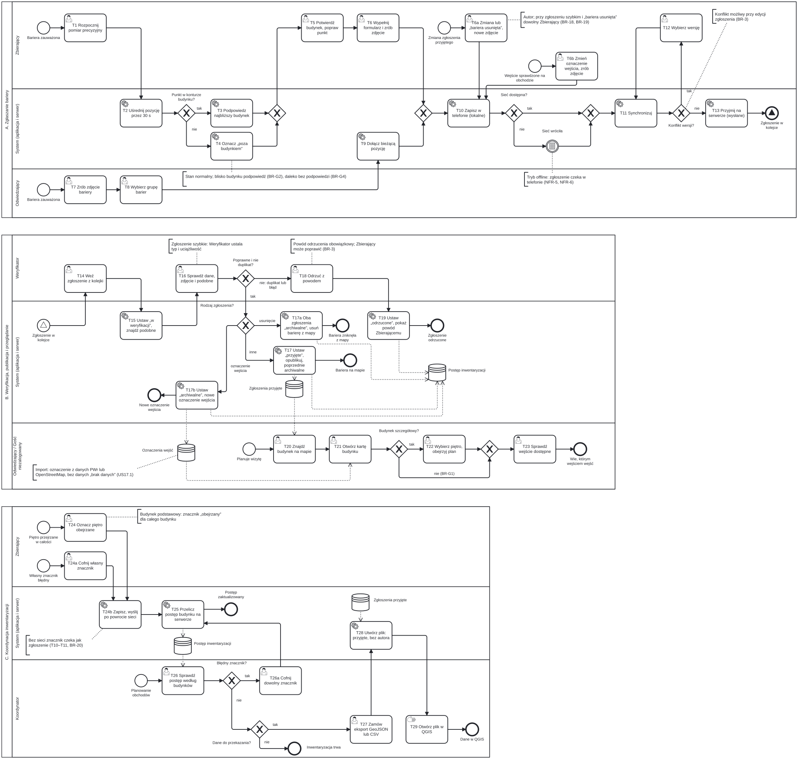

# Proces TO-BE: zgłaszanie, weryfikacja i publikacja barier

Strona pokazuje proces po wdrożeniu aplikacji „Dostępny Kampus”. Punkt wyjścia to problemy P-1…P-9 z [procesu AS-IS](as-is.md). Z kroków T1…T29 wyprowadzamy reguły biznesowe, historyjki, przypadki użycia i scenariusze.

## Diagram

Diagram ma trzy pule. Każda pula to osobny proces z torami ról, które w nim działają:

- **A. Zgłaszanie bariery** — pomiar precyzyjny Zbierającego (T1–T6), zgłoszenie szybkie Odwiedzającego (T7–T9), zapis w telefonie i synchronizacja (T10–T13);
- **B. Weryfikacja, publikacja i przeglądanie** — kolejka i decyzja Weryfikatora (T14–T19), przeglądanie mapy przez Odwiedzającego lub Gościa niezalogowanego (T20–T23);
- **C. Koordynacja inwentaryzacji** — piętro obejrzane (T24–T25), postęp inwentaryzacji i eksport (T26–T29).

Pule A i B łączy sygnał „Zgłoszenie w kolejce”. Magazyn „Zgłoszenia przyjęte” łączy publikację z mapą i eksportem, a magazyn „Postęp inwentaryzacji” łączy Zbierającego z Koordynatorem. Tor „System” obejmuje aplikację i serwer razem.

## Kroki procesu

| Krok | Kto | Co | Rozwiązuje problem (P-…) | Potrzeba (N…) | Ekran (V…/C…/R…/K…) |
| --- | --- | --- | --- | --- | --- |
| T1 | Zbierający | Przy barierze zaczyna pomiar precyzyjny | P-9 | N5 | C1 |
| T2 | System | Uśrednia pozycję przez 30 s, pokazuje dokładność pozycji i liczbę satelitów według systemów (US6.1, NFR-1, NFR-2) | P-9 | N5 | C1 |
| T3 | System | Punkt w konturze budynku: podpowiada najbliższy budynek, także bez sieci (US6.2, NFR-4) | P-9 | N5, N6 | C1 |
| T4 | System | Punkt poza konturem: oznacza „poza budynkiem” i proponuje najbliższy budynek do wyboru (BR-G2, BR-G4) | P-9 | N5 | C1 |
| T5 | Zbierający | Potwierdza albo zmienia budynek, poprawia punkt na planie piętra lub na mapie (US6.2, US6.3, NFR-3, BR-G1) | P-9 | N5 | C1 |
| T6 | Zbierający | Wybiera typ bariery i uciążliwość, podaje piętro, robi zdjęcie, dopisuje opis (US7.1, US7.2) | P-1, P-9 | N5 | C2 |
| T7 | Odwiedzający | Robi zdjęcie bariery | P-1, P-5, P-6 | N3, N4 | V4 |
| T8 | Odwiedzający | Wybiera grupę barier jednym z 6 dużych przycisków; całe zgłoszenie szybkie to najwyżej 3 kroki (US4.1) | P-5, P-6 | N3, N4 | V4 |
| T9 | System | Dołącza bieżącą pozycję telefonu, bez uśredniania | P-9 | N3 | V4 |
| T10 | System | Zapisuje zgłoszenie w telefonie ze statusem „lokalne” (US4.2, NFR-5) | P-6 | N6 | C3, V4 |
| T11 | System | Po powrocie sieci sam uruchamia synchronizację (US9.1, US9.2, NFR-6, NFR-8) | P-3 | N6 | C4 |
| T12 | Zbierający | Przy konflikcie wersji wybiera wersję własną albo z serwera (US9.3, NFR-9, BR-3) | — | N7 | C4 |
| T13 | System | Przyjmuje zgłoszenie na serwerze ze statusem „wysłane” i dodaje je do kolejki | P-6 | N6, N8 | C3 |
| T14 | Weryfikator | Bierze zgłoszenie z kolejki; własnych zgłoszeń nie dostaje (BR-4) | P-7 | N8 | R1 |
| T15 | System | Ustawia status „w weryfikacji”, więc drugi Weryfikator go nie weźmie; wyszukuje podobne zgłoszenia w promieniu 10 m (US10.1) | P-8 | N7, N8 | R2 |
| T16 | Weryfikator | Sprawdza dane, zdjęcie i podobne zgłoszenia; autora zna tylko z pseudonimu (BR-5). Zasłania twarze i tablice rejestracyjne (NFR-25). W zgłoszeniu szybkim ustala typ bariery i uciążliwość | P-8 | N8 | R2 |
| T17 | System | Ustawia „przyjęte” i od razu publikuje barierę na mapie i karcie budynku, ze zdjęciem i datą weryfikacji (US1.3, US2.2) | P-1, P-3, P-4, P-7 | N1, N2 | V1, V2 |
| T18 | Weryfikator | Odrzuca duplikat albo błędne zgłoszenie i podaje powód odrzucenia (US10.2) | P-8 | N8 | R2 |
| T19 | System | Ustawia „odrzucone”; Zbierający widzi powód i może poprawić zgłoszenie (US8.1, BR-3) | P-6 | N8 | C3 |
| T20 | Odwiedzający / Gość niezalogowany | Znajduje budynek na mapie albo na liście po symbolu budynku, bez logowania (US1.1, US1.2, NFR-19) | P-2 | N1, N4 | V1 |
| T21 | Odwiedzający / Gość niezalogowany | Otwiera kartę budynku: wejścia, windy, zgłoszenia przyjęte ze zdjęciami (US2.1, US2.2, BR-6) | P-1, P-4, P-8 | N1, N2 | V2 |
| T22 | Odwiedzający / Gość niezalogowany | W budynku szczegółowym wybiera piętro i ogląda plan piętra; w budynku podstawowym planu nie ma (BR-G1) | P-9 | N1 | V2 |
| T23 | Odwiedzający / Gość niezalogowany | W „Zaplanuj wizytę” sprawdza, które wejście jest wejściem dostępnym (US3.1, US3.2) | P-2, P-9 | N1 | V3 |
| T24 | Zbierający | Oznacza piętro obejrzane; w budynku podstawowym oznacza cały budynek | P-3 | N9 | C1 (do ustalenia w fazie B) |
| T25 | System | Przelicza postęp inwentaryzacji budynku: odsetek pięter obejrzanych, zgłoszenia czekające i przyjęte | P-3 | N9 | K1 |
| T26 | Koordynator | Sprawdza postęp inwentaryzacji według budynków (US11.1) | P-3 | N9 | K1 |
| T27 | Koordynator | Zamawia eksport GeoJSON albo CSV | P-8 | N9 | K3 |
| T28 | System | Tworzy plik tylko ze zgłoszeń przyjętych, bez danych autora; GeoJSON w WGS84, CSV w PUWG 1992 (US13.1, US13.2, BR-6) | P-8 | N9 | K3 |
| T29 | Koordynator | Otwiera plik w QGIS; to krok poza systemem | P-8 | N9 | — |

Gość niezalogowany wykonuje T20–T23 bez konta. Zgłoszenie szybkie (T7–T9) wymaga konta Odwiedzającego, a uprawnienia ról opisuje strona [Role i uprawnienia](../role.md).

## AS-IS → TO-BE

| Problem | Jak TO-BE go rozwiązuje | Czego TO-BE nie rozwiązuje |
| --- | --- | --- |
| P-1 Informacja tylko tekstowa | Każde zgłoszenie ma zdjęcie (T6, T7). Bariery widać na mapie, karcie budynku i planie piętra (T17, T21, T22). | Deklaracje dostępności PWr zostają tekstowe; aplikacja ich nie zastępuje. |
| P-2 Brak mapy przy deklaracjach | Mapa obejmuje wszystkie budynki PWr: 5 szczegółowych i pozostałe jako podstawowe (T20, T23). | Plany pięter mają tylko budynki szczegółowe. Deklaracje PWr nadal nie odsyłają do mapy. |
| P-3 Rzadkie aktualizacje | Bariera trafia na mapę zaraz po weryfikacji (T11, T17). Koordynator widzi piętra obejrzane (T24–T26). | Aktualność zależy od obchodów i liczby Weryfikatorów. System nie wyznacza terminu ponownego obejrzenia. |
| P-4 Data bez szczegółów | Każde zgłoszenie przyjęte ma własną datę weryfikacji i zdjęcie (T17, T21). | Brak zgłoszeń nie znaczy „brak barier”. Czy karta budynku pokaże datę obejrzenia piętra, ustalimy w fazie B. |
| P-5 Brak informacji o bieżących awariach | Odwiedzający zgłasza np. niesprawną windę w 3 krokach (T7–T9). Po naprawie Zbierający wysyła zmianę zgłoszenia przyjętego z oznaczeniem „bariera usunięta” (BR-3, T6–T13). Po weryfikacji (T14–T17) bariera znika z mapy i zostaje w historii. | Zgłoszenie i usunięcie czekają na weryfikację, więc informacja nie jest natychmiastowa. Odwiedzający nie oznacza usunięcia bariery; robi to Zbierający. |
| P-6 Wniosek formalny, a jego los niewidoczny | Zgłoszenie szybkie to 3 kroki bez formularza wniosku (T7–T9). Zgłoszenie ma status od „lokalne” do „przyjęte” lub „odrzucone” (T10, T13, T19). Zgłoszenia przyjęte są publiczne (T17). | Odwiedzający nie ma listy własnych zgłoszeń, więc nie widzi statusu ani powodu odrzucenia (do sprawdzenia w wywiadach). Zgłoszenie w aplikacji nie jest wnioskiem o zapewnienie dostępności z ustawy. |
| P-7 Wniosek nie aktualizuje deklaracji | Zgłoszenie po weryfikacji od razu zmienia mapę i kartę budynku (T17). | Aplikacja nie zmienia deklaracji na stronie PWr. Eksport (T28) może być dla niej materiałem (hipoteza). |
| P-8 Niespójne i rozproszone dane | Jedno źródło danych: podobne zgłoszenia (T15), decyzja Weryfikatora (T16–T18), eksport jednego zbioru (T28). | Rozbieżności w istniejących deklaracjach PWr zostają; aplikacja ich nie importuje. |
| P-9 Lokalizacja bariery tylko słowami | Współrzędne z uśredniania pozycji, budynek, piętro i punkt na planie piętra (T2–T6, T22). | Dokładność poniżej 1 m to cel na zewnątrz (NFR-1). W budynku punkt poprawia się ręcznie (NFR-3). |

## Zdarzenia wyjątkowe

| Zdarzenie | Kroki | Zachowanie | Odwołanie |
| --- | --- | --- | --- |
| Brak sieci | T10, T11 | Zgłoszenie czeka w telefonie ze statusem „lokalne”. Po zdarzeniu „Sieć wróciła” synchronizacja rusza sama. Mapa pokazuje ostatnio pobrane dane z datą, bez podkładu OpenStreetMap. | NFR-5…NFR-8, NFR-10, NFR-39 |
| Konflikt wersji | T11, T12 | Zbierający wybiera wersję; zmiana nigdy nie nadpisuje się po cichu. | NFR-9, US9.3, BR-3 |
| Brak planu piętra | T5, T22 | Budynek działa jako budynek podstawowy: przełącznik pięter ukryty, piętro wpisuje się ręcznie. Zgłoszenie działa zawsze. | BR-G1, BR-G3, NFR-48 |
| Punkt poza budynkiem | T4 | To stan normalny, nie błąd. Podpowiedź najbliższego budynku można odrzucić. Daleko od budynków PWr zgłoszenie zapisuje się jako „poza budynkiem”. | BR-G2, BR-G4, NFR-49 |
| Awaria serwera | T11, T13–T19, T25–T28 | Aplikacja pokazuje dane z telefonu, a zgłoszenia czekają w kolejce. Weryfikacja, postęp i eksport czekają na powrót serwera. | NFR-50 |
| Gość chce zgłosić barierę | przed T7 | Przed zdjęciem aplikacja prosi o logowanie albo rejestrację. | [Role i uprawnienia](../role.md), przypis 2 |
| Jedyny Weryfikator jest autorem | T14 | Nie dostaje własnego zgłoszenia, więc potrzebny jest drugi Weryfikator. | BR-4 |

## Scenariusz demo w budynku A-1

| Krok demo | Co się dzieje | Kroki TO-BE |
| --- | --- | --- |
| 1 | Zbierająca przy wejściu głównym A-1 widzi schody bez pochylni i zaczyna zgłoszenie. | T1 |
| 2 | Przez 30 s uśredniania dokładność pozycji spada z około 6 m poniżej 1 m (cel z NFR-1). | T2 |
| 3 | Aplikacja podpowiada A-1. Zbierająca potwierdza i wybiera TB-1 „schody przy wejściu”, uciążliwość 3, robi zdjęcie. | T3, T5, T6 |
| 4 | W piwnicy nie ma sieci. Zgłoszenie czeka w telefonie i wysyła się samo po powrocie sieci. | T10, T11, T13 |
| 5 | Weryfikator widzi podobne zgłoszenie 5 m dalej, uznaje, że to nie duplikat, i przyjmuje zgłoszenie. | T14–T17 |
| 6 | Słuchacz Politechniki Trzeciego Wieku otwiera A-1: wejście główne ma schody, wejście dostępne to inne wejście [1], [2]. | T20, T21, T23 |
| 7 | Koordynator widzi w A-1 4 z 5 pięter obejrzanych (80 %) i pobiera eksport do QGIS. Piętra oznaczył wcześniej Zbierający. | T24–T29 |

Kandydatów na nowe reguły biznesowe z tego procesu nie numerujemy tutaj. Numery nada strona reguł biznesowych.

## Źródła

1. Stan dostosowania obiektów PWr na dzień 01.01.2025, kampus główny (A-1, dostosowane wejście: „Tak (inne)”): <https://dostepnosc.pwr.edu.pl/dostepnosc-architektoniczna/stan-dostosowania-obiektow-pwr-na-dzien-01-01-2025/kampus-glowny-pwr-na-dzien-01-01-2025>
2. Deklaracja dostępności budynku A-1 (wejście główne ze schodami, wejście dostępne z tyłu budynku): <https://dostepnosc.pwr.edu.pl/dostepnosc-architektoniczna/deklaracje-dostepnosci-budynkow/budynki-a/a1>

Dostęp do źródeł: 27.10.2026.
