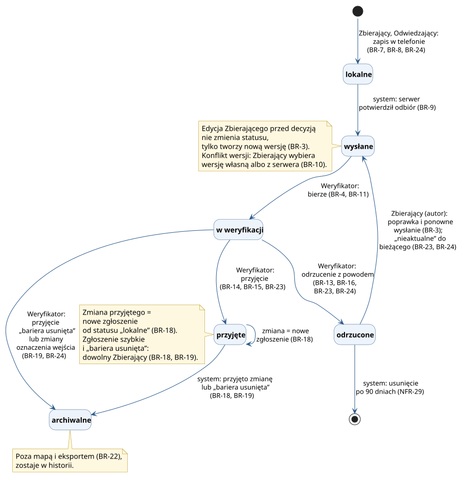

# Reguły biznesowe

Strona zbiera reguły, które obowiązują przy zgłaszaniu, weryfikacji i publikacji barier. Zasady ról BR-1…BR-6 są na stronie [Role i uprawnienia](role.md), a tutaj numeracja zaczyna się od BR-7. Każda reguła ma mieć scenariusz akceptacyjny (NFR-45).

Kolumna „Źródło” wskazuje potrzebę (N), kryterium akceptacji (`USx.y`), decyzję zespołu albo krok procesu [TO-BE](procesy/to-be.md) (T1…T29 i odgałęzienia, np. T6a).

## Zgłaszanie i synchronizacja

| ID | Reguła | Dlaczego | Źródło |
| --- | --- | --- | --- |
| BR-7 | Zgłoszenie z pomiaru precyzyjnego zapisuje się tylko z typem bariery, uciążliwością 1–3 i co najmniej jednym zdjęciem. W budynku trzeba podać piętro, a typ TB-29 „inna bariera” wymaga opisu. Wyjątki: zgłoszenie „bariera usunięta” nie wymaga uciążliwości (BR-19), a zmiana oznaczenia wejścia — typu ani uciążliwości (BR-24). | Weryfikator ocenia barierę po zdjęciu i typie. Bez opisu „inna bariera” nic nie mówi. | US7.1, US7.2, US7.3, T6, słownik (TB-29) |
| BR-8 | Zgłoszenie szybkie składa tylko osoba zalogowana. Wymaga zdjęcia, bieżącej pozycji i grupy barier, najwyżej w 3 krokach. Gościa niezalogowanego aplikacja prosi o logowanie przed zdjęciem. | Senior nie przejdzie długiego formularza (N3, N4). Konto chroni przed spamem. | US4.1, US4.3, US14.2, T7–T9, [przypis 2](role.md#przypisy) |
| BR-9 | Zgłoszenie ma status „lokalne”, dopóki serwer nie potwierdzi odbioru. Telefon nie usuwa go wcześniej. Po powrocie sieci synchronizacja rusza bez działania użytkownika. | W piwnicy nie ma sieci, a zgłoszenie nie może zginąć (N6). | US4.2, US9.1, US9.2, T10, T11, T13, NFR-5, NFR-6, NFR-8 |
| BR-10 | Gdy przy synchronizacji edycji serwer ma inną wersję zgłoszenia, żadna wersja nie zapisuje się sama. Zbierający wybiera wersję własną albo z serwera. Do wyboru zmiana czeka w telefonie. | Nikt nie traci cudzej ani własnej pracy (N7). | US9.3, T12, NFR-9, BR-3 |

Wybór wersji własnej działa jak zwykła edycja w obecnym statusie na serwerze. Zgłoszenie wysłane lub w weryfikacji dostaje nową wersję. Odrzucone wraca do kolejki, a zmiana przyjętego tworzy nowe zgłoszenie (BR-3, BR-18).

## Weryfikacja

| ID | Reguła | Dlaczego | Źródło |
| --- | --- | --- | --- |
| BR-11 | Zgłoszenie w weryfikacji obsługuje tylko Weryfikator, który je wziął. Inny Weryfikator nie może go wziąć ani podjąć decyzji. | Dwie osoby nie sprawdzają tego samego zgłoszenia i nie podejmują sprzecznych decyzji (N7, N8). | US10.4, decyzja 29, T14, T15 |
| BR-13 | Weryfikator widzi podobne zgłoszenia w promieniu 10 m: wysłane, w weryfikacji i przyjęte, z każdego piętra. System sam nie odrzuca ani nie łączy zgłoszeń. Duplikat Weryfikator odrzuca, wskazując wcześniejsze zgłoszenie w powodzie odrzucenia. | O duplikacie decyduje człowiek: bariera 5 m dalej może być inna (scenariusz demo w A-1). Piętro widać przy zgłoszeniu. | US10.1, T15, T16, słownik (duplikat, podobne zgłoszenie) |
| BR-14 | Zgłoszenia szybkiego nie można przyjąć, dopóki Weryfikator nie ustali typu bariery i uciążliwości. Typ może należeć do innej grupy barier niż wybrana przez Odwiedzającego. Budynek przypisuje system z konturu, w którym leży bieżąca pozycja; poza konturem zgłoszenie jest „poza budynkiem” (BR-G2, BR-G4). Piętro zostaje puste, a Weryfikator ustala tylko typ i uciążliwość. | Mapa pokazuje typ i uciążliwość każdej bariery, a grupa od Odwiedzającego to tylko podpowiedź. Bez budynku zgłoszenie nie trafiłoby na kartę budynku ani do postępu (BR-21). | US10.3, decyzja 29, T9, T16 |
| BR-15 | Weryfikator nie zmienia typu, uciążliwości ani miejsca w zgłoszeniu z pomiaru precyzyjnego. Błąd oznacza odrzucenie z powodem, a Zbierający poprawia zgłoszenie. Zasłonięcie twarzy i tablic na zdjęciu (NFR-25) jest częścią przyjęcia i nie tworzy nowej wersji. | Konflikt wersji powstaje tylko między wersjami Zbierającego, a ekran C4 zostaje jedynym miejscem wyboru (N7). Gdy Zbierający wyśle nową wersję w trakcie weryfikacji, Weryfikator decyduje o nowej (BR-3). | słownik (Weryfikator, konflikt wersji), BR-3, NFR-25 |
| BR-16 | Odrzucenie bez powodu odrzucenia jest niemożliwe. Zbierający widzi powód przy własnym zgłoszeniu na liście zgłoszeń. | Autor wie, co poprawić, i może wysłać zgłoszenie ponownie (BR-3). | US10.2, US8.1, T18, T19 |

Przyjęcie wymaga też, by Weryfikator oceniał aktualną wersję zgłoszenia (BR-3) i nie był jego autorem (BR-4).

## Publikacja, postęp inwentaryzacji i eksport

| ID | Reguła | Dlaczego | Źródło |
| --- | --- | --- | --- |
| BR-17 | Zgłoszenie przyjęte jest widoczne na mapie i karcie budynku od chwili decyzji, bez osobnego kroku publikacji. Pokazuje zdjęcie i datę weryfikacji, czyli datę przyjęcia. | Osoba planująca wizytę widzi świeżą informację i wie, kiedy ją sprawdzono (N1, N2). | US1.3, US2.2, T17, BR-6 |
| BR-18 | Zmiana zgłoszenia przyjętego to nowe zgłoszenie powiązane z poprzednim. Po jego przyjęciu poprzednie dostaje status „archiwalne”: znika z mapy i zostaje w historii. Po odrzuceniu na mapie zostaje poprzednie. Zmianę składa autor (BR-3), a przy zgłoszeniu szybkim i „bariera usunięta” dowolny Zbierający; autorem nowego zgłoszenia jest składający zmianę. | Na mapie nie ma dwóch wersji tej samej bariery ani wersji bez weryfikacji (N2). Odwiedzający nie edytuje zgłoszeń, więc błąd w przyjętym zgłoszeniu szybkim poprawia Zbierający. | BR-3, BR-6, BR-19, T6a, T17 |
| BR-19 | Usunięcie bariery zgłasza dowolny Zbierający, nie tylko autor: zmianą zgłoszenia przyjętego z oznaczeniem „bariera usunięta” i nowym zdjęciem miejsca. Typ, miejsce i piętro przechodzą z poprzedniego zgłoszenia, a uciążliwość nie jest wymagana (wyjątek od BR-7). Takie zgłoszenie sprawdza Weryfikator, który go nie złożył (BR-4). Po przyjęciu oba zgłoszenia są archiwalne. | Naprawiona winda nie może wisieć na mapie bez końca, bo podważa zaufanie do danych (N2). Autor mógł odejść z zespołu, a usunięcie też przechodzi weryfikację (N8). | US8.4, US10.6, decyzja 32, decyzja 33, BR-3, T6a, T17a, TO-BE (P-5) |
| BR-20 | Znacznik piętra obejrzanego stawia tylko Zbierający. W budynku podstawowym znacznik „obejrzany” dotyczy całego budynku. Znacznik cofa Zbierający, który go postawił, albo Koordynator. Znacznik i jego cofnięcie działają bez sieci i czekają w telefonie na synchronizację tak samo, jak zgłoszenie (BR-9). | Błędny znacznik zawyża postęp inwentaryzacji, więc trzeba go móc cofnąć. Obchód piwnic odbywa się bez sieci (N6). | US15.1, US15.2, US15.3, US11.3, decyzja 29, decyzja 32, decyzja 33, T24, T24a, T24b, T26a |
| BR-21 | Postęp budynku szczegółowego to odsetek pięter obejrzanych wśród pięter z danych PWr. Budynek podstawowy ma znacznik „obejrzany / nie”. Obok są liczby zgłoszeń czekających (wysłane, w weryfikacji) i przyjętych. | Koordynator mierzy postęp tym samym miernikiem w każdym budynku (N9). Przykład: A-1, 4 z 5 pięter, czyli 80%. | US11.1, US11.2, decyzja 29, T25, T26 |
| BR-22 | Eksport zawiera tylko bieżące zgłoszenia przyjęte. Zgłoszenia archiwalne, czyli bariery usunięte i wersje zastąpione, do niego nie trafiają. Doprecyzowuje BR-6. | Dane w QGIS mają pokazywać obecny stan barier, a nie historię (N9). | US13.3, decyzja 29, decyzja 33, T28, BR-6 |
| BR-23 | Dwie równoległe zmiany tego samego zgłoszenia przyjętego to osobne zgłoszenia. Weryfikator widzi drugą zmianę jako podobne zgłoszenie. Po przyjęciu jednej z nich drugiej nie można przyjąć bez zmian, bo dotyczy zgłoszenia archiwalnego. Weryfikator odrzuca ją z powodem „nieaktualne”, a Zbierający może ją wysłać ponownie do bieżącego zgłoszenia. Gdy przyjęta zmiana to „bariera usunięta”, drugą Weryfikator też odrzuca jako „nieaktualne”, a jeśli bariera nadal istnieje, Zbierający składa nowe zgłoszenie, nie zmianę. | Przyjęcie nieaktualnej zmiany cofnęłoby na mapie wcześniejszą zmianę albo usunięcie bariery (N2, N7). | US10.1, decyzja 33, BR-3, BR-18, BR-19 |
| BR-24 | Każde wejście ma jedno oznaczenie: „dostępne”, „niedostępne” albo „brak danych”, z datą i źródłem. Import nadaje oznaczenie z danych PWr albo OpenStreetMap ze źródłem „import”; wejście bez takich danych dostaje „brak danych”. Zmianę oznaczenia składa dowolny Zbierający jako zgłoszenie z oznaczeniem „dostępne” albo „niedostępne” i nowym zdjęciem wejścia. Może nią też potwierdzić dotychczasowe oznaczenie. Sprawdza ją Weryfikator, który jej nie złożył (BR-4). Po przyjęciu zgłoszenie jest archiwalne, a wejście ma nowe oznaczenie, datę przyjęcia i źródło „obchód”. Po odrzuceniu oznaczenie się nie zmienia. Gdy przyjęto dwie zmiany tego samego wejścia, obowiązuje przyjęta później. | Bez obchodu oznaczenie wejścia starzeje się tak samo jak deklaracje PWr (P-3). Data i źródło mówią, na ile oznaczeniu ufać (N1, N2). | US2.1, US17.1, US17.2, US17.3, decyzja 36, BR-4, T6b, T17b |

Zgłoszenie archiwalne nie jest widoczne na mapie, na karcie budynku ani w eksporcie (BR-22). Nie liczy się też do zgłoszeń przyjętych w postępie (BR-21). Kto i gdzie przegląda historię, ustalimy w fazie projektowania interfejsu.

Postęp przelicza się po każdej zmianie znacznika i statusu, także po cofnięciu znacznika (BR-20). Piętro jest obejrzane albo nie, więc drugi znacznik tego samego piętra nie zmienia postępu. Zgłoszenia lokalne i niewysłane znaczniki nie wchodzą do postępu, bo serwer ich jeszcze nie zna.

## Reguły „nic się nie psuje”

Reguły dotyczą budynków bez planów pięter i miejsc poza budynkiem. Poziomy szczegółowości opisuje strona [Wizja](wizja.md#zakres).

| ID | Reguła | Dlaczego | Źródło |
| --- | --- | --- | --- |
| BR-G1 | Budynek bez planów pięter nie ma przełącznika pięter. Widać napis „Plan piętra niedostępny dla tego budynku”. Piętro wpisuje się ręcznie: liczba całkowita (0 to parter), opcjonalnie z dopiskiem „półpiętro”. Zgłoszenie można złożyć zawsze. | Plany ma tylko 5 budynków szczegółowych. Brak planu nie może blokować zgłoszenia (N3). | produkt §6a, decyzja 26, decyzja 29, US7.2, US16.2, NFR-3, NFR-48 |
| BR-G2 | Punkt poza konturem każdego budynku daje stan „Poza budynkiem”, bez komunikatu o błędzie. W pomiarze precyzyjnym aplikacja proponuje najbliższy budynek, który można wybrać albo odrzucić. Zgłoszenie szybkie zostaje „poza budynkiem” bez pytania (BR-14). | Krawężnik czy pochylnia przed wejściem to też bariery. Pozycja z GNSS przy ścianie bywa niedokładna. | produkt §6a, US6.2, T4, NFR-49 |
| BR-G3 | Gdy import planów budynku się nie uda albo danych brak, budynek działa jako budynek podstawowy. Pozostałe budynki zachowują swoje plany. Import kończy się raportem. | Błąd danych jednego budynku nie psuje aplikacji w pozostałych. | produkt §6a, decyzja 26, NFR-47, NFR-48 |
| BR-G4 | Punkt blisko kampusu, ale z dala od budynków PWr, nie dostaje propozycji budynku. Mapa i zgłoszenie działają, a zgłoszenie zapisuje się jako „poza budynkiem”, bez piętra. | Bariery na trasie do budynku też utrudniają wizytę (N1, N3). | produkt §5 (bufor budynku), produkt §6a, decyzja 26, US6.2, T4, NFR-49 |

Odległość, od której nie proponujemy budynku (BR-G4), ustalimy w fazie implementacji. Zgłoszenia poza budynkiem są na mapie, ale nie wchodzą do postępu żadnego budynku (BR-21).

## Cykl życia zgłoszenia

Statusy pochodzą ze słownika i US8.1. Każde zgłoszenie, także szybkie i zmiana oznaczenia wejścia (BR-24), przechodzi te same statusy. W MVP (minimalnej wersji produktu) widzi je tylko Zbierający na liście własnych zgłoszeń (C3).

### Przejścia

| Z | Do | Kto | Warunek / reguła |
| --- | --- | --- | --- |
| — | lokalne | Zbierający, Odwiedzający | zapis w telefonie, także bez sieci (BR-7, BR-8, BR-24) |
| lokalne | lokalne | Zbierający | edycja przed wysłaniem; konfliktu nie ma, bo serwer nie zna zgłoszenia |
| lokalne | wysłane | system | serwer potwierdził odbiór (BR-9) |
| wysłane | wysłane | Zbierający (autor) | edycja tworzy nową wersję (BR-3); przy innej wersji na serwerze — BR-10 |
| wysłane | w weryfikacji | Weryfikator | nie jest autorem (BR-4); zgłoszenia nie wziął nikt inny (BR-11) |
| w weryfikacji | w weryfikacji | Zbierający (autor) | edycja tworzy nową wersję; Weryfikator decyduje o nowej (BR-3, BR-10) |
| w weryfikacji | przyjęte | Weryfikator, który wziął | aktualna wersja (BR-3); w zgłoszeniu szybkim typ i uciążliwość (BR-14). Zasłonięcie na zdjęciu nie tworzy nowej wersji (BR-15, NFR-25). Zmiana nie dotyczy zgłoszenia archiwalnego (BR-23). Widoczne od razu (BR-17) |
| w weryfikacji | odrzucone | Weryfikator, który wziął | powód odrzucenia (BR-16); przy duplikacie wskazanie wcześniejszego zgłoszenia (BR-13); zmiana zgłoszenia już archiwalnego z powodem „nieaktualne” (BR-23) |
| w weryfikacji | archiwalne | Weryfikator, który wziął | przyjęcie zgłoszenia „bariera usunięta”; Weryfikator nie jest jego autorem (BR-4); bariera znika z mapy i eksportu (BR-19, BR-22). Przyjęcie zmiany oznaczenia wejścia: wejście dostaje nowe oznaczenie, datę i źródło „obchód” (BR-24) |
| odrzucone | wysłane | Zbierający (autor) | poprawka i ponowne wysłanie (BR-3), zmiana „nieaktualne” do bieżącego zgłoszenia (BR-23); Odwiedzający nie edytuje zgłoszeń szybkich |
| odrzucone | — | system | usunięcie po 90 dniach (NFR-29) |
| przyjęte | przyjęte | Zbierający (autor); przy zgłoszeniu szybkim i „bariera usunięta” dowolny Zbierający | zmiana tworzy nowe zgłoszenie od statusu „lokalne”, którego autorem jest składający zmianę; status poprzedniego zgłoszenia się nie zmienia (BR-18) |
| przyjęte | archiwalne | system | przyjęto zmianę tego zgłoszenia albo zgłoszenie „bariera usunięta” (BR-18, BR-19, US10.6) |

Status „archiwalne” jest końcowy: zgłoszenie nie wraca na mapę i nie jest usuwane po 90 dniach.

Niewysłana edycja nie zmienia statusu. Lista zgłoszeń (C3) pokazuje przy zgłoszeniu dodatkowo znak „zmiana czeka na wysłanie”; szczegół ustalimy w fazie B.

## Poza MVP

| Temat | Co jest w MVP | Dlaczego nie więcej | Źródło |
| --- | --- | --- | --- |
| Status zgłoszenia szybkiego dla Odwiedzającego | Odwiedzający nie widzi statusu ani listy swoich zgłoszeń. Lista statusów (US8.1) jest tylko dla Zbierającego. | Potrzebę sprawdzimy w wywiadach. | decyzja 32, [przypis 3](role.md#przypisy) |
| Zwolnienie zgłoszenia bez decyzji | Zgłoszenie w weryfikacji obsługuje do decyzji Weryfikator, który je wziął (BR-11). Zwolnienia nie ma, a numer 12 wśród reguł zostaje wolny. | Nieobecny Weryfikator i tak nie zwolni zgłoszenia. To ryzyko jest na stronie [Ryzyka](ryzyka.md). | BR-11 |
| Usunięcie bariery przez Odwiedzającego | Usunięcie zgłasza tylko Zbierający (BR-19). Odwiedzający nie ma takiej ścieżki. | Odwiedzający nie edytuje zgłoszeń, więc nie ma ścieżki zmiany według BR-3. | decyzja 32, [macierz uprawnień](role.md#macierz-uprawnien) |

## Źródła

- Decyzje zespołu nr 26, 29, 30, 32, 33 i 36 (dziennik decyzji projektu).
- Opis produktu: §5 (bufor budynku), §6a (poziomy szczegółowości, BR-G1…BR-G4) i §8 (potrzeby, historyjki, kryteria akceptacji).
- [Role i uprawnienia](role.md) — BR-1…BR-6, macierz uprawnień, przypisy 2 i 3.
- [Słownik pojęć](slownik.md) — statusy zgłoszenia, klasyfikacja barier.
- [Proces TO-BE](procesy/to-be.md) — kroki T1…T29, w tym T6b i T17b.
- [Potrzeby i historyjki](../wymagania/potrzeby-i-historie.md) — US8.4, US10.3, US10.4, US10.6, US11.3, US13.3, US15.1, US15.2, US16.2 i US17.1…US17.3.
- [Wymagania niefunkcjonalne](../wymagania/niefunkcjonalne.md) — NFR-3, NFR-5…NFR-9, NFR-25, NFR-29, NFR-45, NFR-47…NFR-49.
