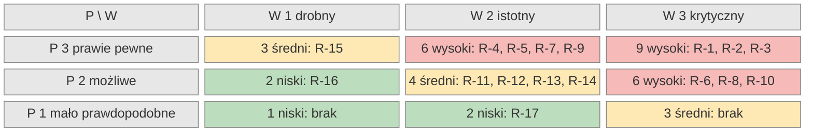

# Ryzyka projektu

Rejestr zbiera zagrożenia dla terminu, jakości i pokazu projektu. Ocena opisuje stan przed reakcją. Rejestr przeglądamy na początku każdego sprintu.

## Skala ocen

| Ocena | Prawdopodobieństwo (P) | Wpływ (W) |
| --- | --- | --- |
| 1 | mało prawdopodobne | drobna strata czasu, bez zmiany zakresu |
| 2 | możliwe | opóźnienie zadania albo okrojenie funkcji „Powinno być” |
| 3 | prawie pewne albo już trwa | zagrożona funkcja obowiązkowa, raport kursu albo pokaz |

Poziom ryzyka: **wysoki** 6–9 (przegląd co tydzień), **średni** 3–4 (przegląd co sprint), **niski** 1–2 (obserwacja). Progi w sygnałach ostrzegawczych to hipotezy zespołu, korygujemy je po pierwszym sprincie implementacji.

## Rejestr ryzyk

| ID | Ryzyko | Kategoria | Prawdopodobieństwo (1–3) | Wpływ (1–3) | Ocena (P×W) | Reakcja | Sygnał ostrzegawczy |
| --- | --- | --- | --- | --- | --- | --- | --- |
| R-1 | Opóźnienie wobec harmonogramu kursu. Trwa już Sprint 2, a w ePortalu brak raportów „Tydzień 2” i „Sprint 1”. | harmonogram | 3 | 3 | 9 | Ograniczamy: oba raporty oddajemy w bieżącym tygodniu. Fazy A i B trwają najwyżej po 4 dni. Najpierw funkcje obowiązkowe, potem reszta. | Raport sprintu nieoddany w terminie. Faza A trwa dłużej niż 4 dni robocze. |
| R-2 | Zależność od jednej osoby. Właściciel repozytorium prowadzi stos, decyzje i przeglądy. Skład zespołu do potwierdzenia. | zespół | 3 | 3 | 9 | Ograniczamy: decyzje trafiają do dziennika, dokumenty powstają przed kodem. Każde zadanie da się przekazać innej osobie. Do decyzji właściciela projektu: drugi opiekun repozytorium. | Ponad 80 % commitów sprintu od jednej osoby. Zadanie czeka ponad 2 dni na jedną osobę. |
| R-3 | Awaria pokazu w sali. W sali sygnał GNSS jest zwykle niedostępny, może zabraknąć sieci albo serwera. | demonstracja | 3 | 3 | 9 | Ograniczamy: tryb demonstracyjny z fikcyjną pozycją, czyli odtwarzaniem nagranej trasy. Serwer działa lokalnie na laptopie. Zapasowo mamy nagranie wideo scenariusza. | Próba generalna w sali nie przechodzi scenariusza od początku do końca. Telefon nie łapie pozycji w sali w 2 minuty. |
| R-4 | Słaba dokładność GNSS przy ścianach i w budynkach. Budynki A-1…A-11 stoją w zwartej zabudowie, błąd przy ścianie sięga 5–15 m (hipoteza). | technologia | 3 | 2 | 6 | Ograniczamy: uśrednianie pozycji przez 30 s i widoczna dokładność. Podpowiedź najbliższego budynku wymaga potwierdzenia (BR-G2). Punkt da się poprawić ręcznie na mapie. | Dokładność po uśrednieniu gorsza niż 10 m. Użytkownik poprawia podpowiedź budynku częściej niż co piąty raz. |
| R-5 | Niespójne i niepełne dane planów PWr. Pole funkcji pomieszczenia ma różne nazwy. D-1/D-2 nie mają w danych żadnej toalety dla OzN, A-1 nie ma wind ani toalet. C-1 ma w danych tylko 22 poligony pomieszczeń, C-13 ma ich 245. | dane | 3 | 2 | 6 | Ograniczamy: import ujednolica nazwy pól. Braki oznaczamy „do sprawdzenia na miejscu”, zespół obchodzi 5 budynków szczegółowych. Budynek bez danych działa na poziomie podstawowym (BR-G3). | Raport importu pokazuje puste lub nieznane wartości funkcji. Budynek szczegółowy nie ma w danych wind lub toalet dla OzN. |
| R-6 | Mała dostępność uczestników wywiadów, zwłaszcza osób starszych. | użytkownicy/badania | 2 | 3 | 6 | Ograniczamy: rekrutujemy w otoczeniu członków zespołu. Wywiad trwa do 30 minut, może być telefoniczny. Termin ustalamy z tygodniowym wyprzedzeniem. | Do końca fazy A umówiono mniej niż 2 wywiady na osobę. Brak choćby jednej osoby po 65. roku życia. |
| R-7 | Potrzeby N to hipotezy. Wywiady mogą zmienić historyjki, reguły i ekrany. | użytkownicy/badania | 3 | 2 | 6 | Akceptujemy: potrzeby oznaczamy jako hipotezy. Po wywiadach poprawiamy dokumenty przed fazą C. Macierz śledzenia wskazuje zależne US. | Wywiad przeczy potrzebie N albo ujawnia nową, nieopisaną potrzebę. |
| R-8 | Zdjęcia barier z twarzami lub tablicami rejestracyjnymi. Wizerunek to dane osobowe (RODO), a jego rozpowszechnianie wymaga zgody osoby (art. 81 prawa autorskiego). | prawo | 2 | 3 | 6 | Ograniczamy: zdjęcie pokazuje barierę, nie ludzi. Weryfikator odrzuca zdjęcie z rozpoznawalną osobą. Wymagania dla zdjęć opisują [wymagania niefunkcjonalne](../wymagania/niefunkcjonalne.md). | Zgłoszenie ze zdjęciem rozpoznawalnej osoby. Prośba o usunięcie wizerunku. |
| R-9 | Tarcie surowych linterów. Część reguł jest sprzeczna ze sobą albo z wymaganiami bibliotek. | technologia | 3 | 2 | 6 | Ograniczamy: na starcie zadanie próbne wyłapuje konflikty. Wyłączamy tylko reguły wzajemnie sprzeczne i zapisujemy powód. | Poprawki pod lintery zajmują ponad 30 % czasu zadania. Dwie reguły wymagają przeciwnych zmian. |
| R-10 | Brak telefonu z Androidem do testów GNSS (do potwierdzenia). | technologia | 2 | 3 | 6 | Unikamy: przed Sprintem 4 ustalamy, kto użycza telefonu. Rezerwą jest tryb demonstracyjny z R-3. | Do końca Sprintu 3 brak urządzenia do testów pozycji. |
| R-11 | Niedostępność usług ArcGIS PWr lub OSM w czasie importu. PWr może też zamknąć dostęp bez logowania. | dane | 2 | 2 | 4 | Ograniczamy: kontury OSM pobieramy raz i zapisujemy w repozytorium. Import planów ponawiamy. Nieudany import przełącza budynek na poziom podstawowy (BR-G3). | Usługa zwraca błąd (np. 406, 429, 502) albo żąda logowania. |
| R-12 | Ciężki serwer uwierzytelniania na darmowym hostingu. Dokumentacja zakłada około 1,25 GB RAM na instancję, najmniejsza darmowa maszyna ma 1 GB. Inny darmowy hosting usypia usługę po 15 minutach. | technologia | 2 | 2 | 4 | Ograniczamy: pokaz uruchamiamy na laptopie. Adres publiczny tylko na maszynie z co najmniej 2 GB RAM. Rezerwa: konta zakładane ręcznie przez administratora. | Serwer restartuje się z braku pamięci. Logowanie trwa ponad 10 s. |
| R-13 | ODbL share-alike. Opublikowany zbiór „kontury OSM + nasze bariery” może przejąć licencję ODbL. | prawo | 2 | 2 | 4 | Ograniczamy: podpis „© OpenStreetMap contributors” w aplikacji i eksporcie. Bariery to osobna warstwa powiązana tylko kodem budynku. Kontury w eksporcie zostają na ODbL. | Plan publikacji jednego połączonego pliku. Brak podpisu OSM na mapie lub w eksporcie. |
| R-14 | Niejasne prawa do planów pięter PWr. Pole licencji w usłudze ArcGIS jest puste. | prawo | 2 | 2 | 4 | Unikamy: planów nie publikujemy w repozytorium. Pobiera je skrypt przy wdrożeniu, a aplikacja podaje źródło PWr. | PWr ustala licencję planów albo zgłasza zastrzeżenia do ich użycia. |
| R-15 | Proces AS-IS zrekonstruowany tylko z otwartych źródeł. Faktycznego procesu PWr nie obserwowaliśmy. | dane | 3 | 1 | 3 | Akceptujemy: strona [AS-IS](procesy/as-is.md) ma oznaczenie rekonstrukcji, każde twierdzenie ma źródło. Poprawiamy ją po wywiadach. | Rozmówca opisuje inny przebieg kontroli dostępności niż AS-IS. |
| R-16 | Limit 300 linii na zmianę utrudnia oddanie zamkniętej funkcji. | harmonogram | 2 | 1 | 2 | Ograniczamy: duże funkcje dzielimy z góry na pionowe, działające kawałki. | Zmiana odrzucona przez limit. Zadanie dzielone dopiero w trakcie pracy. |
| R-17 | Członkowie zespołu omijają reguły repozytorium. | zespół | 1 | 2 | 2 | Unikamy: reguły gałęzi i automatyczne kontrole obowiązują wszystkich, także właściciela. | Próba zapisu do chronionej gałęzi. Zmiana bez zielonych kontroli. |

## Macierz ryzyk

Komórka podaje ocenę P×W, poziom słowem i identyfikatory ryzyk. Kolor tylko powtarza poziom.

Trzy ryzyka z oceną 9 dotyczą terminu, zespołu i pokazu. Reakcje na nie wchodzą do planu każdego sprintu. Ryzyka z oceną 6 mają konkretne zadania, np. obchód budynków (R-5) i uśrednianie pozycji (R-4).

## Źródła

- Licencja danych OpenStreetMap i wymóg podpisu: <https://www.openstreetmap.org/copyright>
- Tekst licencji ODbL 1.0: <https://opendatacommons.org/licenses/odbl/1-0/>
- Zasady korzystania z publicznego Overpass API (błędy 406 i 429, przeciążenie): <https://wiki.openstreetmap.org/wiki/Overpass_API>
- Błędy pozycji GNSS od odbić sygnału przy budynkach: <https://en.wikipedia.org/wiki/Error_analysis_for_the_Global_Positioning_System>
- Zapotrzebowanie serwera uwierzytelniania na pamięć (1250 MB): <https://www.keycloak.org/high-availability/multi-cluster/concepts-memory-and-cpu-sizing>
- Darmowe maszyny Oracle Cloud (1 GB RAM w najmniejszej): <https://docs.oracle.com/en-us/iaas/Content/FreeTier/freetier_topic-Always_Free_Resources.htm>
- Usypianie darmowych usług po 15 minutach: <https://render.com/docs/free>
- RODO, tekst urzędowy: <https://eur-lex.europa.eu/eli/reg/2016/679/oj?locale=pl>
- Ustawa o prawie autorskim i prawach pokrewnych, art. 81 (wizerunek): <https://isap.sejm.gov.pl/isap.nsf/DocDetails.xsp?id=WDU19940240083>
- Plany pięter PWr w ArcGIS (usługi „Planbudynku_*”, nazwy pól, liczby pomieszczeń, wind i toalet, puste pole licencji), sprawdzone 27.10.2026: <https://services3.arcgis.com/rrLByHvJ7zuJQDVw/arcgis/rest/services/>
- Stan sprintów pochodzi z ePortalu kursu z 27.10.2026. Strona wymaga logowania, nie ma publicznego adresu.
