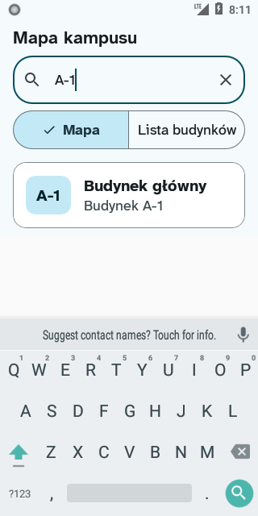
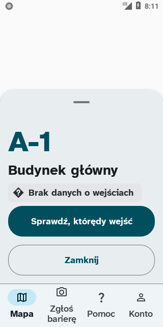
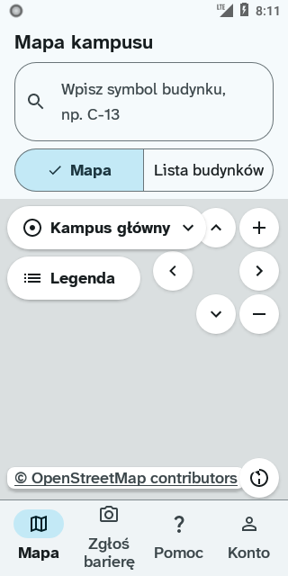
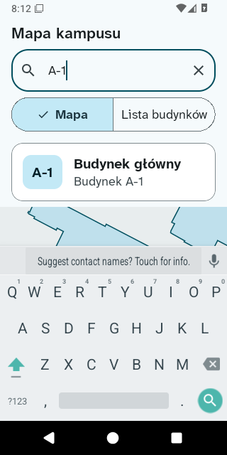
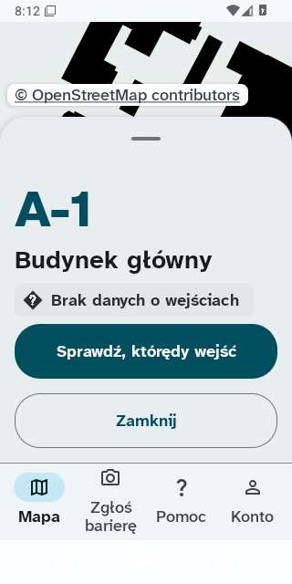
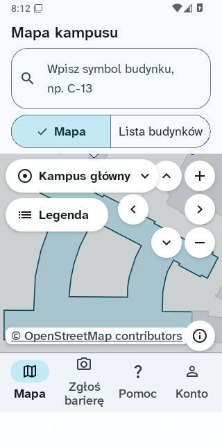

# Klawiatura po wyborze budynku

Sprawdzenie US1.1 na emulatorach z ekranową klawiaturą, 13 listopada 2026 r.

| Model | Android | API |
| --- | --- | --- |
| Android SDK built for x86_64 | 8.0.0 | 26 |
| Android SDK built for x86_64 | 16 | 36 |

Test `CampusPathDeviceTest.us1_1_keyboard_then_back` otwiera pole wyszukiwania i wpisuje `A-1`.
Po wyborze wyniku sprawdza brak systemowego okna klawiatury i pola edycji z fokusem na V2.
Jedno systemowe Wstecz zamyka V2. Po powrocie test sprawdza fokus pola i brak okna klawiatury.

Katalog budynków pochodzi z pliku aplikacji, a kafelki zastępuje lokalny przezroczysty PNG.
Zrzuty całego ekranu zapisuje `UiAutomation.takeScreenshot()`; obejmują także systemową klawiaturę.
Dane PNG trafiają w numerowanych częściach do artefaktu `instrumentacja.txt`.

Na obu wersjach przeszło 5 z 5 testów urządzeniowych, w tym sprawdzenie klawiatury.
[Przebieg CI i źródło zrzutów](https://github.com/dostepny-kampus/dostepny-kampus/actions/runs/43497907754).

## Android 8.0.0

Przed wyborem:

Po wyborze:

Po jednym Wstecz:

## Android 16

Przed wyborem:

Po wyborze:

Po jednym Wstecz:

