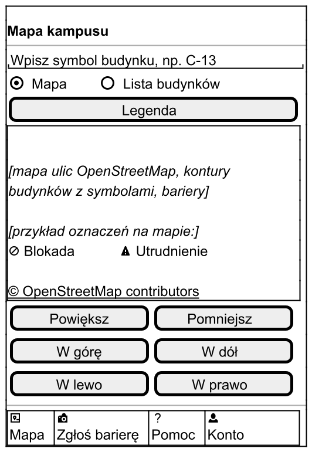
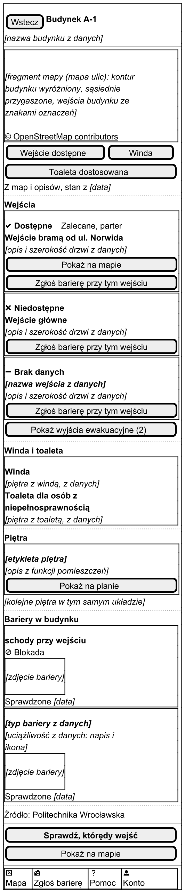
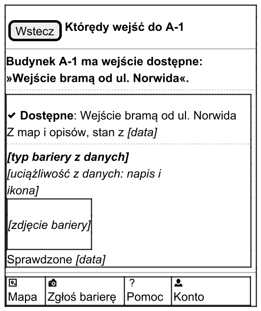
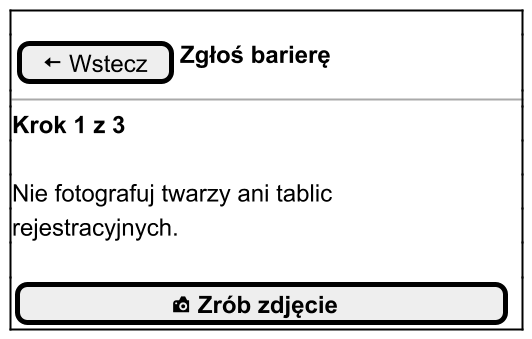
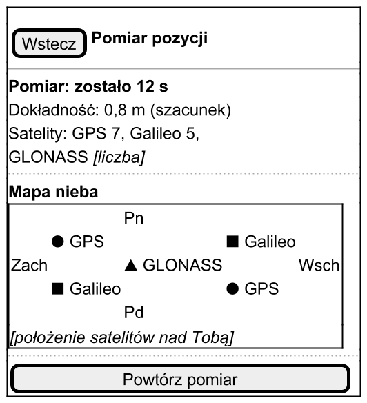
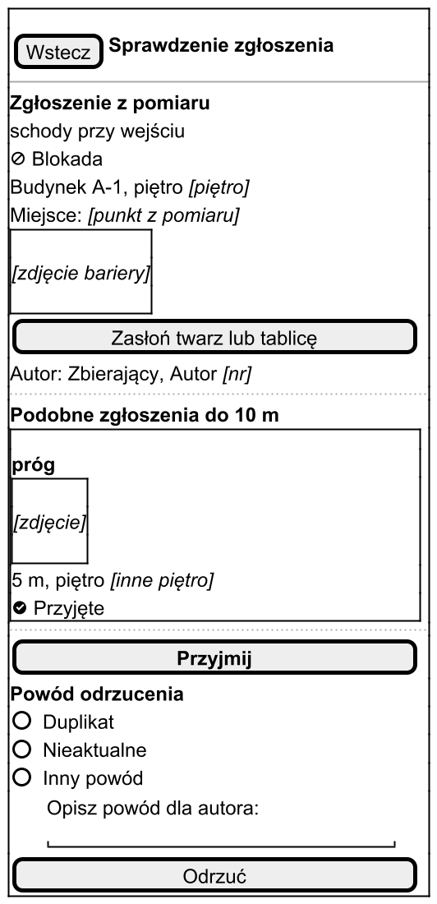
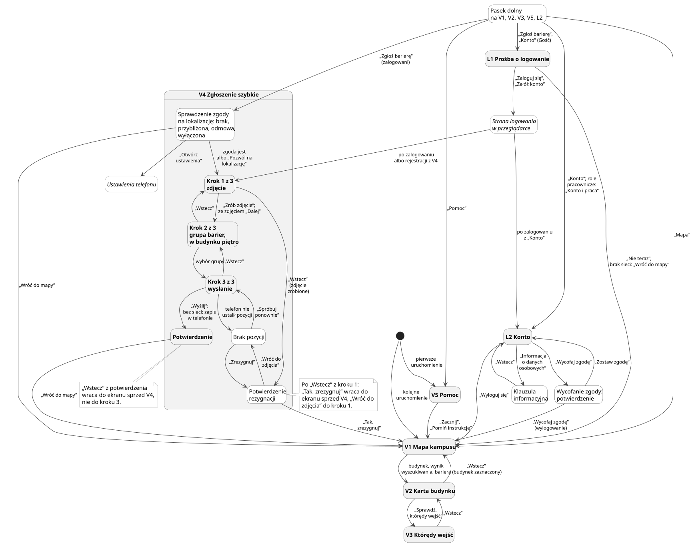

# Raport „Sprint 1”: Dostępny Kampus

| Pole | Wartość |
| --- | --- |
| Projekt | Dostępny Kampus — aplikacja mobilna i serwer do inwentaryzacji barier architektonicznych na kampusie Politechniki Wrocławskiej (PWr) |
| Kurs | Mobilne systemy informatyczne – Projekt (W04IST-SM0302G) [1] |
| Prowadzący | dr inż. Zbigniew Telec |
| Autor | Vladyslav Yevkov |
| Członek zespołu | ………………………………………… |
| Członek zespołu | ………………………………………… |
| Data | 28.10.2026 |
| Zakres raportu | Sprint 1 według harmonogramu kursu: makiety, struktura projektu i praca z Git; stan na 28.10.2026 |

Raport podaje skrót i odsyła do stron dokumentacji projektu. Odwołuje się do identyfikatorów: ekranów V, L, C, R, K, historyjek US, wymagań NFR i ryzyk R.

## 1. Cel sprintu i wynik

| Obszar | Cel Sprintu 1 | Wynik | Stan |
| --- | --- | --- | --- |
| Makiety | makiety ekranów aplikacji | 70 makiet low-fi dla 19 ekranów, mapa nawigacji, słownik napisów | zrobione |
| Struktura projektu | układ repozytoriów i modułów | repozytorium dokumentacji z automatyczną kontrolą jakości; repozytorium kodu zaplanowane, jeszcze nie istnieje | częściowo |
| Git | sposób pracy z Git | zasady ustalone; w repozytorium dokumentacji 344 commity i 30 scalonych gałęzi zadań | zrobione dla dokumentacji, dla kodu plan |

Plan sprintów z raportu [Tydzień 2](tydzien-2.md) przypisał Sprintowi 1 także zadania techniczne, których nie zrobiliśmy. To szkielet repozytorium kodu, kontrakt API v0, kontrola PR w CI, szkielety serwera i aplikacji oraz eksport konturów budynków z OpenStreetMap. Przechodzą do Sprintu 2 (sekcja 7). Nie było też zadań próbnych, więc architektura z raportu „Tydzień 2” zostaje wstępna.

## 2. Makiety

| Grupa | Role | Ekrany | Makiety | Strona |
| --- | --- | --- | --- | --- |
| Odwiedzający | Gość niezalogowany, Odwiedzający | V1–V5, L1, L2 | 32 | [Makiety: odwiedzający](../ux/makiety/odwiedzajacy.md) |
| Zespół w terenie | Zbierający | C1–C7 | 21 | [Makiety: zespół w terenie](../ux/makiety/zespol-w-terenie.md) |
| Weryfikacja i koordynacja | Weryfikator, Koordynator | R1, R2, K1–K3 | 17 | [Makiety: weryfikacja i koordynacja](../ux/makiety/weryfikacja-koordynacja.md) |
| Razem | 5 ról | 19 | 70 | [Makiety: konwencje i lista](../ux/makiety/index.md) |

Każdy ekran ma makietę stanu zwykłego. Pozostałe makiety to stany, które wyglądają inaczej: brak sieci, pusta lista, błąd, brak zgody na lokalizację, a także warianty ról. Stan różny o jeden napis opisuje tabela pod makietą.

Pięć ekranów doszło względem raportu „Tydzień 2”: L1, L2 (US14), C5 (US15), C6 (US17.2) i C7 (US8.4). Ich identyfikatory nadają [wymagania do ekranów](../ux/wymagania-ekranow.md).

### Jak powstały

1. **Persony i ścieżki.** Trzy persony PE-1…PE-3 i dwie mapy ścieżki opisują użytkowników ([Persony](../ux/persony.md), [Mapy ścieżki](../ux/journey.md)). PE-1 to osoba starsza, czyli grupa docelowa.
2. **Wymagania do ekranów.** Dla każdego ekranu: cel, elementy z odwołaniem do kryteriów US, reguł BR i NFR, stany i cel każdej czynności.
3. **Mapa nawigacji.** Przejścia między ekranami powstały z kolumny „Dokąd” wymagań (sekcja 3).
4. **Słownik użytkownika.** Napisy i komunikaty słowami osoby starszej, bez żargonu ([Słownik użytkownika](../ux/slownik-uzytkownika.md)).
5. **Makiety.** Trzy grupy ekranów rysowane równolegle w PlantUML Salt [4], ze wspólnych fragmentów: nagłówka, paska dolnego, przycisków i komunikatów.
6. **Przegląd.** Każdą grupę sprawdziliśmy 10 heurystykami Nielsena [2], kryteriami WCAG 2.1 [3], listą zasad dla osób starszych i pokryciem kryteriów akceptacji. Na końcu był przegląd spójności wszystkich ekranów.
7. **Zatwierdzenie.** 28.10.2026 właściciel projektu zatwierdził makiety z pięcioma drobnymi poprawkami. Dotyczą one m.in. komunikatu o błędzie serwera i przełącznika „Plan piętra” i „Mapa” na C1.

### Zasady

| Zasada | Jak w makietach | Odwołanie |
| --- | --- | --- |
| Low-fi | szare ramki, tekst i przyciski, bez koloru i stylu | — |
| Kolor nie niesie znaczenia | status, oznaczenie wejścia i uciążliwość zawsze tekstem i ikoną | NFR-21 |
| Najpierw osoby starsze | jedna czynność główna na ekranie; „Wstecz” zawsze w tym samym miejscu; komunikat mówi, co się stało i co zrobić | PE-1, NFR-15 |
| Duży tekst | wiersz ma najwyżej 34 znaki, czyli tyle, ile mieści tekst 18 sp na ekranie 360 dp | NFR-20 |
| Cel dotyku 48 dp | makieta sprawdza obecność i proporcje celu; wysokości Salt nie oddaje, więc sprawdzi ją test dostępności w implementacji | NFR-17 |
| Bez czynności tylko gestem | mapa ma przyciski „Powiększ”, „W górę” i inne kierunki; mapa ma też widok listy | NFR-15, NFR-19 |
| Każdy element z kryterium | pod każdą makietą tabela „Element → AC/BR/NFR”; element bez odwołania usuwamy | — |
| Prawdziwe dane przykładowe | budynek A-1 z wejściami jak w deklaracji dostępności [5]; nieznane dane jako zastępniki, np. „[data]” | — |

### Wybrane makiety

| V1: Mapa kampusu | V2: Karta budynku | V3: Którędy wejść |
| --- | --- | --- |
| [{: width="210" }](../_generated/m-v1-mapa.png) | [{: width="210" }](../_generated/m-v2-karta-budynku.png) | [{: width="210" }](../_generated/m-v3-ktoredy-wejsc.png) |

| V4: Zgłoszenie szybkie, krok 1 | C1: Pomiar pozycji | R2: Sprawdzenie zgłoszenia |
| --- | --- | --- |
| [{: width="210" }](../_generated/m-v4-krok-1.png) | [{: width="210" }](../_generated/m-c1-pomiar-pozycji.png) | [{: width="210" }](../_generated/m-r2-sprawdzenie-zgloszenia.png) |

| Ekran | Na co zwrócić uwagę | Odwołanie |
| --- | --- | --- |
| V1 | przełącznik „Mapa” i „Lista budynków”; przyciski zamiast gestów | US1, NFR-19 |
| V2 | oznaczenie wejścia jest pierwszą informacją, pod nim data i źródło | US2.1, US17.3 |
| V3 | odpowiedź pełnym zdaniem: którym wejściem wejść | US3.1 |
| V4 | jedna czynność na ekranie; przypomnienie o twarzach i tablicach przed zdjęciem | US4, NFR-25 |
| C1 | czas pomiaru, dokładność, satelity według systemów i mapa nieba | US6, US6.5 |
| R2 | podobne zgłoszenia w promieniu 10 m; przyjęcie albo odrzucenie z powodem | US10, US10.1 |

## 3. Mapa nawigacji

[Mapa nawigacji](../ux/mapa-nawigacji.md) ma 130 przejść w tabeli i trzy diagramy: Gość i Odwiedzający, Zbierający, Weryfikator i Koordynator. Każde przejście pochodzi z wymagań do ekranów i ma odwołanie do kryterium.

| Kontrola | Wynik |
| --- | --- |
| Najwyżej 3 dotknięcia od mapy do wejścia dostępnego (US3.2) | spełnione: 1 dotknięcie do V2, 2 do V3; z wyszukiwaniem i z czytnikiem TalkBack 3, czyli na progu |
| Ekran osiągalny dla roli z uprawnieniem | spełnione: 19 z 19 ekranów |
| Brak drogi do ekranu roli bez uprawnienia | spełnione |
| Powrót do mapy z każdego ekranu | najwyżej 3 dotknięcia; wyjątek: kroki 2 i 3 V4 po zdjęciu, do 5 dotknięć, bo rezygnacja ze zdjęcia wymaga potwierdzenia |
| Brak ślepych zaułków | spełnione: każdy przycisk ma cel |



Główna droga osoby starszej to V1, V2, V3 i z powrotem. Każdy stan błędu lokalizacji w V4 ma wyjście „Wróć do mapy”.

## 4. Struktura projektu

### Repozytorium dokumentacji (stan)

| Katalog | Zawartość |
| --- | --- |
| `docs/biznes` | wizja, role i macierz uprawnień, słownik pojęć, procesy AS-IS i TO-BE (BPMN), reguły, ryzyka |
| `docs/wymagania` | potrzeby N1–N9, historyjki US z kryteriami, przypadki użycia, NFR, macierz śledzenia |
| `docs/ux` | scenariusz wywiadu, persony, mapy ścieżki, SWOT, QFD, wymagania do ekranów, mapa nawigacji, słownik użytkownika, makiety |
| `docs/raporty` | raporty dla prowadzącego |
| `specs` | 12 plików ze scenariuszami Gherkin po polsku, razem 126 scenariuszy z tagami kryteriów, np. `@US1.1` |
| `scripts` | skrypty renderu i kontroli jakości |
| `styles` | reguły Vale zespołu |

Repozytorium ma 26 stron Markdown, 78 diagramów PlantUML i 2 diagramy BPMN. Wśród diagramów PlantUML jest 70 makiet i katalog fragmentów wspólnych. Diagramy powstają z plików tekstowych. Obrazy i zbudowana strona nie trafiają do Git.

| Narzędzie | Co sprawdza albo robi |
| --- | --- |
| MkDocs z motywem Material, tryb strict | buduje stronę dokumentacji; zepsuty link zatrzymuje budowanie |
| PlantUML, bpmn-to-image (`render.py`) | renderuje diagramy i makiety do SVG i PNG |
| Vale | reguły zespołu: zdanie najwyżej 25 słów, akapit najwyżej 4 zdania, lista pustych zwrotów |
| markdownlint | formatowanie Markdown |
| LanguageTool (`lang.py`) | pisownia i gramatyka polska; wynik to podpowiedź, nie blokada |
| `check_ids.py` | każdy identyfikator ma definicję, brak odwołań do nieistniejących ID, aktualna macierz śledzenia |
| `abbr.py` | podpowiedzi skrótów na stronie, generowane ze słownika pojęć |

Skrypt `verify.py` uruchamia po kolei 8 kroków: render, skróty, Vale, markdownlint, LanguageTool, identyfikatory, macierz i budowanie MkDocs. Na żądanie robi też zrzuty każdej strony w szerokości 1280 i 390 px. Zmianę scalamy do `main` dopiero wtedy, gdy żaden krok nie zgłasza błędu.

### Repozytorium kodu (plan)

| Element | Ustalenie | Skąd |
| --- | --- | --- |
| Repozytorium | jedno publiczne repozytorium na GitHubie: kontrakt API, serwer, aplikacja, dane budynków | [Tydzień 2](tydzien-2.md), sekcja 4 |
| Scenariusze | katalog `specs` przechodzi do repozytorium kodu na początku implementacji, bo to testy uruchamiane w CI | ustalenie zespołu |
| Aplikacja | Kotlin, Jetpack Compose, Material 3; Room i WorkManager do pracy bez sieci | Tydzień 2, sekcja 3 |
| Serwer | Spring Boot 3, Java 21, Maven; granic modułów pilnują Spring Modulith i ArchUnit | Tydzień 2, sekcja 3 |
| Kontrakt API | OpenAPI powstaje przed kodem; z niego generujemy interfejsy serwera i klienta | Tydzień 2, sekcja 3 |
| CI | GitHub Actions: osobne przepływy kontraktu, serwera, aplikacji, testów UI i kontroli PR | Tydzień 2, sekcja 4 |
| Dokumentacja | zostaje w osobnym repozytorium | Tydzień 2, sekcja 4 |

Planowany układ katalogów (ustalenie zespołu, jeszcze nie istnieje):

```text
dostepny-kampus/
  api/openapi.yaml    kontrakt API, pisany jako pierwszy
  specs/*.feature     scenariusze Gherkin po polsku
  backend/            serwer Spring Boot
  android/            aplikacja Kotlin + Compose
  data/buildings/     kontury budynków GeoJSON (ODbL) i skrypt eksportu
  .github/workflows/  przepływy CI
```

Jedno repozytorium pozwala zmienić kontrakt, serwer i aplikację w jednym PR. Przepływy CI uruchamiają się według zmienionych katalogów, więc zmiana w aplikacji nie buduje serwera. Podziału serwera i aplikacji na moduły wewnętrzne dokumentacja jeszcze nie ustala. Ustalimy go razem z modelem danych w Sprincie 2.

## 5. Praca z Git

### Sposób pracy

| Element | Repozytorium kodu (plan) | Repozytorium dokumentacji (stan) |
| --- | --- | --- |
| Gałęzie | `main` ← `sprint/N` ← `feature/<sprint>-<nazwa>` | `main` ← `docs/<zadanie>`; każde zadanie w osobnym katalogu roboczym (git worktree) |
| Przegląd | PR z jedną akceptacją | przegląd każdej zmiany przed scaleniem; poprawki z przeglądu w osobnej gałęzi |
| Ochrona gałęzi | do `main` i `sprint/*` tylko przez PR z zielonym CI | scalenie do `main` tylko po przeglądzie i bez błędów `verify.py` |
| Rozmiar zmiany | PR funkcjonalny najwyżej 300 linii | jedna gałąź to jedno zamknięte zadanie |
| Commity | Conventional Commits [6], sprawdzane przez commitlint | Conventional Commits, np. `docs(ux): …` |

Repozytorium dokumentacji jest na razie lokalne, bez kopii zdalnej. Ochrona gałęzi na GitHubie będzie dotyczyć repozytorium kodu.

### Stan repozytorium dokumentacji na 28.10.2026

| Miara | Wartość |
| --- | --- |
| Commity w `main` | 344: 299 zmian i 45 scaleń |
| Okres | 27.10–28.10.2026: 227 zmian pierwszego dnia, 72 drugiego |
| Scalone gałęzie zadań | 30, z tego 27 z przeglądem w osobnej gałęzi |
| Commity według obszaru (bez scaleń) | UX 116, biznes 76, wymagania 36, scenariusze 36, narzędzia 17, raporty 7, pozostałe 11 |
| Autorzy commitów | 1 osoba |
| Gałęzie w toku | tokeny wizualne i ten raport |

## 6. Zmiany względem planu i ryzyka

| Zmiana albo problem | Skutek | Odwołanie |
| --- | --- | --- |
| Sprint 1 bez zadań technicznych z planu „Tydzień 2” | repozytorium kodu, CI, szkielety i eksport OSM przechodzą do Sprintu 2 | R-1, sekcja 1 |
| Raporty „Tydzień 2” i „Sprint 1” po terminie | wystąpił sygnał ostrzegawczy R-1; reakcja: najpierw funkcje „Musi być” | R-1 |
| Zmiana stosu z „Flutter + FastAPI” na „Kotlin + Spring Boot” | opisana w raporcie „Tydzień 2”; powód: pełny dostęp do GNSS przy uśrednianiu pozycji | [Tydzień 2](tydzien-2.md), sekcja 3 |
| Pięć nowych ekranów: L1, L2, C5, C6, C7 | domykają US14, US15, US17.2 i US8.4 | [wymagania do ekranów](../ux/wymagania-ekranow.md) |
| Wszystkie commity jednej osoby | wystąpił sygnał R-2: ponad 80% commitów od jednej osoby; skład zespołu do potwierdzenia | R-2 |
| Persony, ścieżki i napisy bez wywiadów | to hipotezy; wywiady mogą zmienić ekrany | [scenariusz wywiadu](../ux/scenariusz-wywiadu.md) |
| Wysokości celu dotyku nie da się sprawdzić na makiecie | sprawdzi ją test dostępności w implementacji | NFR-17 |

Pełny rejestr z ocenami i sygnałami jest na stronie [Ryzyka](../biznes/ryzyka.md).

## 7. Plan Sprintu 2

Według harmonogramu kursu Sprint 2 obejmuje interfejs użytkownika, nawigację i model danych. Do tego dochodzą zadania przeniesione ze Sprintu 1.

| Zadanie | Wynik | Odwołanie |
| --- | --- | --- |
| Repozytorium kodu | szkielet według planowanego układu katalogów, katalog `specs` przeniesiony z dokumentacji, reguły gałęzi | Tydzień 2, sekcja 4 |
| CI i kontrola PR | rozmiar zmiany, format commitów, skan sekretów, lintery | NFR-35, NFR-46 |
| Kontrakt API v0 | pierwsza wersja kontraktu OpenAPI | Tydzień 2 |
| Szkielety serwera i aplikacji | projekty z linterami, uruchamiane w CI | Tydzień 2 |
| Model danych | model dziedziny z geometrią; baza lokalna w aplikacji | Tydzień 2, plan S2 |
| Dane budynków | eksport konturów z OpenStreetMap; import budynków z oznaczeniami wejść | R-11, US17 |
| Nawigacja | ekrany i przejścia według mapy nawigacji, pasek dolny, ekrany według roli | [mapa nawigacji](../ux/mapa-nawigacji.md), US14.1 |
| Pierwsze ekrany „Musi być” | V1 mapa z konturami budynków, V2 karta budynku z oznaczeniem wejść | US1, US2, US17 |
| Motyw aplikacji | motyw z tokenów wizualnych; tokeny są w przygotowaniu | NFR-16, NFR-21 |
| Wywiady | rozmowy według scenariusza; poprawki person i napisów | [scenariusz wywiadu](../ux/scenariusz-wywiadu.md) |

Kolejność wynika z reakcji na R-1: najpierw repozytorium i CI, potem ekrany „Musi być”.

## Źródła

1. Programy studiów WIT PWr, karta przedmiotu W04IST-SM0302G: <https://wit.pwr.edu.pl/studenci/programy-studiow/2024-2025-studia-ii-stopnia>
2. Nielsen J., 10 Usability Heuristics for User Interface Design (Nielsen Norman Group): <https://www.nngroup.com/articles/ten-usability-heuristics/>
3. WCAG 2.1 (W3C): <https://www.w3.org/TR/WCAG21/>
4. PlantUML Salt: <https://plantuml.com/salt>
5. Deklaracja dostępności budynku A-1: <https://dostepnosc.pwr.edu.pl/dostepnosc-architektoniczna/deklaracje-dostepnosci-budynkow/budynki-a/a1>
6. Conventional Commits 1.0.0: <https://www.conventionalcommits.org/pl/v1.0.0/>

Dostęp do źródeł: 28.10.2026.
