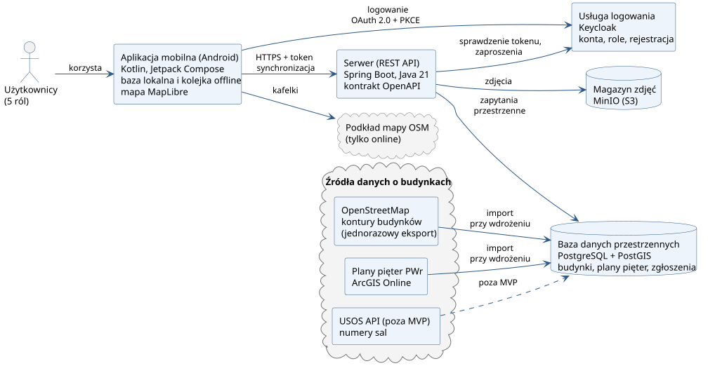

# Raport „Tydzień 2”: Dostępny Kampus

| Pole | Wartość |
| --- | --- |
| Projekt | Dostępny Kampus — aplikacja mobilna i serwer do inwentaryzacji barier architektonicznych na kampusie Politechniki Wrocławskiej (PWr) |
| Kurs | Mobilne systemy informatyczne – Projekt (W04IST-SM0302G) [7] |
| Prowadzący | dr inż. Zbigniew Telec |
| Autor | Vladyslav Yevkov |
| Członek zespołu | ………………………………………… |
| Członek zespołu | ………………………………………… |
| Data | 27.10.2026 |
| Zakres raportu | stan po etapie projektu aplikacji: temat, funkcje, wstępna architektura, sposób pracy i ryzyka |

Szczegóły każdej sekcji są w dokumentacji projektu. Raport podaje skrót i odsyła do identyfikatorów: potrzeb N, historyjek US, reguł BR, ryzyk R.

## 1. Temat i problem

| Fakt | Źródło |
| --- | --- |
| Podmiot publiczny zapewnia dostępność architektoniczną i co 4 lata raportuje jej stan. | [1] |
| Na 1.01.2025 kampus główny PWr ma 44 budynki. W 13, m.in. A-1, dostosowane jest tylko wejście inne niż główne. | [3] |
| Informację publikuje 67 deklaracji budynków: sam tekst, bez mapy i zdjęć. 66 z 67 ma datę „marzec 2024”. | [2] |
| Cyfrowy Przewodnik opisuje 25 budynków. Jego Interaktywna Mapa Kampusu pokazuje położenie i plany pięter wybranych budynków, z danymi z semestru zimowego 2022/2023. | [4], [8] |
| Żaden kanał nie pokazuje bieżących awarii, np. niesprawnej windy. Aktualności Cyfrowego Przewodnika są puste. | [5] |

Dane o dostępności istnieją, ale są rozproszone i rzadko aktualizowane. Osoba na wózku nie sprawdzi przed wizytą, którym wejściem wejdzie do budynku i czy winda działa. Pełny opis dzisiejszego procesu i problemów P-1…P-9 jest na stronie [Proces AS-IS](../biznes/procesy/as-is.md).

Cel projektu pochodzi z [Wizji](../biznes/wizja.md):

> Chcemy rozwiązać problem rozproszonej informacji o barierach na kampusie PWr dotyczący grupy osób starszych i z ograniczoną mobilnością po to, aby planowały wizytę bez przeszkód.

Uczelnia dostaje sprawdzone dane o barierach w formacie GIS.

### Grupa docelowa i role

| Rola | Kto | Co robi w aplikacji | Potrzeby |
| --- | --- | --- | --- |
| Gość niezalogowany (RO-GOS) | każdy, bez konta | przegląda mapę, karty budynków i dostępne wejścia | N1, N2, N4 |
| Odwiedzający (RO-ODW) | osoba starsza, np. słuchacz Politechniki Trzeciego Wieku [6], osoba odwiedzająca uczelnię | jak Gość, a po rejestracji zgłasza barierę w 3 krokach | N1–N4 |
| Zbierający (RO-ZBI) | student lub pracownik prowadzący obchód | dokładnie zaznacza barierę na miejscu, także bez sieci | N5–N7 |
| Weryfikator (RO-WER) | pracownik uczelni | przyjmuje lub odrzuca zgłoszenia, wyłapuje duplikaty | N7, N8 |
| Koordynator (RO-KOO) | osoba prowadząca inwentaryzację | śledzi postęp, zaprasza ludzi, eksportuje dane do QGIS | N9 |

Uprawnienia opisuje [macierz ról](../biznes/role.md). Potrzeby N1–N9 to hipotezy. Sprawdzamy je w wywiadach według [scenariusza wywiadu](../ux/scenariusz-wywiadu.md).

## 2. Funkcje

| Ekran | Funkcja | Rola | Historyjki | Priorytet (MoSCoW) |
| --- | --- | --- | --- | --- |
| V1 | Mapa kampusu, wyszukiwanie budynku po symbolu | wszyscy | US1 | Musi być |
| V2 | Karta budynku: wejścia, windy, bariery ze zdjęciem i datą | wszyscy | US2 | Musi być |
| V2 | Oznaczenie wejścia: dostępne, niedostępne albo brak danych, z datą i źródłem; zmiana na obchodzie | wszyscy; zmiana: Zbierający | US17 | Musi być |
| V2 | Plan piętra z przełącznikiem pięter (5 budynków szczegółowych) | wszyscy | US16 | Powinno być |
| V3 | „Zaplanuj wizytę”: które wejście jest dostępne | wszyscy | US3 | Powinno być |
| V4 | Zgłoszenie szybkie: zdjęcie, grupa barier, pozycja | Odwiedzający | US4 | Musi być |
| V5 | Pomoc i instrukcja przy pierwszym uruchomieniu | wszyscy | US5 | Powinno być |
| C1 | Pomiar precyzyjny: uśrednianie GNSS przez 30 s, podpowiedź budynku, piętro obejrzane | Zbierający | US6, US15 | Musi być (mapa nieba: Powinno być) |
| C2 | Formularz: typ bariery, uciążliwość 1–3, zdjęcie, piętro | Zbierający | US7 | Musi być |
| C3 | Moje zgłoszenia ze statusami | Zbierający | US8 | Musi być |
| C4 | Synchronizacja po pracy offline, wybór wersji przy konflikcie | Zbierający | US9 | Musi być |
| R1, R2 | Kolejka weryfikacji, decyzja z powodem, podobne zgłoszenia w promieniu 10 m | Weryfikator | US10 | Musi być |
| K1 | Postęp inwentaryzacji według budynków | Koordynator | US11 | Musi być |
| K2 | Zaproszenie osoby z rolą | Koordynator | US12 | Powinno być |
| K3 | Eksport GeoJSON (WGS84) i CSV (PUWG 1992) | Koordynator | US13 | Musi być |
| — | Logowanie i rejestracja | wszyscy z kontem | US14 | Musi być |

Historyjki „Musi być” tworzą MVP. Kryteria akceptacji każdej historyjki są na stronie [Potrzeby i historyjki](../wymagania/potrzeby-i-historie.md).

- **Może być:** wersja angielska, tryb ciemny, kolejne budynki szczegółowe, dane z deklaracji dostępności.
- **Nie tym razem:** nawigacja po trasie, iOS, Google Play, sztuczna inteligencja, czat, powiadomienia push.

### Scenariusz demo w budynku A-1

1. Zbierająca przy wejściu głównym A-1 widzi schody bez pochylni i zaczyna zgłoszenie (US6).
2. Przez 30 s uśredniania widać satelity według systemów, a dokładność pozycji się poprawia. W trybie demo z nagraną trasą spada z około 6 m poniżej 1 m; cel NFR-1 dotyczy terenu otwartego.
3. Aplikacja podpowiada A-1, Zbierająca potwierdza, wybiera typ i uciążliwość 3, robi zdjęcie (US7).
4. W piwnicy nie ma sieci: zgłoszenie czeka w telefonie i wysyła się samo po powrocie sieci (US9).
5. Weryfikator widzi podobne zgłoszenie 5 m dalej, uznaje, że to nie duplikat, i przyjmuje zgłoszenie (US10).
6. Słuchacz Politechniki Trzeciego Wieku otwiera kartę A-1: wejście główne ma schody, dostępne jest inne wejście [3] (US2).
7. Koordynator widzi w A-1 4 z 5 pięter obejrzanych (80%) i pobiera eksport do QGIS (US11, US13).

## 3. Wstępna architektura

**Wersja wstępna.** Architektura może się zmienić po zadaniach próbnych Sprintu 1. Decyzje zapisujemy w dzienniku decyzji.

Aplikacja działa także bez sieci: trzyma budynki, bariery i kolejkę zgłoszeń w telefonie. Dane o budynkach importujemy do bazy przy wdrożeniu, więc awaria źródła zewnętrznego nie zatrzymuje aplikacji (NFR-50). Plany pięter PWr nie trafiają do repozytorium, jest tylko skrypt importu (NFR-40).

| Obszar | Technologia | Dlaczego |
| --- | --- | --- |
| Aplikacja | Kotlin 2.x, Jetpack Compose, Material 3 | natywny dostęp do stanu satelitów GNSS i rygorystyczne lintery języka Kotlin |
| Praca offline | Room, WorkManager | lokalna baza z kolejką operacji, wysyłka sama po powrocie sieci (N6) |
| Mapa | MapLibre Native, podkład OSM | otwarta biblioteka; kontury i bariery z własnych danych działają też offline |
| Pozycja i układ PUWG 1992 | Fused Location Provider, GnssStatus, proj4j | uśrednianie pozycji i mapa nieba; przeliczenie układu gotową biblioteką |
| Serwer | Spring Boot 3, Java 21, Maven | stos najlepiej znany autorowi, z kontrolą granic modułów (Spring Modulith, ArchUnit) |
| Kontrakt API | OpenAPI, openapi-generator | kontrakt powstaje przed kodem, z niego generujemy interfejsy serwera i klienta |
| Baza danych | PostgreSQL + PostGIS, Hibernate Spatial, Flyway | zapytania przestrzenne: budynek dla punktu, duplikaty w promieniu, przeliczenie układu |
| Logowanie i role | Keycloak, AppAuth (OAuth 2.0 + PKCE) | gotowe konta, role, rejestracja i zaproszenia, bez własnego przechowywania haseł |
| Zdjęcia | MinIO | magazyn zgodny z S3 zamiast własnej obsługi plików na dysku |
| Import danych | GDAL ogr2ogr | wczytanie konturów OSM i planów ArcGIS do PostGIS bez własnego parsera |
| Uruchomienie | Docker Compose | cały serwer startuje na laptopie, co zabezpiecza pokaz w sali (R-3) |

Względem opisu tematu zmieniliśmy stos z „Flutter + FastAPI” na „Kotlin + Spring Boot”, ponieważ natywny Android daje pełny dostęp do GNSS przy uśrednianiu pozycji. Spring Boot ma też gotowe rozwiązania do logowania, mapowania obiektowo-relacyjnego (ORM) i danych przestrzennych.

Zasada: własny kod piszemy tylko dla logiki dziedziny, czyli cyklu zgłoszenia, synchronizacji i uśredniania pozycji. Infrastrukturę zapewniają gotowe biblioteki.

## 4. Sposób pracy

### Repozytorium i gałęzie

| Element | Ustalenie |
| --- | --- |
| Repozytorium kodu | jedno publiczne repozytorium na GitHubie: kontrakt API, serwer, aplikacja, dane budynków |
| Dokumentacja | osobne repozytorium, strona MkDocs; ten raport jest jej częścią |
| Gałęzie | `main` ← `sprint/N` ← `feature/<sprint>-<nazwa>` |
| Ochrona gałęzi | do `main` i `sprint/*` tylko przez PR z zielonym CI i jedną akceptacją |
| Rozmiar zmiany | PR funkcjonalny ma najwyżej 300 zmienionych linii; jedna gałąź to jedno zamknięte zadanie |
| Commity | Conventional Commits, sprawdzane przez commitlint |

### Kontrola jakości

Używamy tylko gotowych, rygorystycznych zestawów reguł, bez własnych progów. Wyjątek dopuszczamy tylko przy sprzeczności dwóch zestawów, z zapisanym powodem (R-9).

| Obszar | Gotowe zestawy i narzędzia |
| --- | --- |
| Java (serwer) | qulice (Checkstyle, PMD, Error Prone), NullAway, ArchUnit, Spring Modulith |
| Kotlin (aplikacja) | detekt ze wszystkimi regułami, ktlint_official, compose-rules, Android Lint, Konsist |
| Oba moduły | SonarCloud z bramką jakości „Sonar way” |
| Kontrakt API | Redocly lint, oasdiff (zmiana łamiąca zgodność blokuje scalenie) |
| Dokumentacja | Vale, markdownlint, kontrola identyfikatorów, budowanie MkDocs w trybie strict |

CI działa w GitHub Actions. Osobne przepływy obejmują kontrakt API, serwer, aplikację, testy UI na emulatorze i kontrolę PR. Kontrola PR sprawdza rozmiar zmiany, format commitów i sekrety (gitleaks).

### Plan sprintów

| Sprint | Cel | Najważniejsze zadania |
| --- | --- | --- |
| S1 | fundament, CI, dane | analiza i dokumentacja, szkielet repozytorium, kontrakt API v0, kontrola PR, szkielety serwera i aplikacji z linterami, eksport budynków z OSM, makiety low-fi |
| S2 | UI, nawigacja, model danych | model i geometria, system projektowy, nawigacja z rolami, mapa z konturami, baza lokalna, import budynków do bazy |
| S3 | serwer i API | budynki i podpowiedź budynku, zgłoszenia z wersją, zdjęcia, klient API, repozytoria danych |
| S4 | logika dziedziny | uśrednianie pozycji, PUWG 1992, ekran pomiaru z mapą nieba, formularz ze zdjęciem, podobne zgłoszenia |
| S5 | logowanie, role, offline | usługa logowania i role, zaproszenia, logowanie w aplikacji, kolejka offline, ekran konfliktu, weryfikacja |
| S6 | eksport, UX, testy, pokaz | eksport GeoJSON i CSV, ekran postępu, tryb demo z nagraną trasą, dostępność, badanie SUS |

Na prezentację końcową działa scenariusz z sekcji 2: pomiar offline, weryfikacja z powodem i eksport otwierany w QGIS. Do tego ekran wyboru wersji przy konflikcie, zielone CI i raport z badania SUS (NFR-24).

## 5. Najważniejsze ryzyka

| Ryzyko | ID | Ocena P×W | Reakcja |
| --- | --- | --- | --- |
| Opóźnienie wobec harmonogramu kursu | R-1 | 9 | najpierw funkcje „Musi być”; fazy analizy i makiet najwyżej po 4 dni |
| Zależność od jednej osoby | R-2 | 9 | decyzje w dzienniku, dokumenty przed kodem, każde zadanie da się przekazać |
| Awaria pokazu w sali: brak GNSS, sieci lub serwera | R-3 | 9 | tryb demo z nagraną trasą, serwer na laptopie, próba generalna, nagranie wideo |
| Słaba dokładność GNSS przy ścianach budynków | R-4 | 6 | uśrednianie 30 s z widoczną dokładnością, potwierdzenie budynku, ręczna korekta punktu |
| Niespójne i niepełne dane planów PWr | R-5 | 6 | ujednolicenie pól przy imporcie, obchód 5 budynków, poziom podstawowy przy braku danych (BR-G3) |

Pełny rejestr z sygnałami ostrzegawczymi jest na stronie [Ryzyka](../biznes/ryzyka.md).

## Źródła

1. Ustawa z dnia 19 lipca 2019 r. o zapewnianiu dostępności osobom ze szczególnymi potrzebami, art. 4, 6 i 11: <https://eli.gov.pl/eli/DU/2019/1696/ogl/pol/pdf>
2. Deklaracje dostępności budynków PWr: <https://dostepnosc.pwr.edu.pl/dostepnosc-architektoniczna/deklaracje-dostepnosci-budynkow>
3. Stan dostosowania obiektów PWr na dzień 01.01.2025, kampus główny: <https://dostepnosc.pwr.edu.pl/dostepnosc-architektoniczna/stan-dostosowania-obiektow-pwr-na-dzien-01-01-2025/kampus-glowny-pwr-na-dzien-01-01-2025>
4. Interaktywna Mapa Kampusu PWr: <https://mapakampusu.pwr.edu.pl/>
5. Cyfrowy Przewodnik PWr, Aktualności: <https://przewodnik.pwr.edu.pl/pl/aktualnosci>
6. „Historyczna inauguracja. Ruszyła Politechnika Trzeciego Wieku”: <https://pwr.edu.pl/uczelnia/aktualnosci/seniorzy-na-pwr-ruszyla-politechnika-trzeciego-wieku-13912.html>
7. Programy studiów WIT PWr, karta przedmiotu W04IST-SM0302G: <https://wit.pwr.edu.pl/studenci/programy-studiow/2024-2025-studia-ii-stopnia>
8. Cyfrowy Przewodnik PWr, lista 25 budynków i opis Interaktywnej Mapy Kampusu: <https://przewodnik.pwr.edu.pl/pl/budynki>

Dostęp do źródeł: 27.10.2026.
