# Ekrany — makiety hi-fi

Na tej stronie są makiety hi-fi ekranów aplikacji zatwierdzone przez właściciela produktu. Według nich powstaje kod aplikacji. Wszystkie ekrany mają styl „Karta miejsca” (`k5p-b`) opisany w [tokenach wizualnych](../tokeny.md). Skąd się wziął każdy element, pokazują [wymagania do ekranów](../wymagania-ekranow.md) i [makiety low-fi](../makiety/index.md).

Każdy stan ma trzy warianty: jasny, ciemny i przy czcionce 200% (nieliniowa skala Androida 14). Wariant 200% to cała przewijana strona. Na telefonie przypięty jest tylko pasek dolny, a górny pasek z przyciskiem „Wstecz” może się chować przy przewijaniu w dół.

Ekrany zespołu (C1–C7, R1, R2, K1–K3) nie mają paska dolnego. Na C1, C2, C6, C7, K2 i K3 przypięta jest czynność główna (reguła 10 z sekcji [Duża czcionka](../wymagania-ekranow.md#duza-czcionka)). Gdy czcionka ma 200%, nazwa ekranu stoi w treści, a na pasku zostaje „Wstecz”. Przy każdym stanie są odwołania do kryteriów, reguł i wymagań, z których wynikają jego elementy.

Na zrzutach mapa ulic i pozostałe budynki pochodzą z OpenStreetMap. Kontury budynków Politechniki, ścieżki dostosowane, pochylnie, symbole i nazwy budynków, wejścia oraz plany pięter pochodzą z danych Politechniki Wrocławskiej. Przytaczamy je do celów dydaktycznych ze wskazaniem źródła „Źródło: Politechnika Wrocławska”.

W aplikacji kontury budynków pochodzą z OpenStreetMap. Przykładowe są bariery, daty, osoba na ekranie konta i wejścia budynku C-7. Na ekranach zespołu przykładowe są też zgłoszenia, pseudonimy autorów, odległości i dokładności pomiaru, liczby w postępie inwentaryzacji i adres e-mail w zaproszeniu.

Obrazy jasne i ciemne mają 780 px szerokości, czyli ekran 390 dp w skali 2. Obrazy przy czcionce 200% mają 390 px szerokości (skala 1). Kliknięcie obrazu otwiera go w pełnym rozmiarze.

## Zakres stron hi-fi

| Grupa ekranów | Zawartość | Strona |
| --- | --- | --- |
| Gość i Odwiedzający | V1 Mapa kampusu, V2 Karta budynku, V4 Zgłoszenie szybkie, V5 Pomoc, L1–L2 Konto | [Ekrany odwiedzającego](odwiedzajacy.md) |
| Zespół w terenie | C1–C7 pomiar pozycji, formularze i przeglądy | poniższe sekcje (`C1–C7`) |
| Weryfikacja i koordynacja | R1–R2 kolejka sprawdzenia, K1–K3 inwentaryzacja i eksport | poniższe sekcje (`R1–K3`) |

## C1 Pomiar pozycji

Wymagania: [C1 Pomiar pozycji](../wymagania-ekranow.md#c1-pomiar-pozycji). Nagłówek w aplikacji: „Zmierz i zgłoś barierę”.

### C1: pomiar trwa

`m-c1-pomiar-pozycji` · [makieta low-fi](../makiety/zespol-w-terenie.md#pomiar-trwa) · odwołania: US6.1, US6.5, NFR-2, NFR-21, NFR-23

| Jasny | Ciemny | Czcionka 200% |
| --- | --- | --- |
| [{: width="240" loading="lazy" }](obrazy/m-c1-pomiar-pozycji-jasny.webp) | [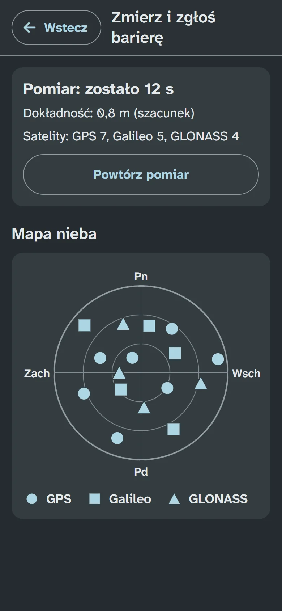{: width="240" loading="lazy" }](obrazy/m-c1-pomiar-pozycji-ciemny.webp) | [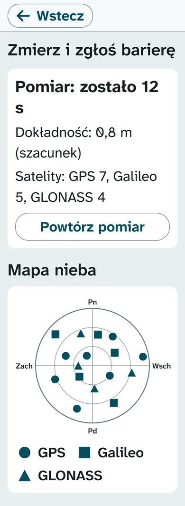{: width="240" loading="lazy" }](obrazy/m-c1-pomiar-pozycji-jasny-200.webp) |

### C1: po pomiarze, podpowiedź budynku

`m-c1-pomiar-pozycji-podpowiedz` · [makieta low-fi](../makiety/zespol-w-terenie.md#po-pomiarze-podpowiedz-budynku) · odwołania: US6.1, US6.2, US6.3, US6.4, BR-G2, NFR-37, NFR-40, NFR-53

| Jasny | Ciemny | Czcionka 200% |
| --- | --- | --- |
| [{: width="240" loading="lazy" }](obrazy/m-c1-pomiar-pozycji-podpowiedz-jasny.webp) | [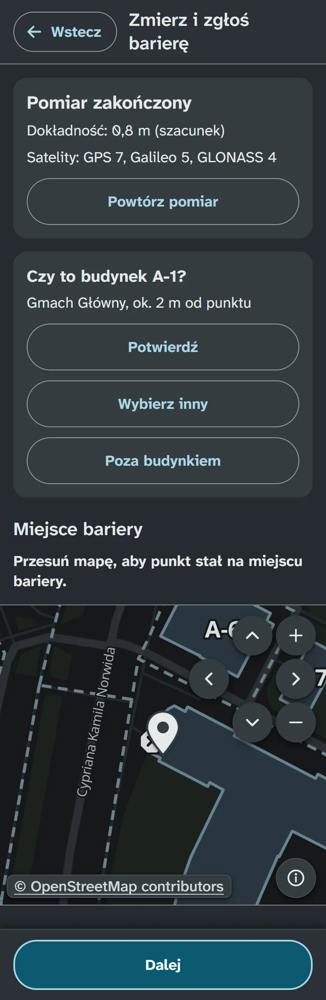{: width="240" loading="lazy" }](obrazy/m-c1-pomiar-pozycji-podpowiedz-ciemny.webp) | [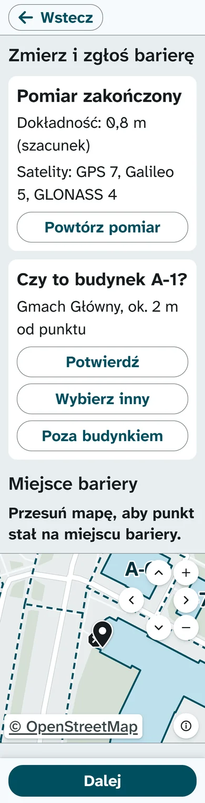{: width="240" loading="lazy" }](obrazy/m-c1-pomiar-pozycji-podpowiedz-jasny-200.webp) |

### C1: wybór innego budynku

`m-c1-pomiar-pozycji-wybor-budynku` · [makieta low-fi](../makiety/zespol-w-terenie.md#wybor-innego-budynku) · odwołania: US6.2, BR-G2, NFR-4

| Jasny | Ciemny | Czcionka 200% |
| --- | --- | --- |
| [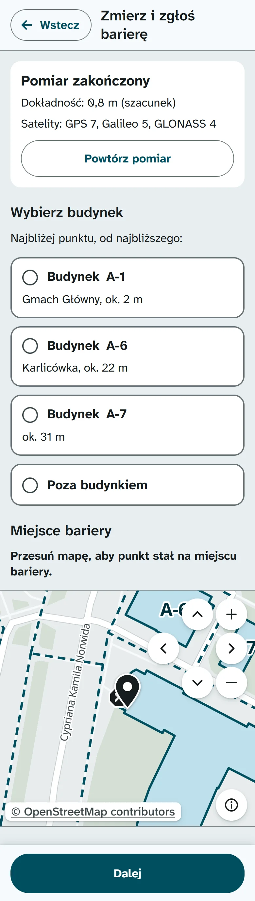{: width="240" loading="lazy" }](obrazy/m-c1-pomiar-pozycji-wybor-budynku-jasny.webp) | [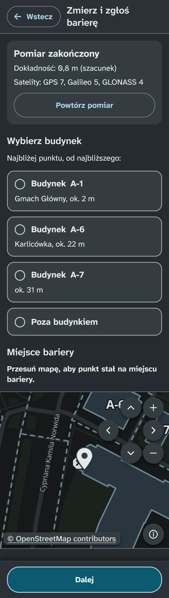{: width="240" loading="lazy" }](obrazy/m-c1-pomiar-pozycji-wybor-budynku-ciemny.webp) | [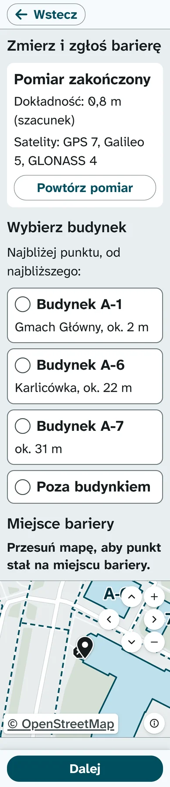{: width="240" loading="lazy" }](obrazy/m-c1-pomiar-pozycji-wybor-budynku-jasny-200.webp) |

### C1: korekta na planie piętra

`m-c1-pomiar-pozycji-korekta` · [makieta low-fi](../makiety/zespol-w-terenie.md#korekta-w-budynku-szczegoowym) · odwołania: US6.3, US6.4, NFR-3, NFR-21, NFR-37, NFR-40, NFR-53

| Jasny | Ciemny | Czcionka 200% |
| --- | --- | --- |
| [{: width="240" loading="lazy" }](obrazy/m-c1-pomiar-pozycji-korekta-jasny.webp) | [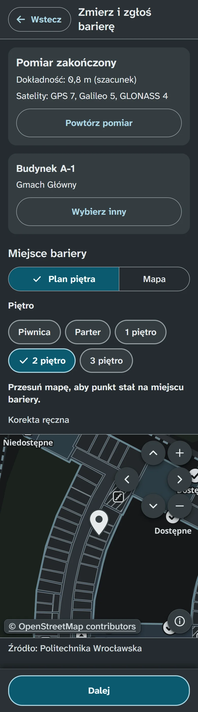{: width="240" loading="lazy" }](obrazy/m-c1-pomiar-pozycji-korekta-ciemny.webp) | [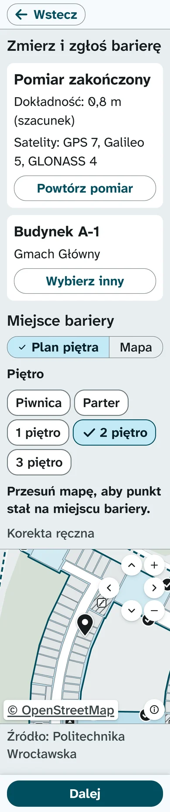{: width="240" loading="lazy" }](obrazy/m-c1-pomiar-pozycji-korekta-jasny-200.webp) |

### C1: budynek bez planu pięter (A-6)

`m-c1-pomiar-pozycji-podstawowy` · odwołania: US6.4, BR-G1, PW-6, NFR-53

| Jasny | Ciemny | Czcionka 200% |
| --- | --- | --- |
| [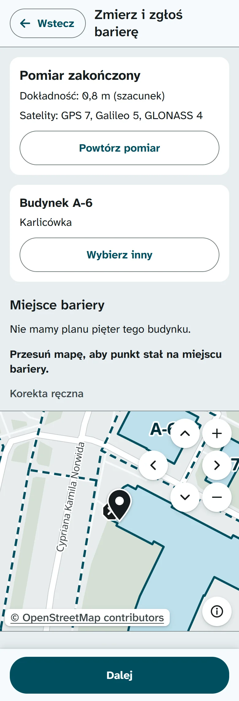{: width="240" loading="lazy" }](obrazy/m-c1-pomiar-pozycji-podstawowy-jasny.webp) | [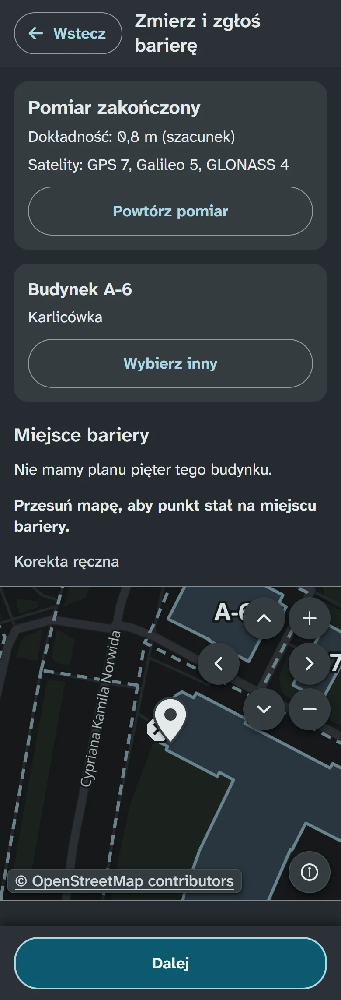{: width="240" loading="lazy" }](obrazy/m-c1-pomiar-pozycji-podstawowy-ciemny.webp) | [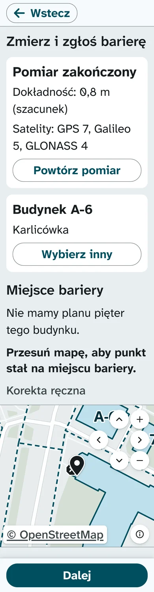{: width="240" loading="lazy" }](obrazy/m-c1-pomiar-pozycji-podstawowy-jasny-200.webp) |

### C1: poza budynkiem, bez internetu

`m-c1-pomiar-pozycji-poza-budynkiem` · [makieta low-fi](../makiety/zespol-w-terenie.md#daleko-od-budynkow-bez-internetu) · odwołania: BR-G4, NFR-4, NFR-10, NFR-49

| Jasny | Ciemny | Czcionka 200% |
| --- | --- | --- |
| [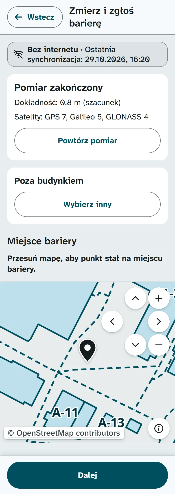{: width="240" loading="lazy" }](obrazy/m-c1-pomiar-pozycji-poza-budynkiem-jasny.webp) | [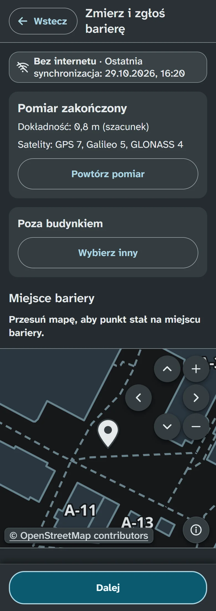{: width="240" loading="lazy" }](obrazy/m-c1-pomiar-pozycji-poza-budynkiem-ciemny.webp) | [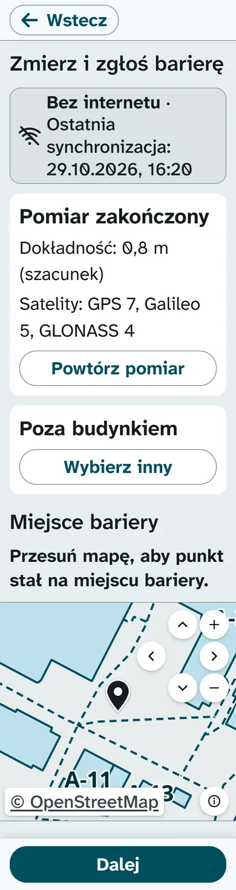{: width="240" loading="lazy" }](obrazy/m-c1-pomiar-pozycji-poza-budynkiem-jasny-200.webp) |

### C1: szukanie satelitów

`m-c1-pomiar-pozycji-szukanie` · [makieta low-fi](../makiety/zespol-w-terenie.md#szukanie-satelitow) · odwołania: NFR-1, PW-9

| Jasny | Ciemny | Czcionka 200% |
| --- | --- | --- |
| [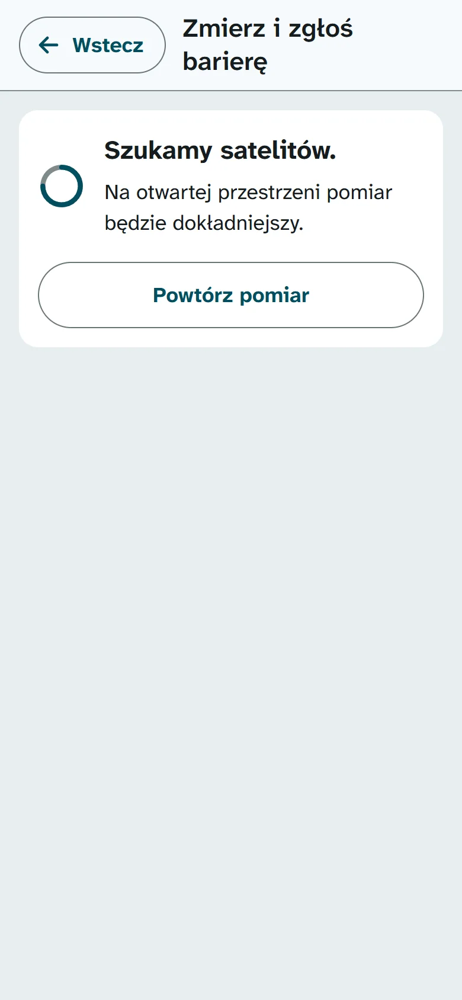{: width="240" loading="lazy" }](obrazy/m-c1-pomiar-pozycji-szukanie-jasny.webp) | [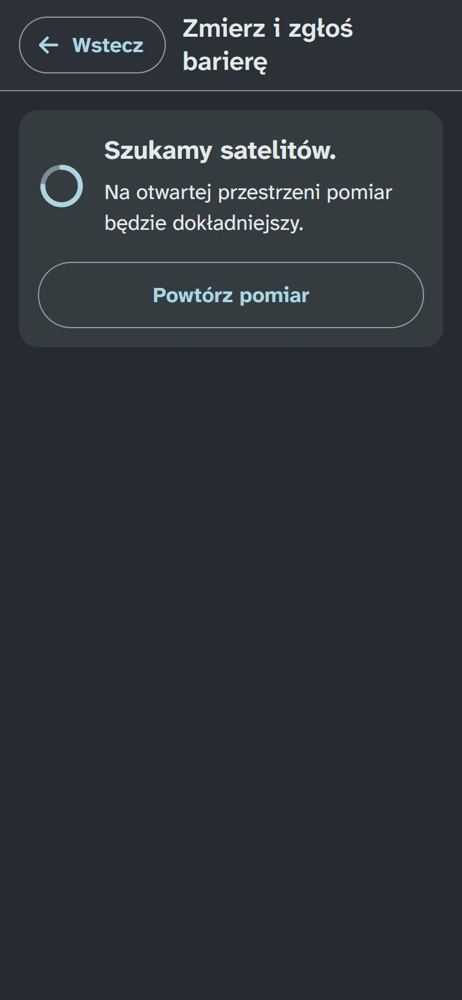{: width="240" loading="lazy" }](obrazy/m-c1-pomiar-pozycji-szukanie-ciemny.webp) | [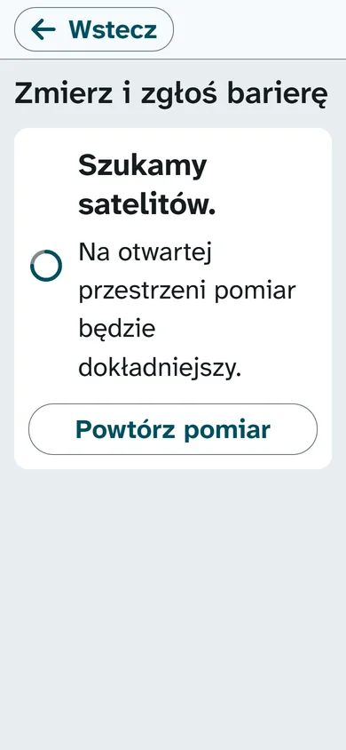{: width="240" loading="lazy" }](obrazy/m-c1-pomiar-pozycji-szukanie-jasny-200.webp) |

### C1: brak zgody na lokalizację

`m-c1-pomiar-pozycji-brak-zgody` · [makieta low-fi](../makiety/zespol-w-terenie.md#brak-zgody-na-lokalizacje) · odwołania: NFR-15, NFR-27

| Jasny | Ciemny | Czcionka 200% |
| --- | --- | --- |
| [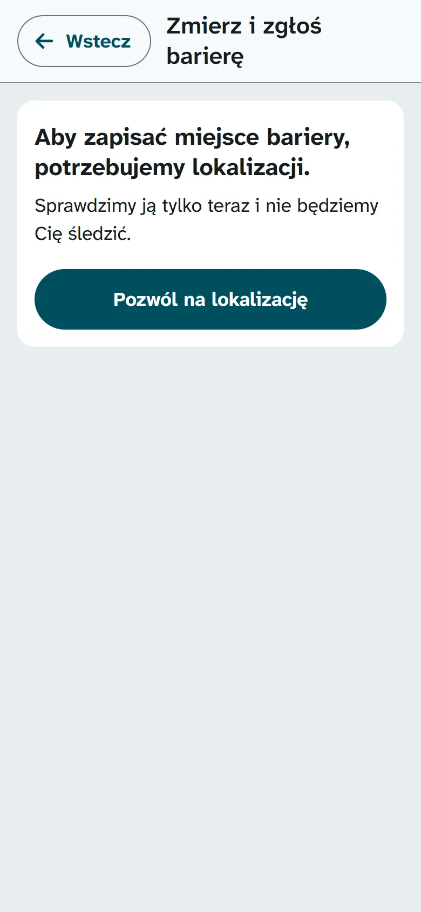{: width="240" loading="lazy" }](obrazy/m-c1-pomiar-pozycji-brak-zgody-jasny.webp) | [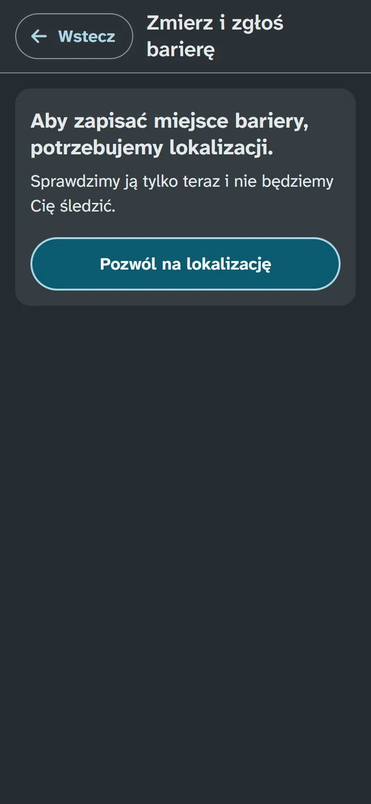{: width="240" loading="lazy" }](obrazy/m-c1-pomiar-pozycji-brak-zgody-ciemny.webp) | [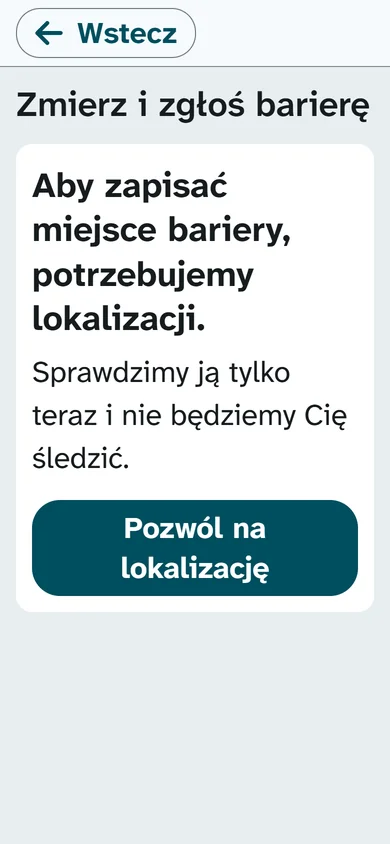{: width="240" loading="lazy" }](obrazy/m-c1-pomiar-pozycji-brak-zgody-jasny-200.webp) |

## C2 Formularz zgłoszenia

Pierwszą wersję makiet C2 właściciel zatwierdził w październiku. Listopadowa aktualizacja pokazuje sześć stanów formularza według kodu aplikacji.

Przycisk „Wybierz typ bariery” otwiera panel na cały ekran. „Zapisz” pozostaje na dole także przy czcionce 200%.

Długie obrazy pokazują całą przewijaną treść. W aplikacji widać jej fragment nad przypiętym przyciskiem.
Makiety pokazują docelowy obrys przycisków zdjęcia i ponowienia zapisu.

Wymagania: [C2 Formularz zgłoszenia](../wymagania-ekranow.md#c2-formularz-zgoszenia). Nagłówek w aplikacji: „Opisz barierę”, przy edycji „Popraw zgłoszenie”.

### C2: nowe zgłoszenie

`m-c2-formularz-zgloszenia` · [makieta low-fi](../makiety/zespol-w-terenie.md#nowe-zgoszenie-w-budynku-szczegoowym) · odwołania: US7.1, US7.2, US7.3, US7.4, NFR-19, NFR-21, NFR-25, PW-8, PW-13

| Jasny | Ciemny | Czcionka 200% |
| --- | --- | --- |
| [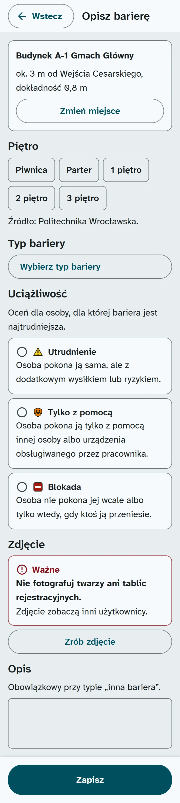{: width="240" loading="lazy" }](obrazy/m-c2-formularz-zgloszenia-jasny.webp) | [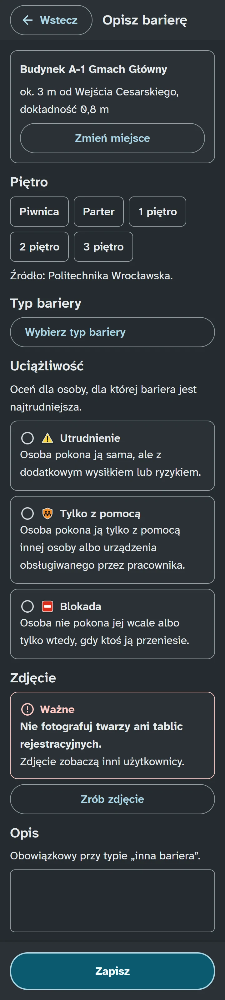{: width="240" loading="lazy" }](obrazy/m-c2-formularz-zgloszenia-ciemny.webp) | [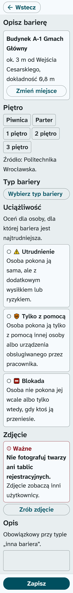{: width="240" loading="lazy" }](obrazy/m-c2-formularz-zgloszenia-jasny-200.webp) |

### C2: edycja w budynku bez planu (C-13)

`m-c2-formularz-zgloszenia-edycja` · [makieta low-fi](../makiety/zespol-w-terenie.md#edycja-w-budynku-podstawowym) · odwołania: US8.3, US7.2, US7.3, BR-G1, PW-6

| Jasny | Ciemny | Czcionka 200% |
| --- | --- | --- |
| [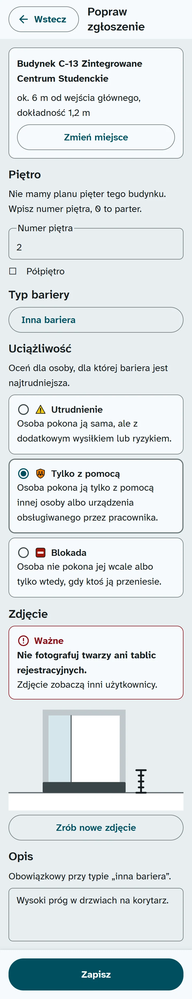{: width="240" loading="lazy" }](obrazy/m-c2-formularz-zgloszenia-edycja-jasny.webp) | [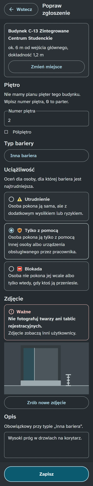{: width="240" loading="lazy" }](obrazy/m-c2-formularz-zgloszenia-edycja-ciemny.webp) | [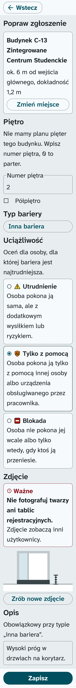{: width="240" loading="lazy" }](obrazy/m-c2-formularz-zgloszenia-edycja-jasny-200.webp) |

### C2: błąd walidacji

`m-c2-formularz-zgloszenia-blad` · [makieta low-fi](../makiety/zespol-w-terenie.md#bad-walidacji) · odwołania: US7.1, NFR-15, PW-10

| Jasny | Ciemny | Czcionka 200% |
| --- | --- | --- |
| [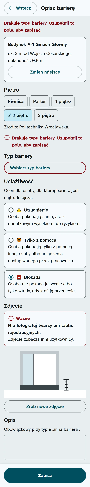{: width="240" loading="lazy" }](obrazy/m-c2-formularz-zgloszenia-blad-jasny.webp) | [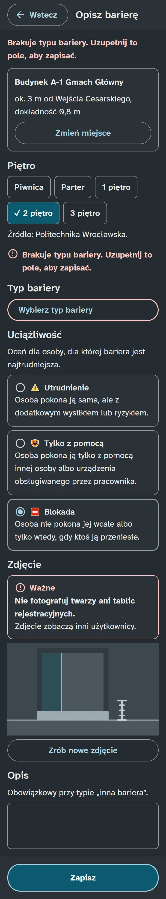{: width="240" loading="lazy" }](obrazy/m-c2-formularz-zgloszenia-blad-ciemny.webp) | [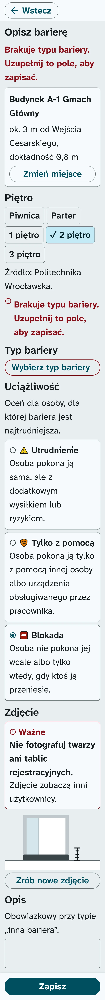{: width="240" loading="lazy" }](obrazy/m-c2-formularz-zgloszenia-blad-jasny-200.webp) |

### C2: zmiana zgłoszenia przyjętego

`m-c2-formularz-zgloszenia-przyjete` · odwołania: BR-18, US8.3

| Jasny | Ciemny | Czcionka 200% |
| --- | --- | --- |
| [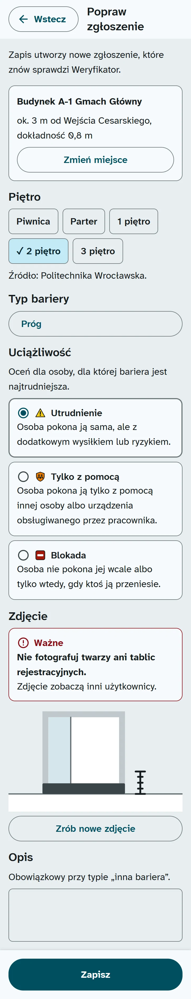{: width="240" loading="lazy" }](obrazy/m-c2-formularz-zgloszenia-przyjete-jasny.webp) | [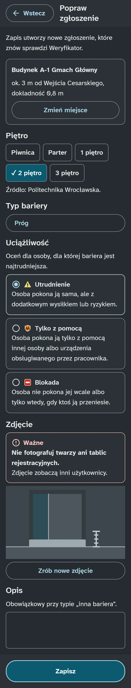{: width="240" loading="lazy" }](obrazy/m-c2-formularz-zgloszenia-przyjete-ciemny.webp) | [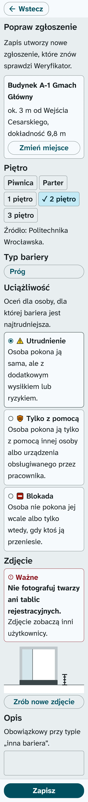{: width="240" loading="lazy" }](obrazy/m-c2-formularz-zgloszenia-przyjete-jasny-200.webp) |

### C2: wyjście bez zapisu

`m-c2-formularz-zgloszenia-wyjscie` · odwołania: US7.4, NFR-23

| Jasny | Ciemny | Czcionka 200% |
| --- | --- | --- |
| [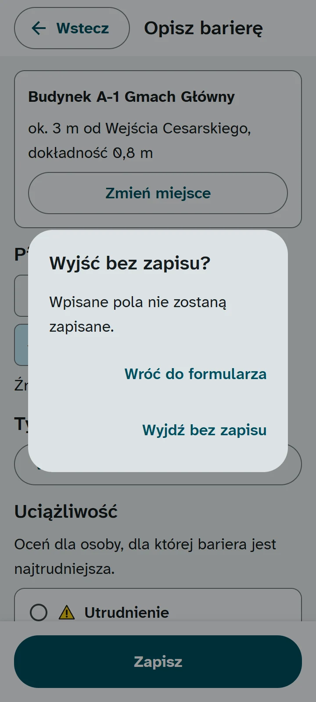{: width="240" loading="lazy" }](obrazy/m-c2-formularz-zgloszenia-wyjscie-jasny.webp) | [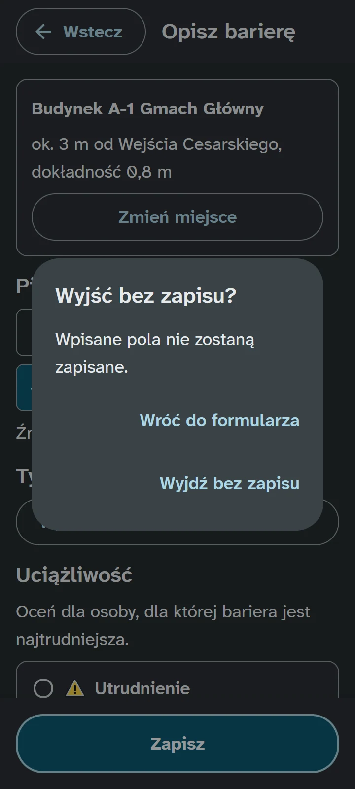{: width="240" loading="lazy" }](obrazy/m-c2-formularz-zgloszenia-wyjscie-ciemny.webp) | [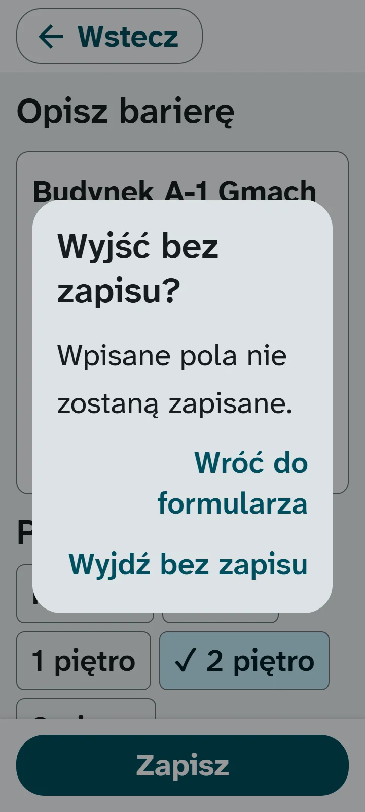{: width="240" loading="lazy" }](obrazy/m-c2-formularz-zgloszenia-wyjscie-jasny-200.webp) |

### C2: błąd zapisu

`m-c2-formularz-zgloszenia-blad-zapisu` · odwołania: NFR-7, PW-10

| Jasny | Ciemny | Czcionka 200% |
| --- | --- | --- |
| [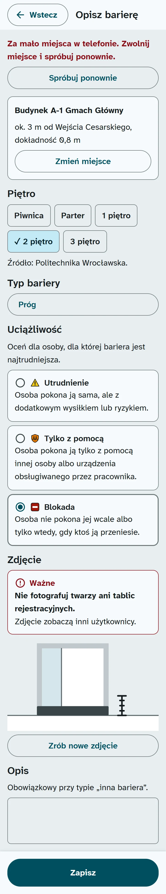{: width="240" loading="lazy" }](obrazy/m-c2-formularz-zgloszenia-blad-zapisu-jasny.webp) | [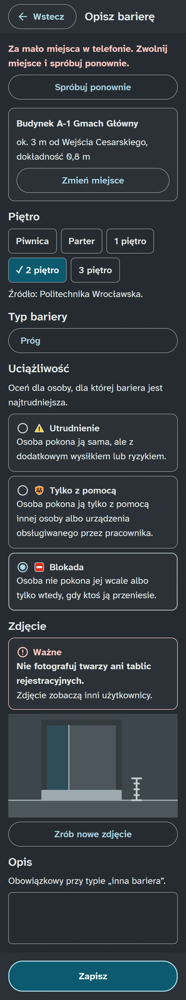{: width="240" loading="lazy" }](obrazy/m-c2-formularz-zgloszenia-blad-zapisu-ciemny.webp) | [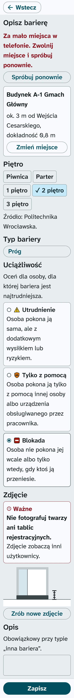{: width="240" loading="lazy" }](obrazy/m-c2-formularz-zgloszenia-blad-zapisu-jasny-200.webp) |

## C3 Moje zgłoszenia

Makiety hi-fi C3 zatwierdził właściciel projektu 30.10.2026 razem z całą partią 2 (C1–C7, R1–R2, K1–K3). Według nich powstaje kod ekranu.

Wymagania: [C3 Moje zgłoszenia](../wymagania-ekranow.md#c3-moje-zgoszenia). Nagłówek w aplikacji: „Moje zgłoszenia”.

### C3: lista zgłoszeń

`m-c3-moje-zgloszenia` · [makieta low-fi](../makiety/zespol-w-terenie.md#lista-zgoszen) · odwołania: US8.1, US8.2, US8.4, US9.1, US17.2, BR-16, NFR-21, PW-12

| Jasny | Ciemny | Czcionka 200% |
| --- | --- | --- |
| [![Lista zgłoszeń: Czeka na wysłanie: 2 i przycisk wypełniony Zmierz i zgłoś barierę, potem karty z ramką, w każdej status słowem z ikoną, typ, Budynek i piętro, data: W telefonie, Bariery już nie ma, Niesprawna winda z Otwórz ze strzałką; Odrzucone, Próg z Powód odrzucenia: Zdjęcie nie pokazuje progu i Otwórz; W weryfikacji, Zmiana czeka na wysłanie, Ciężkie drzwi; Wysłane, Próg z jedną czynnością „Dwie wersje: wybierz jedną” ze strzałką; Przyjęte, Schody przy wejściu bez przycisku; Archiwalne, Zmiana oznaczenia wejścia z Nowe oznaczenie: Niedostępne](obrazy/m-c3-moje-zgloszenia-jasny.webp){: width="240" loading="lazy" }](obrazy/m-c3-moje-zgloszenia-jasny.webp) | [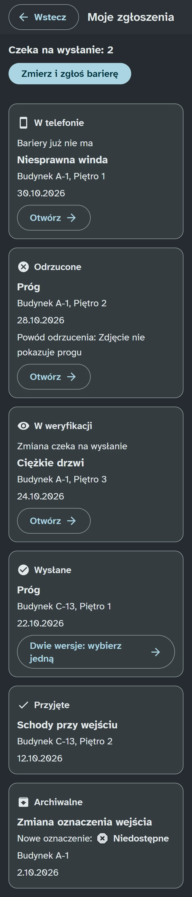{: width="240" loading="lazy" }](obrazy/m-c3-moje-zgloszenia-ciemny.webp) | [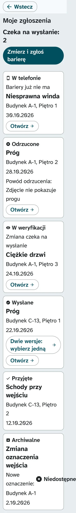{: width="240" loading="lazy" }](obrazy/m-c3-moje-zgloszenia-jasny-200.webp) |

### C3: odrzucone jako „Nieaktualne”

`m-c3-moje-zgloszenia-nieaktualne` · [makieta low-fi](../makiety/zespol-w-terenie.md#odrzucone-jako-nieaktualne) · odwołania: BR-23, BR-24, PW-12, PW-14

| Jasny | Ciemny | Czcionka 200% |
| --- | --- | --- |
| [{: width="240" loading="lazy" }](obrazy/m-c3-moje-zgloszenia-nieaktualne-jasny.webp) | [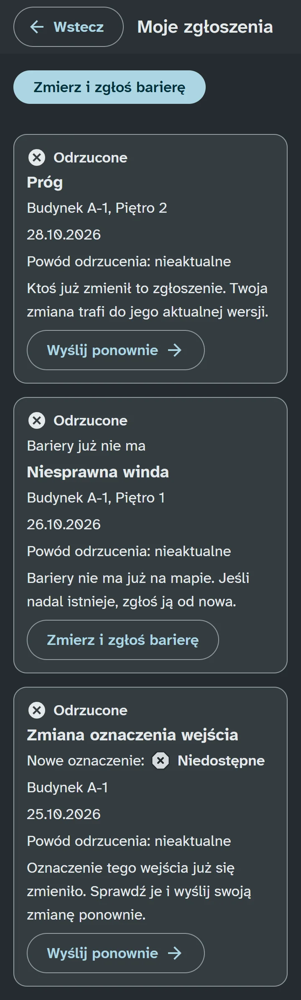{: width="240" loading="lazy" }](obrazy/m-c3-moje-zgloszenia-nieaktualne-ciemny.webp) | [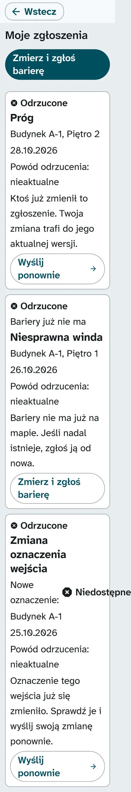{: width="240" loading="lazy" }](obrazy/m-c3-moje-zgloszenia-nieaktualne-jasny-200.webp) |

### C3: pusta lista

`m-c3-moje-zgloszenia-pusty` · [makieta low-fi](../makiety/zespol-w-terenie.md#pusta-lista) · odwołania: PW-12

| Jasny | Ciemny | Czcionka 200% |
| --- | --- | --- |
| [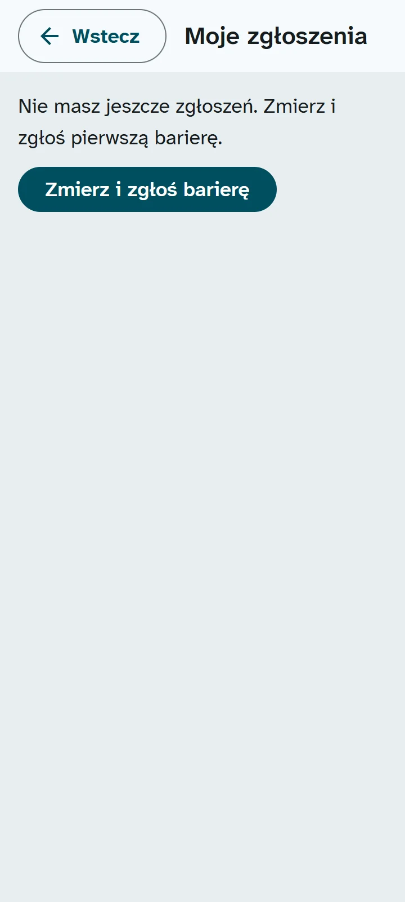{: width="240" loading="lazy" }](obrazy/m-c3-moje-zgloszenia-pusty-jasny.webp) | [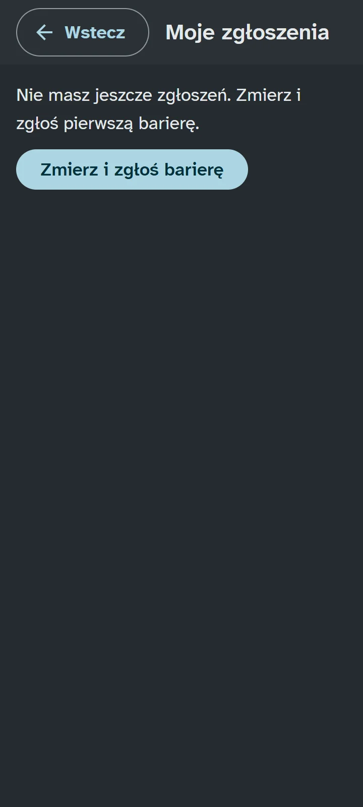{: width="240" loading="lazy" }](obrazy/m-c3-moje-zgloszenia-pusty-ciemny.webp) | [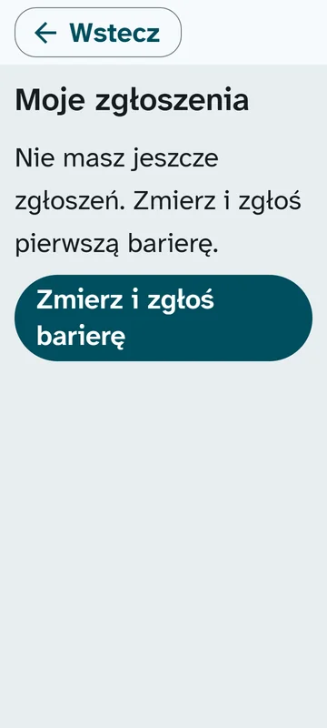{: width="240" loading="lazy" }](obrazy/m-c3-moje-zgloszenia-pusty-jasny-200.webp) |

### C3: sprawdzanie statusów

`m-c3-moje-zgloszenia-ladowanie` · odwołania: US8.1, PW-9

| Jasny | Ciemny | Czcionka 200% |
| --- | --- | --- |
| [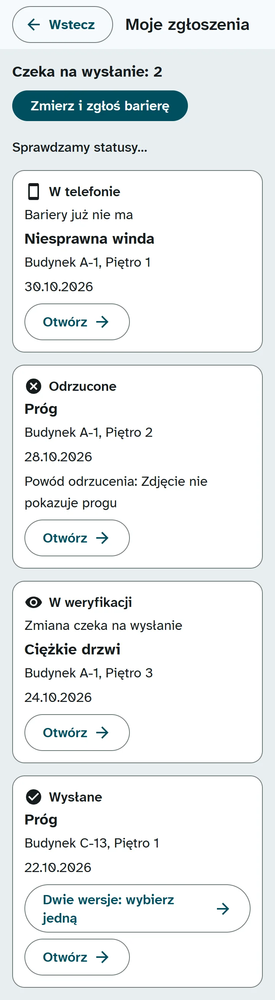{: width="240" loading="lazy" }](obrazy/m-c3-moje-zgloszenia-ladowanie-jasny.webp) | [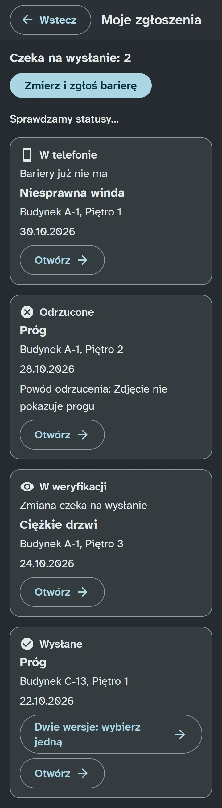{: width="240" loading="lazy" }](obrazy/m-c3-moje-zgloszenia-ladowanie-ciemny.webp) | [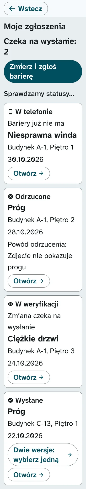{: width="240" loading="lazy" }](obrazy/m-c3-moje-zgloszenia-ladowanie-jasny-200.webp) |

### C3: bez internetu

`m-c3-moje-zgloszenia-brak-sieci` · odwołania: US9.1, NFR-10

| Jasny | Ciemny | Czcionka 200% |
| --- | --- | --- |
| [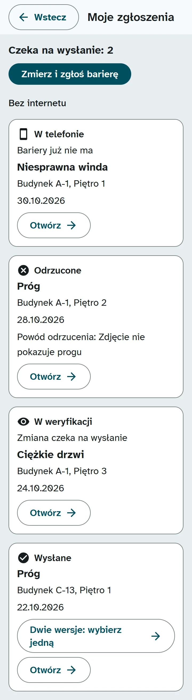{: width="240" loading="lazy" }](obrazy/m-c3-moje-zgloszenia-brak-sieci-jasny.webp) | [{: width="240" loading="lazy" }](obrazy/m-c3-moje-zgloszenia-brak-sieci-ciemny.webp) | [{: width="240" loading="lazy" }](obrazy/m-c3-moje-zgloszenia-brak-sieci-jasny-200.webp) |

### C3: błąd sprawdzania statusów

`m-c3-moje-zgloszenia-blad` · odwołania: NFR-5, NFR-50, PW-10

| Jasny | Ciemny | Czcionka 200% |
| --- | --- | --- |
| [{: width="240" loading="lazy" }](obrazy/m-c3-moje-zgloszenia-blad-jasny.webp) | [{: width="240" loading="lazy" }](obrazy/m-c3-moje-zgloszenia-blad-ciemny.webp) | [{: width="240" loading="lazy" }](obrazy/m-c3-moje-zgloszenia-blad-jasny-200.webp) |

## C4 Synchronizacja i wybór wersji

Wymagania: [C4 Synchronizacja i wybór wersji](../wymagania-ekranow.md#c4-synchronizacja-i-wybor-wersji). Nagłówek w aplikacji: „Synchronizacja”.

### C4: kolejka w telefonie

`m-c4-synchronizacja` · [makieta low-fi](../makiety/zespol-w-terenie.md#kolejka-w-telefonie) · odwołania: US9.1, US9.2, BR-9, NFR-10

| Jasny | Ciemny | Czcionka 200% |
| --- | --- | --- |
| [{: width="240" loading="lazy" }](obrazy/m-c4-synchronizacja-jasny.webp) | [{: width="240" loading="lazy" }](obrazy/m-c4-synchronizacja-ciemny.webp) | [{: width="240" loading="lazy" }](obrazy/m-c4-synchronizacja-jasny-200.webp) |

### C4: konflikt wersji

`m-c4-synchronizacja-konflikt` · [makieta low-fi](../makiety/zespol-w-terenie.md#konflikt-wersji) · odwołania: US9.3, BR-10, NFR-21, NFR-52, NFR-54, PW-12

| Jasny | Ciemny | Czcionka 200% |
| --- | --- | --- |
| [{: width="240" loading="lazy" }](obrazy/m-c4-synchronizacja-konflikt-jasny.webp) | [{: width="240" loading="lazy" }](obrazy/m-c4-synchronizacja-konflikt-ciemny.webp) | [{: width="240" loading="lazy" }](obrazy/m-c4-synchronizacja-konflikt-jasny-200.webp) |

### C4: wszystko wysłane

`m-c4-synchronizacja-pusty` · odwołania: US9.1, NFR-10

| Jasny | Ciemny | Czcionka 200% |
| --- | --- | --- |
| [{: width="240" loading="lazy" }](obrazy/m-c4-synchronizacja-pusty-jasny.webp) | [{: width="240" loading="lazy" }](obrazy/m-c4-synchronizacja-pusty-ciemny.webp) | [{: width="240" loading="lazy" }](obrazy/m-c4-synchronizacja-pusty-jasny-200.webp) |

### C4: wysyłanie

`m-c4-synchronizacja-ladowanie` · odwołania: US9.2, PW-9

| Jasny | Ciemny | Czcionka 200% |
| --- | --- | --- |
| [{: width="240" loading="lazy" }](obrazy/m-c4-synchronizacja-ladowanie-jasny.webp) | [{: width="240" loading="lazy" }](obrazy/m-c4-synchronizacja-ladowanie-ciemny.webp) | [{: width="240" loading="lazy" }](obrazy/m-c4-synchronizacja-ladowanie-jasny-200.webp) |

### C4: bez internetu

`m-c4-synchronizacja-brak-sieci` · odwołania: US9.1, US9.2, NFR-10

| Jasny | Ciemny | Czcionka 200% |
| --- | --- | --- |
| [{: width="240" loading="lazy" }](obrazy/m-c4-synchronizacja-brak-sieci-jasny.webp) | [{: width="240" loading="lazy" }](obrazy/m-c4-synchronizacja-brak-sieci-ciemny.webp) | [{: width="240" loading="lazy" }](obrazy/m-c4-synchronizacja-brak-sieci-jasny-200.webp) |

### C4: błąd serwera

`m-c4-synchronizacja-blad` · odwołania: NFR-50, PW-10

| Jasny | Ciemny | Czcionka 200% |
| --- | --- | --- |
| [{: width="240" loading="lazy" }](obrazy/m-c4-synchronizacja-blad-jasny.webp) | [{: width="240" loading="lazy" }](obrazy/m-c4-synchronizacja-blad-ciemny.webp) | [{: width="240" loading="lazy" }](obrazy/m-c4-synchronizacja-blad-jasny-200.webp) |

### C4: wygasłe logowanie

`m-c4-synchronizacja-logowanie` · odwołania: US9.4, US14.4, BR-26, PW-10

| Jasny | Ciemny | Czcionka 200% |
| --- | --- | --- |
| [{: width="240" loading="lazy" }](obrazy/m-c4-synchronizacja-logowanie-jasny.webp) | [{: width="240" loading="lazy" }](obrazy/m-c4-synchronizacja-logowanie-ciemny.webp) | [{: width="240" loading="lazy" }](obrazy/m-c4-synchronizacja-logowanie-jasny-200.webp) |

### C4: mało miejsca w telefonie

`m-c4-synchronizacja-malo-miejsca` · odwołania: NFR-7, PW-10

| Jasny | Ciemny | Czcionka 200% |
| --- | --- | --- |
| [{: width="240" loading="lazy" }](obrazy/m-c4-synchronizacja-malo-miejsca-jasny.webp) | [{: width="240" loading="lazy" }](obrazy/m-c4-synchronizacja-malo-miejsca-ciemny.webp) | [{: width="240" loading="lazy" }](obrazy/m-c4-synchronizacja-malo-miejsca-jasny-200.webp) |

## C5 Piętra obejrzane

Wymagania: [C5 Piętra obejrzane](../wymagania-ekranow.md#c5-pietra-obejrzane). Nagłówek w aplikacji: „Obejrzane piętra”.

### C5: Zbierający, budynek A-1

`m-c5-obejrzane-pietra` · [makieta low-fi](../makiety/zespol-w-terenie.md#zbierajacy-budynek-szczegoowy) · odwołania: US15.1, US15.2, US15.3, US16.1, BR-5, PW-11

| Jasny | Ciemny | Czcionka 200% |
| --- | --- | --- |
| [{: width="240" loading="lazy" }](obrazy/m-c5-obejrzane-pietra-jasny.webp) | [{: width="240" loading="lazy" }](obrazy/m-c5-obejrzane-pietra-ciemny.webp) | [{: width="240" loading="lazy" }](obrazy/m-c5-obejrzane-pietra-jasny-200.webp) |

### C5: Zbierający, potwierdzenie cofnięcia

`m-c5-obejrzane-pietra-potwierdzenie` · [makieta low-fi](../makiety/zespol-w-terenie.md#zbierajacy-potwierdzenie-cofniecia) · odwołania: US15.2, BR-20, PW-12

| Jasny | Ciemny | Czcionka 200% |
| --- | --- | --- |
| [{: width="240" loading="lazy" }](obrazy/m-c5-obejrzane-pietra-potwierdzenie-jasny.webp) | [{: width="240" loading="lazy" }](obrazy/m-c5-obejrzane-pietra-potwierdzenie-ciemny.webp) | [{: width="240" loading="lazy" }](obrazy/m-c5-obejrzane-pietra-potwierdzenie-jasny-200.webp) |

### C5: Koordynator, autorzy znaczników

`m-c5-obejrzane-pietra-koordynator` · [makieta low-fi](../makiety/zespol-w-terenie.md#koordynator-potwierdzenie-cofniecia) · odwołania: US11.3, BR-5, BR-20

| Jasny | Ciemny | Czcionka 200% |
| --- | --- | --- |
| [{: width="240" loading="lazy" }](obrazy/m-c5-obejrzane-pietra-koordynator-jasny.webp) | [{: width="240" loading="lazy" }](obrazy/m-c5-obejrzane-pietra-koordynator-ciemny.webp) | [{: width="240" loading="lazy" }](obrazy/m-c5-obejrzane-pietra-koordynator-jasny-200.webp) |

### C5: budynek bez planu (A-6), bez internetu

`m-c5-obejrzane-pietra-podstawowy-brak-sieci` · [makieta low-fi](../makiety/zespol-w-terenie.md#budynek-podstawowy-bez-internetu) · odwołania: US15.1, US15.3, BR-20, NFR-10

| Jasny | Ciemny | Czcionka 200% |
| --- | --- | --- |
| [{: width="240" loading="lazy" }](obrazy/m-c5-obejrzane-pietra-podstawowy-brak-sieci-jasny.webp) | [{: width="240" loading="lazy" }](obrazy/m-c5-obejrzane-pietra-podstawowy-brak-sieci-ciemny.webp) | [{: width="240" loading="lazy" }](obrazy/m-c5-obejrzane-pietra-podstawowy-brak-sieci-jasny-200.webp) |

### C5: błąd zapisu znacznika

`m-c5-obejrzane-pietra-blad-zapisu` · odwołania: NFR-7, PW-10

| Jasny | Ciemny | Czcionka 200% |
| --- | --- | --- |
| [{: width="240" loading="lazy" }](obrazy/m-c5-obejrzane-pietra-blad-zapisu-jasny.webp) | [{: width="240" loading="lazy" }](obrazy/m-c5-obejrzane-pietra-blad-zapisu-ciemny.webp) | [{: width="240" loading="lazy" }](obrazy/m-c5-obejrzane-pietra-blad-zapisu-jasny-200.webp) |

## C6 Zmiana oznaczenia wejścia

Wymagania: [C6 Zmiana oznaczenia wejścia](../wymagania-ekranow.md#c6-zmiana-oznaczenia-wejscia). Nagłówek w aplikacji: „Zmień oznaczenie wejścia”.

### C6: przed wyborem

`m-c6-zmien-oznaczenie-wejscia` · [makieta low-fi](../makiety/zespol-w-terenie.md#przed-wyborem) · odwołania: US17.2, US17.3, BR-4, BR-24, NFR-17, NFR-21, NFR-25, PW-3, PW-8

| Jasny | Ciemny | Czcionka 200% |
| --- | --- | --- |
| [{: width="240" loading="lazy" }](obrazy/m-c6-zmien-oznaczenie-wejscia-jasny.webp) | [{: width="240" loading="lazy" }](obrazy/m-c6-zmien-oznaczenie-wejscia-ciemny.webp) | [{: width="240" loading="lazy" }](obrazy/m-c6-zmien-oznaczenie-wejscia-jasny-200.webp) |

### C6: potwierdzenie obecnego oznaczenia

`m-c6-zmien-oznaczenie-wejscia-obecna` · [makieta low-fi](../makiety/zespol-w-terenie.md#potwierdzenie-obecnego-oznaczenia) · odwołania: BR-24, US17.2

| Jasny | Ciemny | Czcionka 200% |
| --- | --- | --- |
| [{: width="240" loading="lazy" }](obrazy/m-c6-zmien-oznaczenie-wejscia-obecna-jasny.webp) | [{: width="240" loading="lazy" }](obrazy/m-c6-zmien-oznaczenie-wejscia-obecna-ciemny.webp) | [{: width="240" loading="lazy" }](obrazy/m-c6-zmien-oznaczenie-wejscia-obecna-jasny-200.webp) |

### C6: błąd walidacji

`m-c6-zmien-oznaczenie-wejscia-walidacja` · odwołania: BR-24, NFR-15, PW-10

| Jasny | Ciemny | Czcionka 200% |
| --- | --- | --- |
| [{: width="240" loading="lazy" }](obrazy/m-c6-zmien-oznaczenie-wejscia-walidacja-jasny.webp) | [{: width="240" loading="lazy" }](obrazy/m-c6-zmien-oznaczenie-wejscia-walidacja-ciemny.webp) | [{: width="240" loading="lazy" }](obrazy/m-c6-zmien-oznaczenie-wejscia-walidacja-jasny-200.webp) |

### C6: błąd zapisu

`m-c6-zmien-oznaczenie-wejscia-blad-zapisu` · odwołania: NFR-7, PW-10

| Jasny | Ciemny | Czcionka 200% |
| --- | --- | --- |
| [{: width="240" loading="lazy" }](obrazy/m-c6-zmien-oznaczenie-wejscia-blad-zapisu-jasny.webp) | [{: width="240" loading="lazy" }](obrazy/m-c6-zmien-oznaczenie-wejscia-blad-zapisu-ciemny.webp) | [{: width="240" loading="lazy" }](obrazy/m-c6-zmien-oznaczenie-wejscia-blad-zapisu-jasny-200.webp) |

### C6: po wysłaniu bez internetu (C3)

`m-c6-zmien-oznaczenie-wejscia-brak-sieci` · odwołania: US9.1, NFR-54

| Jasny | Ciemny | Czcionka 200% |
| --- | --- | --- |
| [{: width="240" loading="lazy" }](obrazy/m-c6-zmien-oznaczenie-wejscia-brak-sieci-jasny.webp) | [{: width="240" loading="lazy" }](obrazy/m-c6-zmien-oznaczenie-wejscia-brak-sieci-ciemny.webp) | [{: width="240" loading="lazy" }](obrazy/m-c6-zmien-oznaczenie-wejscia-brak-sieci-jasny-200.webp) |

## C7 Usunięcie bariery

Wymagania: [C7 Usunięcie bariery](../wymagania-ekranow.md#c7-usuniecie-bariery). Nagłówek w aplikacji: „Zgłoś, że bariery nie ma”.

### C7: przyjęte zgłoszenie i nowe zdjęcie

`m-c7-bariery-nie-ma` · [makieta low-fi](../makiety/zespol-w-terenie.md#c7-zgos-ze-bariery-nie-ma) · odwołania: US8.4, BR-19, NFR-25, NFR-54, PW-8

| Jasny | Ciemny | Czcionka 200% |
| --- | --- | --- |
| [{: width="240" loading="lazy" }](obrazy/m-c7-bariery-nie-ma-jasny.webp) | [{: width="240" loading="lazy" }](obrazy/m-c7-bariery-nie-ma-ciemny.webp) | [{: width="240" loading="lazy" }](obrazy/m-c7-bariery-nie-ma-jasny-200.webp) |

### C7: błąd walidacji

`m-c7-bariery-nie-ma-walidacja` · odwołania: BR-19, NFR-15, PW-10

| Jasny | Ciemny | Czcionka 200% |
| --- | --- | --- |
| [{: width="240" loading="lazy" }](obrazy/m-c7-bariery-nie-ma-walidacja-jasny.webp) | [{: width="240" loading="lazy" }](obrazy/m-c7-bariery-nie-ma-walidacja-ciemny.webp) | [{: width="240" loading="lazy" }](obrazy/m-c7-bariery-nie-ma-walidacja-jasny-200.webp) |

### C7: błąd zapisu

`m-c7-bariery-nie-ma-blad-zapisu` · odwołania: NFR-7, PW-10

| Jasny | Ciemny | Czcionka 200% |
| --- | --- | --- |
| [{: width="240" loading="lazy" }](obrazy/m-c7-bariery-nie-ma-blad-zapisu-jasny.webp) | [{: width="240" loading="lazy" }](obrazy/m-c7-bariery-nie-ma-blad-zapisu-ciemny.webp) | [{: width="240" loading="lazy" }](obrazy/m-c7-bariery-nie-ma-blad-zapisu-jasny-200.webp) |

### C7: po wysłaniu bez internetu (C3)

`m-c7-bariery-nie-ma-brak-sieci` · odwołania: US8.4, US9.1, NFR-54

| Jasny | Ciemny | Czcionka 200% |
| --- | --- | --- |
| [{: width="240" loading="lazy" }](obrazy/m-c7-bariery-nie-ma-brak-sieci-jasny.webp) | [{: width="240" loading="lazy" }](obrazy/m-c7-bariery-nie-ma-brak-sieci-ciemny.webp) | [{: width="240" loading="lazy" }](obrazy/m-c7-bariery-nie-ma-brak-sieci-jasny-200.webp) |

## R1 Kolejka weryfikacji

Wymagania: [R1 Kolejka weryfikacji](../wymagania-ekranow.md#r1-kolejka-weryfikacji). Nagłówek w aplikacji: „Zgłoszenia do sprawdzenia”.

### R1: lista do sprawdzenia

`m-r1-kolejka-weryfikacji` · [makieta low-fi](../makiety/weryfikacja-koordynacja.md#r1-kolejka-weryfikacji) · odwołania: US10.4, US10.5, US10.7, BR-4, BR-11, BR-14, BR-24, NFR-21

| Jasny | Ciemny | Czcionka 200% |
| --- | --- | --- |
| [![Lista: sekcja Wzięte przeze mnie z kartą z ramką Schody przy wejściu, Budynek A-1, Zgłoszenie z pomiaru, Wysłane 26.10.2026 i przyciskiem obrysowanym Otwórz ze strzałką, nagłówek Do sprawdzenia, przełącznik Mapa i Lista z wybraną listą, cztery karty od najdawniej wysłanego zgłoszenia: Próg w C-13, Schody i windy w C-6 jako zgłoszenie szybkie, Niesprawna winda w A-1 z Bariery już nie ma, Wejście dostosowane w A-1 ze Zmiana oznaczenia wejścia, w każdej z lewej przycisk obrysowany Weź do sprawdzenia](obrazy/m-r1-kolejka-weryfikacji-jasny.webp){: width="240" loading="lazy" }](obrazy/m-r1-kolejka-weryfikacji-jasny.webp) | [{: width="240" loading="lazy" }](obrazy/m-r1-kolejka-weryfikacji-ciemny.webp) | [{: width="240" loading="lazy" }](obrazy/m-r1-kolejka-weryfikacji-jasny-200.webp) |

### R1: widok mapy

`m-r1-kolejka-weryfikacji-mapa` · [makieta low-fi](../makiety/weryfikacja-koordynacja.md#r1-kolejka-weryfikacji) · odwołania: UC14, NFR-18, NFR-19, NFR-21, NFR-37, NFR-40, NFR-53

| Jasny | Ciemny | Czcionka 200% |
| --- | --- | --- |
| [{: width="240" loading="lazy" }](obrazy/m-r1-kolejka-weryfikacji-mapa-jasny.webp) | [{: width="240" loading="lazy" }](obrazy/m-r1-kolejka-weryfikacji-mapa-ciemny.webp) | [{: width="240" loading="lazy" }](obrazy/m-r1-kolejka-weryfikacji-mapa-jasny-200.webp) |

### R1: brak zgłoszeń

`m-r1-kolejka-weryfikacji-pusty` · [makieta low-fi](../makiety/weryfikacja-koordynacja.md#r1-kolejka-weryfikacji) · odwołania: US10.4, PW-10

| Jasny | Ciemny | Czcionka 200% |
| --- | --- | --- |
| [{: width="240" loading="lazy" }](obrazy/m-r1-kolejka-weryfikacji-pusty-jasny.webp) | [{: width="240" loading="lazy" }](obrazy/m-r1-kolejka-weryfikacji-pusty-ciemny.webp) | [{: width="240" loading="lazy" }](obrazy/m-r1-kolejka-weryfikacji-pusty-jasny-200.webp) |

### R1: zgłoszenie zajęte

`m-r1-kolejka-weryfikacji-zajete` · [makieta low-fi](../makiety/weryfikacja-koordynacja.md#r1-kolejka-weryfikacji) · odwołania: BR-11, US10.4

| Jasny | Ciemny | Czcionka 200% |
| --- | --- | --- |
| [{: width="240" loading="lazy" }](obrazy/m-r1-kolejka-weryfikacji-zajete-jasny.webp) | [{: width="240" loading="lazy" }](obrazy/m-r1-kolejka-weryfikacji-zajete-ciemny.webp) | [{: width="240" loading="lazy" }](obrazy/m-r1-kolejka-weryfikacji-zajete-jasny-200.webp) |

### R1: bez internetu

`m-r1-kolejka-weryfikacji-brak-sieci` · [makieta low-fi](../makiety/weryfikacja-koordynacja.md#stany-wspolne) · odwołania: NFR-50, PW-10

| Jasny | Ciemny | Czcionka 200% |
| --- | --- | --- |
| [{: width="240" loading="lazy" }](obrazy/m-r1-kolejka-weryfikacji-brak-sieci-jasny.webp) | [{: width="240" loading="lazy" }](obrazy/m-r1-kolejka-weryfikacji-brak-sieci-ciemny.webp) | [{: width="240" loading="lazy" }](obrazy/m-r1-kolejka-weryfikacji-brak-sieci-jasny-200.webp) |

### R1: wczytywanie

`m-r1-kolejka-weryfikacji-ladowanie` · odwołania: PW-9

| Jasny | Ciemny | Czcionka 200% |
| --- | --- | --- |
| [{: width="240" loading="lazy" }](obrazy/m-r1-kolejka-weryfikacji-ladowanie-jasny.webp) | [{: width="240" loading="lazy" }](obrazy/m-r1-kolejka-weryfikacji-ladowanie-ciemny.webp) | [{: width="240" loading="lazy" }](obrazy/m-r1-kolejka-weryfikacji-ladowanie-jasny-200.webp) |

## R2 Sprawdzenie zgłoszenia

Wymagania: [R2 Sprawdzenie zgłoszenia](../wymagania-ekranow.md#r2-sprawdzenie-zgoszenia). Nagłówek w aplikacji: „Sprawdzenie zgłoszenia”.

### R2: zgłoszenie z pomiaru

`m-r2-sprawdzenie-zgloszenia` · [makieta low-fi](../makiety/weryfikacja-koordynacja.md#r2-sprawdzenie-zgoszenia) · odwołania: US10, US10.1, US10.2, BR-5, BR-13, BR-15, BR-16, NFR-21, NFR-25

| Jasny | Ciemny | Czcionka 200% |
| --- | --- | --- |
| [{: width="240" loading="lazy" }](obrazy/m-r2-sprawdzenie-zgloszenia-jasny.webp) | [{: width="240" loading="lazy" }](obrazy/m-r2-sprawdzenie-zgloszenia-ciemny.webp) | [{: width="240" loading="lazy" }](obrazy/m-r2-sprawdzenie-zgloszenia-jasny-200.webp) |

### R2: duplikat

`m-r2-sprawdzenie-zgloszenia-duplikat` · [makieta low-fi](../makiety/weryfikacja-koordynacja.md#r2-sprawdzenie-zgoszenia) · odwołania: US10.1, US10.2, BR-13, BR-16

| Jasny | Ciemny | Czcionka 200% |
| --- | --- | --- |
| [{: width="240" loading="lazy" }](obrazy/m-r2-sprawdzenie-zgloszenia-duplikat-jasny.webp) | [{: width="240" loading="lazy" }](obrazy/m-r2-sprawdzenie-zgloszenia-duplikat-ciemny.webp) | [{: width="240" loading="lazy" }](obrazy/m-r2-sprawdzenie-zgloszenia-duplikat-jasny-200.webp) |

### R2: zgłoszenie szybkie

`m-r2-sprawdzenie-zgloszenia-szybkie` · [makieta low-fi](../makiety/weryfikacja-koordynacja.md#r2-sprawdzenie-zgoszenia) · odwołania: US10.3, US7.1, BR-14, BR-5, NFR-21, PW-13

| Jasny | Ciemny | Czcionka 200% |
| --- | --- | --- |
| [{: width="240" loading="lazy" }](obrazy/m-r2-sprawdzenie-zgloszenia-szybkie-jasny.webp) | [{: width="240" loading="lazy" }](obrazy/m-r2-sprawdzenie-zgloszenia-szybkie-ciemny.webp) | [{: width="240" loading="lazy" }](obrazy/m-r2-sprawdzenie-zgloszenia-szybkie-jasny-200.webp) |

### R2: bariery już nie ma

`m-r2-sprawdzenie-zgloszenia-usunieta` · [makieta low-fi](../makiety/weryfikacja-koordynacja.md#r2-sprawdzenie-zgoszenia) · odwołania: US10.6, US10.8, BR-19, BR-23, NFR-20, NFR-21

| Jasny | Ciemny | Czcionka 200% |
| --- | --- | --- |
| [{: width="240" loading="lazy" }](obrazy/m-r2-sprawdzenie-zgloszenia-usunieta-jasny.webp) | [{: width="240" loading="lazy" }](obrazy/m-r2-sprawdzenie-zgloszenia-usunieta-ciemny.webp) | [{: width="240" loading="lazy" }](obrazy/m-r2-sprawdzenie-zgloszenia-usunieta-jasny-200.webp) |

### R2: zmiana oznaczenia wejścia

`m-r2-sprawdzenie-zgloszenia-wejscie` · [makieta low-fi](../makiety/weryfikacja-koordynacja.md#r2-sprawdzenie-zgoszenia) · odwołania: US17.2, US17.3, US10.8, BR-23, BR-24, NFR-21, PW-3

| Jasny | Ciemny | Czcionka 200% |
| --- | --- | --- |
| [{: width="240" loading="lazy" }](obrazy/m-r2-sprawdzenie-zgloszenia-wejscie-jasny.webp) | [{: width="240" loading="lazy" }](obrazy/m-r2-sprawdzenie-zgloszenia-wejscie-ciemny.webp) | [{: width="240" loading="lazy" }](obrazy/m-r2-sprawdzenie-zgloszenia-wejscie-jasny-200.webp) |

### R2: nowa wersja od autora

`m-r2-sprawdzenie-zgloszenia-nowa-wersja` · [makieta low-fi](../makiety/weryfikacja-koordynacja.md#r2-sprawdzenie-zgoszenia) · odwołania: US10.8, BR-3, BR-15, PW-10

| Jasny | Ciemny | Czcionka 200% |
| --- | --- | --- |
| [{: width="240" loading="lazy" }](obrazy/m-r2-sprawdzenie-zgloszenia-nowa-wersja-jasny.webp) | [{: width="240" loading="lazy" }](obrazy/m-r2-sprawdzenie-zgloszenia-nowa-wersja-ciemny.webp) | [{: width="240" loading="lazy" }](obrazy/m-r2-sprawdzenie-zgloszenia-nowa-wersja-jasny-200.webp) |

### R2: wczytywanie zdjęć

`m-r2-sprawdzenie-zgloszenia-ladowanie` · odwołania: US10, PW-9

| Jasny | Ciemny | Czcionka 200% |
| --- | --- | --- |
| [{: width="240" loading="lazy" }](obrazy/m-r2-sprawdzenie-zgloszenia-ladowanie-jasny.webp) | [{: width="240" loading="lazy" }](obrazy/m-r2-sprawdzenie-zgloszenia-ladowanie-ciemny.webp) | [{: width="240" loading="lazy" }](obrazy/m-r2-sprawdzenie-zgloszenia-ladowanie-jasny-200.webp) |

### R2: błąd przy przyjęciu

`m-r2-sprawdzenie-zgloszenia-walidacja-przyjecie` · odwołania: US10.3, NFR-15, PW-10

| Jasny | Ciemny | Czcionka 200% |
| --- | --- | --- |
| [{: width="240" loading="lazy" }](obrazy/m-r2-sprawdzenie-zgloszenia-walidacja-przyjecie-jasny.webp) | [{: width="240" loading="lazy" }](obrazy/m-r2-sprawdzenie-zgloszenia-walidacja-przyjecie-ciemny.webp) | [{: width="240" loading="lazy" }](obrazy/m-r2-sprawdzenie-zgloszenia-walidacja-przyjecie-jasny-200.webp) |

### R2: błąd przy odrzuceniu

`m-r2-sprawdzenie-zgloszenia-walidacja-odrzucenie` · odwołania: US10.2, NFR-15, PW-10

| Jasny | Ciemny | Czcionka 200% |
| --- | --- | --- |
| [{: width="240" loading="lazy" }](obrazy/m-r2-sprawdzenie-zgloszenia-walidacja-odrzucenie-jasny.webp) | [{: width="240" loading="lazy" }](obrazy/m-r2-sprawdzenie-zgloszenia-walidacja-odrzucenie-ciemny.webp) | [{: width="240" loading="lazy" }](obrazy/m-r2-sprawdzenie-zgloszenia-walidacja-odrzucenie-jasny-200.webp) |

### R2: bez internetu przy decyzji

`m-r2-sprawdzenie-zgloszenia-brak-sieci` · odwołania: BR-11, NFR-50, PW-10

| Jasny | Ciemny | Czcionka 200% |
| --- | --- | --- |
| [{: width="240" loading="lazy" }](obrazy/m-r2-sprawdzenie-zgloszenia-brak-sieci-jasny.webp) | [{: width="240" loading="lazy" }](obrazy/m-r2-sprawdzenie-zgloszenia-brak-sieci-ciemny.webp) | [{: width="240" loading="lazy" }](obrazy/m-r2-sprawdzenie-zgloszenia-brak-sieci-jasny-200.webp) |

## K1 Postęp inwentaryzacji

Wymagania: [K1 Postęp inwentaryzacji](../wymagania-ekranow.md#k1-postep-inwentaryzacji). Nagłówek w aplikacji: „Postęp inwentaryzacji”.

### K1: lista budynków

`m-k1-postep-inwentaryzacji` · [makieta low-fi](../makiety/weryfikacja-koordynacja.md#k1-postep-inwentaryzacji) · odwołania: US11.1, US11.2, US11.3, BR-21, NFR-21, PW-11

| Jasny | Ciemny | Czcionka 200% |
| --- | --- | --- |
| [{: width="240" loading="lazy" }](obrazy/m-k1-postep-inwentaryzacji-jasny.webp) | [{: width="240" loading="lazy" }](obrazy/m-k1-postep-inwentaryzacji-ciemny.webp) | [{: width="240" loading="lazy" }](obrazy/m-k1-postep-inwentaryzacji-jasny-200.webp) |

### K1: budynek szczegółowy A-1

`m-k1-postep-inwentaryzacji-a1` · [makieta low-fi](../makiety/weryfikacja-koordynacja.md#k1-postep-inwentaryzacji) · odwołania: US11.1, US11.2, US11.4, BR-21, BR-24, PW-3

| Jasny | Ciemny | Czcionka 200% |
| --- | --- | --- |
| [{: width="240" loading="lazy" }](obrazy/m-k1-postep-inwentaryzacji-a1-jasny.webp) | [{: width="240" loading="lazy" }](obrazy/m-k1-postep-inwentaryzacji-a1-ciemny.webp) | [{: width="240" loading="lazy" }](obrazy/m-k1-postep-inwentaryzacji-a1-jasny-200.webp) |

### K1: wczytywanie

`m-k1-postep-inwentaryzacji-ladowanie` · odwołania: PW-9

| Jasny | Ciemny | Czcionka 200% |
| --- | --- | --- |
| [{: width="240" loading="lazy" }](obrazy/m-k1-postep-inwentaryzacji-ladowanie-jasny.webp) | [{: width="240" loading="lazy" }](obrazy/m-k1-postep-inwentaryzacji-ladowanie-ciemny.webp) | [{: width="240" loading="lazy" }](obrazy/m-k1-postep-inwentaryzacji-ladowanie-jasny-200.webp) |

### K1: bez internetu

`m-k1-postep-inwentaryzacji-brak-sieci` · [makieta low-fi](../makiety/weryfikacja-koordynacja.md#stany-wspolne) · odwołania: NFR-50, PW-10

| Jasny | Ciemny | Czcionka 200% |
| --- | --- | --- |
| [{: width="240" loading="lazy" }](obrazy/m-k1-postep-inwentaryzacji-brak-sieci-jasny.webp) | [{: width="240" loading="lazy" }](obrazy/m-k1-postep-inwentaryzacji-brak-sieci-ciemny.webp) | [{: width="240" loading="lazy" }](obrazy/m-k1-postep-inwentaryzacji-brak-sieci-jasny-200.webp) |

### K1: błąd serwera

`m-k1-postep-inwentaryzacji-blad-serwera` · [makieta low-fi](../makiety/weryfikacja-koordynacja.md#stany-wspolne) · odwołania: NFR-50, PW-10

| Jasny | Ciemny | Czcionka 200% |
| --- | --- | --- |
| [{: width="240" loading="lazy" }](obrazy/m-k1-postep-inwentaryzacji-blad-serwera-jasny.webp) | [{: width="240" loading="lazy" }](obrazy/m-k1-postep-inwentaryzacji-blad-serwera-ciemny.webp) | [{: width="240" loading="lazy" }](obrazy/m-k1-postep-inwentaryzacji-blad-serwera-jasny-200.webp) |

### K1: brak uprawnień

`m-k1-postep-inwentaryzacji-brak-uprawnien` · [makieta low-fi](../makiety/weryfikacja-koordynacja.md#stany-wspolne) · odwołania: BR-2, PW-10

| Jasny | Ciemny | Czcionka 200% |
| --- | --- | --- |
| [{: width="240" loading="lazy" }](obrazy/m-k1-postep-inwentaryzacji-brak-uprawnien-jasny.webp) | [{: width="240" loading="lazy" }](obrazy/m-k1-postep-inwentaryzacji-brak-uprawnien-ciemny.webp) | [{: width="240" loading="lazy" }](obrazy/m-k1-postep-inwentaryzacji-brak-uprawnien-jasny-200.webp) |

## K2 Zaproszenie

Wymagania: [K2 Zaproszenie](../wymagania-ekranow.md#k2-zaproszenie). Nagłówek w aplikacji: „Zaproś osobę”.

### K2: formularz zaproszenia

`m-k2-zaproszenie` · [makieta low-fi](../makiety/weryfikacja-koordynacja.md#k2-zaproszenie) · odwołania: US12.1, BR-2

| Jasny | Ciemny | Czcionka 200% |
| --- | --- | --- |
| [{: width="240" loading="lazy" }](obrazy/m-k2-zaproszenie-jasny.webp) | [{: width="240" loading="lazy" }](obrazy/m-k2-zaproszenie-ciemny.webp) | [{: width="240" loading="lazy" }](obrazy/m-k2-zaproszenie-jasny-200.webp) |

### K2: zaproszenie wysłane

`m-k2-zaproszenie-sukces` · [makieta low-fi](../makiety/weryfikacja-koordynacja.md#k2-zaproszenie) · odwołania: US12.1, PW-10

| Jasny | Ciemny | Czcionka 200% |
| --- | --- | --- |
| [{: width="240" loading="lazy" }](obrazy/m-k2-zaproszenie-sukces-jasny.webp) | [{: width="240" loading="lazy" }](obrazy/m-k2-zaproszenie-sukces-ciemny.webp) | [{: width="240" loading="lazy" }](obrazy/m-k2-zaproszenie-sukces-jasny-200.webp) |

### K2: konto już istnieje

`m-k2-zaproszenie-konto-istnieje` · odwołania: US12.2, BR-2

| Jasny | Ciemny | Czcionka 200% |
| --- | --- | --- |
| [{: width="240" loading="lazy" }](obrazy/m-k2-zaproszenie-konto-istnieje-jasny.webp) | [{: width="240" loading="lazy" }](obrazy/m-k2-zaproszenie-konto-istnieje-ciemny.webp) | [{: width="240" loading="lazy" }](obrazy/m-k2-zaproszenie-konto-istnieje-jasny-200.webp) |

### K2: błąd walidacji

`m-k2-zaproszenie-walidacja` · [makieta low-fi](../makiety/weryfikacja-koordynacja.md#k2-zaproszenie) · odwołania: US12.1, NFR-15, PW-10

| Jasny | Ciemny | Czcionka 200% |
| --- | --- | --- |
| [{: width="240" loading="lazy" }](obrazy/m-k2-zaproszenie-walidacja-jasny.webp) | [{: width="240" loading="lazy" }](obrazy/m-k2-zaproszenie-walidacja-ciemny.webp) | [{: width="240" loading="lazy" }](obrazy/m-k2-zaproszenie-walidacja-jasny-200.webp) |

## K3 Eksport

Wymagania: [K3 Eksport](../wymagania-ekranow.md#k3-eksport). Nagłówek w aplikacji: „Pobierz eksport”.

### K3: wybór formatu

`m-k3-eksport` · [makieta low-fi](../makiety/weryfikacja-koordynacja.md#k3-eksport) · odwołania: US13.1, US13.2, US13.3, BR-22

| Jasny | Ciemny | Czcionka 200% |
| --- | --- | --- |
| [{: width="240" loading="lazy" }](obrazy/m-k3-eksport-jasny.webp) | [{: width="240" loading="lazy" }](obrazy/m-k3-eksport-ciemny.webp) | [{: width="240" loading="lazy" }](obrazy/m-k3-eksport-jasny-200.webp) |

### K3: plik zapisany

`m-k3-eksport-sukces` · [makieta low-fi](../makiety/weryfikacja-koordynacja.md#k3-eksport) · odwołania: US13.1, PW-10

| Jasny | Ciemny | Czcionka 200% |
| --- | --- | --- |
| [{: width="240" loading="lazy" }](obrazy/m-k3-eksport-sukces-jasny.webp) | [{: width="240" loading="lazy" }](obrazy/m-k3-eksport-sukces-ciemny.webp) | [{: width="240" loading="lazy" }](obrazy/m-k3-eksport-sukces-jasny-200.webp) |

### K3: błąd serwera

`m-k3-eksport-blad` · [makieta low-fi](../makiety/weryfikacja-koordynacja.md#k3-eksport) · odwołania: NFR-50, PW-10

| Jasny | Ciemny | Czcionka 200% |
| --- | --- | --- |
| [{: width="240" loading="lazy" }](obrazy/m-k3-eksport-blad-jasny.webp) | [{: width="240" loading="lazy" }](obrazy/m-k3-eksport-blad-ciemny.webp) | [{: width="240" loading="lazy" }](obrazy/m-k3-eksport-blad-jasny-200.webp) |

### K3: przygotowanie pliku

`m-k3-eksport-ladowanie` · odwołania: US13.1, PW-9

| Jasny | Ciemny | Czcionka 200% |
| --- | --- | --- |
| [{: width="240" loading="lazy" }](obrazy/m-k3-eksport-ladowanie-jasny.webp) | [{: width="240" loading="lazy" }](obrazy/m-k3-eksport-ladowanie-ciemny.webp) | [{: width="240" loading="lazy" }](obrazy/m-k3-eksport-ladowanie-jasny-200.webp) |

### K3: brak przyjętych barier

`m-k3-eksport-pusty` · odwołania: US13.1, PW-10

| Jasny | Ciemny | Czcionka 200% |
| --- | --- | --- |
| [{: width="240" loading="lazy" }](obrazy/m-k3-eksport-pusty-jasny.webp) | [{: width="240" loading="lazy" }](obrazy/m-k3-eksport-pusty-ciemny.webp) | [{: width="240" loading="lazy" }](obrazy/m-k3-eksport-pusty-jasny-200.webp) |
