# Ekrany odwiedzającego (V1–V2, V4–V5, L1–L2)

Zatwierdzone makiety hi-fi ekranów Gościa i Odwiedzającego (styl `k5p-b`, opis na [stronie przeglądu](index.md) i w [wymaganiach do ekranów](../wymagania-ekranow.md)).

## V1 Mapa kampusu

Wymagania: [V1 Mapa kampusu](../wymagania-ekranow.md#v1-mapa-kampusu).

### V1: mapa ze znakami barier

`m-v1-mapa` · [makieta low-fi](../makiety/odwiedzajacy.md#v1-stan-zwyky) · [wymagania V1](../wymagania-ekranow.md#v1-mapa-kampusu): US1.6

| Jasny | Ciemny | Czcionka 200% |
| --- | --- | --- |
| [{: width="240" loading="lazy" }](obrazy/m-v1-mapa-jasny.webp) | [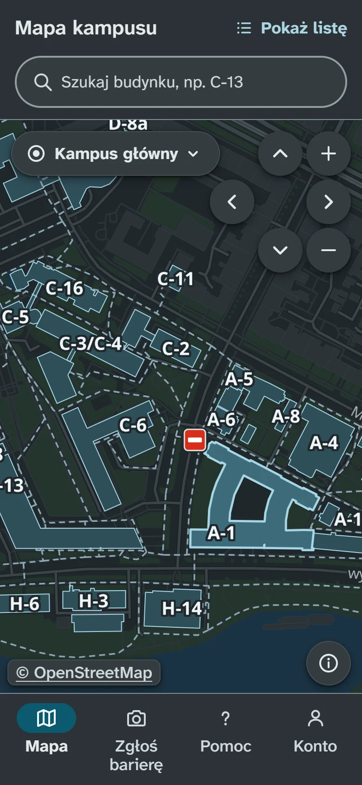{: width="240" loading="lazy" }](obrazy/m-v1-mapa-ciemny.webp) | [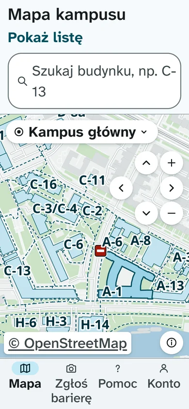{: width="240" loading="lazy" }](obrazy/m-v1-mapa-jasny-200.webp) |

### V1: lista budynków

`m-v1-mapa-lista` · [makieta low-fi](../makiety/odwiedzajacy.md#v1-lista-budynkow) · [wymagania V1](../wymagania-ekranow.md#v1-mapa-kampusu): US1.8, NFR-19

Obraz pokazuje po pięć pierwszych budynków każdego terenu. W aplikacji lista ma wszystkie budynki.

| Jasny | Ciemny | Czcionka 200% |
| --- | --- | --- |
| [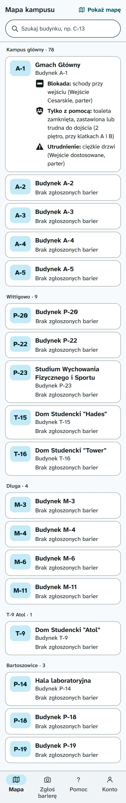{: width="240" loading="lazy" }](obrazy/m-v1-mapa-lista-jasny.webp) | [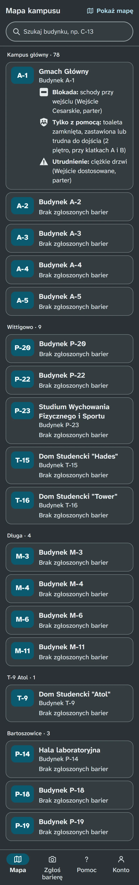{: width="240" loading="lazy" }](obrazy/m-v1-mapa-lista-ciemny.webp) | [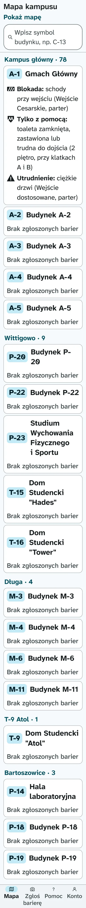{: width="240" loading="lazy" }](obrazy/m-v1-mapa-lista-jasny-200.webp) |

### V1: wyszukiwanie `c13`

`m-v1-mapa-wyszukiwanie` · [makieta low-fi](../makiety/odwiedzajacy.md#v1-wyszukiwanie)

| Jasny | Ciemny | Czcionka 200% |
| --- | --- | --- |
| [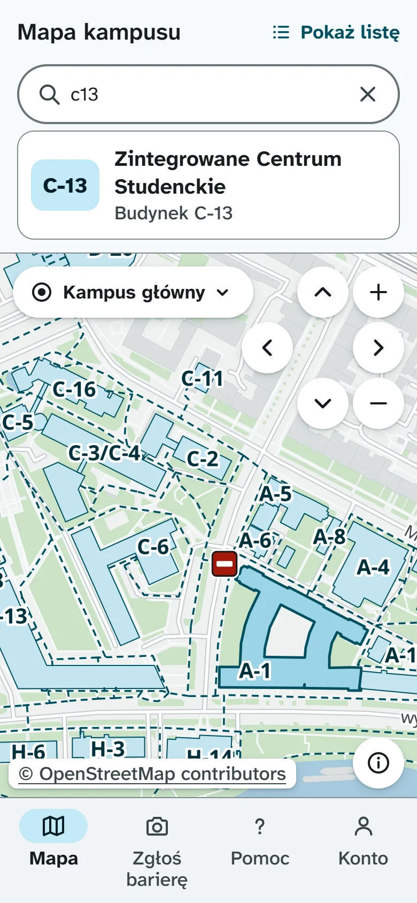{: width="240" loading="lazy" }](obrazy/m-v1-mapa-wyszukiwanie-jasny.webp) | [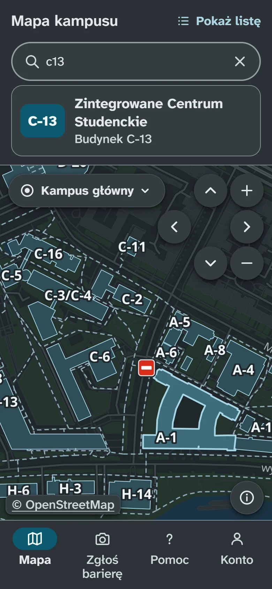{: width="240" loading="lazy" }](obrazy/m-v1-mapa-wyszukiwanie-ciemny.webp) | [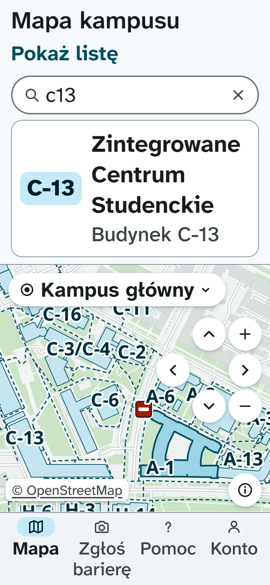{: width="240" loading="lazy" }](obrazy/m-v1-mapa-wyszukiwanie-jasny-200.webp) |

### V1: brak wyniku dla „C-31”

`m-v1-mapa-pusty` · [makieta low-fi](../makiety/odwiedzajacy.md#v1-brak-wyniku)

| Jasny | Ciemny | Czcionka 200% |
| --- | --- | --- |
| [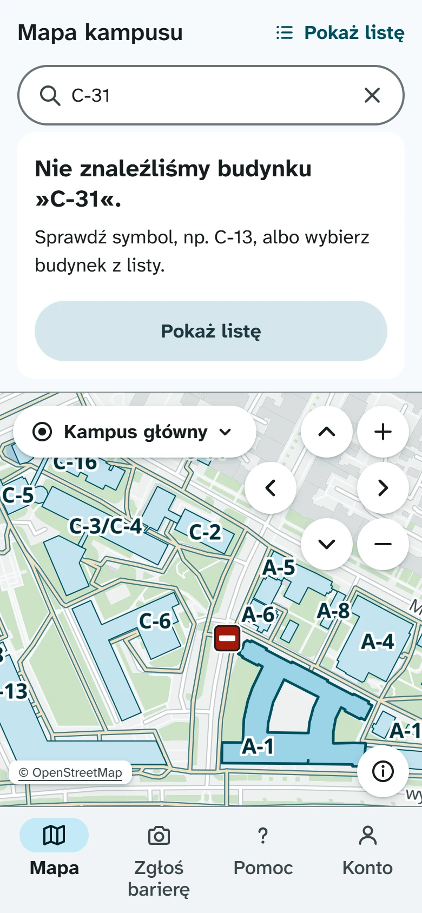{: width="240" loading="lazy" }](obrazy/m-v1-mapa-pusty-jasny.webp) | [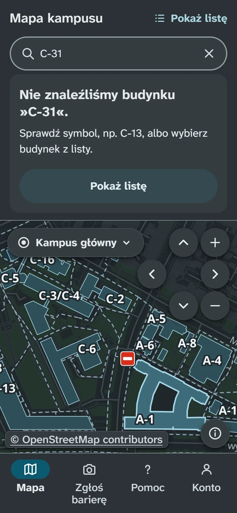{: width="240" loading="lazy" }](obrazy/m-v1-mapa-pusty-ciemny.webp) | [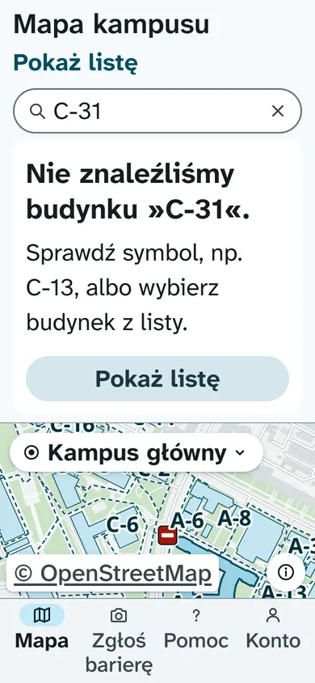{: width="240" loading="lazy" }](obrazy/m-v1-mapa-pusty-jasny-200.webp) |

### V1: arkusz bariery po dotknięciu znaku

`m-v1-mapa-bariera` · [makieta low-fi](../makiety/odwiedzajacy.md#v1-bariera-na-mapie)

| Jasny | Ciemny | Czcionka 200% |
| --- | --- | --- |
| [{: width="240" loading="lazy" }](obrazy/m-v1-mapa-bariera-jasny.webp) | [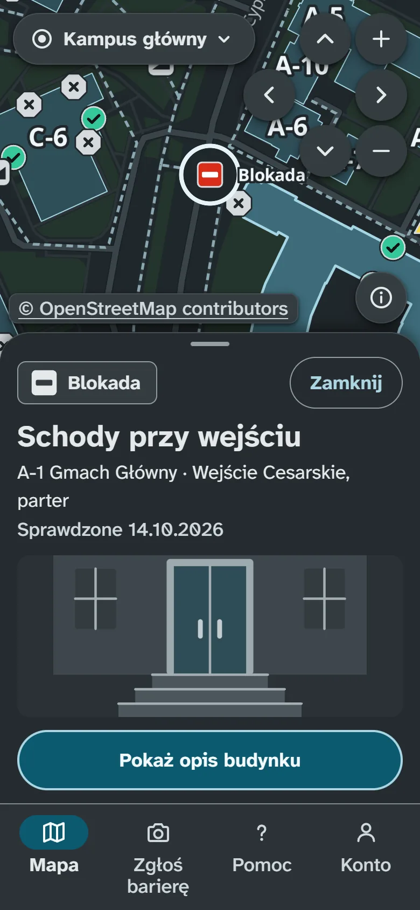{: width="240" loading="lazy" }](obrazy/m-v1-mapa-bariera-ciemny.webp) | [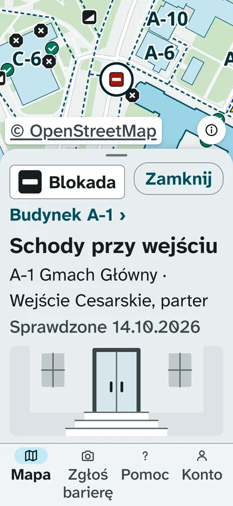{: width="240" loading="lazy" }](obrazy/m-v1-mapa-bariera-jasny-200.webp) |

### V1: arkusz wejścia po dotknięciu znaku {#v1-arkusz-wejscia}

`m-v1-mapa-wejscie` · [wymagania V1](../wymagania-ekranow.md#v1-mapa-kampusu): US2.1, US3.3, NFR-20

| Jasny | Ciemny | Czcionka 200% |
| --- | --- | --- |
| [{: width="240" loading="lazy" }](obrazy/m-v1-mapa-wejscie-jasny.webp) | [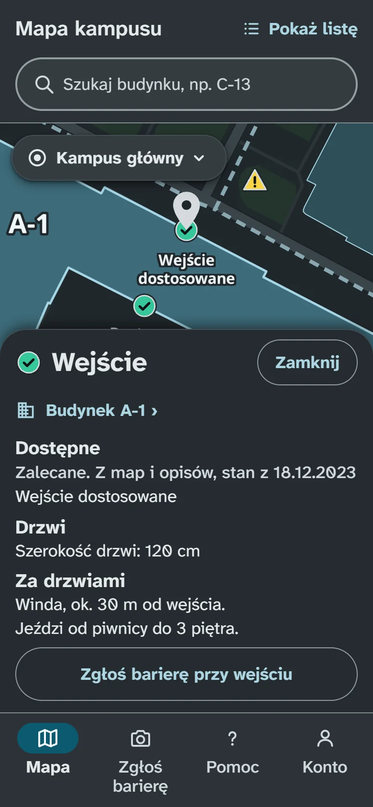{: width="240" loading="lazy" }](obrazy/m-v1-mapa-wejscie-ciemny.webp) | [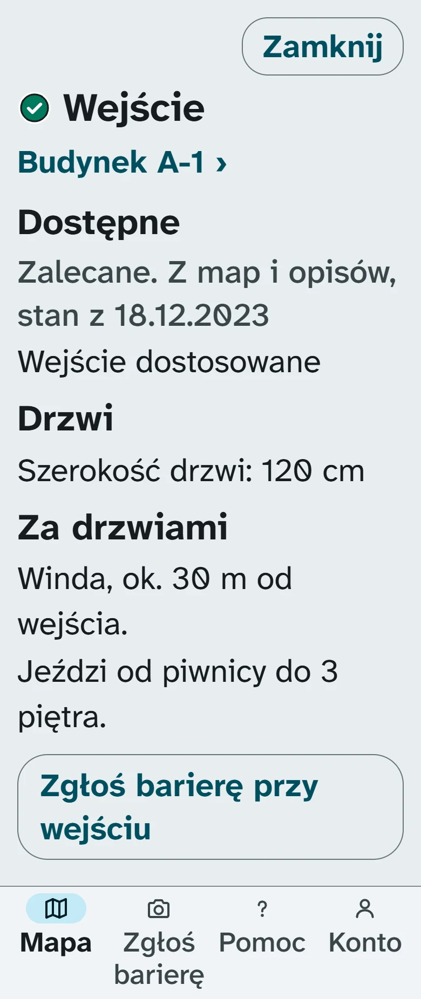{: width="240" loading="lazy" }](obrazy/m-v1-mapa-wejscie-jasny-200.webp) |

### V1: znaleziona sala A-1 329

`m-v1-mapa-sala` · [makieta low-fi](../makiety/odwiedzajacy.md#v1-znaleziona-sala)

| Jasny | Ciemny | Czcionka 200% |
| --- | --- | --- |
| [{: width="240" loading="lazy" }](obrazy/m-v1-mapa-sala-jasny.webp) | [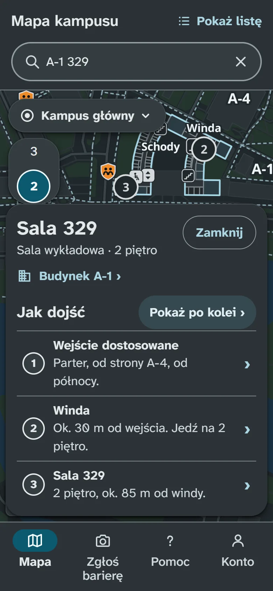{: width="240" loading="lazy" }](obrazy/m-v1-mapa-sala-ciemny.webp) | [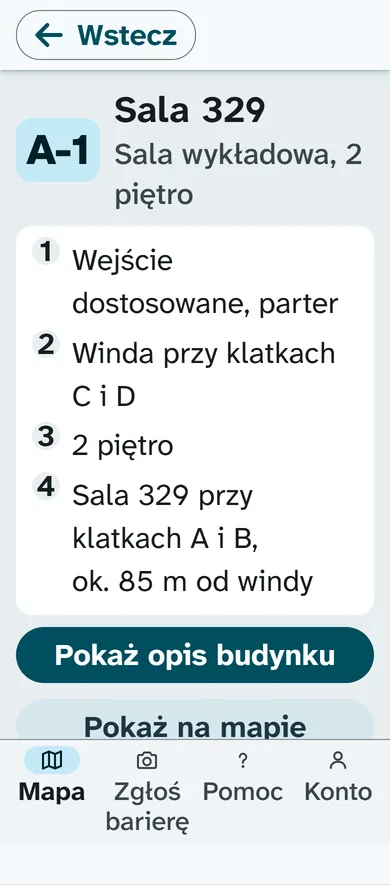{: width="240" loading="lazy" }](obrazy/m-v1-mapa-sala-jasny-200.webp) |

### V1: kroki po kolei

`m-v1-mapa-sala-kroki` · [makieta low-fi](../makiety/odwiedzajacy.md#v1-kroki-po-kolei)

| Jasny | Ciemny |
| --- | --- |
| [{: width="240" loading="lazy" }](obrazy/m-v1-mapa-sala-kroki-jasny.webp) | [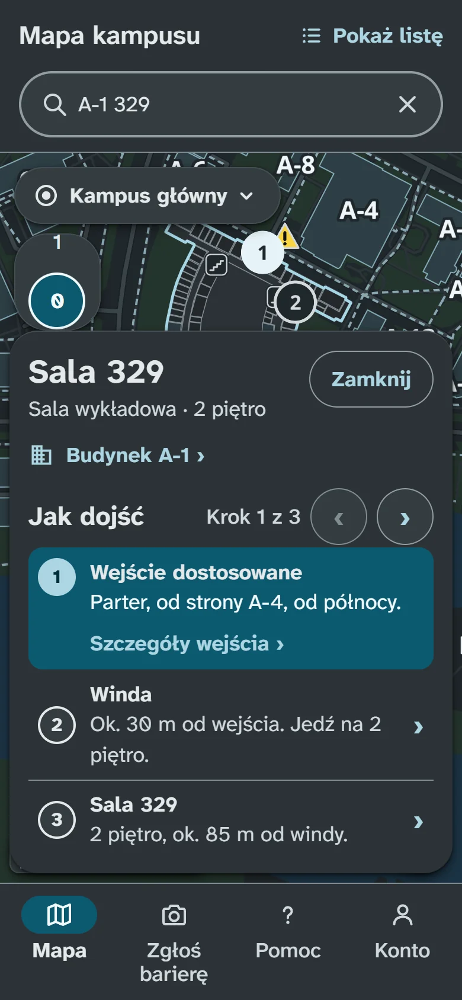{: width="240" loading="lazy" }](obrazy/m-v1-mapa-sala-kroki-ciemny.webp) |

### V1: plan piętra

`m-v1-mapa-plan` · [makieta low-fi](../makiety/odwiedzajacy.md#v1-plan-pietra) · [wymagania V1](../wymagania-ekranow.md#v1-mapa-kampusu): US16.1

| Jasny | Ciemny | Czcionka 200% |
| --- | --- | --- |
| [{: width="240" loading="lazy" }](obrazy/m-v1-mapa-plan-jasny.webp) | [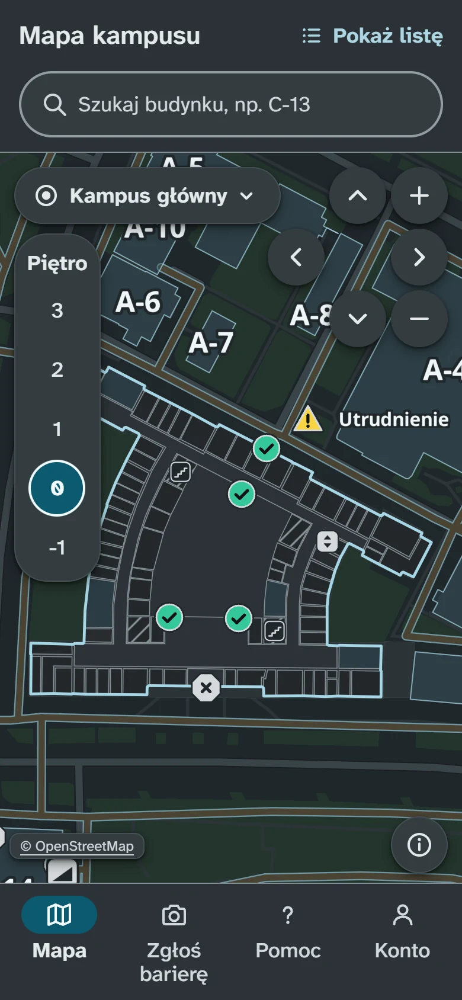{: width="240" loading="lazy" }](obrazy/m-v1-mapa-plan-ciemny.webp) | [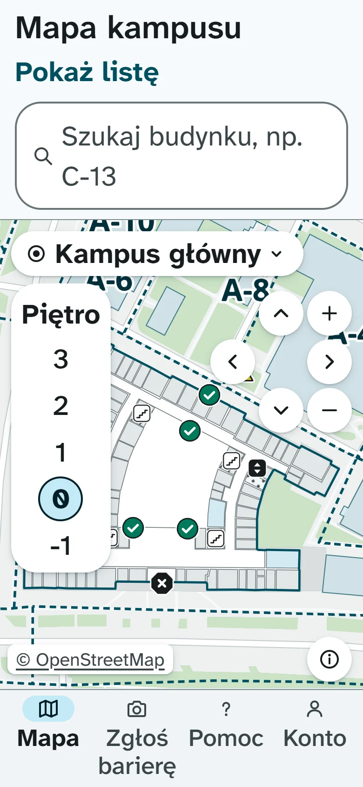{: width="240" loading="lazy" }](obrazy/m-v1-mapa-plan-jasny-200.webp) |

### V1: budynek bez planu

`m-v1-mapa-plan-podstawowy` · [makieta low-fi](../makiety/odwiedzajacy.md#v1-budynek-bez-planu) · [wymagania V1](../wymagania-ekranow.md#v1-mapa-kampusu): US16.2, BR-G1

| Jasny | Ciemny | Czcionka 200% |
| --- | --- | --- |
| [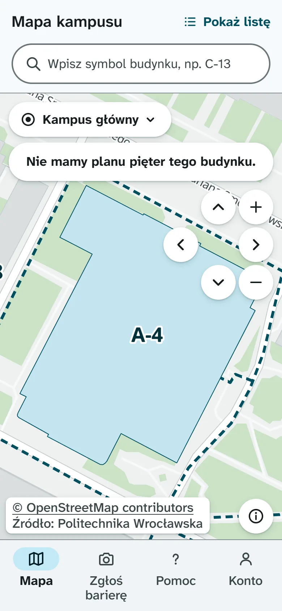{: width="240" loading="lazy" }](obrazy/m-v1-mapa-plan-podstawowy-jasny.webp) | [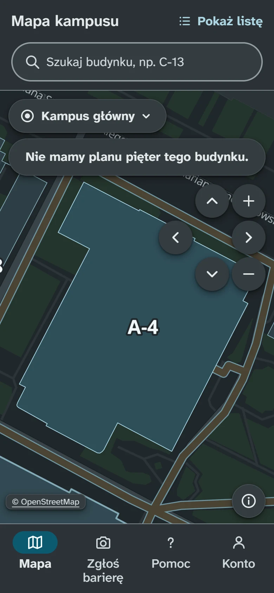{: width="240" loading="lazy" }](obrazy/m-v1-mapa-plan-podstawowy-ciemny.webp) | [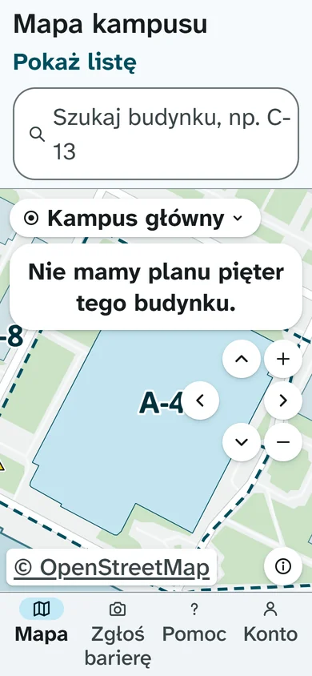{: width="240" loading="lazy" }](obrazy/m-v1-mapa-plan-podstawowy-jasny-200.webp) |

### V1: winda na planie

`m-v1-mapa-plan-winda` · [makieta low-fi](../makiety/odwiedzajacy.md#v1-winda-na-planie) · [wymagania V1](../wymagania-ekranow.md#v1-mapa-kampusu): US16.1, US18.2

| Jasny | Ciemny | Czcionka 200% |
| --- | --- | --- |
| [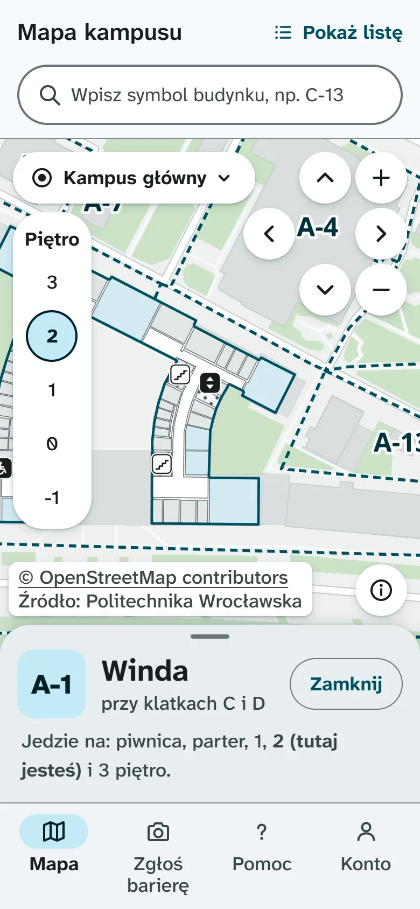{: width="240" loading="lazy" }](obrazy/m-v1-mapa-plan-winda-jasny.webp) | [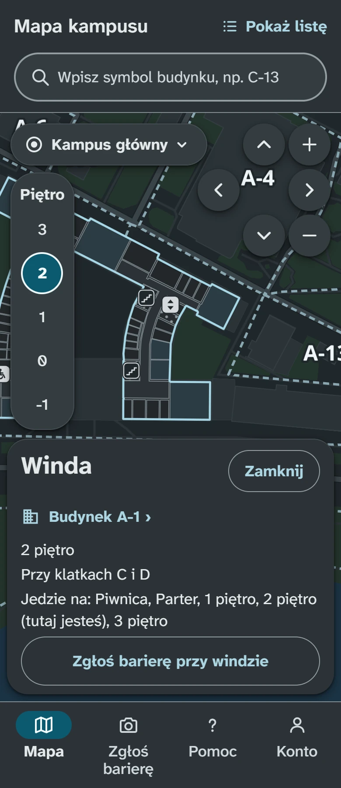{: width="240" loading="lazy" }](obrazy/m-v1-mapa-plan-winda-ciemny.webp) | [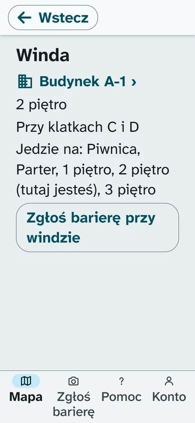{: width="240" loading="lazy" }](obrazy/m-v1-mapa-plan-winda-jasny-200.webp) |

### V1: bariery na planie

`m-v1-mapa-plan-bariery` · [makieta low-fi](../makiety/odwiedzajacy.md#v1-bariery-na-planie) · [wymagania V1](../wymagania-ekranow.md#v1-mapa-kampusu): US16.1, BR-14, NFR-18

| Jasny | Ciemny | Czcionka 200% |
| --- | --- | --- |
| [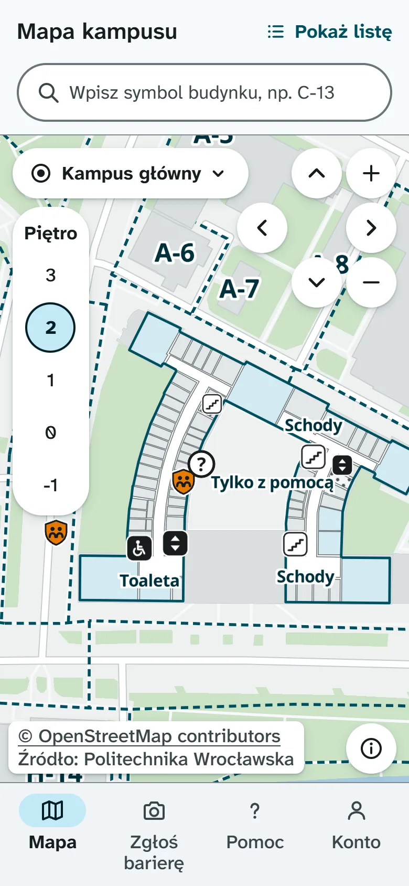{: width="240" loading="lazy" }](obrazy/m-v1-mapa-plan-bariery-jasny.webp) | [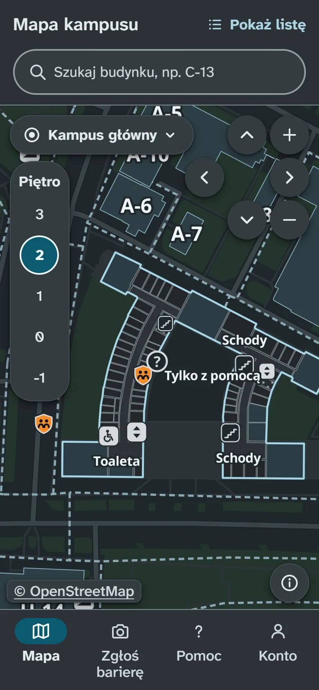{: width="240" loading="lazy" }](obrazy/m-v1-mapa-plan-bariery-ciemny.webp) | [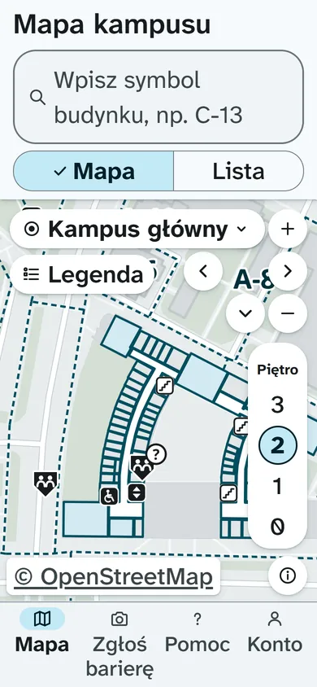{: width="240" loading="lazy" }](obrazy/m-v1-mapa-plan-bariery-jasny-200.webp) |

### V1: numery sal na planie

`m-v1-mapa-plan-numery` · [wymagania V1](../wymagania-ekranow.md#v1-mapa-kampusu): US16.1, NFR-16

| Jasny | Ciemny | Czcionka 200% |
| --- | --- | --- |
| [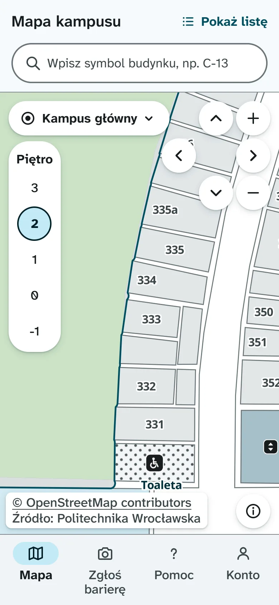{: width="240" loading="lazy" }](obrazy/m-v1-mapa-plan-numery-jasny.webp) | [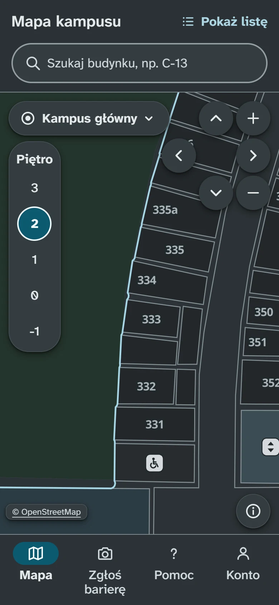{: width="240" loading="lazy" }](obrazy/m-v1-mapa-plan-numery-ciemny.webp) | [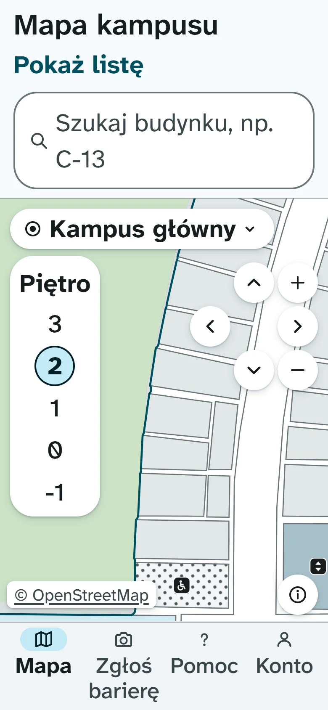{: width="240" loading="lazy" }](obrazy/m-v1-mapa-plan-numery-jasny-200.webp) |

### V1: legenda i źródła danych {#v1-legenda}

`m-v1-mapa-legenda` · [makieta low-fi](../makiety/odwiedzajacy.md#v1-legenda-przy-planie) · [wymagania V1](../wymagania-ekranow.md#v1-mapa-kampusu): US1.4, US16.1, NFR-37, NFR-40

| Jasny | Ciemny | Czcionka 200% |
| --- | --- | --- |
| [{: width="240" loading="lazy" }](obrazy/m-v1-mapa-legenda-jasny.webp) | [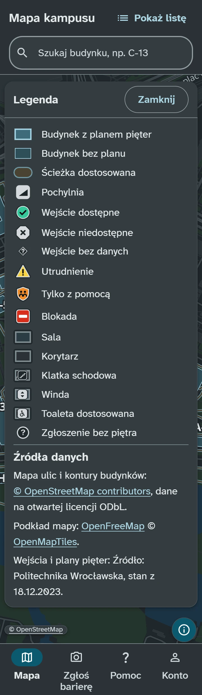{: width="240" loading="lazy" }](obrazy/m-v1-mapa-legenda-ciemny.webp) | [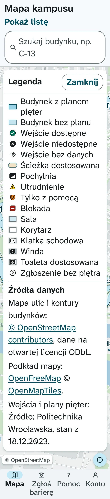{: width="240" loading="lazy" }](obrazy/m-v1-mapa-legenda-jasny-200.webp) |

### V1: bez internetu

`m-v1-mapa-brak-sieci` · [makieta low-fi](../makiety/odwiedzajacy.md#v1-brak-sieci)

| Jasny | Ciemny | Czcionka 200% |
| --- | --- | --- |
| [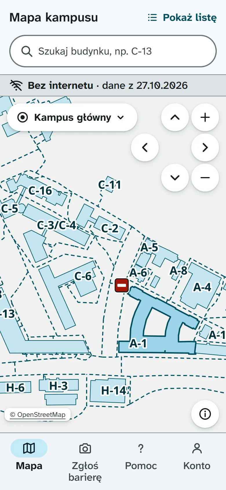{: width="240" loading="lazy" }](obrazy/m-v1-mapa-brak-sieci-jasny.webp) | [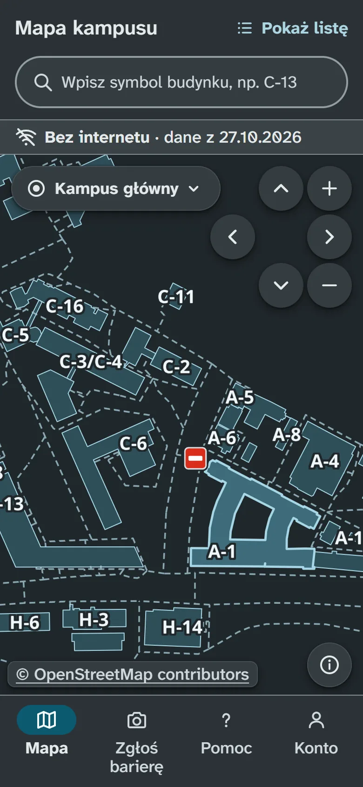{: width="240" loading="lazy" }](obrazy/m-v1-mapa-brak-sieci-ciemny.webp) | [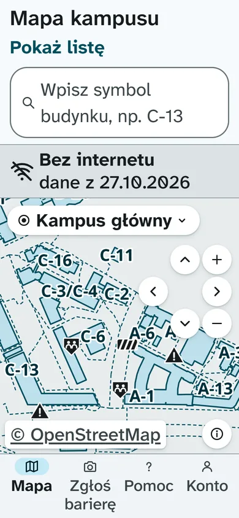{: width="240" loading="lazy" }](obrazy/m-v1-mapa-brak-sieci-jasny-200.webp) |

### V1: panel „Teren na mapie”

`m-v1-mapa-teren-panel` · [wymagania V1](../wymagania-ekranow.md#v1-mapa-kampusu): US1.7

| Jasny | Ciemny | Czcionka 200% |
| --- | --- | --- |
| [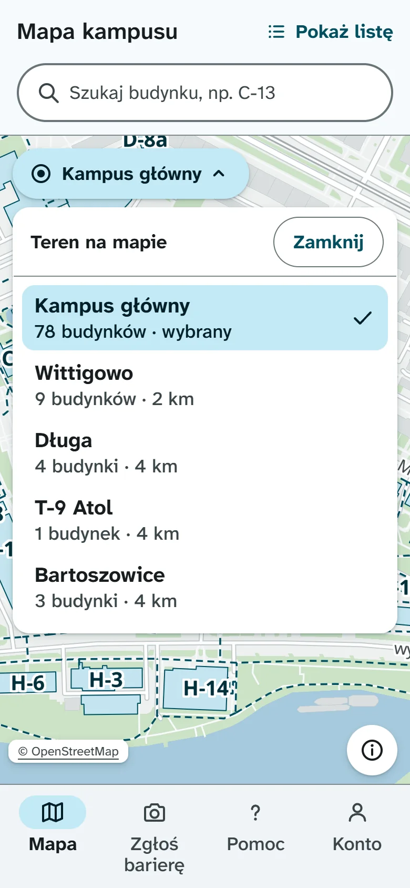{: width="240" loading="lazy" }](obrazy/m-v1-mapa-teren-panel-jasny.webp) | [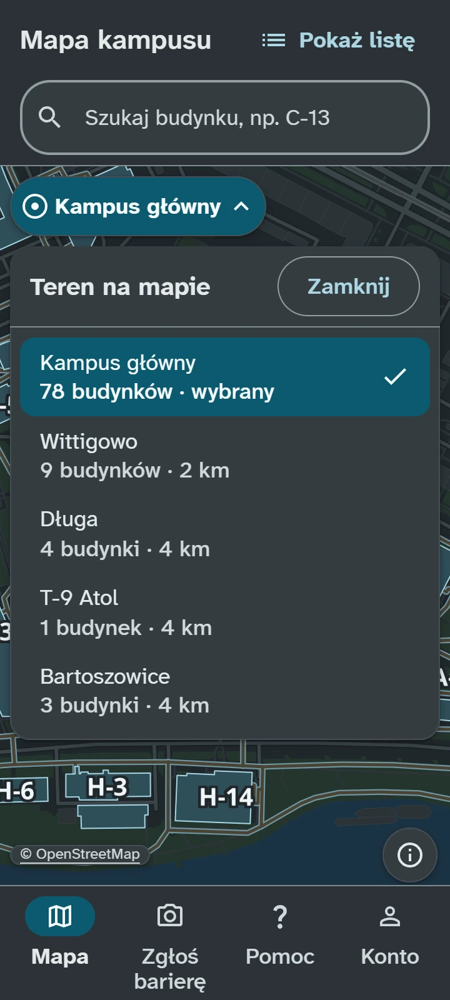{: width="240" loading="lazy" }](obrazy/m-v1-mapa-teren-panel-ciemny.webp) | [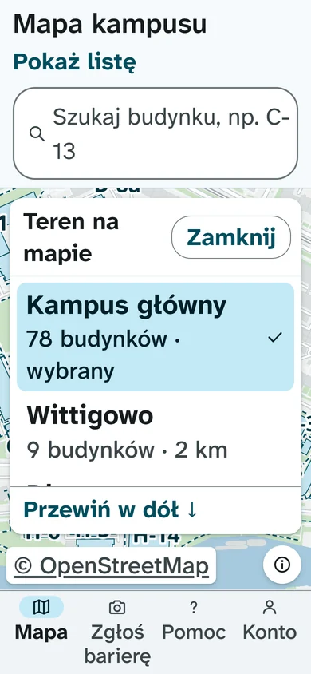{: width="240" loading="lazy" }](obrazy/m-v1-mapa-teren-panel-jasny-200.webp) |

### V1: mapa po zmianie terenu

`m-v1-mapa-teren-zmiana` · [wymagania V1](../wymagania-ekranow.md#v1-mapa-kampusu): US1.8

| Jasny | Ciemny | Czcionka 200% |
| --- | --- | --- |
| [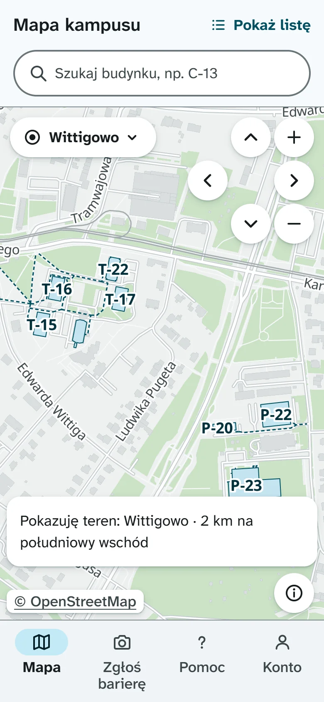{: width="240" loading="lazy" }](obrazy/m-v1-mapa-teren-zmiana-jasny.webp) | [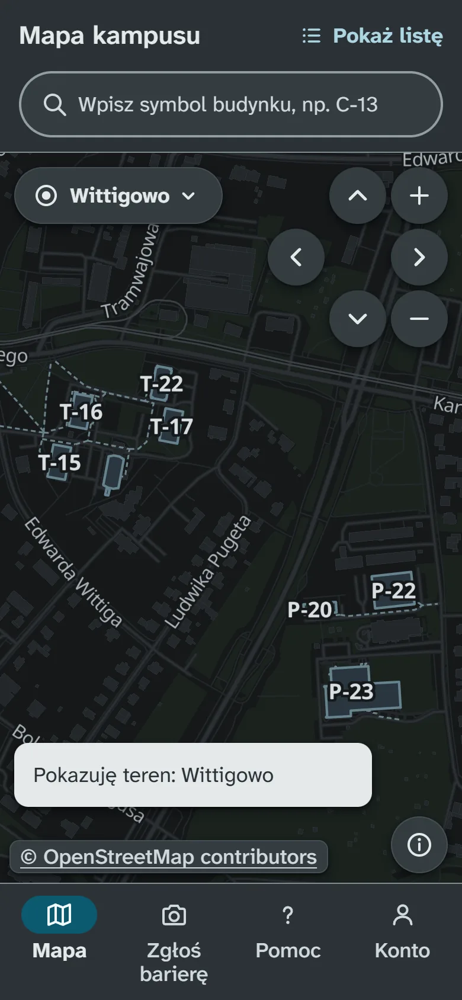{: width="240" loading="lazy" }](obrazy/m-v1-mapa-teren-zmiana-ciemny.webp) | [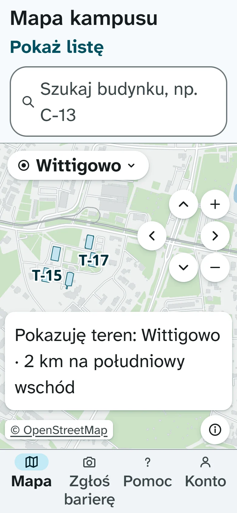{: width="240" loading="lazy" }](obrazy/m-v1-mapa-teren-zmiana-jasny-200.webp) |

## V2 Karta budynku

Wymagania: [V2 Karta budynku](../wymagania-ekranow.md#v2-karta-budynku).

Zestaw pokazuje pięć głównych stanów karty (pozostałe korzystają z tych samych wzorców). Osobny ekran V3 został wycofany — szczegóły wejścia otwiera [arkusz wejścia na V1](#v1-arkusz-wejscia).

### V2: pełny ekran po rozwinięciu karty (A-1)

`m-v2-karta-budynku` · [makieta low-fi](../makiety/index.md#wzorcowa-makieta-v2-karta-budynku)

| Jasny | Ciemny | Czcionka 200% |
| --- | --- | --- |
| [{: width="240" loading="lazy" }](obrazy/m-v2-karta-budynku-jasny.webp) | [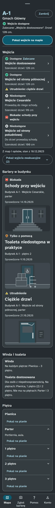{: width="240" loading="lazy" }](obrazy/m-v2-karta-budynku-ciemny.webp) | [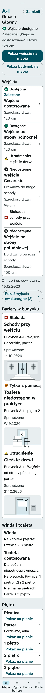{: width="240" loading="lazy" }](obrazy/m-v2-karta-budynku-jasny-200.webp) |

### V2: mała karta nad mapą {#v2-mala-karta}

`m-v2-karta-budynku-mala`. Po dotknięciu budynku na V1 mapa otwiera V2 jako małą kartę o wysokości treści. Nie ma na niej chipów ani listy wejść. Uchwyt, przewinięcie albo przeciągnięcie w górę otwiera pełny ekran.

Nad kartą zostają przyciski mapy, a zaznaczony budynek mieści się w części mapy obok nich (NFR-53). „Zamknij” i „Wstecz” wracają do mapy bez zaznaczenia.

| Jasny | Ciemny | Czcionka 200% |
| --- | --- | --- |
| [{: width="240" loading="lazy" }](obrazy/m-v2-karta-budynku-mala-jasny.webp) | [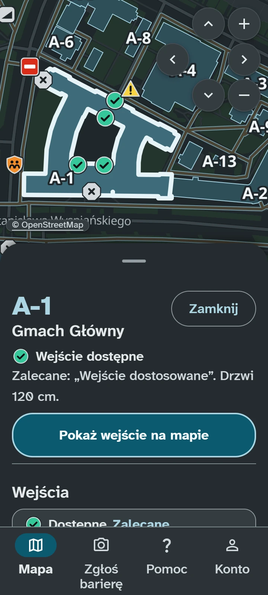{: width="240" loading="lazy" }](obrazy/m-v2-karta-budynku-mala-ciemny.webp) | [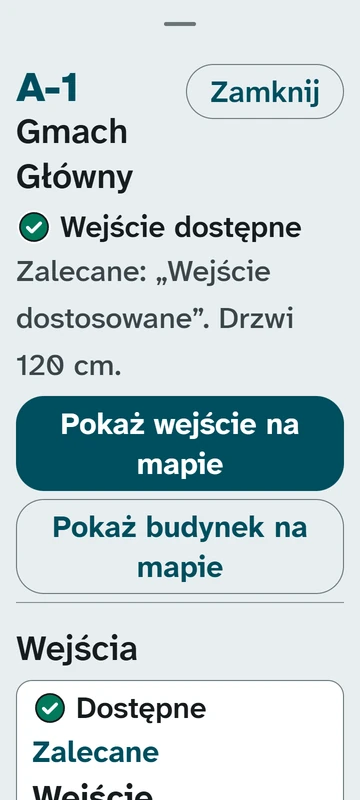{: width="240" loading="lazy" }](obrazy/m-v2-karta-budynku-mala-jasny-200.webp) |

### V2: wejście bez danych (C-7)

`m-v2-karta-budynku-wejscie-brak-danych`

| Jasny | Ciemny | Czcionka 200% |
| --- | --- | --- |
| [{: width="240" loading="lazy" }](obrazy/m-v2-karta-budynku-wejscie-brak-danych-jasny.webp) | [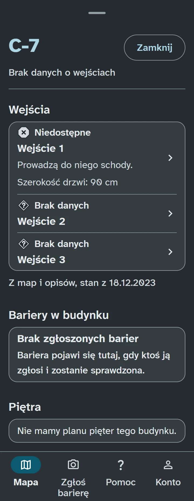{: width="240" loading="lazy" }](obrazy/m-v2-karta-budynku-wejscie-brak-danych-ciemny.webp) | [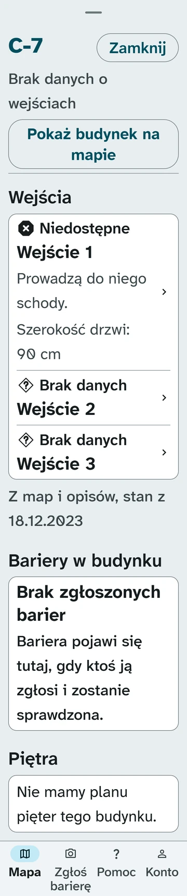{: width="240" loading="lazy" }](obrazy/m-v2-karta-budynku-wejscie-brak-danych-jasny-200.webp) |

### V2: budynku nie ma w telefonie (C-13)

`m-v2-karta-budynku-brak-w-telefonie` · [makieta low-fi](../makiety/odwiedzajacy.md#v2-budynku-nie-ma-w-telefonie)

| Jasny | Ciemny | Czcionka 200% |
| --- | --- | --- |
| [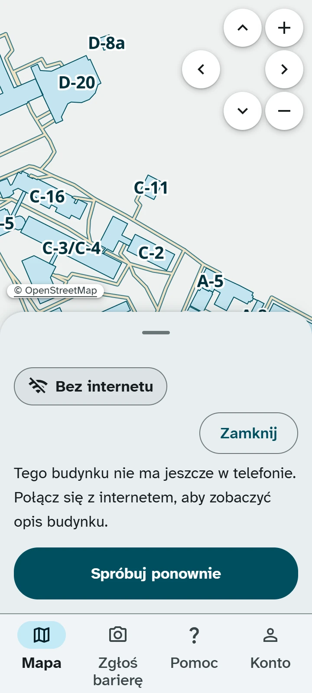{: width="240" loading="lazy" }](obrazy/m-v2-karta-budynku-brak-w-telefonie-jasny.webp) | [{: width="240" loading="lazy" }](obrazy/m-v2-karta-budynku-brak-w-telefonie-ciemny.webp) | [{: width="240" loading="lazy" }](obrazy/m-v2-karta-budynku-brak-w-telefonie-jasny-200.webp) |

### V2: widok Zbierającego

`m-v2-karta-budynku-zbierajacy` · [makieta low-fi](../makiety/odwiedzajacy.md#v2-zbierajacy)

| Jasny | Ciemny | Czcionka 200% |
| --- | --- | --- |
| [{: width="240" loading="lazy" }](obrazy/m-v2-karta-budynku-zbierajacy-jasny.webp) | [{: width="240" loading="lazy" }](obrazy/m-v2-karta-budynku-zbierajacy-ciemny.webp) | [{: width="240" loading="lazy" }](obrazy/m-v2-karta-budynku-zbierajacy-jasny-200.webp) |

## V4 Zgłoszenie szybkie

Wymagania: [V4 Zgłoszenie szybkie](../wymagania-ekranow.md#v4-zgoszenie-szybkie).

Zestaw [makiet low-fi V4](../makiety/odwiedzajacy.md#v4-zgoszenie-szybkie).

### V4: prośba o lokalizację

| Jasny | Ciemny | Czcionka 200% |
| --- | --- | --- |
| [{: width="240" loading="lazy" }](obrazy/m-v4-zgoda-lokalizacja-jasny.webp) | [{: width="240" loading="lazy" }](obrazy/m-v4-zgoda-lokalizacja-ciemny.webp) | [{: width="240" loading="lazy" }](obrazy/m-v4-zgoda-lokalizacja-jasny-200.webp) |

### V4: tylko przybliżona lokalizacja

| Jasny | Ciemny | Czcionka 200% |
| --- | --- | --- |
| [{: width="240" loading="lazy" }](obrazy/m-v4-zgoda-przyblizona-jasny.webp) | [{: width="240" loading="lazy" }](obrazy/m-v4-zgoda-przyblizona-ciemny.webp) | [{: width="240" loading="lazy" }](obrazy/m-v4-zgoda-przyblizona-jasny-200.webp) |

### V4: krok 1 z 3, zdjęcie

| Jasny | Ciemny | Czcionka 200% |
| --- | --- | --- |
| [{: width="240" loading="lazy" }](obrazy/m-v4-krok-1-jasny.webp) | [{: width="240" loading="lazy" }](obrazy/m-v4-krok-1-ciemny.webp) | [{: width="240" loading="lazy" }](obrazy/m-v4-krok-1-jasny-200.webp) |

### V4: krok 1 po zrobieniu zdjęcia

| Jasny | Ciemny | Czcionka 200% |
| --- | --- | --- |
| [{: width="240" loading="lazy" }](obrazy/m-v4-krok-1-zdjecie-jasny.webp) | [{: width="240" loading="lazy" }](obrazy/m-v4-krok-1-zdjecie-ciemny.webp) | [{: width="240" loading="lazy" }](obrazy/m-v4-krok-1-zdjecie-jasny-200.webp) |

### V4: krok 2, czego dotyczy bariera

| Jasny | Ciemny | Czcionka 200% |
| --- | --- | --- |
| [{: width="240" loading="lazy" }](obrazy/m-v4-krok-2-jasny.webp) | [{: width="240" loading="lazy" }](obrazy/m-v4-krok-2-ciemny.webp) | [{: width="240" loading="lazy" }](obrazy/m-v4-krok-2-jasny-200.webp) |

### V4: krok 2, na którym piętrze

| Jasny | Ciemny | Czcionka 200% |
| --- | --- | --- |
| [{: width="240" loading="lazy" }](obrazy/m-v4-krok-2-pietro-jasny.webp) | [{: width="240" loading="lazy" }](obrazy/m-v4-krok-2-pietro-ciemny.webp) | [{: width="240" loading="lazy" }](obrazy/m-v4-krok-2-pietro-jasny-200.webp) |

### V4: krok 3, sprawdzenie i wysłanie

| Jasny | Ciemny | Czcionka 200% |
| --- | --- | --- |
| [{: width="240" loading="lazy" }](obrazy/m-v4-krok-3-jasny.webp) | [{: width="240" loading="lazy" }](obrazy/m-v4-krok-3-ciemny.webp) | [{: width="240" loading="lazy" }](obrazy/m-v4-krok-3-jasny-200.webp) |

### V4: telefon nie ustalił miejsca

| Jasny | Ciemny | Czcionka 200% |
| --- | --- | --- |
| [{: width="240" loading="lazy" }](obrazy/m-v4-brak-pozycji-jasny.webp) | [{: width="240" loading="lazy" }](obrazy/m-v4-brak-pozycji-ciemny.webp) | [{: width="240" loading="lazy" }](obrazy/m-v4-brak-pozycji-jasny-200.webp) |

### V4: potwierdzenie rezygnacji

| Jasny | Ciemny | Czcionka 200% |
| --- | --- | --- |
| [{: width="240" loading="lazy" }](obrazy/m-v4-rezygnacja-jasny.webp) | [{: width="240" loading="lazy" }](obrazy/m-v4-rezygnacja-ciemny.webp) | [{: width="240" loading="lazy" }](obrazy/m-v4-rezygnacja-jasny-200.webp) |

### V4: wysłane

| Jasny | Ciemny | Czcionka 200% |
| --- | --- | --- |
| [{: width="240" loading="lazy" }](obrazy/m-v4-wyslane-jasny.webp) | [{: width="240" loading="lazy" }](obrazy/m-v4-wyslane-ciemny.webp) | [{: width="240" loading="lazy" }](obrazy/m-v4-wyslane-jasny-200.webp) |

### V4: zapisane bez internetu

| Jasny | Ciemny | Czcionka 200% |
| --- | --- | --- |
| [{: width="240" loading="lazy" }](obrazy/m-v4-wyslane-brak-sieci-jasny.webp) | [{: width="240" loading="lazy" }](obrazy/m-v4-wyslane-brak-sieci-ciemny.webp) | [{: width="240" loading="lazy" }](obrazy/m-v4-wyslane-brak-sieci-jasny-200.webp) |

## V5 Pomoc

Wymagania: [V5 Pomoc](../wymagania-ekranow.md#v5-pomoc).

Zestaw [makiet low-fi V5](../makiety/odwiedzajacy.md#v5-pomoc).

### V5: pierwsze uruchomienie, krok 1 z 3

Przy pierwszym uruchomieniu „Wstecz” na tym kroku pomija instrukcję i otwiera mapę.

| Jasny | Ciemny | Czcionka 200% |
| --- | --- | --- |
| [{: width="240" loading="lazy" }](obrazy/m-v5-pomoc-pierwsze-uruchomienie-jasny.webp) | [{: width="240" loading="lazy" }](obrazy/m-v5-pomoc-pierwsze-uruchomienie-ciemny.webp) | [{: width="240" loading="lazy" }](obrazy/m-v5-pomoc-pierwsze-uruchomienie-jasny-200.webp) |

### V5: krok 2 z 3, co znaczy „Dostępne”

Oznaczenie wejścia w przykładzie to ten sam znak co na mapie i słowo, bez plakietki.

| Jasny | Ciemny | Czcionka 200% |
| --- | --- | --- |
| [{: width="240" loading="lazy" }](obrazy/m-v5-pomoc-jasny.webp) | [{: width="240" loading="lazy" }](obrazy/m-v5-pomoc-ciemny.webp) | [{: width="240" loading="lazy" }](obrazy/m-v5-pomoc-jasny-200.webp) |

### V5: krok 3 z 3, zgłoś barierę {#v5-krok-3}

Ostatni krok nie ma obrazu. Zamiast „Dalej” stoi „Zacznij”, które otwiera mapę.

| Jasny | Ciemny | Czcionka 200% |
| --- | --- | --- |
| [{: width="240" loading="lazy" }](obrazy/m-v5-pomoc-krok-3-jasny.webp) | [{: width="240" loading="lazy" }](obrazy/m-v5-pomoc-krok-3-ciemny.webp) | [{: width="240" loading="lazy" }](obrazy/m-v5-pomoc-krok-3-jasny-200.webp) |

## L1 Prośba o logowanie

Wymagania: [L1 Prośba o logowanie](../wymagania-ekranow.md#l1-prosba-o-logowanie).

Zestaw [makiet low-fi L1](../makiety/odwiedzajacy.md#l1-stan-zwyky).

### L1: prośba o logowanie przy zgłoszeniu

| Jasny | Ciemny | Czcionka 200% |
| --- | --- | --- |
| [{: width="240" loading="lazy" }](obrazy/m-l1-konto-jasny.webp) | [{: width="240" loading="lazy" }](obrazy/m-l1-konto-ciemny.webp) | [{: width="240" loading="lazy" }](obrazy/m-l1-konto-jasny-200.webp) |

### L1: logowanie bez internetu

| Jasny | Ciemny | Czcionka 200% |
| --- | --- | --- |
| [{: width="240" loading="lazy" }](obrazy/m-l1-konto-brak-sieci-jasny.webp) | [{: width="240" loading="lazy" }](obrazy/m-l1-konto-brak-sieci-ciemny.webp) | [{: width="240" loading="lazy" }](obrazy/m-l1-konto-brak-sieci-jasny-200.webp) |

## L2 Konto

Wymagania: [L2 Konto](../wymagania-ekranow.md#l2-konto).

Zestaw [makiet low-fi L2](../makiety/odwiedzajacy.md#l2-odwiedzajacy).

### L2: konto Odwiedzającego

| Jasny | Ciemny | Czcionka 200% |
| --- | --- | --- |
| [{: width="240" loading="lazy" }](obrazy/m-l2-konto-jasny.webp) | [{: width="240" loading="lazy" }](obrazy/m-l2-konto-ciemny.webp) | [{: width="240" loading="lazy" }](obrazy/m-l2-konto-jasny-200.webp) |

### L2: Konto i praca

| Jasny | Ciemny | Czcionka 200% |
| --- | --- | --- |
| [{: width="240" loading="lazy" }](obrazy/m-l2-konto-praca-jasny.webp) | [{: width="240" loading="lazy" }](obrazy/m-l2-konto-praca-ciemny.webp) | [{: width="240" loading="lazy" }](obrazy/m-l2-konto-praca-jasny-200.webp) |

### L2: informacja o danych osobowych

| Jasny | Ciemny | Czcionka 200% |
| --- | --- | --- |
| [{: width="240" loading="lazy" }](obrazy/m-l2-konto-klauzula-jasny.webp) | [{: width="240" loading="lazy" }](obrazy/m-l2-konto-klauzula-ciemny.webp) | [{: width="240" loading="lazy" }](obrazy/m-l2-konto-klauzula-jasny-200.webp) |

### L2: wycofanie zgody

| Jasny | Ciemny | Czcionka 200% |
| --- | --- | --- |
| [{: width="240" loading="lazy" }](obrazy/m-l2-konto-wycofanie-jasny.webp) | [{: width="240" loading="lazy" }](obrazy/m-l2-konto-wycofanie-ciemny.webp) | [{: width="240" loading="lazy" }](obrazy/m-l2-konto-wycofanie-jasny-200.webp) |
