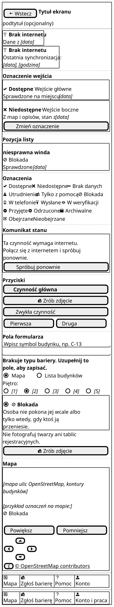
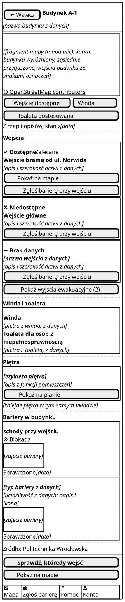

# Makiety

Makiety low-fi pokazują układ i treść każdego ekranu z [wymagań do ekranów](../wymagania-ekranow.md). Rysujemy je w PlantUML Salt: szare ramki, tekst i przyciski, bez koloru i stylu. Napisy pochodzą ze [słownika użytkownika](../slownik-uzytkownika.md) i są hipotezą do sprawdzenia w wywiadach.

## Konwencje

| Temat | Zasada |
| --- | --- |
| Element | Na makiecie jest tylko element z tabeli elementów ekranu w wymaganiach. Element bez kryterium, reguły albo NFR usuwamy (decyzja 16). |
| Nazwa pliku | `m-<ekran>-<nazwa>[-<stan>].puml`, małe litery, bez polskich znaków, np. `m-v2-karta-budynku.puml`. Nazwa jest unikalna w całym `docs/`. |
| Stan w nazwie | Stan zwykły nie ma dopisku. Pozostałe: `-brak-sieci`, `-pusty`, `-blad`, `-ladowanie`, `-brak-uprawnien`, a inne stany skrótem nazwy z tabeli stanów. Wariant roli: `-zbierajacy`, `-koordynator`. |
| Stany | Rysujemy tylko stany, które wyglądają inaczej niż już narysowane. Stan, który różni się jednym napisem, opisujemy w tabeli pod makietą. |
| Blok | `@startsalt` bez nazwy, potem `!include _wspolne.iuml`. Treść ekranu stoi między `$ekran_poczatek()` i `$ekran_koniec()`. |
| Fragmenty | Nagłówek, wskaźnik braku internetu, pasek dolny, komunikat stanu, oznaczenia, przyciski, pola formularza, ramki pozycji i mapa tylko z fragmentów. Ręczna kopia rozjeżdża się przy pierwszej zmianie słownika. Plik grupy (`_odwiedzajacy.iuml`, `_zespol-w-terenie.iuml`, `_weryfikacja.iuml`) dołączamy po `_wspolne.iuml` i trzymamy w nim tylko to, czego używa jeden ekran. |
| Szerokość | Ramka ma 266 px, skala 2, więc każdy PNG ma 532 px szerokości. Szerszy PNG znaczy, że jakiś wiersz wychodzi poza ekran telefonu. |
| Tekst | Wiersz ma najwyżej 34 znaki: tyle mieści tekst 18 sp na ekranie 360 dp. Dłuższy tekst zawija `$tekst("…")`. |
| Wysokość | Makieta pokazuje cały przewijany ekran: nagłówek na górze, pasek dolny na dole. |
| Cel dotyku | Salt nie oddaje wysokości 48 dp (NFR-17). Makiety sprawdzają proporcje i obecność celu, a wysokość celu sprawdza faza C: podgląd ekranu i test dostępności. |
| Ikony | Tylko ikony z tabeli „Metafory i ikony” słownika użytkownika, zawsze z tekstem obok, przez funkcje fragmentów. `[X]` w Salt to pole wyboru, a nie ikona statusu. |
| Kolor | Bez koloru: nie używamy `<color>` ani `<back>`. Czynność główna jest pogrubiona i ma pełną szerokość (`$przycisk_glowny`). |
| Zastępniki | Zdjęcie, plan, mapę i dane z bazy rysujemy kursywą w nawiasach, np. „[zdjęcie bariery]”. To nie są napisy aplikacji. |
| Przykłady | Budynek A-1 z wejściami jak w deklaracji dostępności [1]. Dane przykładowe nie mogą przeczyć faktom. Daty, nazwy i etykiety, których nie znamy, są zastępnikami, np. „[data]”. W argumencie `$tekst` zastępnik nie ma spacji w środku. |
| Strona | Obraz `../../_generated/<nazwa>.svg`, a pod nim tabela „Element → AC/BR/NFR” z odwołaniami z wymagań do ekranów. |
| Render | `python scripts/render.py`. Skrypt sprawdza tylko datę plików `.puml`, więc po zmianie `_wspolne.iuml` uruchamiamy go z `--force`. |

## Fragmenty wspólne

Plik `_wspolne.iuml` ma rozszerzenie `.iuml`, więc skrypt `render.py` nie traktuje go jak osobnego diagramu. Procedury PlantUML (`!procedure`, `!function`) działają wewnątrz `@startsalt`, co sprawdziliśmy w wersji 1.2026.9.

| Fragment | Co rysuje | Odwołanie |
| --- | --- | --- |
| `$naglowek("Tytuł", "podtytuł")` | „Wstecz” bez ikony i tytuł ekranu; podtytuł opcjonalny | wymagania wspólne, NFR-15 |
| `$naglowek_startowy("Mapa kampusu")` | sam tytuł, tylko na V1 | wymagania wspólne |
| `$brak_internetu("Dane z <i>[data]</i>")` | „Brak internetu” z ikoną i dopiskiem o wieku danych; bez argumentu sam napis | US9.1, NFR-10, NFR-21 |
| `$pasek_dolny_konto()` | „Mapa”, „Zgłoś barierę”, „Pomoc”, „Konto” | wymagania wspólne, US14 |
| `$pasek_dolny_praca()` | to samo z „Konto i praca” | wymagania wspólne, US14.1 |
| `$komunikat("Treść.", "Przycisk")` | ramka z komunikatem i najwyżej dwoma przyciskami tej samej wielkości | NFR-15, NFR-50 |
| `$wejscie($dostepne(), "Nazwa", "Źródło", "Zmień oznaczenie")` | oznaczenie, nazwa wejścia, data i źródło; przycisk opcjonalny | US2.1, US17.1, US17.3 |
| `$pozycja("Tytuł", $blokada(), "Dopisek", "Przycisk")` | pozycja listy z oznaczeniem tekstem i ikoną | NFR-21 |
| `$przycisk_glowny("…")`, `$przycisk("…", "camera-slr")` | przycisk na pełną szerokość, zawsze tej samej szerokości, z ikoną albo bez | NFR-17, NFR-21 |
| `$przyciski_obok("…", "…")` | dwa przyciski po pół szerokości w jednym wierszu | NFR-17 |
| `$mapa("opis", legenda)`, `$przyciski_mapy()` | mapa na pełną szerokość z podpisem OpenStreetMap w ramce. Pod nią „Powiększ”, „Pomniejsz” i kierunki, po dwa przyciski w wierszu. Układ jest ten sam na V1, C1 i R1. | NFR-15, NFR-37, PW-8 |
| `$ramka()` … `}` | ramka pozycji listy na pełną szerokość; używają jej `$wejscie`, `$pozycja`, `$opcja`, `$komunikat` i `$mapa` | NFR-17 |
| `$pole_tekstowe("…")`, `$blad_pola("…")` | pole tekstowe stałej szerokości; błąd przy polu pogrubiony | NFR-15, NFR-21 |
| `$przelacznik("Mapa", "Lista budynków", 1)`, `$pietra(2)`, `$opcja("X", $blokada(), "opis")` | przełącznik dwóch widoków, wybór piętra, opcja w dużej ramce | NFR-17, NFR-19, NFR-21, US16.1 |
| `$zdjecie("opis")` | przypomnienie o twarzach i tablicach, zdjęcie i „Zrób zdjęcie” albo „Zrób nowe zdjęcie” | NFR-25, PW-8 |
| `$tekst("…")`, `$sekcja("…")`, `$obraz("…")` | tekst zawinięty, nagłówek sekcji, zastępnik obrazu | NFR-20 |
| `$dostepne()` i pozostałe funkcje oznaczeń | napis z ikoną: oznaczenie wejścia, uciążliwość, status, znacznik | NFR-21, US17.1, US8.1, US15.1 |

Katalog to podgląd fragmentów dla autorów, a nie ekran aplikacji. Salt liczy szerokość przycisku jak pisma o stałej szerokości, 8 px na znak, dlatego fragmenty dopełniają napis do stałej liczby znaków. Pułapki sprawdzone w praktyce:

| Pułapka | Skutek | Jak unikać |
| --- | --- | --- |
| Słowa `@startsalt` albo `@endsalt` w pliku dołączanym, nawet w komentarzu | PlantUML bierze tylko tekst między nimi i zgłasza błąd | nie wpisywać ich w `_wspolne.iuml` |
| Parametr procedury o nazwie innej procedury, np. `$przycisk` | wywołanie trafia w parametr, a nie w procedurę | nazwy parametrów inne niż nazwy procedur |
| Pionowa kreska w tekście | Salt dzieli wiersz na komórki | nie używać jej w napisach |
| Procedura w środku wiersza, np. w komórce tabeli | PlantUML jej nie wywołuje | w komórce wpisać funkcję, np. `$dk_pole("", 26)` zamiast `$pole_tekstowe()` |

## Lista ekranów

Każda grupa ma własną stronę z makietami, tabelami „Element → AC/BR/NFR” i stanami bez makiety:

- [Makiety: odwiedzający](odwiedzajacy.md) — V1–V5, L1, L2;
- [Makiety: zespół w terenie](zespol-w-terenie.md) — C1–C7;
- [Makiety: weryfikacja i koordynacja](weryfikacja-koordynacja.md) — R1, R2, K1–K3.

| Ekran | Nagłówek na ekranie | Strona |
| --- | --- | --- |
| V1 | „Mapa kampusu” | [odwiedzający](odwiedzajacy.md) |
| V2 | „Budynek C-13” | [odwiedzający](odwiedzajacy.md) |
| V3 | „Którędy wejść do C-13” | [odwiedzający](odwiedzajacy.md) |
| V4 | „Zgłoś barierę” | [odwiedzający](odwiedzajacy.md) |
| V5 | „Jak korzystać z aplikacji” | [odwiedzający](odwiedzajacy.md) |
| L1 | „Konto” | [odwiedzający](odwiedzajacy.md) |
| L2 | „Konto” albo „Konto i praca” | [odwiedzający](odwiedzajacy.md) |
| C1 | „Pomiar pozycji” | [zespół w terenie](zespol-w-terenie.md) |
| C2 | „Formularz zgłoszenia” | [zespół w terenie](zespol-w-terenie.md) |
| C3 | „Moje zgłoszenia” | [zespół w terenie](zespol-w-terenie.md) |
| C4 | „Synchronizacja” | [zespół w terenie](zespol-w-terenie.md) |
| C5 | „Obejrzane piętra” | [zespół w terenie](zespol-w-terenie.md) |
| C6 | „Zmień oznaczenie wejścia” | [zespół w terenie](zespol-w-terenie.md) |
| C7 | „Zgłoś, że bariery nie ma” | [zespół w terenie](zespol-w-terenie.md) |
| R1 | „Zgłoszenia do sprawdzenia” | [weryfikacja i koordynacja](weryfikacja-koordynacja.md) |
| R2 | „Sprawdzenie zgłoszenia” | [weryfikacja i koordynacja](weryfikacja-koordynacja.md) |
| K1 | „Postęp inwentaryzacji” | [weryfikacja i koordynacja](weryfikacja-koordynacja.md) |
| K2 | „Zaproś osobę” | [weryfikacja i koordynacja](weryfikacja-koordynacja.md) |
| K3 | „Pobierz eksport” | [weryfikacja i koordynacja](weryfikacja-koordynacja.md) |

## Wszystkie makiety

71 makiet ekranów i katalog fragmentów. Stan zwykły nie ma dopisku w nazwie pliku. Stany, które różnią się jednym napisem, opisuje tabela pod makietą na stronie grupy.

| Ekran | Stan | Makieta | Strona |
| --- | --- | --- | --- |
| V1 | zwykły | [`m-v1-mapa`](../../_generated/m-v1-mapa.svg) | [odwiedzający](odwiedzajacy.md) |
| V1 | wyszukiwanie | [`m-v1-mapa-wyszukiwanie`](../../_generated/m-v1-mapa-wyszukiwanie.svg) | [odwiedzający](odwiedzajacy.md) |
| V1 | lista budynków | [`m-v1-mapa-lista`](../../_generated/m-v1-mapa-lista.svg) | [odwiedzający](odwiedzajacy.md) |
| V1 | brak wyniku | [`m-v1-mapa-pusty`](../../_generated/m-v1-mapa-pusty.svg) | [odwiedzający](odwiedzajacy.md) |
| V1 | brak sieci | [`m-v1-mapa-brak-sieci`](../../_generated/m-v1-mapa-brak-sieci.svg) | [odwiedzający](odwiedzajacy.md) |
| V1 | pierwsze otwarcie bez internetu | [`m-v1-mapa-pierwsze-otwarcie`](../../_generated/m-v1-mapa-pierwsze-otwarcie.svg) | [odwiedzający](odwiedzajacy.md) |
| V1 | znaleziona sala | [`m-v1-mapa-sala`](../../_generated/m-v1-mapa-sala.svg) | [odwiedzający](odwiedzajacy.md) |
| V2 | zwykły, budynek szczegółowy (wzorzec) | [`m-v2-karta-budynku`](../../_generated/m-v2-karta-budynku.svg) | [odwiedzający](odwiedzajacy.md) |
| V2 | budynek podstawowy bez wejścia zalecanego | [`m-v2-karta-budynku-podstawowy`](../../_generated/m-v2-karta-budynku-podstawowy.svg) | [odwiedzający](odwiedzajacy.md) |
| V2 | brak sprawdzonych barier | [`m-v2-karta-budynku-pusty`](../../_generated/m-v2-karta-budynku-pusty.svg) | [odwiedzający](odwiedzajacy.md) |
| V2 | brak sieci | [`m-v2-karta-budynku-brak-sieci`](../../_generated/m-v2-karta-budynku-brak-sieci.svg) | [odwiedzający](odwiedzajacy.md) |
| V2 | budynku nie ma w telefonie | [`m-v2-karta-budynku-brak-w-telefonie`](../../_generated/m-v2-karta-budynku-brak-w-telefonie.svg) | [odwiedzający](odwiedzajacy.md) |
| V2 | Zbierający | [`m-v2-karta-budynku-zbierajacy`](../../_generated/m-v2-karta-budynku-zbierajacy.svg) | [odwiedzający](odwiedzajacy.md) |
| V3 | wejście jest | [`m-v3-ktoredy-wejsc`](../../_generated/m-v3-ktoredy-wejsc.svg) | [odwiedzający](odwiedzajacy.md) |
| V3 | brak wejścia dostępnego | [`m-v3-ktoredy-wejsc-brak-dostepnego`](../../_generated/m-v3-ktoredy-wejsc-brak-dostepnego.svg) | [odwiedzający](odwiedzajacy.md) |
| V3 | brak danych o wejściach | [`m-v3-ktoredy-wejsc-brak-danych`](../../_generated/m-v3-ktoredy-wejsc-brak-danych.svg) | [odwiedzający](odwiedzajacy.md) |
| V4 | krok 1 z 3 | [`m-v4-krok-1`](../../_generated/m-v4-krok-1.svg) | [odwiedzający](odwiedzajacy.md) |
| V4 | krok 1 ze zdjęciem | [`m-v4-krok-1-zdjecie`](../../_generated/m-v4-krok-1-zdjecie.svg) | [odwiedzający](odwiedzajacy.md) |
| V4 | krok 2 z 3 | [`m-v4-krok-2`](../../_generated/m-v4-krok-2.svg) | [odwiedzający](odwiedzajacy.md) |
| V4 | krok 2, pytanie o piętro | [`m-v4-krok-2-pietro`](../../_generated/m-v4-krok-2-pietro.svg) | [odwiedzający](odwiedzajacy.md) |
| V4 | krok 3 z 3 | [`m-v4-krok-3`](../../_generated/m-v4-krok-3.svg) | [odwiedzający](odwiedzajacy.md) |
| V4 | prośba o zgodę na lokalizację | [`m-v4-zgoda-lokalizacja`](../../_generated/m-v4-zgoda-lokalizacja.svg) | [odwiedzający](odwiedzajacy.md) |
| V4 | zgoda tylko przybliżona | [`m-v4-zgoda-przyblizona`](../../_generated/m-v4-zgoda-przyblizona.svg) | [odwiedzający](odwiedzajacy.md) |
| V4 | brak pozycji | [`m-v4-brak-pozycji`](../../_generated/m-v4-brak-pozycji.svg) | [odwiedzający](odwiedzajacy.md) |
| V4 | potwierdzenie rezygnacji | [`m-v4-rezygnacja`](../../_generated/m-v4-rezygnacja.svg) | [odwiedzający](odwiedzajacy.md) |
| V4 | potwierdzenie wysłania | [`m-v4-wyslane`](../../_generated/m-v4-wyslane.svg) | [odwiedzający](odwiedzajacy.md) |
| V4 | potwierdzenie bez internetu | [`m-v4-wyslane-brak-sieci`](../../_generated/m-v4-wyslane-brak-sieci.svg) | [odwiedzający](odwiedzajacy.md) |
| V5 | zwykły | [`m-v5-pomoc`](../../_generated/m-v5-pomoc.svg) | [odwiedzający](odwiedzajacy.md) |
| L1 | zwykły | [`m-l1-konto`](../../_generated/m-l1-konto.svg) | [odwiedzający](odwiedzajacy.md) |
| L1 | brak sieci | [`m-l1-konto-brak-sieci`](../../_generated/m-l1-konto-brak-sieci.svg) | [odwiedzający](odwiedzajacy.md) |
| L2 | Odwiedzający | [`m-l2-konto`](../../_generated/m-l2-konto.svg) | [odwiedzający](odwiedzajacy.md) |
| L2 | rola pracownicza | [`m-l2-konto-praca`](../../_generated/m-l2-konto-praca.svg) | [odwiedzający](odwiedzajacy.md) |
| L2 | klauzula informacyjna | [`m-l2-konto-klauzula`](../../_generated/m-l2-konto-klauzula.svg) | [odwiedzający](odwiedzajacy.md) |
| L2 | potwierdzenie wycofania zgody | [`m-l2-konto-wycofanie`](../../_generated/m-l2-konto-wycofanie.svg) | [odwiedzający](odwiedzajacy.md) |
| C1 | pomiar trwa | [`m-c1-pomiar-pozycji`](../../_generated/m-c1-pomiar-pozycji.svg) | [zespół w terenie](zespol-w-terenie.md) |
| C1 | podpowiedź budynku | [`m-c1-pomiar-pozycji-podpowiedz`](../../_generated/m-c1-pomiar-pozycji-podpowiedz.svg) | [zespół w terenie](zespol-w-terenie.md) |
| C1 | wybór innego budynku | [`m-c1-pomiar-pozycji-wybor-budynku`](../../_generated/m-c1-pomiar-pozycji-wybor-budynku.svg) | [zespół w terenie](zespol-w-terenie.md) |
| C1 | korekta w budynku szczegółowym | [`m-c1-pomiar-pozycji-korekta`](../../_generated/m-c1-pomiar-pozycji-korekta.svg) | [zespół w terenie](zespol-w-terenie.md) |
| C1 | szukanie satelitów | [`m-c1-pomiar-pozycji-szukanie`](../../_generated/m-c1-pomiar-pozycji-szukanie.svg) | [zespół w terenie](zespol-w-terenie.md) |
| C1 | daleko od budynków, bez internetu | [`m-c1-pomiar-pozycji-poza-budynkiem`](../../_generated/m-c1-pomiar-pozycji-poza-budynkiem.svg) | [zespół w terenie](zespol-w-terenie.md) |
| C1 | brak zgody na lokalizację | [`m-c1-pomiar-pozycji-brak-zgody`](../../_generated/m-c1-pomiar-pozycji-brak-zgody.svg) | [zespół w terenie](zespol-w-terenie.md) |
| C2 | nowe zgłoszenie | [`m-c2-formularz-zgloszenia`](../../_generated/m-c2-formularz-zgloszenia.svg) | [zespół w terenie](zespol-w-terenie.md) |
| C2 | błąd walidacji | [`m-c2-formularz-zgloszenia-blad`](../../_generated/m-c2-formularz-zgloszenia-blad.svg) | [zespół w terenie](zespol-w-terenie.md) |
| C2 | edycja w budynku podstawowym | [`m-c2-formularz-zgloszenia-edycja`](../../_generated/m-c2-formularz-zgloszenia-edycja.svg) | [zespół w terenie](zespol-w-terenie.md) |
| C3 | lista zgłoszeń | [`m-c3-moje-zgloszenia`](../../_generated/m-c3-moje-zgloszenia.svg) | [zespół w terenie](zespol-w-terenie.md) |
| C3 | odrzucone jako „nieaktualne” | [`m-c3-moje-zgloszenia-nieaktualne`](../../_generated/m-c3-moje-zgloszenia-nieaktualne.svg) | [zespół w terenie](zespol-w-terenie.md) |
| C3 | pusta lista | [`m-c3-moje-zgloszenia-pusty`](../../_generated/m-c3-moje-zgloszenia-pusty.svg) | [zespół w terenie](zespol-w-terenie.md) |
| C4 | kolejka w telefonie | [`m-c4-synchronizacja`](../../_generated/m-c4-synchronizacja.svg) | [zespół w terenie](zespol-w-terenie.md) |
| C4 | konflikt wersji | [`m-c4-synchronizacja-konflikt`](../../_generated/m-c4-synchronizacja-konflikt.svg) | [zespół w terenie](zespol-w-terenie.md) |
| C5 | Zbierający, budynek szczegółowy | [`m-c5-obejrzane-pietra`](../../_generated/m-c5-obejrzane-pietra.svg) | [zespół w terenie](zespol-w-terenie.md) |
| C5 | budynek podstawowy, bez internetu | [`m-c5-obejrzane-pietra-podstawowy-brak-sieci`](../../_generated/m-c5-obejrzane-pietra-podstawowy-brak-sieci.svg) | [zespół w terenie](zespol-w-terenie.md) |
| C5 | Koordynator, potwierdzenie cofnięcia | [`m-c5-obejrzane-pietra-koordynator`](../../_generated/m-c5-obejrzane-pietra-koordynator.svg) | [zespół w terenie](zespol-w-terenie.md) |
| C6 | przed wyborem | [`m-c6-zmien-oznaczenie-wejscia`](../../_generated/m-c6-zmien-oznaczenie-wejscia.svg) | [zespół w terenie](zespol-w-terenie.md) |
| C6 | potwierdzenie obecnego oznaczenia | [`m-c6-zmien-oznaczenie-wejscia-obecna`](../../_generated/m-c6-zmien-oznaczenie-wejscia-obecna.svg) | [zespół w terenie](zespol-w-terenie.md) |
| C7 | zwykły | [`m-c7-bariery-nie-ma`](../../_generated/m-c7-bariery-nie-ma.svg) | [zespół w terenie](zespol-w-terenie.md) |
| R1 | zwykły, lista | [`m-r1-kolejka-weryfikacji`](../../_generated/m-r1-kolejka-weryfikacji.svg) | [weryfikacja i koordynacja](weryfikacja-koordynacja.md) |
| R1 | widok mapy | [`m-r1-kolejka-weryfikacji-mapa`](../../_generated/m-r1-kolejka-weryfikacji-mapa.svg) | [weryfikacja i koordynacja](weryfikacja-koordynacja.md) |
| R1 | zgłoszenie zajęte | [`m-r1-kolejka-weryfikacji-zajete`](../../_generated/m-r1-kolejka-weryfikacji-zajete.svg) | [weryfikacja i koordynacja](weryfikacja-koordynacja.md) |
| R1 | pusty | [`m-r1-kolejka-weryfikacji-pusty`](../../_generated/m-r1-kolejka-weryfikacji-pusty.svg) | [weryfikacja i koordynacja](weryfikacja-koordynacja.md) |
| R1 | brak sieci (stan wspólny R1, R2, K1–K3) | [`m-r1-kolejka-weryfikacji-brak-sieci`](../../_generated/m-r1-kolejka-weryfikacji-brak-sieci.svg) | [weryfikacja i koordynacja](weryfikacja-koordynacja.md) |
| R2 | zwykły, zgłoszenie z pomiaru | [`m-r2-sprawdzenie-zgloszenia`](../../_generated/m-r2-sprawdzenie-zgloszenia.svg) | [weryfikacja i koordynacja](weryfikacja-koordynacja.md) |
| R2 | odrzucenie jako duplikat | [`m-r2-sprawdzenie-zgloszenia-duplikat`](../../_generated/m-r2-sprawdzenie-zgloszenia-duplikat.svg) | [weryfikacja i koordynacja](weryfikacja-koordynacja.md) |
| R2 | zgłoszenie szybkie | [`m-r2-sprawdzenie-zgloszenia-szybkie`](../../_generated/m-r2-sprawdzenie-zgloszenia-szybkie.svg) | [weryfikacja i koordynacja](weryfikacja-koordynacja.md) |
| R2 | bariera usunięta | [`m-r2-sprawdzenie-zgloszenia-usunieta`](../../_generated/m-r2-sprawdzenie-zgloszenia-usunieta.svg) | [weryfikacja i koordynacja](weryfikacja-koordynacja.md) |
| R2 | zmiana oznaczenia wejścia | [`m-r2-sprawdzenie-zgloszenia-wejscie`](../../_generated/m-r2-sprawdzenie-zgloszenia-wejscie.svg) | [weryfikacja i koordynacja](weryfikacja-koordynacja.md) |
| R2 | nowa wersja | [`m-r2-sprawdzenie-zgloszenia-nowa-wersja`](../../_generated/m-r2-sprawdzenie-zgloszenia-nowa-wersja.svg) | [weryfikacja i koordynacja](weryfikacja-koordynacja.md) |
| K1 | zwykły | [`m-k1-postep-inwentaryzacji`](../../_generated/m-k1-postep-inwentaryzacji.svg) | [weryfikacja i koordynacja](weryfikacja-koordynacja.md) |
| K2 | zwykły | [`m-k2-zaproszenie`](../../_generated/m-k2-zaproszenie.svg) | [weryfikacja i koordynacja](weryfikacja-koordynacja.md) |
| K2 | sukces | [`m-k2-zaproszenie-sukces`](../../_generated/m-k2-zaproszenie-sukces.svg) | [weryfikacja i koordynacja](weryfikacja-koordynacja.md) |
| K3 | zwykły | [`m-k3-eksport`](../../_generated/m-k3-eksport.svg) | [weryfikacja i koordynacja](weryfikacja-koordynacja.md) |
| K3 | sukces | [`m-k3-eksport-sukces`](../../_generated/m-k3-eksport-sukces.svg) | [weryfikacja i koordynacja](weryfikacja-koordynacja.md) |
| K3 | błąd serwera | [`m-k3-eksport-blad`](../../_generated/m-k3-eksport-blad.svg) | [weryfikacja i koordynacja](weryfikacja-koordynacja.md) |

## Wzorcowa makieta: V2 Karta budynku

Stan zwykły, budynek szczegółowy, Gość niezalogowany. Budynek A-1 ma trzy wejścia, po jednym w każdym oznaczeniu.

Wejście główne ma schody, a dostępne jest wejście z tyłu budynku, bramą od ulicy Norwida [1]. Dlatego ono jest wejściem zalecanym (BR-25). Trzecie wejście to przykład oznaczenia „Brak danych”.

Makiety V2 pokazują arkusz rozwinięty na cały ekran. W aplikacji V2 wysuwa się najpierw do połowy ekranu nad mapą V1 (wymagania V2, decyzja 48). Fragment mapy z góry makiety to mapa nad arkuszem.

| Element | AC/BR/NFR |
| --- | --- |
| „Wstecz” i nagłówek „Budynek A-1” | US2, NFR-15 (wymagania wspólne) |
| Nazwa budynku z danych, zastępnik | US2 |
| Fragment mapy z konturem i wejściami budynku, podpis OpenStreetMap w ramce; bez własnych czynności | US2.1, NFR-37, decyzja 44, decyzja 48 |
| Chipy „Wejście dostępne”, „Winda”, „Toaleta dostosowana”: fakty z danych, dotknięcie przewija do grupy | US2.1, US16.1, NFR-17, decyzja 48 |
| Wejście zalecane pierwsze, z napisem „Zalecane, parter” i „Pokaż na mapie” | BR-25, decyzja 48 |
| Wejście: oznaczenie tekstem i ikoną na początku, potem nazwa wejścia; „Wejście główne” niedostępne, „Wejście bramą od ul. Norwida” dostępne [1]; nazwa odróżnia je od drugiego wejścia przy ul. Norwida, które według deklaracji nie jest dostosowane | US2.1, US17.1, NFR-21 |
| „Brak danych” z ikoną `minus`, inną niż `x` przy „Niedostępne” | US17.1 |
| Wspólna data i źródło jeden raz nad grupą „Wejścia”: „Z map i opisów, stan z [data]” | US17.3, BR-24, PW-3 |
| „Zgłoś barierę przy tym wejściu” przy każdym wejściu: otwiera V4 z wybranym wejściem | US4, decyzja 48 |
| „Pokaż wyjścia ewakuacyjne (2)” pod wejściami, liczba z danych | US2.1, decyzja 44, decyzja 48 |
| Grupy „Winda i toaleta” i „Piętra”: zastępniki danych PWr, przy piętrze „Pokaż na planie” | US16.1, decyzja 44 |
| „Źródło: Politechnika Wrocławska” na dole karty | NFR-40 |
| Przypięty pas: „Sprawdź, którędy wejść”, czynność główna, pogrubiona, i „Pokaż na mapie” | US3, US3.2, NFR-21, decyzja 48 |
| „Bariery w budynku”: typ, uciążliwość tekstem i ikoną, zdjęcie, „Sprawdzone [data]”; pierwsza bariera to schody przy wejściu głównym (TB-1, „Blokada”) [1] | US2.2, BR-17, NFR-21 |
| Druga bariera: typ i uciążliwość jako zastępniki, bo deklaracja nie podaje innej bariery A-1 | US2.2, BR-7, NFR-21 |
| Pasek dolny z „Konto” | US1, US4, US5.1, US14 (wymagania wspólne) |

Gość nie widzi przycisków Zbierającego, więc karta jest krótka (US14.1). Wariant dla RO-ZBI to osobny plik z dopiskiem `-zbierajacy`. Wskaźnik braku internetu pojawia się dopiero w stanie braku sieci.

## Źródła

1. Deklaracja dostępności budynku A-1 (wejście główne ze schodami, wejście dostępne z tyłu budynku, bramą od strony K.C. Norwida; drugie wejście przy ul. C.K. Norwida niedostosowane dla osób z problemami motorycznymi): <https://dostepnosc.pwr.edu.pl/dostepnosc-architektoniczna/deklaracje-dostepnosci-budynkow/budynki-a/a1>
2. PlantUML Salt: <https://plantuml.com/salt>
3. Preprocesor PlantUML: <https://plantuml.com/preprocessing>

Dostęp do źródeł: 28.10.2026.
