# Makiety: odwiedzający

Strona pokazuje ekrany Gościa niezalogowanego i Odwiedzającego: V1–V5, L1 i L2. Elementy, stany i cele przycisków pochodzą z [wymagań do ekranów](../wymagania-ekranow.md) i [mapy nawigacji](../mapa-nawigacji.md). Napisy są ze [słownika użytkownika](../slownik-uzytkownika.md) i są hipotezą do sprawdzenia w wywiadach.

Konwencje opisuje strona [Makiety](index.md). Stan, który różni się jednym napisem, opisuje tabela pod makietą. Wzorcowa makieta V2 w stanie zwykłym jest na stronie [Makiety](index.md#wzorcowa-makieta-v2-karta-budynku).

| Ekran | Makiety | Stany w tabelach |
| --- | --- | --- |
| V1 Mapa kampusu | zwykły, wyszukiwanie, lista budynków, brak wyniku, brak sieci, pierwsze otwarcie bez internetu, znaleziona sala, bariera na mapie, arkusz wejścia | ładowanie, brak mapy ulic, pierwsze uruchomienie, wybór budynku, plan piętra, sala bez drogi, brak sali, duża czcionka |
| V2 Karta budynku | wysokości: niska, połowa ekranu, od razu cały ekran. Stany: budynek podstawowy bez wejścia zalecanego, brak barier, wejścia bez nazw, brak sieci, budynku nie ma w telefonie, Zbierający | ładowanie, błąd zdjęcia, budynek podstawowy bez barier |
| V4 Zgłoszenie szybkie | kroki 1–3, krok 1 ze zdjęciem, prośba o zgodę, zgoda przybliżona, brak pozycji, rezygnacja, wysłane, wysłane bez internetu | Gość, odmowa zgody, lokalizacja wyłączona, ustalanie miejsca, błąd zapisu |
| V5 Pomoc | krok z objaśnieniem „Dostępne” | krok o koncie, ostatni krok |
| L1 Prośba o logowanie | zwykły, brak sieci | wejście z „Konto”, błąd |
| L2 Konto | Odwiedzający, rola pracownicza, klauzula, wycofanie zgody | brak sieci |

Pole tekstowe, mapa z podpisem OpenStreetMap i przyciski mapy pochodzą z `_wspolne.iuml`, tak jak na C1 i R1. W pliku `_odwiedzajacy.iuml` jest numer kroku V4 i V5. Są tam też części karty budynku V2: nagłówek, wiersz o wejściach, góra karty, wejście, grupy z planów PWr i dół karty. Każdy przycisk na pełną szerokość ma tę samą szerokość na wszystkich ekranach.

## V1 Mapa kampusu

Makiety low-fi to wcześniejszy etap. Wzorcem ekranu V1 są [makiety hi-fi](../ekrany/index.md#v1-mapa-kampusu).

### V1: stan zwykły

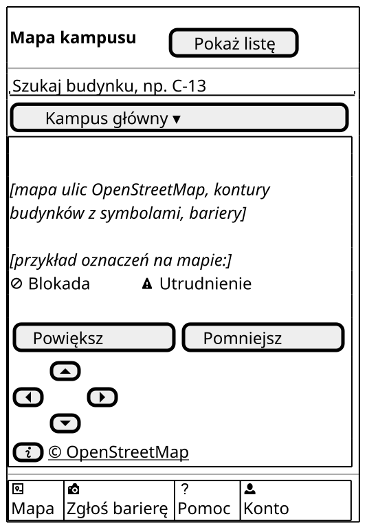

Czynność główna: wpisanie symbolu budynku w pole na górze ekranu.

| Element | AC/BR/NFR |
| --- | --- |
| Nagłówek „Mapa kampusu” bez „Wstecz”, bo to ekran startowy | wymagania wspólne, NFR-15 |
| Pole „Szukaj budynku, np. C-13” na pełną szerokość, pierwsze pod nagłówkiem | US1.1, PW-8 |
| „Pokaż listę” w wierszu tytułu; na liście „Pokaż mapę” | NFR-19 |
| Przycisk terenu w lewym górnym rogu mapy z nazwą wybranego terenu, np. „Kampus główny”; otwiera panel „Teren na mapie” | US1.6, US1.7, NFR-17, NFR-18 |
| „ⓘ” przy podpisie otwiera arkusz „Legenda”: znaki mapy i planu z napisami, na końcu źródła | US1.4, NFR-21, decyzja 48 |
| Zastępnik mapy: mapa ulic, kontury budynków, bariery ze zgłoszeń przyjętych | US1, US1.3, US10.6, NFR-11 |
| Bariera na mapie: znak uciążliwości, a słowo, np. „Blokada”, gdy mieści się bez nakładania | US1.3, NFR-20, NFR-21, PW-13 |
| Na mapie „Powiększ”, „Pomniejsz” i strzałki przesuwania w krzyżu, każda z nazwą dla TalkBack „Przesuń mapę w górę” itd. | NFR-15 (WCAG 2.5.1, 2.5.7), NFR-18, PW-8, PW-11 |
| „© OpenStreetMap contributors” w jednym wierszu jako odnośnik, w ramce mapy; obok „ⓘ” | NFR-37, NFR-40 |
| Pasek dolny z „Konto” | US1, US4, US5.1, US14 |

| Stan bez osobnej makiety | Co się zmienia |
| --- | --- |
| Ładowanie | w miejscu mapy napis „Wczytujemy mapę kampusu…”; kontury pojawiają się przed mapą ulic (NFR-11) |
| Błąd: brak mapy ulic | w miejscu mapy ulic napis „Mapa ulic chwilowo się nie wczytuje. Budynki i bariery nadal możesz oglądać.” (NFR-50) |
| Pierwsze uruchomienie | przed mapą otwiera się instrukcja V5 (US5.1) |
| Duża czcionka | przy skali czcionki co najmniej 1,5 ekran startuje na liście budynków (NFR-19, NFR-20) |

### V1: wyszukiwanie

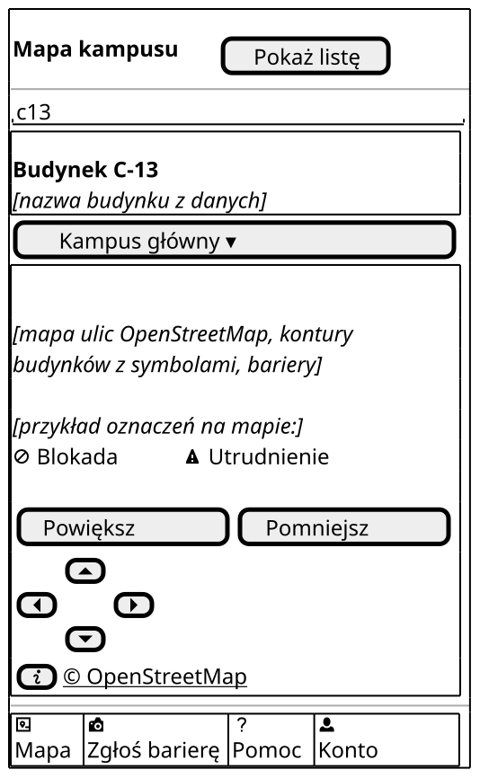

Czynność główna: wybór wyniku „Budynek C-13”, który zaznacza budynek na mapie i otwiera V2.

| Element | AC/BR/NFR |
| --- | --- |
| Wpisany zapis „c13” bez myślnika i wielkiej litery | US1.1, PW-8 |
| Wynik: symbol w zapisie z dywizem i nazwa budynku z danych; cała ramka wyniku to jeden cel dotyku | US1.1, NFR-17 |
| Wybór wyniku otwiera V2; po „Wstecz” z V2 widać zaznaczony budynek | US1.1, US3.2 |

### V1: lista budynków

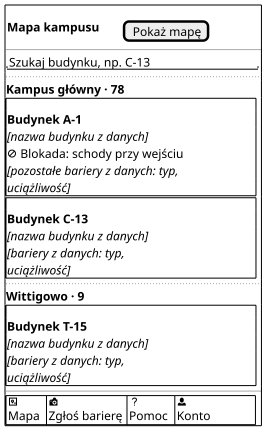

Czynność główna: dotknięcie budynku na liście, które otwiera V2.

| Element | AC/BR/NFR |
| --- | --- |
| Lista otwarta przyciskiem „Pokaż listę”; w wierszu tytułu „Pokaż mapę” | NFR-19 |
| Pozycja: „Budynek A-1”, nazwa z danych, bariery z uciążliwością tekstem i ikoną; cała ramka pozycji to jeden cel dotyku | NFR-19, US1.3, NFR-21, NFR-17 |
| Bariery A-1 jak we wzorcu V2: schody przy wejściu głównym [1], pozostałe jako zastępnik | US1.3, BR-7 |
| Lista daje tę samą informację co mapa, więc jest drogą dla TalkBack | NFR-19, NFR-18 |
| Dotknięcie pozycji: mapa z zaznaczonym budynkiem i kartą V2 na niskiej wysokości. Przy TalkBack, dużej czcionce albo szerokim oknie karta V2 od razu na cały ekran. Zamknięcie karty wraca do listy | US2.8, NFR-19 |
| Przy dużej czcionce lista jest widokiem startowym | NFR-20 |
| Lista jest podzielona nagłówkami terenów z liczbą budynków, np. „Wittigowo · 9”; wybranie budynku z innego terenu zmienia teren | US1.8, NFR-18, NFR-19 |
| Bez przycisków mapy i podpisu OpenStreetMap, bo lista nie pokazuje mapy | decyzja 16 |

### V1: brak wyniku

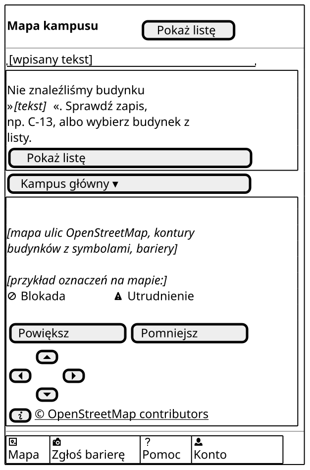

Czynność główna: „Pokaż listę” w komunikacie, gdy wyszukiwanie nic nie dało.

| Element | AC/BR/NFR |
| --- | --- |
| Komunikat z katalogu; wpisany tekst jako zastępnik | UC1 3a, NFR-50, PW-9 |
| Przycisk „Pokaż listę” przełącza widok na listę | UC1 3a, NFR-19 |
| Komunikat stoi zaraz pod polem, więc osoba widzi go tam, gdzie pisała | NFR-15 (WCAG 3.3.1) |

### V1: brak sieci

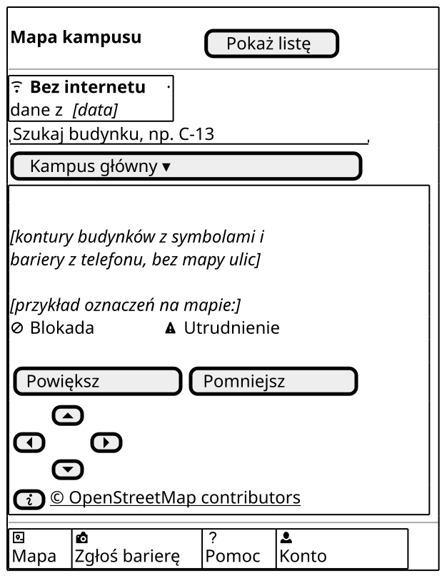

Czynność główna: wpisanie symbolu budynku, jak w stanie zwykłym.

| Element | AC/BR/NFR |
| --- | --- |
| „Brak internetu” z ikoną i „Dane z [data]” pod nagłówkiem | US9.1, NFR-10, NFR-21, PW-4 |
| Kontury i bariery z telefonu, bez mapy ulic | NFR-10, NFR-39 |

### V1: pierwsze otwarcie bez internetu

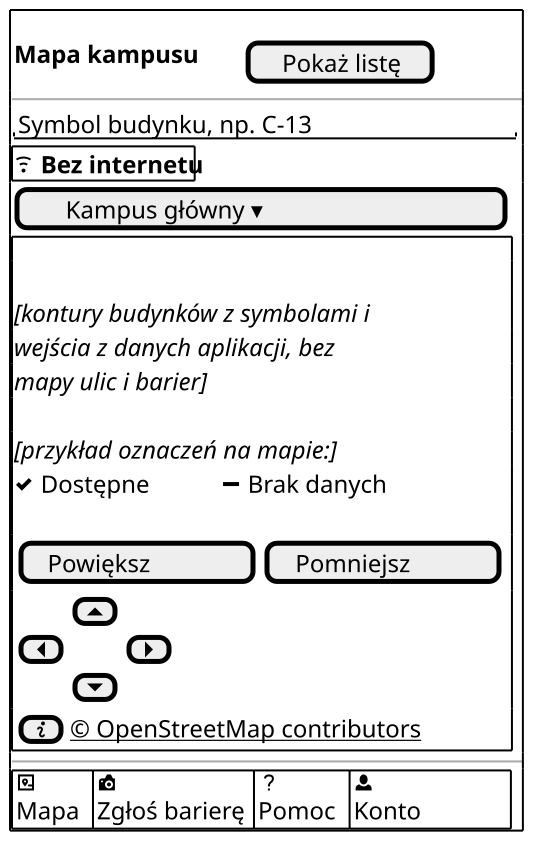

Czynność główna: wpisanie symbolu budynku, jak w stanie zwykłym.

| Element | AC/BR/NFR |
| --- | --- |
| Wskaźnik braku internetu bez daty, bo w telefonie nie ma jeszcze pobranych danych | NFR-10, NFR-21, PW-4 |
| Kontury budynków z symbolami i wejścia z danych aplikacji, bez mapy ulic, barier i planów pięter | NFR-10, NFR-39, US1.4 |
| Pole symbolu działa, bo kontury z symbolami są w danych aplikacji | US1.1, NFR-10 |
| Bez komunikatu i bez przycisku: bariery, plany i mapa ulic wczytają się same po powrocie sieci | NFR-10, NFR-6 |

### V1: znaleziona sala

Czynność główna: przeczytanie kroków. Wiersz budynku „Budynek A-1” pod nagłówkiem otwiera V2 na niskiej wysokości.

| Element | AC/BR/NFR |
| --- | --- |
| W polu „A-1 329”: symbol budynku i numer sali | decyzja 44 |
| Kolumna pięter po lewej pod przyciskiem terenu, nad arkuszem; wybrane piętro sali | US16.1, NFR-21 |
| Plan piętra z wyróżnioną salą i krótkimi podpisami; pod mapą „Źródło: Politechnika Wrocławska” | US16.1, NFR-40 |
| Nagłówek arkusza „Sala 329” z „Zamknij”, pod nim wiersz budynku ze znakiem budynku i strzałką, funkcja sali jako zastępnik i piętro z danych PWr | decyzja 44, NFR-40, decyzja z 18.11.2026 |
| Kroki tekstem od wejścia zalecanego, bez linii trasy | BR-25, decyzja 44, decyzja 48 |
| Krok 2: winda przy klatkach C i D, bo tylko ona staje na parterze i na 2 piętrze [2] | decyzja 48 |
| „Zamknij” chowa arkusz, a plan zostaje | decyzja 48 |

| Stan bez osobnej makiety | Co się zmienia |
| --- | --- |
| Plan piętra | po „Pokaż na planie” na V2: plan bez arkusza sali |
| Sala bez drogi | w arkuszu zamiast kroków komunikat „Nie znaleźliśmy w danych wejścia i windy…”; wiersz budynku zostaje (BR-25) |
| Brak sali | komunikat „Nie znaleźliśmy sali »X« w budynku A-1…”, a pod nim wiersz budynku „Budynek A-1” |

### V1: plan piętra

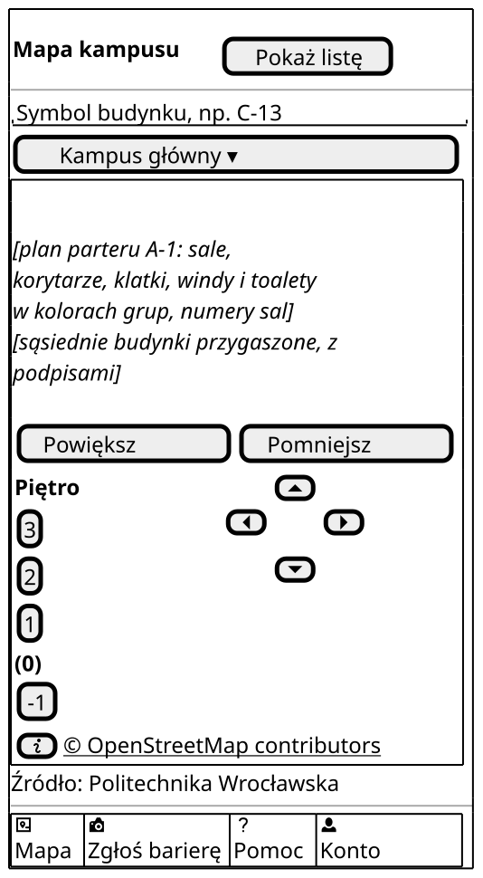

Czynność główna: wybór piętra w kolumnie pięter.

| Element | AC/BR/NFR |
| --- | --- |
| Plan pojawia się sam przy powiększeniu co najmniej 17 dla budynku szczegółowego na środku mapy; inne budynki przygaszone z podpisami | US16.1, NFR-11 |
| Na start piętro wejścia zalecanego; gdy dane go nie podają, parter | US16.1, BR-25 |
| Kolumna pięter po lewej pod przyciskiem terenu: „Piętro”, najwyższe u góry, wybrane w kółku, numery zamiast etykiet; TalkBack czyta pełną etykietę. Po „Pokaż na planie” budynek stoi obok kolumny, nie pod nią | US16.1, US1.3, US1.4, NFR-17, NFR-18, NFR-21 |
| Pod mapą „Źródło: Politechnika Wrocławska” | NFR-40 |

### V1: budynek bez planu

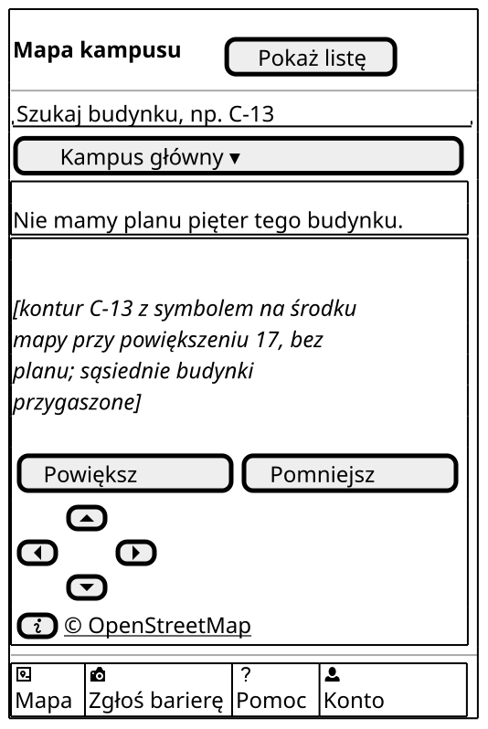

Czynność główna: brak; zdanie mówi, dlaczego planu nie widać.

| Element | AC/BR/NFR |
| --- | --- |
| Nad mapą „Nie mamy planu pięter tego budynku.” przy powiększeniu co najmniej 17 | US16.2, BR-G1 |
| Bez kolumny pięter i bez podpisu źródła planu | US16.2 |

### V1: winda na planie

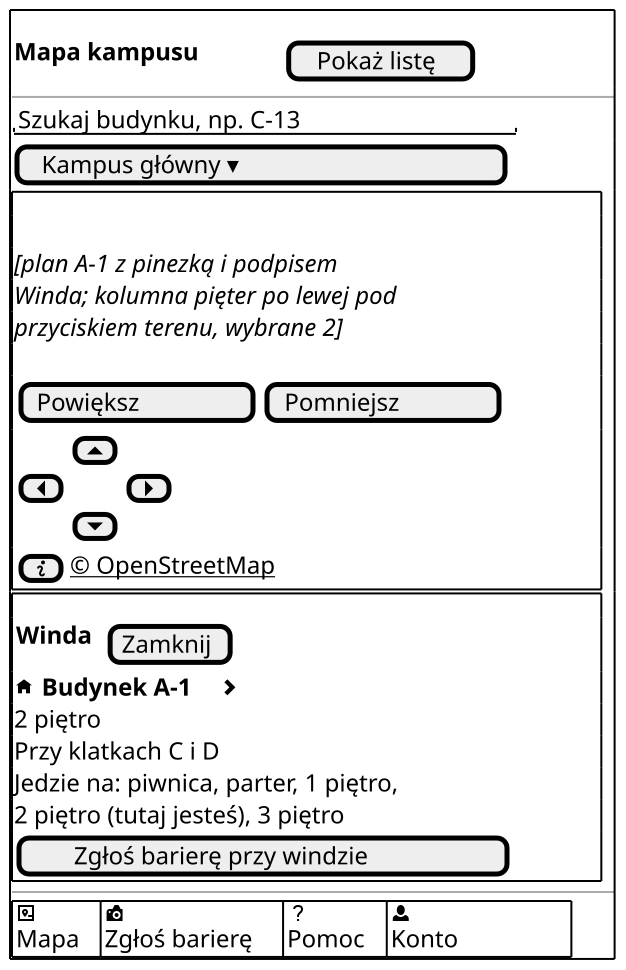

Czynność główna: przeczytanie, na które piętra jedzie winda.

| Element | AC/BR/NFR |
| --- | --- |
| Dotknięcie windy na planie otwiera arkusz „Winda” z klatkami, przy których stoi | US16.1, US18.2 |
| „Jedzie na: …” z piętrami windy; przy bieżącym piętrze „(tutaj jesteś)” | US16.1, US18.2, NFR-18 |
| „Zamknij” w nagłówku; przy dużej czcionce arkusz na cały ekran | NFR-53, NFR-20 |

### V1: legenda przy planie

Czynność główna: odczytanie znaków planu.

| Element | AC/BR/NFR |
| --- | --- |
| Znaki mapy z napisami, jak bez planu | US1.4, NFR-21 |
| Gdy widać plan: sala, korytarz, klatka schodowa, winda, toaleta dostosowana i „?” zgłoszenia bez piętra | US1.4, US16.1, NFR-21 |
| Na końcu „Źródło: Politechnika Wrocławska”, a gdy treść się nie mieści, „Przewiń w dół ↓” | NFR-40, NFR-20 |

### V1: bariery na planie

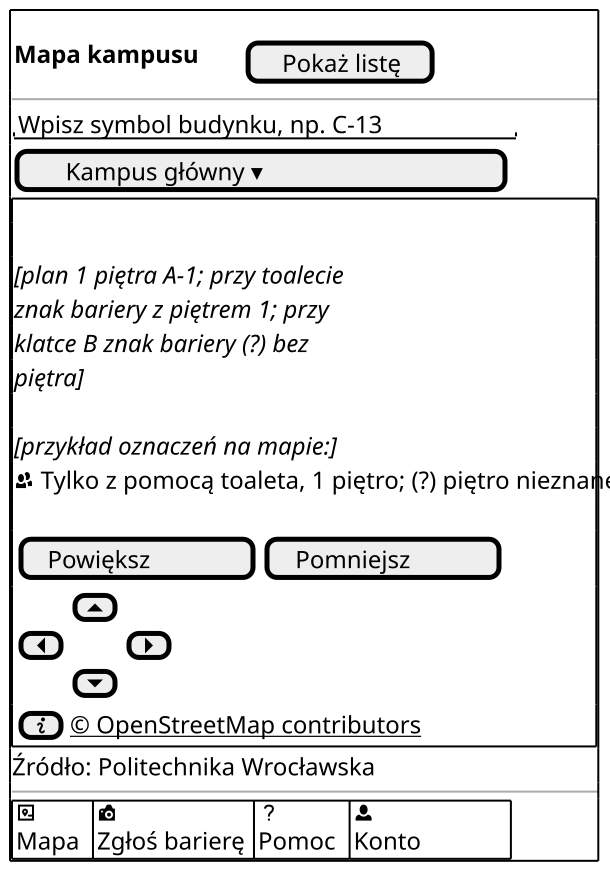

Czynność główna: dotknięcie znaku bariery, jak bez planu.

| Element | AC/BR/NFR |
| --- | --- |
| Zgłoszenie przyjęte z piętrem stoi tylko na swoim piętrze | US16.1, BR-14 |
| Zgłoszenie bez piętra stoi na każdym piętrze ze znakiem „?”, a TalkBack czyta „piętro nieznane” | US16.1, BR-14, NFR-18 |

### V1: bariera na mapie

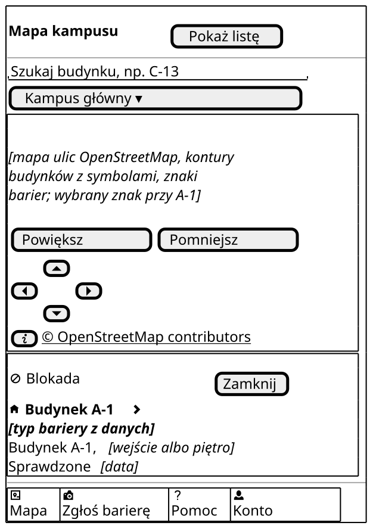

Czynność główna: przeczytanie, jaka to bariera. Wiersz budynku „Budynek A-1” pod nagłówkiem otwiera V2 na niskiej wysokości.

| Element | AC/BR/NFR |
| --- | --- |
| Dotknięcie znaku bariery otwiera arkusz; znak ma nazwę dla TalkBack | US1.3, NFR-18 |
| Typ bariery jako zastępnik, uciążliwość napisem i ikoną | US1.3, BR-7, NFR-21 |
| Miejsce: budynek i wejście albo piętro, „Sprawdzone [data]” | US2.2, PW-3 |
| Wiersz budynku ze znakiem budynku i strzałką zastępuje „Pokaż opis budynku”; mapa się nie rusza. Bariera poza budynkiem ma „Poza budynkiem” i nie ma wiersza | US1.5, BR-G2, decyzja z 18.11.2026 |
| „Zamknij” w nagłówku chowa arkusz, a mapa zostaje | wymagania do ekranów (V1) |

### V1: arkusz wejścia

Czynność główna: brak; odpowiedź, którym wejściem wejść, podała już karta V2.

| Element | AC/BR/NFR |
| --- | --- |
| Arkusz otwiera „Pokaż wejście na mapie” z V2, dotknięcie wiersza wejścia na V2 i dotknięcie znaku wejścia na mapie | US2.1, US3.3 |
| Wejście zaznaczone pinezką z podpisem nazwy; kamera stoi na wejściu. Arkusz ma najwyżej pół ekranu, a dłuższa treść się przewija; wejście stoi na środku mapy nad arkuszem | US3.3, NFR-19, NFR-53 |
| Znak oznaczenia, nagłówek „Wejście” i obrysowany „Zamknij”; po otwarciu fokus TalkBack na nagłówku. „Zamknij” zamyka arkusz razem z kartą i zostawia mapę. „Wstecz” arkusza otwartego z karty V2 wraca do karty: ta sama wysokość, to samo przewinięcie |
| Pod nagłówkiem wiersz budynku: znak budynku, „Budynek A-1” i strzałka. Otwiera V2 na niskiej wysokości, a arkusz otwarty z karty wraca do niej; mapa się nie rusza | US2.8, US3.3, NFR-18, decyzja z 18.11.2026 | US2.1, US3.3, NFR-18, NFR-21, NFR-53 |
| Pod słowem oznaczenia „Zalecane.”, data i źródło | US17.3, BR-24, BR-25, PW-3 |
| Części „Dojście”, „Drzwi” z szerokością i „Za drzwiami” z windą i odległością w linii prostej. Te same części z nagłówkami przy każdym wejściu; część bez danych nie stoi. Przy wejściu z planów PWr nie ma „Za drzwiami” | US3.3, US16.3, BR-25 |
| „Bariery przy tym wejściu”: typ i uciążliwość jako zastępniki, bo deklaracja A-1 nie podaje barier przy tym wejściu. Typ stoi krojem nagłówków części | US2.2, US3.3, PW-3 |
| Innych wejść budynku arkusz nie pokazuje: są na liście „Wejścia” karty V2 | US3.3 |
| „Zgłoś barierę przy wejściu” na końcu arkusza: V4 z wybranym wejściem, Gość: L1 | US4.6, US14.2, WCAG 2.5.3 |

| Stan bez osobnej makiety | Co się zmienia |
| --- | --- |
| Wejście „Niedostępne” albo niezalecane | znak i słowo oznaczenia, data i źródło bez „Zalecane.”; nazwa, uwaga i części z nagłówkami jak przy wejściu zalecanym, gdy są w danych (US2.1) |
| Wejście „Brak danych” | cichy romb i słowo, zdanie „Nie mamy danych o dostępności tego wejścia.” (US17.1) |
| Duża czcionka, okno co najmniej 600 dp | arkusz na cały ekran, bez mapy, z „Zamknij” w nagłówku. „Zamknij” zostawia mapę, a „Wstecz” wraca do karty V2 albo do mapy, skąd otwarto arkusz (reguła 6 sekcji „Duża czcionka”, NFR-20) |

### V1: arkusz toalety

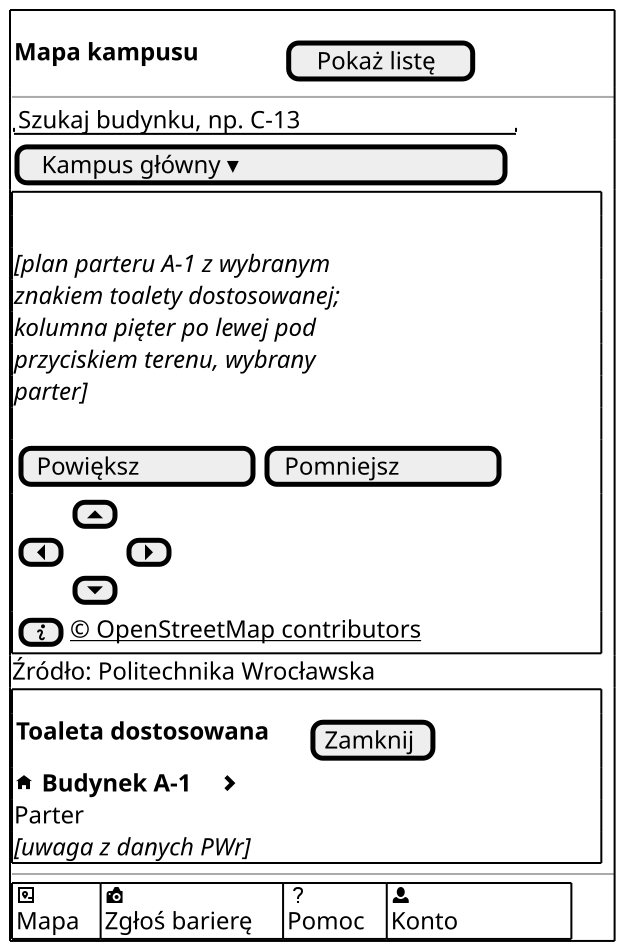

Czynność główna: przeczytanie, gdzie jest toaleta.

| Element | AC/BR/NFR |
| --- | --- |
| Dotknięcie znaku toalety dostosowanej na planie otwiera arkusz; mapa się nie rusza | US16.1, NFR-17 |
| Nagłówek „Toaleta dostosowana” i obrysowany „Zamknij” | US16.1, NFR-53 |
| Pod nagłówkiem wiersz budynku „Budynek A-1”: otwiera V2 na niskiej wysokości | US2.8, decyzja z 18.11.2026 |
| Etykieta piętra z danych PWr, np. „Parter”, i uwaga, gdy jest w danych | US16.1, NFR-40 |

### V1: arkusz schodów

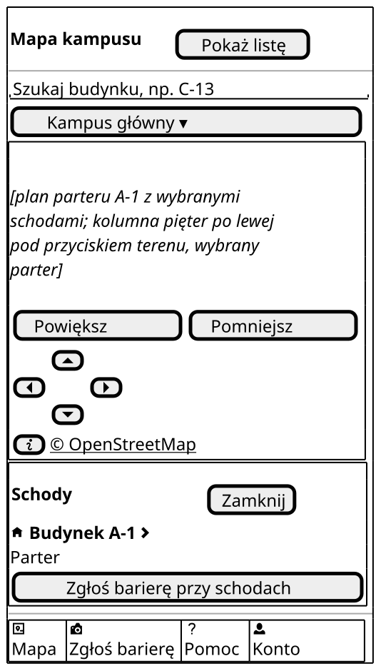

Czynność główna: przeczytanie, na którym piętrze są schody.

| Element | AC/BR/NFR |
| --- | --- |
| Dotknięcie schodów na planie otwiera arkusz; mapa się nie rusza | US16.1, NFR-17 |
| Nagłówek „Schody” i obrysowany „Zamknij” | US16.1, NFR-53 |
| Pod nagłówkiem wiersz budynku „Budynek A-1”, a pod nim etykieta piętra z danych PWr | US2.8, US16.1, decyzja z 18.11.2026 |

### V1: arkusz „Który budynek?”

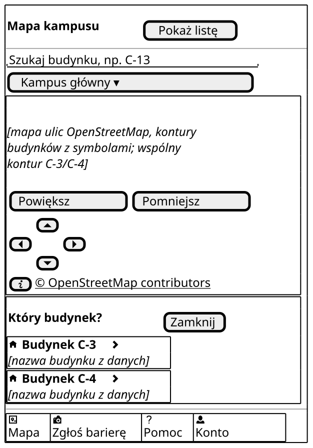

Czynność główna: wybór budynku.

| Element | AC/BR/NFR |
| --- | --- |
| Arkusz otwiera dotknięcie konturu wspólnego, np. „C-3/C-4”, albo dotknięcie obok dwóch konturów, poza nimi | US2, US3.2, decyzja 85 |
| Nagłówek „Który budynek?” i obrysowany „Zamknij” | NFR-53 |
| Każdy budynek to wiersz budynku w ramce na pełną szerokość: znak budynku, „Budynek C-3”, strzałka i pod spodem nazwa z danych, gdy jest. Otwiera V2 na niskiej wysokości; mapa się nie rusza | US2, NFR-17, NFR-18, decyzja z 18.11.2026 |

### V1: panel „Teren na mapie”

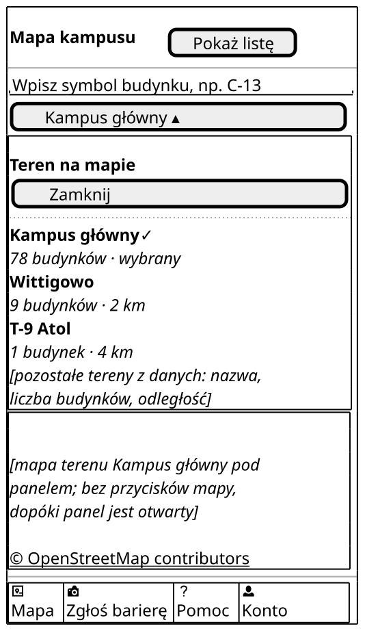

Czynność główna: wybranie terenu z listy, które pokazuje mapę tego terenu.

| Element | AC/BR/NFR |
| --- | --- |
| Przycisk terenu z nazwą wybranego terenu otwiera panel pod sobą; panel i arkusz „Legenda” nie są otwarte razem | US1.6, US1.7 |
| Nagłówek „Teren na mapie” z „Zamknij”; po otwarciu fokus TalkBack stoi na nagłówku, po zamknięciu wraca na przycisk terenu | US1.7, NFR-18, NFR-20 |
| Teren na liście: nazwa, liczba budynków i odległość od wybranego terenu; wybrany ma znak „✓” i napis „wybrany” | US1.7, NFR-21 |
| Wybranie terenu zamyka panel i pokazuje mapę tego terenu | US1.7, BR-G5 |

### V1: brzeg terenu

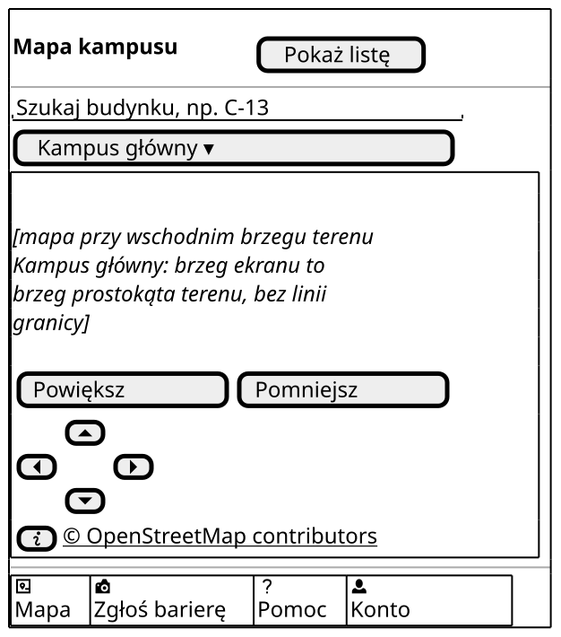

Czynność główna: przycisk terenu, który otwiera listę terenów.

| Element | AC/BR/NFR |
| --- | --- |
| Cały widok mapy zostaje w prostokącie wokół wybranego terenu; mapa nie rysuje granicy terenu i nie wybiela otoczenia | US1.7, BR-G5, NFR-39 |
| Przy dojściu do granicy TalkBack ogłasza raz: „Tu kończy się teren Kampus główny. Inny teren wybierzesz przyciskiem «Zmień teren» u góry mapy.” | US1.7, NFR-18 |

### V1: wynik z innego terenu

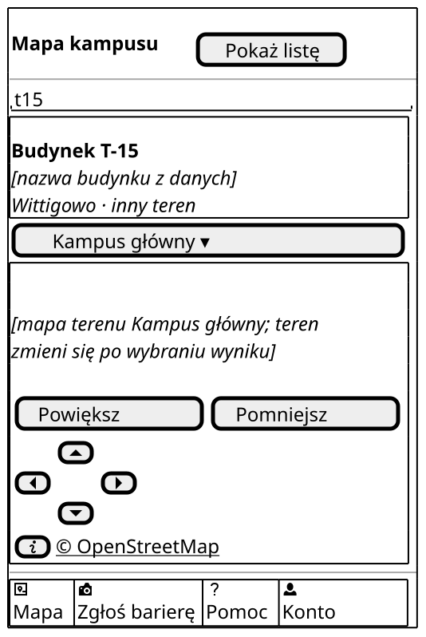

Czynność główna: wybranie wyniku, które zmienia teren mapy i otwiera V2.

| Element | AC/BR/NFR |
| --- | --- |
| Wynik budynku z innego terenu ma dopisek z nazwą terenu: „Wittigowo · inny teren” | US1.8, US1.1 |
| Wybranie wyniku zmienia teren na teren budynku | US1.8, BR-G5 |

### V1: po zmianie terenu

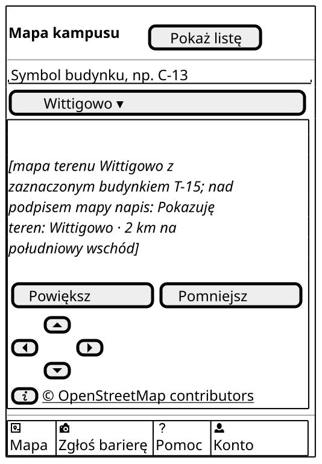

Czynność główna: jak w stanie zwykłym, na nowym terenie.

| Element | AC/BR/NFR |
| --- | --- |
| Przycisk terenu pokazuje nową nazwę: „Wittigowo” | US1.6, US1.8 |
| Napis „Pokazuję teren: Wittigowo · 2 km na południowy wschód” nad mapą mówi o zmianie terenu, odległości i kierunku | US1.8, NFR-18, NFR-56 |
| Zamknięcie karty zostawia teren „Wittigowo” | US1.8, BR-G5 |

## V2 Karta budynku

Makiety low-fi to wcześniejszy etap. Wzorcem ekranu V2 są [makiety hi-fi](../ekrany/index.md#v2-karta-budynku).

Jak we wzorcu, makiety pokazują kartę na całym ekranie, bez mapy. Po dotknięciu budynku na mapie karta otwiera się na niskiej wysokości nad mapą V1 (decyzja 115).

### V2: mała karta nad mapą

Czynność główna: „Pokaż wejście na mapie”.

| Element | AC/BR/NFR |
| --- | --- |
| Mapa z wyróżnionym konturem budynku; mapa pod kartą bez nazw dla TalkBack | US2.8, NFR-19 |
| Przyciski mapy nad kartą: „Powiększ”, „Pomniejsz” i strzałki; bez wiersza tytułu i pola symbolu | NFR-53, decyzja 151 |
| Uchwyt: przycisk „Wysokość karty” z bieżącą wysokością; dotknięcie przechodzi na następną wysokość | US2.8, NFR-18, NFR-53 |
| Nagłówek: symbol, nazwa i obrysowany „Zamknij” po prawej; dolnego „Zamknij” nie ma | US2, NFR-53, decyzja 152 |
| Wiersz o wejściach zamiast chipów: znak, „Wejście dostępne” i zdanie z wejściem zalecanym | US2.8, US3.1, NFR-21 |
| „Pokaż wejście na mapie” wypełniony, tylko gdy jest wejście zalecane: V1 z zaznaczonym wejściem i jego arkuszem | US3, US3.2, US3.3, BR-25 |
| Pod kreską wystaje nagłówek „Wejścia” z uciętym następnym wierszem; dotknięcie podnosi kartę na połowę ekranu | US2.8, NFR-17, NFR-53 |

| Stan bez osobnej makiety | Co się zmienia |
| --- | --- |
| Brak wejścia dostępnego | wiersz „Brak wejścia dostępnego” ze znakiem i zdaniem, np. „Żadne z 3 wejść nie jest dostępne.”; bez „Pokaż wejście na mapie” (US3.1, BR-25) |
| Brak danych o wejściach | cichy napis „Brak danych o wejściach”, bez zdania i bez przycisku (US3.1, US17.1) |
| Brak sieci | nad nagłówkiem plakietka „Bez internetu” (NFR-10) |

### V2: połowa ekranu

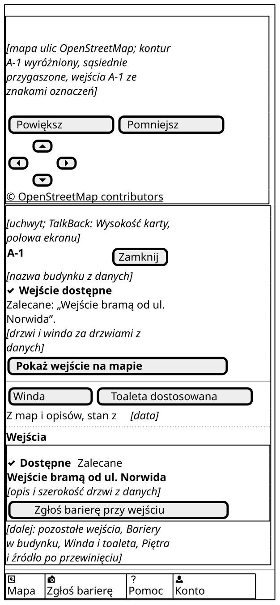

Czynność główna: „Pokaż wejście na mapie”.

| Element | AC/BR/NFR |
| --- | --- |
| Mapa nad kartą zostaje, z przyciskami mapy, gdy nad kartą jest co najmniej 300 dp mapy | US2.8, NFR-53, decyzja 151 |
| Uchwyt „Wysokość karty” z bieżącą wysokością; dotknięcie przechodzi na cały ekran | US2.8, NFR-18, NFR-53 |
| Nagłówek i wiersz o wejściach jak na niskiej wysokości | US2.8, US3.2 |
| Pod kreską początek pełnego opisu: chipy, data i źródło, „Wejścia”. Po przewinięciu karty dalej „Bariery w budynku”, „Winda i toaleta”, „Piętra” i źródło | US2, US2.8, NFR-53 |

### V2: od razu na cały ekran

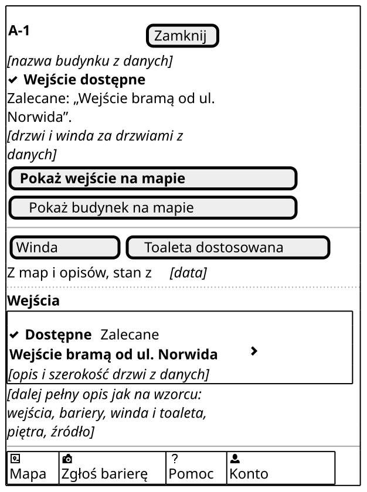

Czynność główna: „Pokaż wejście na mapie”.

| Element | AC/BR/NFR |
| --- | --- |
| Karta otwiera się od razu na cały ekran przy skali czcionki co najmniej 1,5 i w oknie co najmniej 600 dp. Tak samo poziomo i po wyborze z listy przy TalkBack. Mapy nie ma | NFR-19, NFR-20, NFR-22, NFR-51 |
| Dwie wysokości: cały ekran i zamknięta; przeciągnięcie w dół zamyka kartę | US2.8, NFR-53 |
| Pod „Pokaż wejście na mapie” obrysowany „Pokaż budynek na mapie”, a bez wejścia zalecanego pod wierszem o wejściach. Zmienia zapamiętany wybór V1 na „Mapa” | US2.9, NFR-19, NFR-20 |
| Dalej pełny opis jak na wzorcu | US2 |

### V2: budynek podstawowy

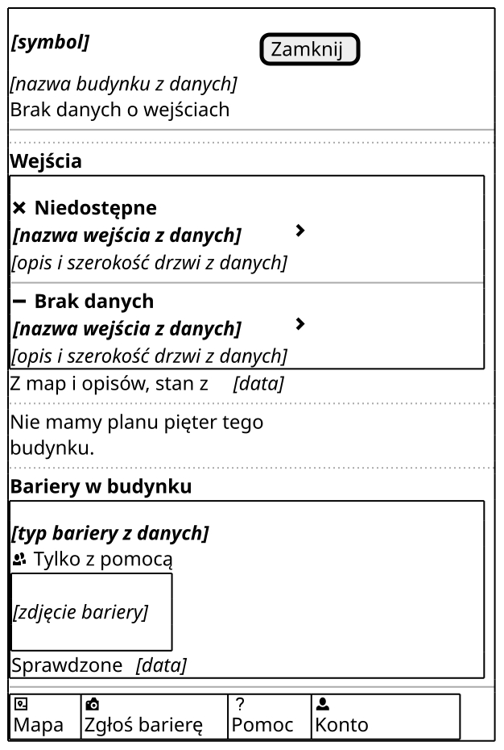

Czynność główna: brak; bez wejścia zalecanego nie ma „Pokaż wejście na mapie”.

| Element | AC/BR/NFR |
| --- | --- |
| Symbol, nazwa i wejścia jako zastępniki, bo nie wiemy, które budynki będą podstawowe | BR-G1, BR-G3 |
| Napis „Nie mamy planu pięter tego budynku.” zamiast pięter i planu | US16.2, BR-G1, PW-6, decyzja 54 |
| Bez grup „Winda i toaleta” i „Piętra”, bez chipów i bez „Źródło: Politechnika Wrocławska” | US16.2, NFR-48 |
| Budynek bez wejścia „Dostępne”: brak napisu „Zalecane”, wejścia „Niedostępne” na początku | BR-25 |
| Bariera z uciążliwością „Tylko z pomocą” tekstem i ikoną | US2.2, NFR-21, PW-13 |

| Stan bez osobnej makiety | Co się zmienia |
| --- | --- |
| Ładowanie | tekst widać od razu, a w miejscu zdjęcia jest napis „Wczytujemy zdjęcie…” (NFR-12) |
| Błąd zdjęcia | w miejscu zdjęcia „Nie udało się wczytać zdjęcia. Spróbuj ponownie za chwilę.” i „Spróbuj ponownie” (NFR-50) |
| Budynek podstawowy bez barier | napis „Nie mamy planu pięter tego budynku.”, a pod „Bariery w budynku” zdanie ze stanu pustego (UC2 2a, PW-6) |

### V2: brak sprawdzonych barier

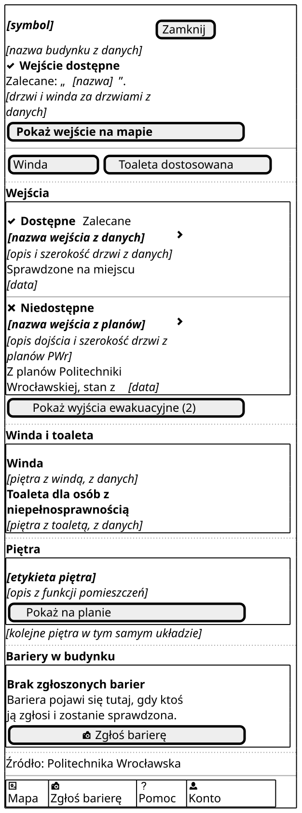

Czynność główna: „Pokaż wejście na mapie”.

| Element | AC/BR/NFR |
| --- | --- |
| Pod „Bariery w budynku” ramka „Brak zgłoszonych barier” ze zdaniem „Bariera pojawi się tutaj, gdy ktoś ją zgłosi i zostanie sprawdzona.” | UC2 2a, PW-6, decyzja 48 |
| „Zgłoś barierę” w ramce: jedyne miejsce tego przycisku w treści karty | US4, decyzja 48 |
| Wejścia mają różne źródła, więc data i źródło stoją przy każdym wejściu | BR-24, US17.3 |
| Drugie wejście z planów PWr: nazwa, opis dojścia i szerokość drzwi, źródło „Z planów Politechniki Wrocławskiej, stan z [data]” | BR-24, BR-27, US17.1 |
| „Pokaż wyjścia ewakuacyjne (2)” pod listą wejść; wyjście ewakuacyjne nie stoi na liście wejść | US2.6, BR-27 |
| Nagłówek „Bariery w budynku” zostaje, więc osoba wie, której części dotyczy zdanie | UC2 2a |
| Budynek szczegółowy jako zastępnik: pusta lista nie może brzmieć jak fakt o PWr | decyzja 16, zasada danych przykładowych |

### V2: wejścia bez nazw

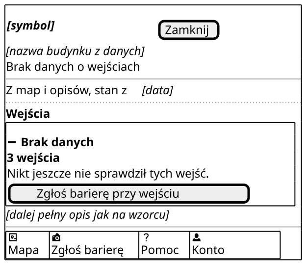

Czynność główna: brak; bez wejścia zalecanego nie ma „Pokaż wejście na mapie”.

| Element | AC/BR/NFR |
| --- | --- |
| Jeden wiersz zamiast jednakowych bloków, gdy żadne wejście budynku nie ma oznaczenia ani nazwy | US2.1, US17.1, NFR-21 |
| Napis „3 wejścia”: 2–4 „wejścia”, 5 i więcej „wejść” | US17.1 |
| „Zgłoś barierę przy wejściu” w wierszu, bo nie ma jednego wejścia do otwarcia: V4 bez wybranego wejścia, Gość: L1 | US4.6, US14.2 |

| Stan bez osobnej makiety | Co się zmienia |
| --- | --- |
| Jedno wejście bez oznaczenia i nazwy | zwykły wiersz „Wejście” ze strzałką (US17.1) |

### V2: brak sieci

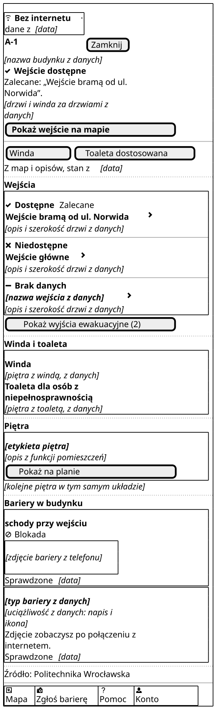

Czynność główna: „Pokaż wejście na mapie”; arkusz wejścia działa na danych z telefonu.

| Element | AC/BR/NFR |
| --- | --- |
| Plakietka „Bez internetu · dane z [data]” nad nagłówkiem karty, w tym samym miejscu na każdej wysokości; bez „Wstecz” | US9.1, NFR-10, NFR-21, decyzja 153 |
| Karta na całym ekranie bez mapy; na niższych wysokościach mapa nad kartą bez nowego podkładu | NFR-10, US2.8 |
| Zdjęcie zapisane w telefonie widać normalnie | NFR-10 |
| Zdjęcie spoza telefonu zastępuje „Zdjęcie zobaczysz po połączeniu z internetem.” | NFR-10, PW-6 |

### V2: budynku nie ma w telefonie

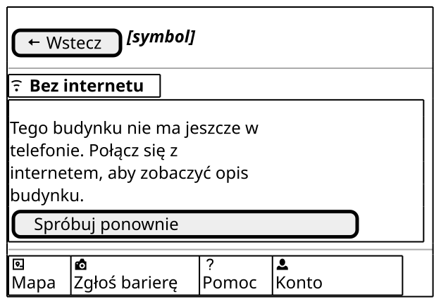

Czynność główna: „Spróbuj ponownie” po połączeniu z internetem.

| Element | AC/BR/NFR |
| --- | --- |
| Komunikat „Tego budynku nie ma jeszcze w telefonie…” ze słowami „opis budynku” zamiast „karta budynku” | NFR-10, PW-4 |
| „Spróbuj ponownie” wczytuje V2 | NFR-10 |
| Pasek dolny zostaje, więc osoba wraca do mapy jednym dotknięciem | wymagania wspólne |

### V2: Zbierający

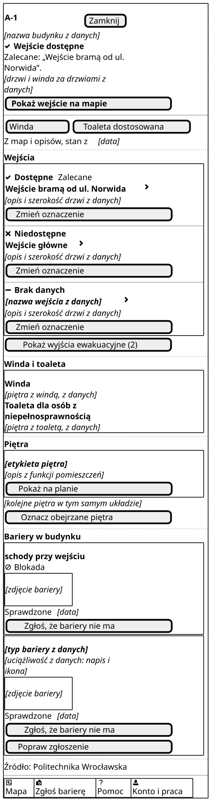

Czynność główna: „Pokaż wejście na mapie”; przyciski Zbierającego są zwykłe, bez pogrubienia.

| Element | AC/BR/NFR |
| --- | --- |
| „Zmień oznaczenie” w wierszu każdego wejścia, także przy „Brak danych” | US17.2, BR-24 |
| „Oznacz obejrzane piętra” pod grupą „Piętra”, raz dla całego budynku | US15.1, PW-12 |
| „Zgłoś, że bariery nie ma” przy każdej barierze | US8.4, BR-19, PW-12 |
| „Popraw zgłoszenie” tylko przy własnym zgłoszeniu przyjętym albo zgłoszeniu szybkim; tu przy drugiej barierze | BR-3, BR-18 |
| Pasek dolny z „Konto i praca” | US14.1, PW-1 |
| Gość i Odwiedzający nie widzą tych przycisków | US14.1, NFR-33 |

## V4 Zgłoszenie szybkie

Makiety low-fi to wcześniejszy etap. Wzorcem ekranu V4 są [makiety hi-fi](../ekrany/index.md#v4-zgoszenie-szybkie).

Kroki i potwierdzenia nie mają paska dolnego (wymagania wspólne). Gość niezalogowany zamiast aparatu widzi L1 (US14.2).

### V4: krok 1 z 3

Czynność główna: „Zrób zdjęcie”.

| Element | AC/BR/NFR |
| --- | --- |
| Nagłówek „Zgłoś barierę”, ten sam napis co na pasku dolnym | US4, PW-14 |
| „Krok 1 z 3” | US4.1 |
| „Nie fotografuj twarzy ani tablic rejestracyjnych.” przed przyciskiem | NFR-25 |
| „Zrób zdjęcie” z ikoną `camera-slr`, tą samą co na pasku | US4.1, BR-8 |

| Stan bez osobnej makiety | Co się zmienia |
| --- | --- |
| Błąd zapisu | „W telefonie brakuje miejsca, więc nie zapisaliśmy zdjęcia bariery…” i „Spróbuj ponownie”; zdjęcie i grupa zostają (NFR-5, NFR-7) |
| Z wybranym wejściem | po „Zgłoś barierę przy wejściu” w arkuszu wejścia pod numerem kroku napis „Wejście: »nazwa wejścia«” (US4.6) |

### V4: krok 1 ze zdjęciem

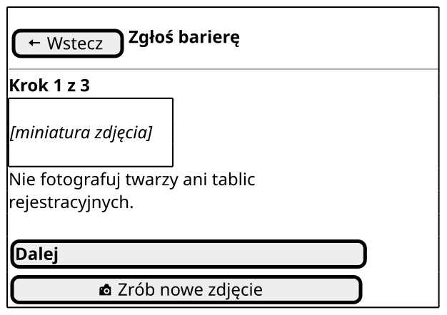

Czynność główna: „Dalej”. Przycisk prowadzi znowu do kroku 2 bez nowego zdjęcia.

| Element | AC/BR/NFR |
| --- | --- |
| Miniatura zrobionego zdjęcia | US4.1 |
| „Dalej” pogrubione nad „Zrób nowe zdjęcie”; wybrana grupa zostaje | US4.1, heurystyka Nielsena 3 |
| „Zrób nowe zdjęcie” z ikoną aparatu zamiast „Zrób zdjęcie” | US4.1, PW-8 |
| „Wstecz” otwiera potwierdzenie rezygnacji | UC7 1b |

### V4: krok 2 z 3

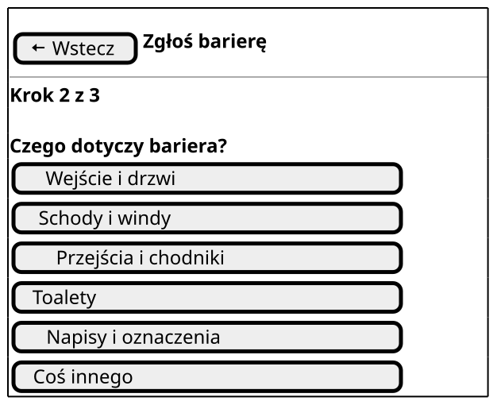

Czynność główna: wybór jednej z 6 grup barier.

| Element | AC/BR/NFR |
| --- | --- |
| Pytanie „Czego dotyczy bariera?” | US4.3, PW-7 |
| 6 przycisków grup jeden pod drugim, tej samej szerokości, sam tekst, bez ikon | US4.3, NFR-17, PW-7 |
| Bez typu, uciążliwości i budynku; o piętro pyta dopiero stan niżej | US4.3, BR-14 |
| „Wstecz” wraca do kroku 1, a zdjęcie zostaje | US4.1 |

### V4: krok 2, pytanie o piętro

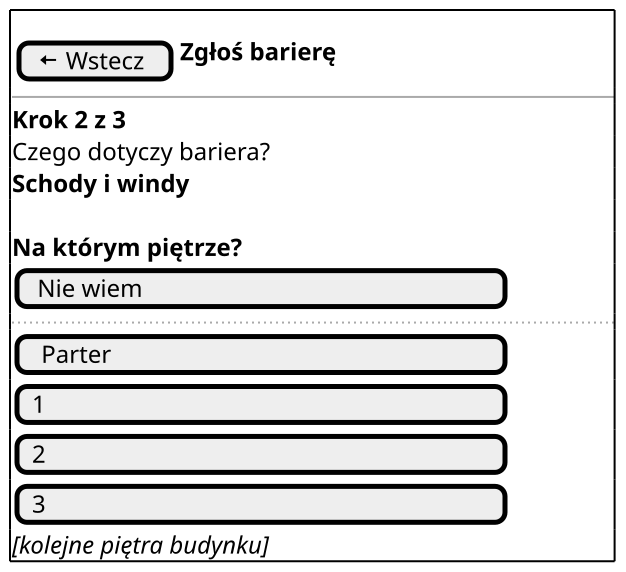

Czynność główna: wybór piętra albo „Nie wiem”. Stan pojawia się tylko w konturze budynku i przy grupie z tabeli w [regułach](../../biznes/reguly.md#pietro-w-zgloszeniu-szybkim).

| Element | AC/BR/NFR |
| --- | --- |
| „Krok 2 z 3” bez zmian, bo pytanie jest częścią kroku 2 | US4.1, NFR-27 |
| Wybrana grupa pod pytaniem „Czego dotyczy bariera?” | US4.5 |
| „Na którym piętrze?” i przyciski na pełną szerokość | US4.5, NFR-17 |
| „Nie wiem” nad piętrami, widoczne bez przewijania; zostawia piętro puste | US4.5, BR-14 |
| Budynek podstawowy: „Parter”, „1”, „2”…; budynek szczegółowy: etykiety pięter z danych PWr | US4.5, BR-G1 |
| „Wstecz” wraca do listy grup, a zdjęcie zostaje | US4.5 |

### V4: krok 3 z 3

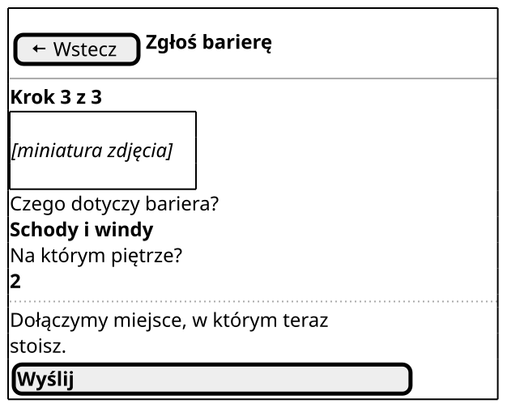

Czynność główna: „Wyślij”.

| Element | AC/BR/NFR |
| --- | --- |
| Miniatura zdjęcia i wybrana grupa pod pytaniem z kroku 2 | US4.1 |
| Wybrane piętro albo „Nie wiem” pod pytaniem „Na którym piętrze?”; bez tych wierszy, gdy pytania nie było | US4.5 |
| „Dołączymy miejsce, w którym teraz stoisz.” | US4.1, NFR-27 |
| „Wyślij” prowadzi do potwierdzenia | US4.1, US4.4 |

| Stan bez osobnej makiety | Co się zmienia |
| --- | --- |
| Ładowanie: pozycja jeszcze nieznana | zamiast zdania o miejscu „Ustalamy, gdzie jesteś…”; „Wyślij” czeka bez limitu czasu (NFR-23, PW-9) |

### V4: prośba o zgodę na lokalizację

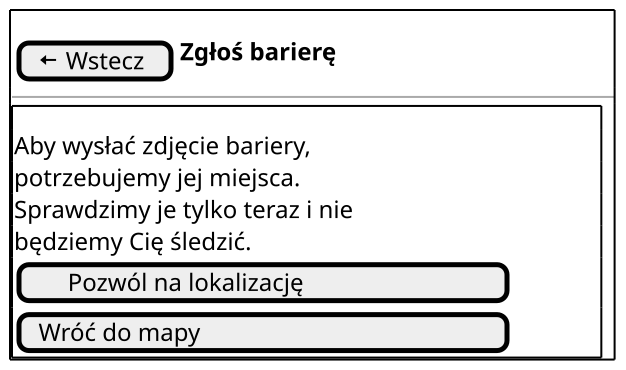

Czynność główna: „Pozwól na lokalizację”.

| Element | AC/BR/NFR |
| --- | --- |
| Komunikat przed aparatem: po co miejsce i że nie śledzimy | UC7 2a, NFR-27, PW-5 |
| „Pozwól na lokalizację” i „Wróć do mapy” tej samej wielkości | UC7 2a, NFR-15 |

| Stan bez osobnej makiety | Co się zmienia |
| --- | --- |
| Odmowa zgody | „Bez lokalizacji nie wyślesz zdjęcia bariery…”, przyciski „Otwórz ustawienia” i „Wróć do mapy”; aplikacja nie ponawia prośby (UC7 2a, BR-8) |
| Lokalizacja wyłączona w telefonie | „Lokalizacja w telefonie jest wyłączona…”, przyciski „Otwórz ustawienia” i „Wróć do mapy” (UC7 4c) |

### V4: zgoda tylko przybliżona

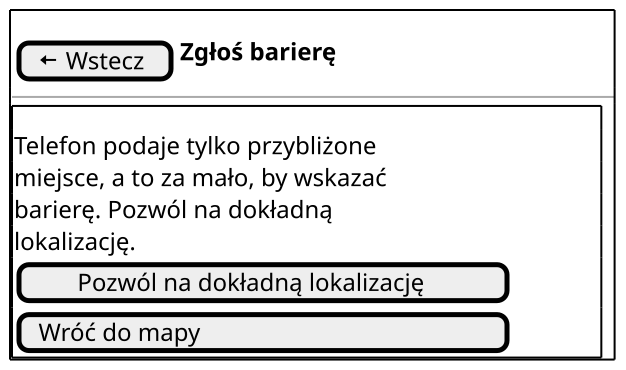

Czynność główna: „Pozwól na dokładną lokalizację”.

| Element | AC/BR/NFR |
| --- | --- |
| Komunikat: przybliżone miejsce nie wystarczy, by wskazać barierę | BR-8, BR-14 |
| „Pozwól na dokładną lokalizację” i „Wróć do mapy” tej samej wielkości | BR-8, NFR-15 |

### V4: brak pozycji

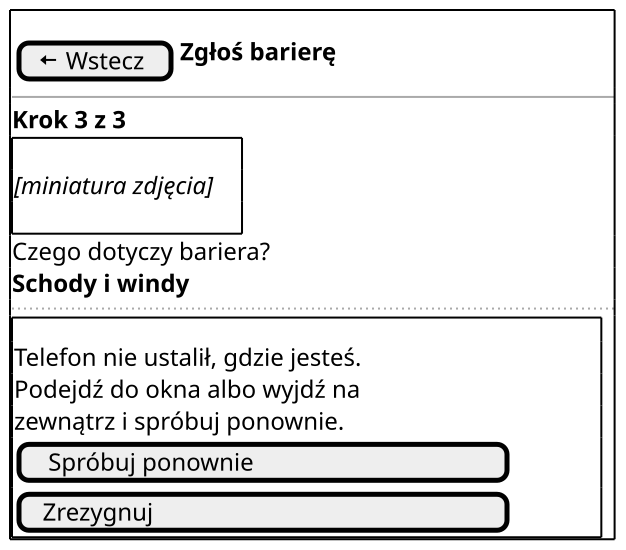

Czynność główna: „Spróbuj ponownie”.

| Element | AC/BR/NFR |
| --- | --- |
| Miniatura i grupa zostają na ekranie | UC7 4c |
| Komunikat z radą zamiast zdania o miejscu i „Wyślij” | UC7 4c, PW-5 |
| „Spróbuj ponownie” wraca do kroku 3, „Zrezygnuj” otwiera potwierdzenie rezygnacji | UC7 4c, UC7 1b |

### V4: potwierdzenie rezygnacji

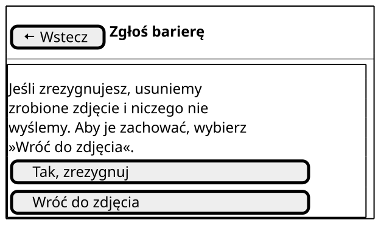

Czynność główna: brak wyróżnionej; oba przyciski mają tę samą wielkość.

| Element | AC/BR/NFR |
| --- | --- |
| Komunikat o skutku przed usunięciem zdjęcia | UC7 1b, heurystyki Nielsena 3 i 5 |
| „Tak, zrezygnuj” i „Wróć do zdjęcia” tej samej wielkości, bez limitu czasu | UC7 1b, NFR-23 |
| Po „Tak, zrezygnuj” V1 albo ekran sprzed V4; „Wróć do zdjęcia” wraca, skąd osoba przyszła | UC7 1b, UC7 4c |

### V4: potwierdzenie wysłania

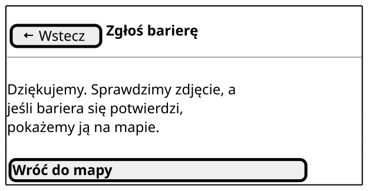

Czynność główna: „Wróć do mapy”.

| Element | AC/BR/NFR |
| --- | --- |
| „Dziękujemy. Sprawdzimy zdjęcie, a jeśli bariera się potwierdzi, pokażemy ją na mapie.” | US4.4, PW-5 |
| „Wróć do mapy” otwiera V1 | US4.4 |
| „Wstecz” wraca do ekranu sprzed V4, a nie do kroku 3 | wymagania wspólne, P2 |

### V4: potwierdzenie bez internetu

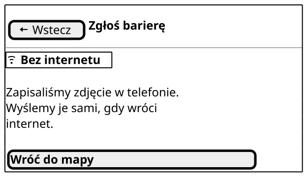

Czynność główna: „Wróć do mapy”.

| Element | AC/BR/NFR |
| --- | --- |
| „Brak internetu” z ikoną, bez daty danych, bo ekran nie pokazuje danych z telefonu | US9.1, NFR-21 |
| „Zapisaliśmy zdjęcie w telefonie. Wyślemy je sami, gdy wróci internet.” | US4.2, UC7 7a, PW-5 |

## V5 Pomoc

Makiety low-fi to wcześniejszy etap. Wzorcem ekranu V5 są [makiety hi-fi](../ekrany/index.md#v5-pomoc).

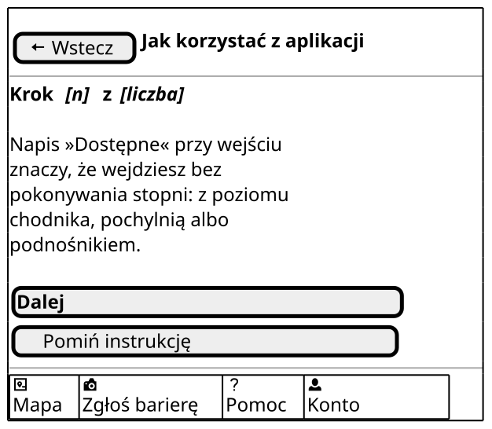

Czynność główna: „Dalej”.

| Element | AC/BR/NFR |
| --- | --- |
| Nagłówek „Jak korzystać z aplikacji” | US5.1 |
| Numer kroku jako zastępnik, bo liczbę kroków ustali treść instrukcji | US5.1 |
| Zdanie o napisie „Dostępne”: bez stopni, z poziomu chodnika, pochylnią albo podnośnikiem | US5.1, US2.1, BR-24, PW-15 |
| Bez obrazu: krok nie pokazuje przycisku aplikacji | US5.1, NFR-18 |
| „Dalej” pogrubione, „Pomiń instrukcję” zwykłe, oba na pełną szerokość | US5.1, PW-8, NFR-15 (WCAG 2.5.1) |
| Pasek dolny z „Konto” | wymagania wspólne |

| Stan bez osobnej makiety | Co się zmienia |
| --- | --- |
| Krok o koncie | zdanie „Aby zgłosić barierę, potrzebne jest konto. Możesz je założyć teraz w »Konto«.” (US5.1, US14.2) |
| Ostatni krok | „Zacznij” zamiast „Dalej”; otwiera V1 (US5.1) |
| Pierwsze uruchomienie i otwarcie z „Pomoc” | ten sam układ; przy pierwszym uruchomieniu instrukcja otwiera się sama (US5.1) |
| „Wstecz” | poprzedni krok instrukcji; w pierwszym kroku przy pierwszym uruchomieniu działa jak „Pomiń instrukcję” i otwiera V1 (wymagania wspólne, NFR-15) |

## L1 Prośba o logowanie

Makiety low-fi to wcześniejszy etap. Wzorcem ekranu L1 są [makiety hi-fi](../ekrany/index.md#l1-prosba-o-logowanie).

### L1: stan zwykły

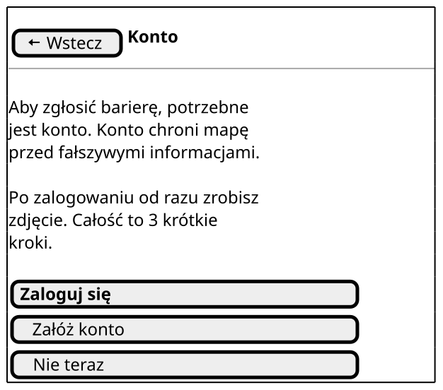

Czynność główna: „Zaloguj się”.

| Element | AC/BR/NFR |
| --- | --- |
| Nagłówek „Konto”, ten sam napis co na pasku dolnym | US14, PW-14 |
| „Aby zgłosić barierę, potrzebne jest konto. Konto chroni mapę przed fałszywymi informacjami.” | US14.2, BR-8, PW-5 |
| Przy wejściu z V4: „Po zalogowaniu od razu zrobisz zdjęcie. Całość to 3 krótkie kroki.” | US14.2, US4.1 |
| „Zaloguj się” prowadzi do strony logowania w przeglądarce; pola hasła w aplikacji nie ma | US14, NFR-31 |
| „Załóż konto” prowadzi do rejestracji z klauzulą informacyjną | US14.3, NFR-30 |
| „Nie teraz” tak samo szerokie, jak „Zaloguj się”; wraca do V1 | UC7 1b |
| Bez paska dolnego | wymagania wspólne |

| Stan bez osobnej makiety | Co się zmienia |
| --- | --- |
| Wejście z „Konto” | bez zdania o 3 krokach; po zalogowaniu otwiera się L2 (P3) |
| Błąd | komunikat „Logowanie się nie udało albo zostało przerwane. Sprawdź internet i spróbuj ponownie.”, przyciski „Spróbuj ponownie” i „Nie teraz” |

### L1: brak sieci

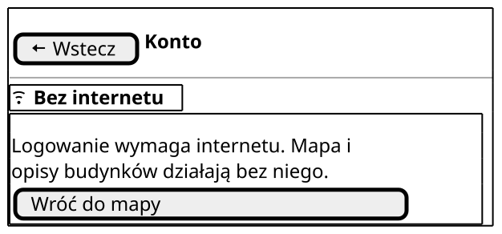

Czynność główna: „Wróć do mapy”.

| Element | AC/BR/NFR |
| --- | --- |
| „Brak internetu” z ikoną | US9.1, NFR-21 |
| „Logowanie wymaga internetu. Mapa i opisy budynków działają bez niego.” | UC6 1a, PW-4 |
| „Wróć do mapy” otwiera V1 | UC6 1a |

## L2 Konto

Makiety low-fi to wcześniejszy etap. Wzorcem ekranu L2 są [makiety hi-fi](../ekrany/index.md#l2-konto).

### L2: Odwiedzający

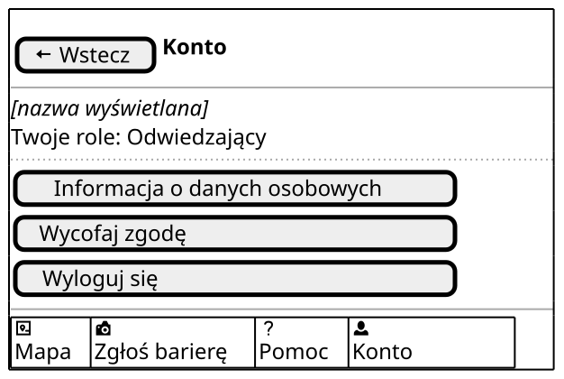

Czynność główna: brak; Odwiedzający nie ma czynności roli, a ekran pokazuje dane konta.

| Element | AC/BR/NFR |
| --- | --- |
| Nagłówek „Konto”, bez sekcji „Twoja praca” | US14.1, US14.3, PW-1 |
| Nazwa wyświetlana jako zastępnik i „Twoje role: Odwiedzający” | BR-1, US14.3 |
| „Informacja o danych osobowych”, „Wycofaj zgodę”, „Wyloguj się” w tej kolejności | NFR-30, NFR-29, PW-14 |
| Żaden przycisk nie jest pogrubiony, bo ekran nie ma czynności głównej | NFR-21 |
| Pasek dolny z „Konto” | wymagania wspólne |

| Stan bez osobnej makiety | Co się zmienia |
| --- | --- |
| Brak sieci | pod nagłówkiem „Brak internetu”; role z ostatniego logowania |

### L2: rola pracownicza

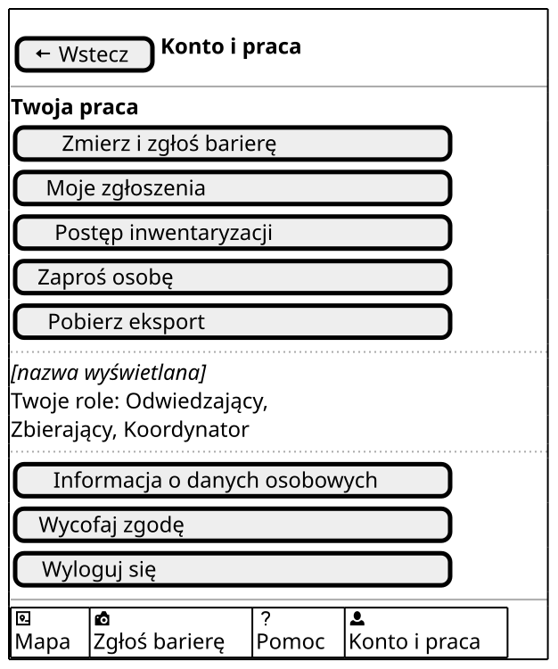

Czynność główna: wybór czynności z listy „Twoja praca” na górze ekranu.

| Element | AC/BR/NFR |
| --- | --- |
| Nagłówek „Konto i praca”, ten sam napis co na pasku | US14.1, PW-1 |
| „Twoja praca” na górze, lista przycisków z tekstem, bez kafelków | US14.1, BR-1, PW-1 |
| Zbierający: „Zmierz i zgłoś barierę” (C1), „Moje zgłoszenia” (C3) | US6, US8 |
| Koordynator: „Postęp inwentaryzacji” (K1), „Zaproś osobę” (K2), „Pobierz eksport” (K3) | US11, US12, US13 |
| Weryfikator widziałby „Zgłoszenia do sprawdzenia” (R1); tu nie ma tej roli | US10, US14.1 |
| „Twoje role: Odwiedzający, Zbierający, Koordynator” | BR-1, US14.3 |
| Pod spodem dane konta, klauzula, „Wycofaj zgodę”, „Wyloguj się” | NFR-30, NFR-29 |

### L2: klauzula informacyjna

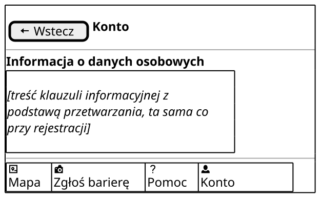

Czynność główna: brak; osoba czyta treść, a „Wstecz” wraca do zwykłego stanu L2.

| Element | AC/BR/NFR |
| --- | --- |
| Tytuł „Informacja o danych osobowych”, ten sam napis co przycisk | NFR-30, PW-14 |
| Treść klauzuli z podstawą przetwarzania jako zastępnik, ta sama co przy rejestracji | NFR-30 |
| 2 dotknięcia od mapy: „Konto”, „Informacja o danych osobowych” | NFR-30 |

### L2: potwierdzenie wycofania zgody

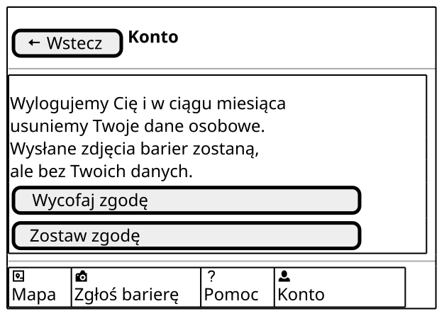

Czynność główna: brak wyróżnionej; oba przyciski mówią o skutku i mają tę samą wielkość.

| Element | AC/BR/NFR |
| --- | --- |
| Komunikat: wylogowanie, usunięcie danych w ciągu miesiąca, zdjęcia zostają bez danych | NFR-29, PW-5 |
| „Wycofaj zgodę” wylogowuje i otwiera V1, „Zostaw zgodę” wraca do L2 | NFR-29, NFR-30 |

## Źródła

1. Deklaracja dostępności budynku A-1 (wejście główne ze schodami, wejście dostępne z tyłu budynku, bramą od strony K.C. Norwida; drugie wejście przy ul. C.K. Norwida niedostosowane dla osób z problemami motorycznymi): <https://dostepnosc.pwr.edu.pl/dostepnosc-architektoniczna/deklaracje-dostepnosci-budynkow/budynki-a/a1>
2. Plany pięter PWr w ArcGIS (usługa „Planbudynku_A1”: sala 329 na 2 piętrze, windy A-1): <https://services3.arcgis.com/rrLByHvJ7zuJQDVw/arcgis/rest/services/>

Dostęp do źródeł: 28.10.2026.
