# Makiety: odwiedzający

Strona pokazuje ekrany Gościa niezalogowanego i Odwiedzającego: V1–V5, L1 i L2. Elementy, stany i cele przycisków pochodzą z [wymagań do ekranów](../wymagania-ekranow.md) i [mapy nawigacji](../mapa-nawigacji.md). Napisy są ze [słownika użytkownika](../slownik-uzytkownika.md) i są hipotezą do sprawdzenia w wywiadach.

Konwencje opisuje strona [Makiety](index.md). Stan, który różni się jednym napisem, opisuje tabela pod makietą. Wzorcowa makieta V2 w stanie zwykłym jest na stronie [Makiety](index.md#wzorcowa-makieta-v2-karta-budynku).

| Ekran | Makiety | Stany w tabelach |
| --- | --- | --- |
| V1 Mapa kampusu | zwykły, wyszukiwanie, lista budynków, brak wyniku, brak sieci, pierwsze otwarcie bez internetu | ładowanie, brak mapy ulic, pierwsze uruchomienie |
| V2 Karta budynku | budynek podstawowy, brak barier, brak sieci, budynku nie ma w telefonie, Zbierający | ładowanie, błąd zdjęcia, budynek podstawowy bez barier |
| V3 Którędy wejść | wejście jest, brak wejścia dostępnego, brak danych | brak sieci |
| V4 Zgłoszenie szybkie | kroki 1–3, krok 1 ze zdjęciem, prośba o zgodę, zgoda przybliżona, brak pozycji, rezygnacja, wysłane, wysłane bez internetu | Gość, odmowa zgody, lokalizacja wyłączona, ustalanie miejsca, błąd zapisu |
| V5 Pomoc | krok z objaśnieniem „Dostępne” | krok o koncie, ostatni krok |
| L1 Prośba o logowanie | zwykły, brak sieci | wejście z „Konto”, błąd |
| L2 Konto | Odwiedzający, rola pracownicza, klauzula, wycofanie zgody | brak sieci |

Fragmenty V1, V4 i V5, których nie ma w `_wspolne.iuml`, są w pliku `_odwiedzajacy.iuml`. To pole tekstowe, przełącznik „Mapa” i „Lista budynków”, przyciski mapy, zastępnik mapy, odnośnik OpenStreetMap i numer kroku. Plik poprawia też dopełnienie napisów przycisków, więc każdy przycisk z `$przycisk`, `$przycisk_glowny` i `$komunikat` ma tę samą szerokość.

## V1 Mapa kampusu

### V1: stan zwykły

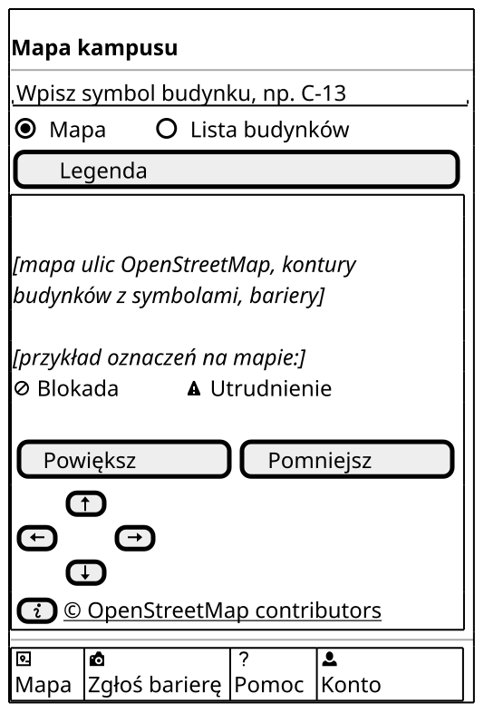

Czynność główna: wpisanie symbolu budynku w pole na górze ekranu.

| Element | AC/BR/NFR |
| --- | --- |
| Nagłówek „Mapa kampusu” bez „Wstecz”, bo to ekran startowy | wymagania wspólne, NFR-15 |
| Pole „Wpisz symbol budynku, np. C-13” na pełną szerokość, pierwsze pod nagłówkiem | US1.1, PW-8 |
| Przełącznik „Mapa” i „Lista budynków”; wybraną pozycję widać po kształcie pola | NFR-19, NFR-21 |
| Zastępnik mapy: mapa ulic, kontury budynków, bariery ze zgłoszeń przyjętych | US1, US1.3, US10.6, NFR-11 |
| Bariera na mapie: uciążliwość napisem i ikoną, np. „Blokada”, „Utrudnienie” | US1.3, NFR-21, PW-13 |
| „Powiększ”, „Pomniejsz”, „W górę”, „W dół”, „W lewo”, „W prawo” zamiast gestów | NFR-15 (WCAG 2.5.1), PW-8 |
| „© OpenStreetMap contributors” jako odnośnik | NFR-37 |
| Pasek dolny z „Konto” | US1, US4, US5.1, US14 |

| Stan bez osobnej makiety | Co się zmienia |
| --- | --- |
| Ładowanie | w miejscu mapy napis „Wczytujemy mapę kampusu…”; kontury pojawiają się przed mapą ulic (NFR-11) |
| Błąd: brak mapy ulic | w miejscu mapy ulic napis „Mapa ulic chwilowo się nie wczytuje. Budynki i bariery nadal możesz oglądać.” (NFR-50) |
| Pierwsze uruchomienie | przed mapą otwiera się instrukcja V5 (US5.1) |

### V1: wyszukiwanie

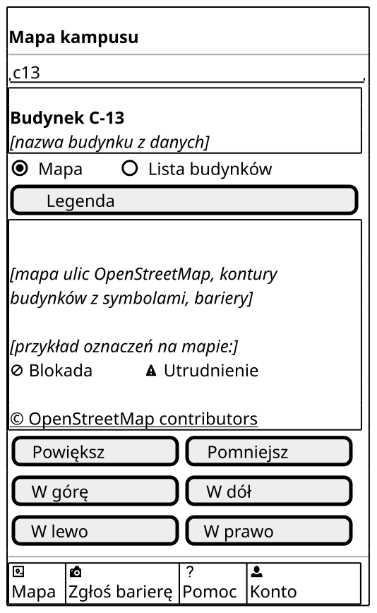

Czynność główna: wybór wyniku „Budynek C-13”, który zaznacza budynek na mapie i otwiera V2.

| Element | AC/BR/NFR |
| --- | --- |
| Wpisany zapis „c13” bez myślnika i wielkiej litery | US1.1, PW-8 |
| Wynik: symbol w zapisie z dywizem i nazwa budynku z danych; cała ramka wyniku to jeden cel dotyku | US1.1, NFR-17 |
| Wybór wyniku otwiera V2; po „Wstecz” z V2 widać zaznaczony budynek | US1.1, US3.2 |

### V1: lista budynków

Czynność główna: dotknięcie budynku na liście, które otwiera V2.

| Element | AC/BR/NFR |
| --- | --- |
| „Lista budynków” wybrana w przełączniku | NFR-19 |
| Pozycja: „Budynek A-1”, nazwa z danych, bariery z uciążliwością tekstem i ikoną; cała ramka pozycji to jeden cel dotyku | NFR-19, US1.3, NFR-21, NFR-17 |
| Bariery A-1 jak we wzorcu V2: schody przy wejściu głównym [1] i TB-22 | US1.3, BR-7 |
| Lista daje tę samą informację co mapa, więc jest drogą dla TalkBack | NFR-19, NFR-18 |
| Bez przycisków mapy i podpisu OpenStreetMap, bo lista nie pokazuje mapy | decyzja 16 |

### V1: brak wyniku

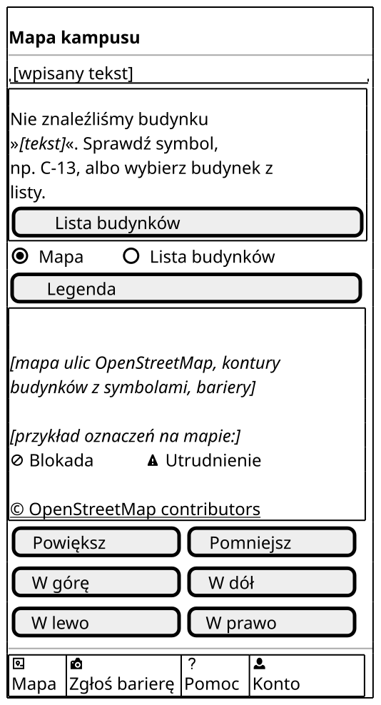

Czynność główna: „Lista budynków” w komunikacie, gdy wyszukiwanie nic nie dało.

| Element | AC/BR/NFR |
| --- | --- |
| Komunikat z katalogu; wpisany tekst jako zastępnik | UC1 3a, NFR-50, PW-9 |
| Przycisk „Lista budynków” przełącza widok na listę | UC1 3a, NFR-19 |
| Komunikat stoi zaraz pod polem, więc osoba widzi go tam, gdzie pisała | NFR-15 (WCAG 3.3.1) |

### V1: brak sieci

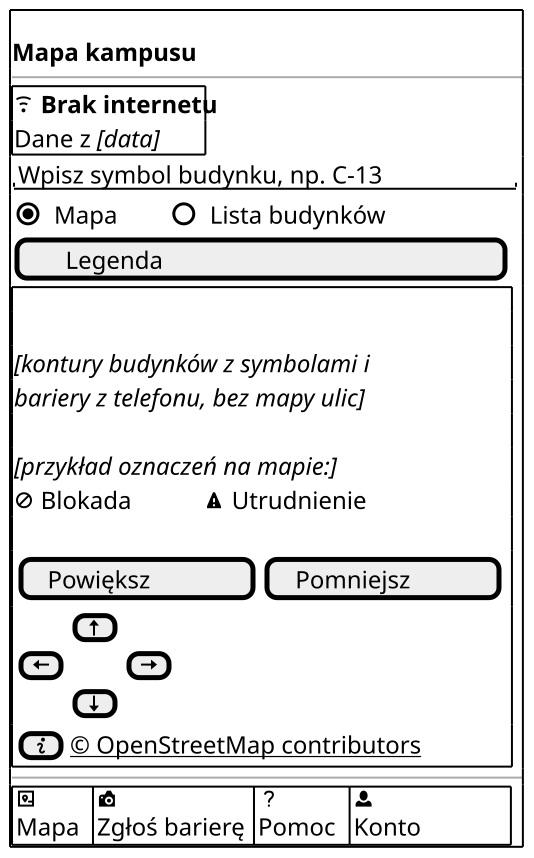

Czynność główna: wpisanie symbolu budynku, jak w stanie zwykłym.

| Element | AC/BR/NFR |
| --- | --- |
| „Brak internetu” z ikoną i „Dane z [data]” pod nagłówkiem | US9.1, NFR-10, NFR-21, PW-4 |
| Kontury i bariery z telefonu, bez mapy ulic | NFR-10, NFR-39 |

### V1: pierwsze otwarcie bez internetu

Czynność główna: brak; mapa wczyta się sama po połączeniu z internetem.

| Element | AC/BR/NFR |
| --- | --- |
| Komunikat „Pierwsze otwarcie aplikacji wymaga internetu…” bez przycisku | NFR-11, PW-4 |
| Bez pola i mapy, bo w telefonie nie ma jeszcze danych | NFR-11 |

## V2 Karta budynku

### V2: budynek podstawowy

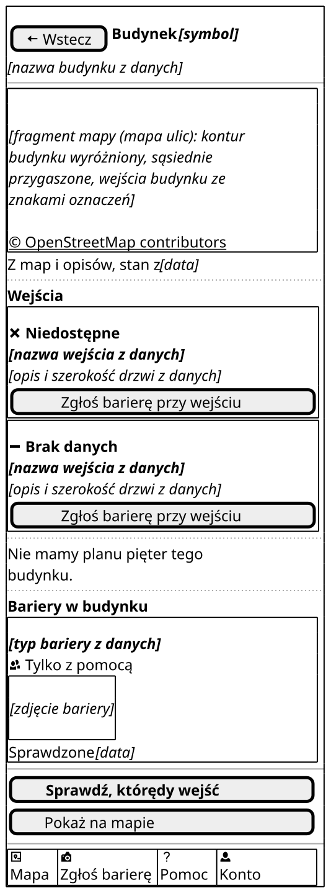

Czynność główna: „Sprawdź, którędy wejść”, jak we wzorcu.

| Element | AC/BR/NFR |
| --- | --- |
| Symbol, nazwa i wejścia jako zastępniki, bo nie wiemy, które budynki będą podstawowe | BR-G1, BR-G3 |
| Napis „Nie mamy planu pięter tego budynku. Bariery są na liście niżej.” zamiast pięter i planu; drugie zdanie tylko przy niepustej liście barier | US16.2, BR-G1, PW-6 |
| Bez „Piętro:”, planu i „Źródło: Politechnika Wrocławska” | US16.2, NFR-48 |
| Bariera z uciążliwością „Tylko z pomocą” tekstem i ikoną | US2.2, NFR-21, PW-13 |

| Stan bez osobnej makiety | Co się zmienia |
| --- | --- |
| Ładowanie | tekst widać od razu, a w miejscu zdjęcia jest napis „Wczytujemy zdjęcie…” (NFR-12) |
| Błąd zdjęcia | w miejscu zdjęcia „Nie udało się wczytać zdjęcia. Spróbuj ponownie za chwilę.” i „Spróbuj ponownie” (NFR-50) |
| Budynek podstawowy bez barier | napis „Nie mamy planu pięter tego budynku.” bez drugiego zdania, a pod „Bariery w budynku” zdanie ze stanu pustego (UC2 2a, PW-6) |

### V2: brak sprawdzonych barier

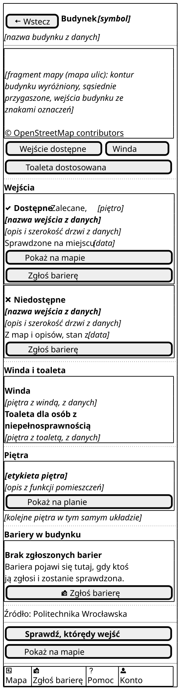

Czynność główna: „Sprawdź, którędy wejść”.

| Element | AC/BR/NFR |
| --- | --- |
| Pod „Bariery w budynku” zdanie „Nie mamy jeszcze sprawdzonych barier w tym budynku. To nie znaczy, że barier tu nie ma.” | UC2 2a, PW-6 |
| Nagłówek „Bariery w budynku” zostaje, więc osoba wie, której części dotyczy zdanie | UC2 2a |
| Budynek szczegółowy jako zastępnik: pusta lista nie może brzmieć jak fakt o PWr | decyzja 16, zasada danych przykładowych |

### V2: brak sieci

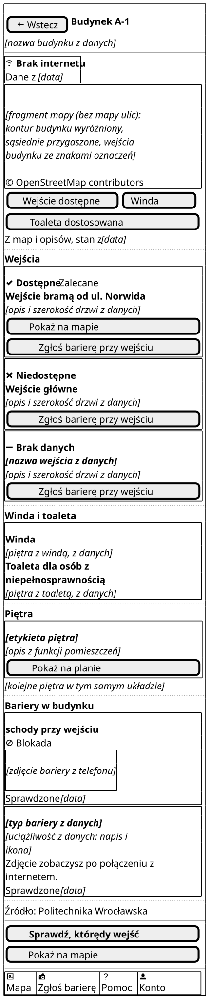

Czynność główna: „Sprawdź, którędy wejść”; V3 działa na danych z telefonu.

| Element | AC/BR/NFR |
| --- | --- |
| „Brak internetu” z ikoną i „Dane z [data]” pod nagłówkiem | US9.1, NFR-10, NFR-21 |
| Zdjęcie zapisane w telefonie widać normalnie | NFR-10 |
| Zdjęcie spoza telefonu zastępuje „Zdjęcie zobaczysz po połączeniu z internetem.” | NFR-10, PW-6 |

### V2: budynku nie ma w telefonie

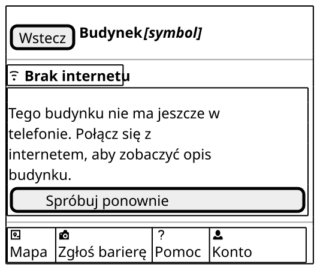

Czynność główna: „Spróbuj ponownie” po połączeniu z internetem.

| Element | AC/BR/NFR |
| --- | --- |
| Komunikat „Tego budynku nie ma jeszcze w telefonie…” ze słowami „opis budynku” zamiast „karta budynku” | NFR-10, PW-4 |
| „Spróbuj ponownie” wczytuje V2 | NFR-10 |
| Pasek dolny zostaje, więc osoba wraca do mapy jednym dotknięciem | wymagania wspólne |

### V2: Zbierający

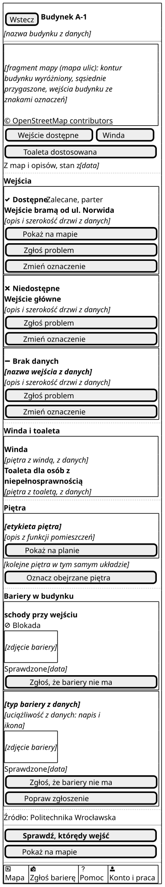

Czynność główna: „Sprawdź, którędy wejść”; przyciski Zbierającego są zwykłe, bez pogrubienia.

| Element | AC/BR/NFR |
| --- | --- |
| „Zmień oznaczenie” w ramce każdego wejścia, także przy „Brak danych” | US17.2, BR-24 |
| „Oznacz obejrzane piętra” pod planem, raz dla całego budynku | US15.1, PW-12 |
| „Zgłoś, że bariery nie ma” przy każdej barierze | US8.4, BR-19, PW-12 |
| „Popraw zgłoszenie” tylko przy własnym zgłoszeniu przyjętym albo zgłoszeniu szybkim; tu przy drugiej barierze | BR-3, BR-18 |
| Typ TB-22 nazwą z klasyfikacji, „brak planu tyflograficznego”: prostszy napis widzą tylko Gość i Odwiedzający | BR-7, słownik użytkownika |
| Pasek dolny z „Konto i praca” | US14.1, PW-1 |
| Gość i Odwiedzający nie widzą tych przycisków | US14.1, NFR-33 |

## V3 Którędy wejść

### V3: wejście jest

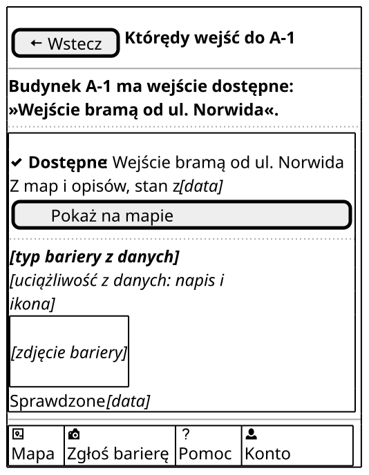

Czynność główna: brak; ekran odpowiada na jedno pytanie, a dalej prowadzą „Wstecz” i pasek dolny.

| Element | AC/BR/NFR |
| --- | --- |
| Nagłówek „Którędy wejść do A-1”, ten sam napis co przycisk na V2 | US3, PW-2 |
| Zdanie z odpowiedzią na górze, pogrubione: TalkBack czyta je pierwsze | US3, US3.1, NFR-18 |
| Wejście od ul. Norwida jako dostępne, jak w deklaracji A-1 [1] | US2.1, US3 |
| Oznaczenie tekstem i ikoną, pod nim data i źródło | US2.1, US17.3, NFR-21 |
| Bariera przy tym wejściu: typ z danych, uciążliwość, zdjęcie, „Sprawdzone [data]” | US2.2, UC4 4c, PW-3 |
| Pasek dolny z „Konto” | wymagania wspólne |

| Stan bez osobnej makiety | Co się zmienia |
| --- | --- |
| Brak sieci | pod nagłówkiem „Brak internetu” i „Dane z [data]”, jak na V2 (NFR-10) |

### V3: brak wejścia dostępnego

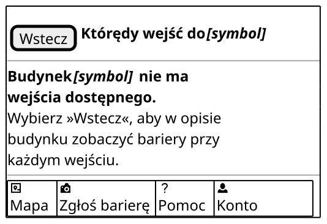

Czynność główna: brak; „Wstecz” wraca do opisu budynku z barierami przy każdym wejściu.

| Element | AC/BR/NFR |
| --- | --- |
| Pierwsze zdanie komunikatu pogrubione jako odpowiedź, drugie zwykłe jako rada | US3.1, UC4 4a, PW-10 |
| Symbol budynku jako zastępnik zamiast „B-4” z katalogu, bo nie znamy wejść tego budynku | zasada danych przykładowych |
| Bez przycisku: rada odsyła do „Wstecz”, które jest zawsze w tym samym miejscu | NFR-15 (WCAG 3.2.3) |

### V3: brak danych o wejściach

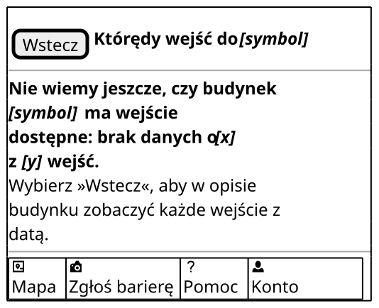

Czynność główna: brak; „Wstecz” wraca do opisu budynku z każdym wejściem i datą.

| Element | AC/BR/NFR |
| --- | --- |
| Zdanie „Nie wiemy jeszcze…” różni się od „nie ma wejścia dostępnego” | US17.1, UC4 4b, PW-10 |
| Liczby wejść jako zastępniki „[x] z [y]”, bo zależą od budynku | UC4 4b |
| Ten sam układ co brak wejścia dostępnego; różnicę niesie treść, a nie kształt | US3.1, US17.1 |

## V4 Zgłoszenie szybkie

Kroki i potwierdzenia nie mają paska dolnego (wymagania wspólne). Gość niezalogowany zamiast aparatu widzi L1 (US14.2).

### V4: krok 1 z 3

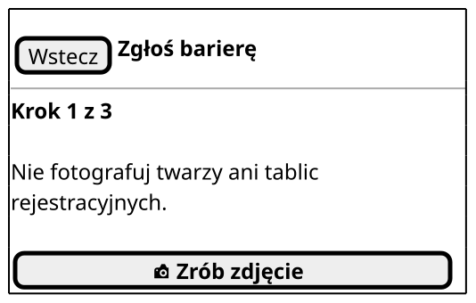

Czynność główna: „Zrób zdjęcie”.

| Element | AC/BR/NFR |
| --- | --- |
| Nagłówek „Zgłoś barierę”, ten sam napis co na pasku dolnym | US4, PW-14 |
| „Krok 1 z 3” | US4.1 |
| „Nie fotografuj twarzy ani tablic rejestracyjnych.” przed przyciskiem | NFR-25 |
| „Zrób zdjęcie” z ikoną `camera-slr`, tą samą co na pasku | US4.1, BR-8 |

| Stan bez osobnej makiety | Co się zmienia |
| --- | --- |
| Błąd zapisu | „W telefonie brakuje miejsca, więc nie zapisaliśmy zdjęcia bariery…” i „Spróbuj ponownie”; zdjęcie i grupa zostają (NFR-5, NFR-7) |

### V4: krok 1 ze zdjęciem

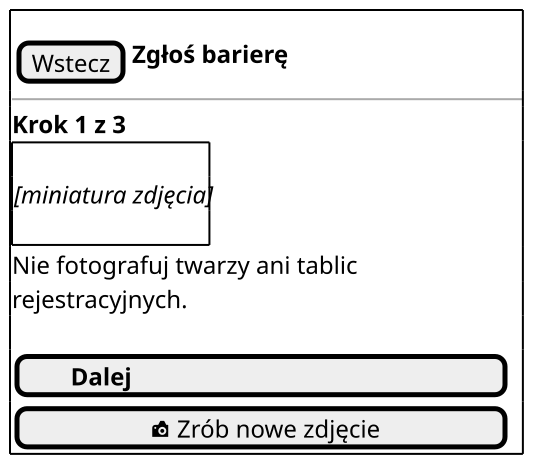

Czynność główna: „Dalej”, które prowadzi znowu do kroku 2 bez nowego zdjęcia.

| Element | AC/BR/NFR |
| --- | --- |
| Miniatura zrobionego zdjęcia | US4.1 |
| „Dalej” pogrubione nad „Zrób nowe zdjęcie”; wybrana grupa zostaje | US4.1, heurystyka Nielsena 3 |
| „Zrób nowe zdjęcie” z ikoną aparatu zamiast „Zrób zdjęcie” | US4.1, PW-8 |
| „Wstecz” otwiera potwierdzenie rezygnacji | UC7 1b |

### V4: krok 2 z 3

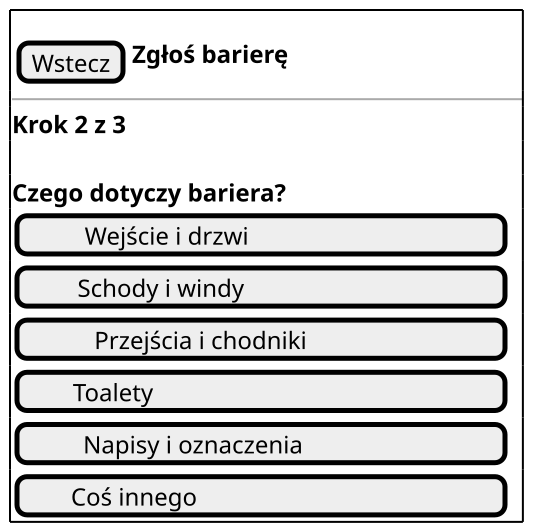

Czynność główna: wybór jednej z 6 grup barier.

| Element | AC/BR/NFR |
| --- | --- |
| Pytanie „Czego dotyczy bariera?” | US4.3, PW-7 |
| 6 przycisków grup jeden pod drugim, tej samej szerokości, sam tekst, bez ikon | US4.3, NFR-17, PW-7 |
| Bez typu, uciążliwości, budynku i piętra | US4.3, BR-14 |
| „Wstecz” wraca do kroku 1, a zdjęcie zostaje | US4.1 |

### V4: krok 3 z 3

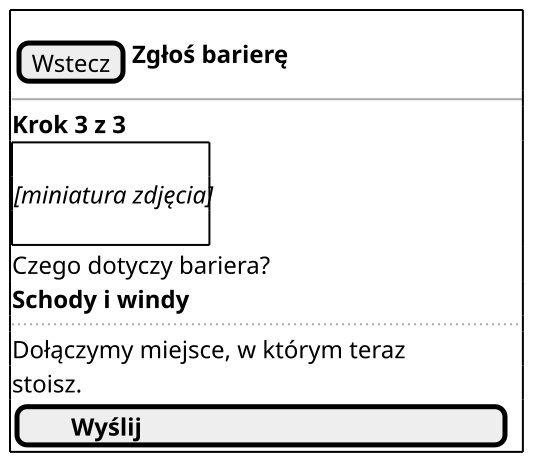

Czynność główna: „Wyślij”.

| Element | AC/BR/NFR |
| --- | --- |
| Miniatura zdjęcia i wybrana grupa pod pytaniem z kroku 2 | US4.1 |
| „Dołączymy miejsce, w którym teraz stoisz.” | US4.1, NFR-27 |
| „Wyślij” prowadzi do potwierdzenia | US4.1, US4.4 |

| Stan bez osobnej makiety | Co się zmienia |
| --- | --- |
| Ładowanie: pozycja jeszcze nieznana | zamiast zdania o miejscu „Ustalamy, gdzie jesteś…”; „Wyślij” czeka bez limitu czasu (NFR-23, PW-9) |

### V4: prośba o zgodę na lokalizację

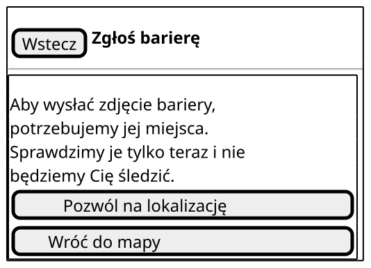

Czynność główna: „Pozwól na lokalizację”.

| Element | AC/BR/NFR |
| --- | --- |
| Komunikat przed aparatem: po co miejsce i że nie śledzimy | UC7 2a, NFR-27, PW-5 |
| „Pozwól na lokalizację” i „Wróć do mapy” tej samej wielkości | UC7 2a, NFR-15 |

| Stan bez osobnej makiety | Co się zmienia |
| --- | --- |
| Odmowa zgody | „Bez lokalizacji nie wyślesz zdjęcia bariery…”, przyciski „Otwórz ustawienia” i „Wróć do mapy”; aplikacja nie ponawia prośby (UC7 2a, BR-8) |
| Lokalizacja wyłączona w telefonie | „Lokalizacja w telefonie jest wyłączona…”, przyciski „Otwórz ustawienia” i „Wróć do mapy” (UC7 4c) |

### V4: zgoda tylko przybliżona

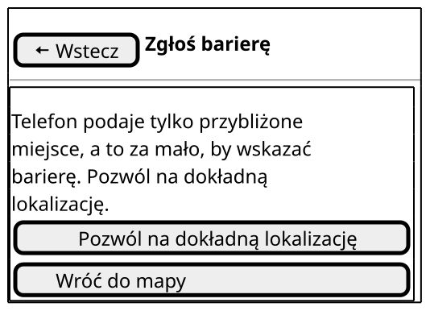

Czynność główna: „Pozwól na dokładną lokalizację”.

| Element | AC/BR/NFR |
| --- | --- |
| Komunikat: przybliżone miejsce nie wystarczy, by wskazać barierę | BR-8, BR-14 |
| „Pozwól na dokładną lokalizację” i „Wróć do mapy” tej samej wielkości | BR-8, NFR-15 |

### V4: brak pozycji

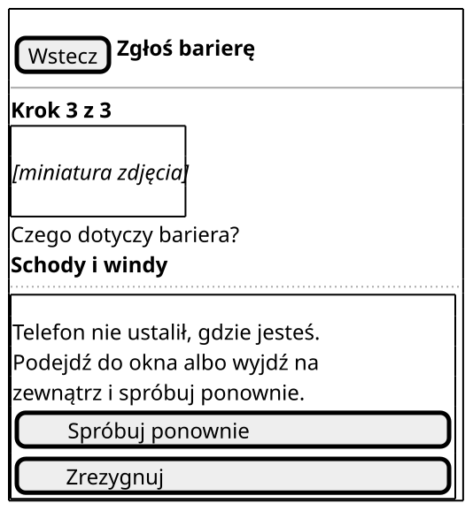

Czynność główna: „Spróbuj ponownie”.

| Element | AC/BR/NFR |
| --- | --- |
| Miniatura i grupa zostają na ekranie | UC7 4c |
| Komunikat z radą zamiast zdania o miejscu i „Wyślij” | UC7 4c, PW-5 |
| „Spróbuj ponownie” wraca do kroku 3, „Zrezygnuj” otwiera potwierdzenie rezygnacji | UC7 4c, UC7 1b |

### V4: potwierdzenie rezygnacji

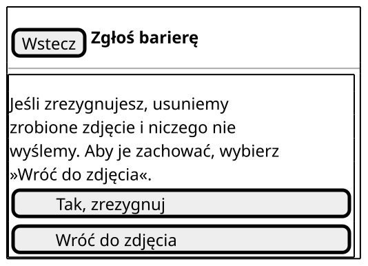

Czynność główna: brak wyróżnionej; oba przyciski mają tę samą wielkość.

| Element | AC/BR/NFR |
| --- | --- |
| Komunikat o skutku przed usunięciem zdjęcia | UC7 1b, heurystyki Nielsena 3 i 5 |
| „Tak, zrezygnuj” i „Wróć do zdjęcia” tej samej wielkości, bez limitu czasu | UC7 1b, NFR-23 |
| Po „Tak, zrezygnuj” V1 albo ekran sprzed V4; „Wróć do zdjęcia” wraca, skąd osoba przyszła | UC7 1b, UC7 4c |

### V4: potwierdzenie wysłania

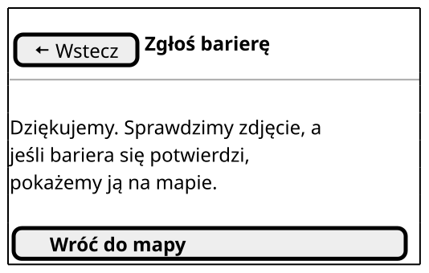

Czynność główna: „Wróć do mapy”.

| Element | AC/BR/NFR |
| --- | --- |
| „Dziękujemy. Sprawdzimy zdjęcie, a jeśli bariera się potwierdzi, pokażemy ją na mapie.” | US4.4, PW-5 |
| „Wróć do mapy” otwiera V1 | US4.4 |
| „Wstecz” wraca do ekranu sprzed V4, a nie do kroku 3 | wymagania wspólne, P2 |

### V4: potwierdzenie bez internetu

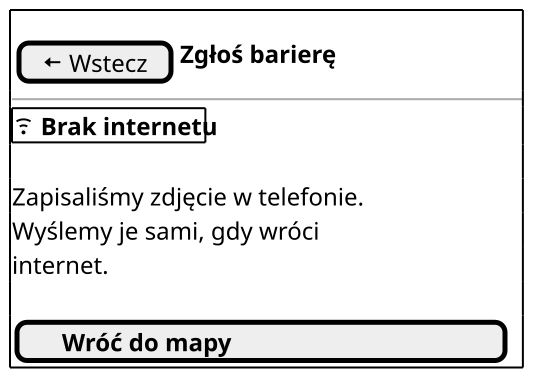

Czynność główna: „Wróć do mapy”.

| Element | AC/BR/NFR |
| --- | --- |
| „Brak internetu” z ikoną, bez daty danych, bo ekran nie pokazuje danych z telefonu | US9.1, NFR-21 |
| „Zapisaliśmy zdjęcie w telefonie. Wyślemy je sami, gdy wróci internet.” | US4.2, UC7 7a, PW-5 |

## V5 Pomoc

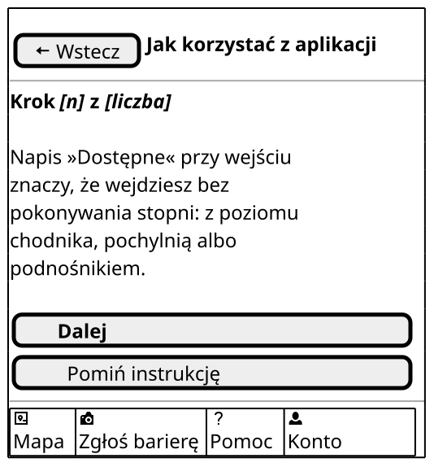

Czynność główna: „Dalej”.

| Element | AC/BR/NFR |
| --- | --- |
| Nagłówek „Jak korzystać z aplikacji” | US5.1 |
| Numer kroku jako zastępnik, bo liczbę kroków ustali treść instrukcji | US5.1 |
| Zdanie o napisie „Dostępne”: bez stopni, z poziomu chodnika, pochylnią albo podnośnikiem | US5.1, US2.1, BR-24, PW-15 |
| Bez obrazu: krok nie pokazuje przycisku aplikacji | US5.1, NFR-18 |
| „Dalej” pogrubione, „Pomiń instrukcję” zwykłe, oba na pełną szerokość | US5.1, PW-8, NFR-15 (WCAG 2.5.1) |
| Pasek dolny z „Konto” | wymagania wspólne |

| Stan bez osobnej makiety | Co się zmienia |
| --- | --- |
| Krok o koncie | zdanie „Aby zgłosić barierę, potrzebne jest konto. Możesz je założyć teraz w »Konto«.” (US5.1, US14.2) |
| Ostatni krok | „Zacznij” zamiast „Dalej”; otwiera V1 (US5.1) |
| Pierwsze uruchomienie i otwarcie z „Pomoc” | ten sam układ; przy pierwszym uruchomieniu instrukcja otwiera się sama (US5.1) |

## L1 Prośba o logowanie

### L1: stan zwykły

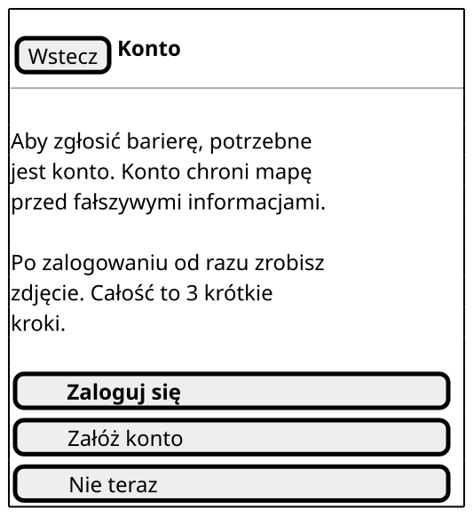

Czynność główna: „Zaloguj się”.

| Element | AC/BR/NFR |
| --- | --- |
| Nagłówek „Konto”, ten sam napis co na pasku dolnym | US14, PW-14 |
| „Aby zgłosić barierę, potrzebne jest konto. Konto chroni mapę przed fałszywymi informacjami.” | US14.2, BR-8, PW-5 |
| Przy wejściu z V4: „Po zalogowaniu od razu zrobisz zdjęcie. Całość to 3 krótkie kroki.” | US14.2, US4.1 |
| „Zaloguj się” prowadzi do strony logowania w przeglądarce; pola hasła w aplikacji nie ma | US14, NFR-31 |
| „Załóż konto” prowadzi do rejestracji z klauzulą informacyjną | US14.3, NFR-30 |
| „Nie teraz” tak samo szerokie, jak „Zaloguj się”; wraca do V1 | UC7 1b |
| Bez paska dolnego | wymagania wspólne |

| Stan bez osobnej makiety | Co się zmienia |
| --- | --- |
| Wejście z „Konto” | bez zdania o 3 krokach; po zalogowaniu otwiera się L2 (P3) |
| Błąd | komunikat „Logowanie się nie udało albo zostało przerwane. Sprawdź internet i spróbuj ponownie.”, przyciski „Spróbuj ponownie” i „Nie teraz” |

### L1: brak sieci

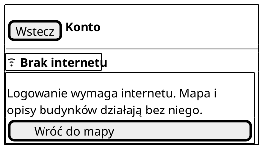

Czynność główna: „Wróć do mapy”.

| Element | AC/BR/NFR |
| --- | --- |
| „Brak internetu” z ikoną | US9.1, NFR-21 |
| „Logowanie wymaga internetu. Mapa i opisy budynków działają bez niego.” | UC6 1a, PW-4 |
| „Wróć do mapy” otwiera V1 | UC6 1a |

## L2 Konto

### L2: Odwiedzający

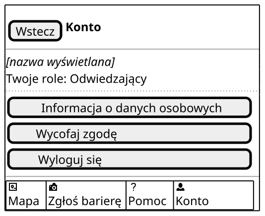

Czynność główna: brak; Odwiedzający nie ma czynności roli, a ekran pokazuje dane konta.

| Element | AC/BR/NFR |
| --- | --- |
| Nagłówek „Konto”, bez sekcji „Twoja praca” | US14.1, US14.3, PW-1 |
| Nazwa wyświetlana jako zastępnik i „Twoje role: Odwiedzający” | BR-1, US14.3 |
| „Informacja o danych osobowych”, „Wycofaj zgodę”, „Wyloguj się” w tej kolejności | NFR-30, NFR-29, PW-14 |
| Żaden przycisk nie jest pogrubiony, bo ekran nie ma czynności głównej | NFR-21 |
| Pasek dolny z „Konto” | wymagania wspólne |

| Stan bez osobnej makiety | Co się zmienia |
| --- | --- |
| Brak sieci | pod nagłówkiem „Brak internetu”; role z ostatniego logowania |

### L2: rola pracownicza

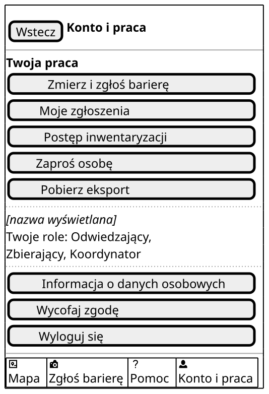

Czynność główna: wybór czynności z listy „Twoja praca” na górze ekranu.

| Element | AC/BR/NFR |
| --- | --- |
| Nagłówek „Konto i praca”, ten sam napis co na pasku | US14.1, PW-1 |
| „Twoja praca” na górze, lista przycisków z tekstem, bez kafelków | US14.1, BR-1, PW-1 |
| Zbierający: „Zmierz i zgłoś barierę” (C1), „Moje zgłoszenia” (C3) | US6, US8 |
| Koordynator: „Postęp inwentaryzacji” (K1), „Zaproś osobę” (K2), „Pobierz eksport” (K3) | US11, US12, US13 |
| Weryfikator widziałby „Zgłoszenia do sprawdzenia” (R1); tu nie ma tej roli | US10, US14.1 |
| „Twoje role: Odwiedzający, Zbierający, Koordynator” | BR-1, US14.3 |
| Pod spodem dane konta, klauzula, „Wycofaj zgodę”, „Wyloguj się” | NFR-30, NFR-29 |

### L2: klauzula informacyjna

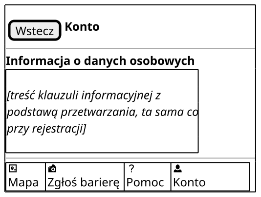

Czynność główna: brak; osoba czyta treść, a „Wstecz” wraca do zwykłego stanu L2.

| Element | AC/BR/NFR |
| --- | --- |
| Tytuł „Informacja o danych osobowych”, ten sam napis co przycisk | NFR-30, PW-14 |
| Treść klauzuli z podstawą przetwarzania jako zastępnik, ta sama co przy rejestracji | NFR-30 |
| 2 dotknięcia od mapy: „Konto”, „Informacja o danych osobowych” | NFR-30 |

### L2: potwierdzenie wycofania zgody

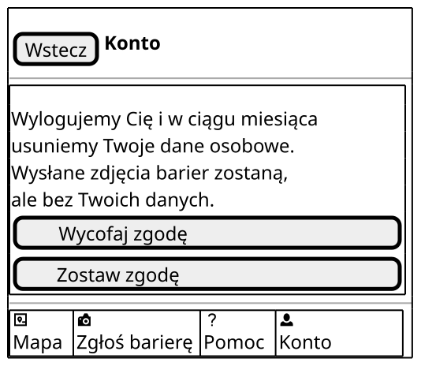

Czynność główna: brak wyróżnionej; oba przyciski mówią o skutku i mają tę samą wielkość.

| Element | AC/BR/NFR |
| --- | --- |
| Komunikat: wylogowanie, usunięcie danych w ciągu miesiąca, zdjęcia zostają bez danych | NFR-29, PW-5 |
| „Wycofaj zgodę” wylogowuje i otwiera V1, „Zostaw zgodę” wraca do L2 | NFR-29, NFR-30 |

## Źródła

1. Deklaracja dostępności budynku A-1 (wejście główne ze schodami, wejście dostępne z tyłu budynku, bramą od strony K.C. Norwida): <https://dostepnosc.pwr.edu.pl/dostepnosc-architektoniczna/deklaracje-dostepnosci-budynkow/budynki-a/a1>

Dostęp do źródeł: 28.10.2026.
