# Makiety: weryfikacja i koordynacja

Strona pokazuje makiety ekranów Weryfikatora (R1, R2) i Koordynatora (K1, K2, K3). Elementy i stany pochodzą z [wymagań do ekranów](../wymagania-ekranow.md), a napisy ze [słownika użytkownika](../slownik-uzytkownika.md). Konwencje rysowania opisuje strona [Makiety](index.md).

Ekrany ról pracowniczych nie mają paska dolnego, bo wymagania wspólne przewidują go tylko na V1, V2, V3, V5 i L2. Do R1 i K1–K3 prowadzą przyciski z L2 „Konto i praca” ([mapa nawigacji](../mapa-nawigacji.md)).

## Stany wspólne

Wszystkie pięć ekranów potrzebuje serwera, więc mają te same stany „brak sieci”, „błąd serwera” i „brak uprawnień”. Makieta pokazuje je raz, na R1.

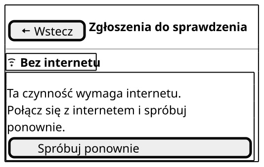

| Element | AC/BR/NFR |
| --- | --- |
| „Brak internetu” z ikoną pod nagłówkiem, bez dopisku o dacie, bo ekran nie pokazuje danych z telefonu | US9.1, NFR-10, NFR-21 |
| Komunikat „Ta czynność wymaga internetu…” i „Spróbuj ponownie” na pełną szerokość | NFR-50, PW-10; stan wspólny |
| Błąd serwera: ten sam układ, bez wskaźnika sieci, komunikat „Serwer chwilowo nie odpowiada…” i „Spróbuj ponownie” | NFR-50, PW-10 |
| Brak uprawnień: ten sam układ, komunikat „Nie masz już uprawnień do tej czynności…” i „Wróć do mapy”, który otwiera V1 | US14.1, NFR-33, PW-10 |

Przy otwarciu R1, R2 i K1 komunikat zastępuje treść ekranu. Po czynności na R2, K2 i K3 wpisane i wybrane wartości zostają, a komunikat stoi w miejscu czynności głównej (makieta [K3 błąd](#k3-eksport)).

## R1 Kolejka weryfikacji

Czynność główna: „Weź do sprawdzenia” przy wybranym zgłoszeniu.

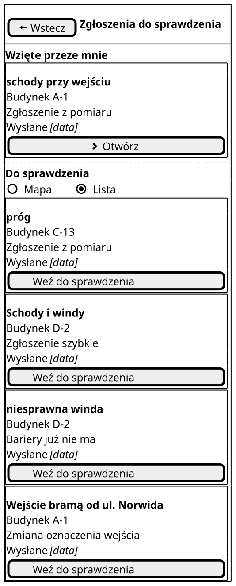

| Element | AC/BR/NFR |
| --- | --- |
| „Wstecz” i nagłówek „Zgłoszenia do sprawdzenia”, równy napisowi przycisku w L2 | NFR-15, PW-14 |
| Sekcja „Wzięte przeze mnie” na górze; dotknięcie pozycji otwiera R2 | BR-11, UC14 2b |
| Przełącznik „Lista” i „Mapa”; wybrany widok widać po kształcie pola | UC14, NFR-19, NFR-21 |
| Pozycja zgłoszenia „wysłane”: typ albo grupa barier, budynek, rodzaj, data wysłania | US10.4, BR-14 |
| Grupa „Schody i windy” zamiast typu przy zgłoszeniu szybkim, bo typ ustala dopiero Weryfikator | BR-14, PW-7 |
| Rodzaj: „Zgłoszenie z pomiaru”, „Zgłoszenie szybkie”, „Bariery już nie ma”, „Zmiana oznaczenia wejścia” | US10.5, US17.2, BR-19, BR-24 |
| „Weź do sprawdzenia” przy każdym zgłoszeniu, pogrubiony, na pełną szerokość ramki | US10.4, BR-11, NFR-17, NFR-21 |
| Brak zgłoszeń samego Weryfikatora, także jego zmian „bariera usunięta” i oznaczenia wejścia; filtr robi serwer | US10.5, BR-4 |

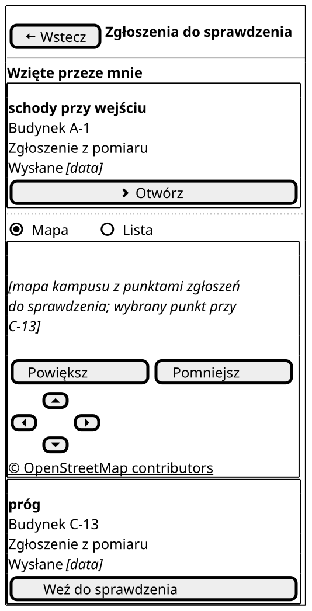

| Element | AC/BR/NFR |
| --- | --- |
| Mapa z punktami zgłoszeń, zastępnik | UC14 |
| „© OpenStreetMap contributors” pod mapą | NFR-37 |
| „Powiększ”, „Pomniejsz”, „W górę”, „W dół”, „W lewo”, „W prawo” zamiast gestów | NFR-15 (WCAG 2.5.1), PW-8; wymagania wspólne |
| Pod mapą zgłoszenie z wybranego punktu, z tymi samymi danymi co na liście | NFR-19, US10.4 |

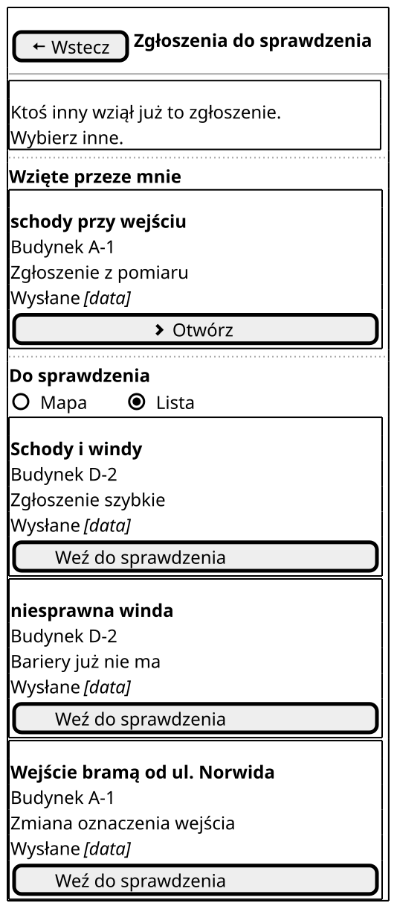

| Element | AC/BR/NFR |
| --- | --- |
| Komunikat „Ktoś inny wziął już to zgłoszenie. Wybierz inne.” nad listą | UC14 2a, BR-11 |
| Zgłoszenia „próg” z C-13 już nie ma na liście | US10.4, BR-11 |

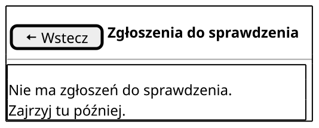

| Element | AC/BR/NFR |
| --- | --- |
| Komunikat „Nie ma zgłoszeń do sprawdzenia. Zajrzyj tu później.” bez przycisku; przełącznik znika, bo nie ma czego pokazać | PW-10 |

| Stan bez osobnej makiety | Co widać |
| --- | --- |
| Ładowanie | napis „Wczytujemy zgłoszenia…” w miejscu listy (PW-9) |
| Pusty, ale ze wziętymi zgłoszeniami | sekcja „Wzięte przeze mnie”, a pod nią ten sam komunikat |

## R2 Sprawdzenie zgłoszenia

Czynność główna: „Przyjmij”. Odrzucenie wymaga powodu, więc stoi niżej i jest zwykłym przyciskiem.

Stan zwykły pokazuje scenariusz demo w A-1: podobne zgłoszenie „próg” 5 m dalej, na innym piętrze, to nie duplikat. Schody przy wejściu głównym A-1 zgadzają się z deklaracją dostępności [1].

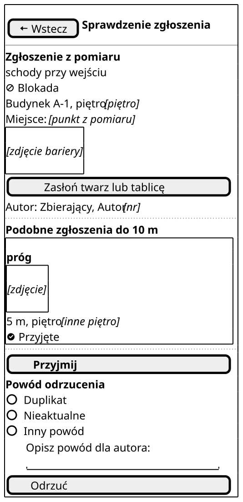

| Element | AC/BR/NFR |
| --- | --- |
| „Wstecz” i nagłówek „Sprawdzenie zgłoszenia”; „Wstecz” przed decyzją zostawia zgłoszenie we „Wziętych przeze mnie” | NFR-15, BR-11 |
| Typ, uciążliwość tekstem i ikoną, budynek, piętro, miejsce, rodzaj; bez pól do edycji | BR-15, PW-13, NFR-21 |
| Zdjęcie, zastępnik | US10 |
| „Zasłoń twarz lub tablicę” pod zdjęciem; zasłonięcie nie tworzy nowej wersji | BR-15, NFR-25 |
| „Autor: Zbierający, Autor 17”: rola i pseudonim, bez imienia i adresu e-mail | BR-5 |
| „Podobne zgłoszenia do 10 m”: typ, zdjęcie, odległość tekstem, piętro, status tekstem i ikoną | US10.1, BR-13, NFR-19, NFR-21 |
| „Przyjmij”, pogrubiony, na pełną szerokość; po przyjęciu otwiera się R1 | US10, NFR-21 |
| „Powód odrzucenia”: gotowe „Duplikat” i „Nieaktualne” oraz pole na własny powód | US10.2, BR-13, BR-16, BR-23 |
| „Odrzuć”; po odrzuceniu otwiera się R1, a R2 znika z historii „Wstecz” | US10.2, BR-16; wymagania wspólne |

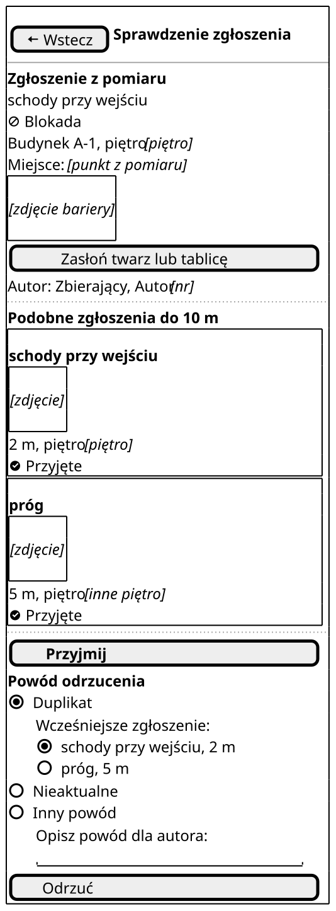

| Element | AC/BR/NFR |
| --- | --- |
| Przyjęte zgłoszenie tej samej bariery 2 m dalej na liście podobnych | US10.1, BR-13 |
| Po wyborze „Duplikat” lista „Wcześniejsze zgłoszenie:” z podobnymi zgłoszeniami; wybrane trafia do powodu odrzucenia | BR-13 |
| System niczego nie odrzuca ani nie łączy sam: wybór robi Weryfikator | BR-13 |

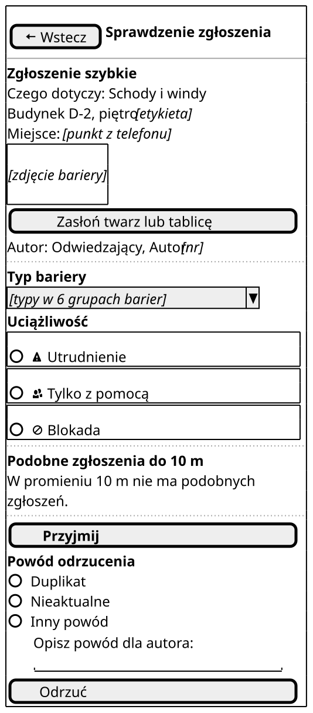

| Element | AC/BR/NFR |
| --- | --- |
| „Zgłoszenie szybkie”, „Czego dotyczy: Schody i windy” jako podpowiedź od autora; bez piętra, bo zostaje puste | BR-14, PW-7 |
| Budynek D-2 przypisany przez system z konturu | BR-14 |
| „Autor: Odwiedzający, Autor [nr]” | BR-5 |
| „Typ bariery”: lista do wyboru, także z innej grupy niż podpowiedź | US10.3, BR-14 |
| „Uciążliwość”: „Utrudnienie”, „Tylko z pomocą”, „Blokada”, każda z ikoną | US10.3, PW-13, NFR-21 |
| „W promieniu 10 m nie ma podobnych zgłoszeń.” zamiast listy | US10.1 |

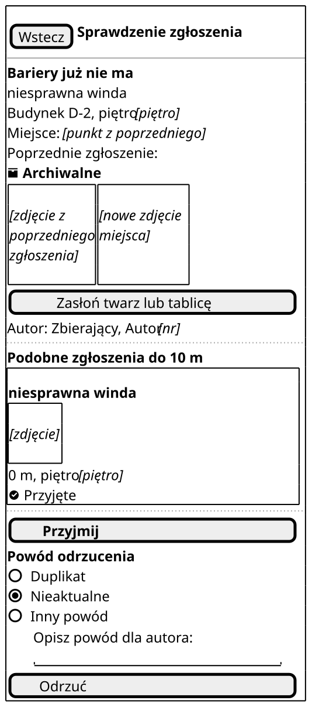

| Element | AC/BR/NFR |
| --- | --- |
| „Bariery już nie ma” i typ z poprzedniego zgłoszenia; bez uciążliwości, bo nie jest wymagana | BR-19 |
| Zdjęcie z poprzedniego zgłoszenia obok nowego zdjęcia miejsca | US10.6, BR-19 |
| Na liście podobnych równoległa zmiana tej samej windy, już przyjęta, 0 m, bo miejsce przechodzi z poprzedniego zgłoszenia | BR-19, BR-23 |
| Wybrany powód „Nieaktualne”: ta zmiana dotyczy zgłoszenia, które stało się archiwalne | BR-23 |
| Po przyjęciu „Przyjmij” winda znika z mapy i karty budynku | US10.6 |

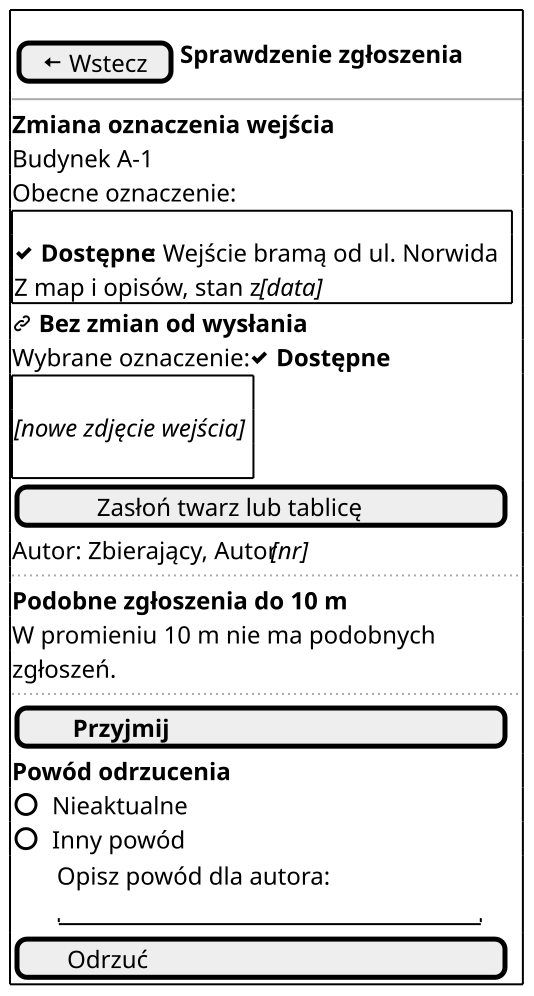

| Element | AC/BR/NFR |
| --- | --- |
| „Zmiana oznaczenia wejścia” i budynek A-1 | US17.2 |
| Obecne oznaczenie tekstem i ikoną, z datą i źródłem jak na V2 | US17.3, BR-24, PW-3 |
| „Wybrane oznaczenie: Dostępne”: Zbierający potwierdza obecne oznaczenie; wejście od ul. Norwida jest dostępne według deklaracji [1] | US17.2, BR-24 |
| Nowe zdjęcie wejścia z „Zasłoń twarz lub tablicę” | BR-24, NFR-25 |
| Weryfikator nie zmienia wybranego oznaczenia: gdy zdjęcie mu przeczy, odrzuca z powodem | BR-24, BR-16 |

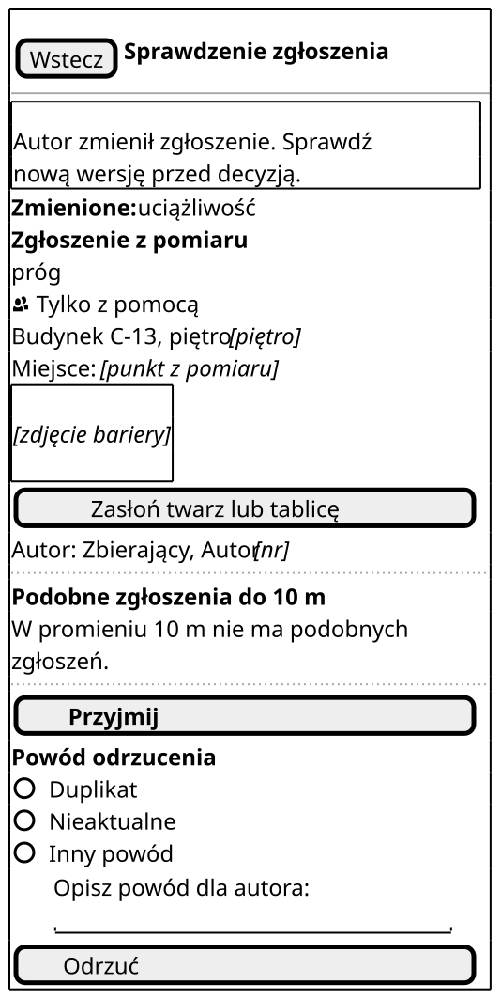

| Element | AC/BR/NFR |
| --- | --- |
| Komunikat „Autor zmienił zgłoszenie. Sprawdź nową wersję przed decyzją.” nad danymi | BR-3, UC14 5e, PW-10 |
| Dane nowej wersji: uciążliwość „Tylko z pomocą” zamiast „Utrudnienie”, jak w scenariuszu `@BR-3` | BR-3 |

| Stan bez osobnej makiety | Co widać |
| --- | --- |
| Ładowanie | tekst od razu, w ramkach zdjęć napis „Wczytujemy zdjęcie…” (PW-9) |
| Błąd walidacji przy przyjęciu | nad „Przyjmij” komunikat „Ustal typ bariery i uciążliwość, aby przyjąć zgłoszenie.” (US10.3) |
| Błąd walidacji przy odrzuceniu | nad „Odrzuć” komunikat „Podaj powód odrzucenia, aby autor wiedział, co poprawić.” (US10.2) |
| Brak sieci przy decyzji | wskaźnik „Brak internetu” i nad „Przyjmij” komunikat „Decyzja wymaga internetu, a zgłoszenie czeka w »Wziętych przeze mnie«…”; dane i wybory zostają (BR-11) |
| Błąd serwera, brak uprawnień | stany wspólne |

## K1 Postęp inwentaryzacji

Czynność główna: dotknięcie budynku, które otwiera C5 „Obejrzane piętra”. Tam Koordynator cofa znacznik piętra (US11.3).

A-1 ma 4 z 5 pięter obejrzanych, jak w scenariuszu demo i w przykładzie BR-21. Trzy wejścia A-1 i jedno „Sprawdzone na miejscu” zgadzają się ze [wzorcową makietą V2](index.md#wzorcowa-makieta-v2-karta-budynku).

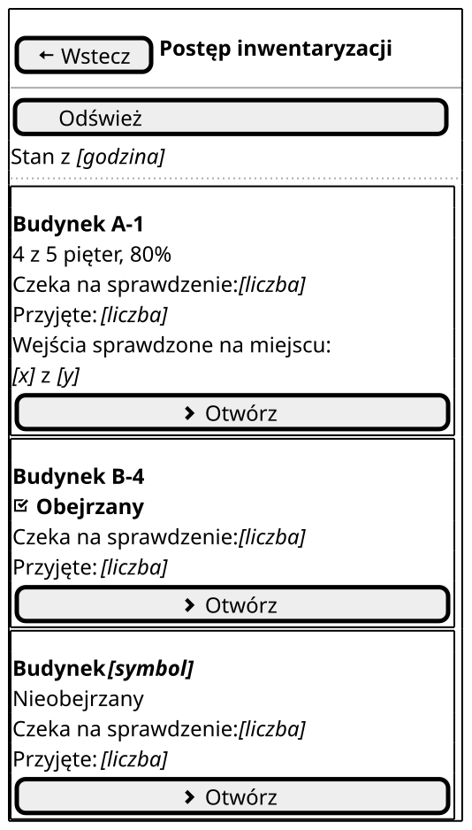

| Element | AC/BR/NFR |
| --- | --- |
| „Wstecz” i nagłówek „Postęp inwentaryzacji” | NFR-15 |
| „Odśwież” i godzina odczytu „Stan z [godzina]” | US11.2 |
| Lista budynków z symbolem, bez sortowania i filtrów | US11.1, decyzja 16 |
| Budynek szczegółowy: „4 z 5 pięter, 80%” | US11.1, US11.2, BR-21 |
| Budynek podstawowy: „Obejrzany” tekstem i ikoną albo „Nieobejrzany” samym tekstem | US11.1, PW-11 |
| „Czeka na sprawdzenie: [liczba]” i „Przyjęte: [liczba]” przy każdym budynku | US11.1, BR-21 |
| Tylko budynek szczegółowy: „Wejścia sprawdzone na miejscu:” i liczba „1 z 3” w osobnym wierszu | US11.4, BR-24, PW-3 |
| Cała ramka budynku to jeden cel dotyku; otwiera C5 | US11.3, NFR-17 |

Wiersz o wejściach ma dwie linie, bo cały napis ma 36 znaków, a wiersz mieści 34. Scenariusze `@US11.4` mają jeszcze dawne brzmienie „Wejścia potwierdzone na obchodzie”, a makieta idzie za PW-3.

| Stan bez osobnej makiety | Co widać |
| --- | --- |
| Ładowanie | napis „Wczytujemy postęp…” w miejscu listy (PW-9) |
| Brak sieci, błąd serwera, brak uprawnień | stany wspólne; bez sieci postępu nie widać, bo liczy go serwer (UC15 1a) |

## K2 Zaproszenie

Czynność główna: „Wyślij zaproszenie”.

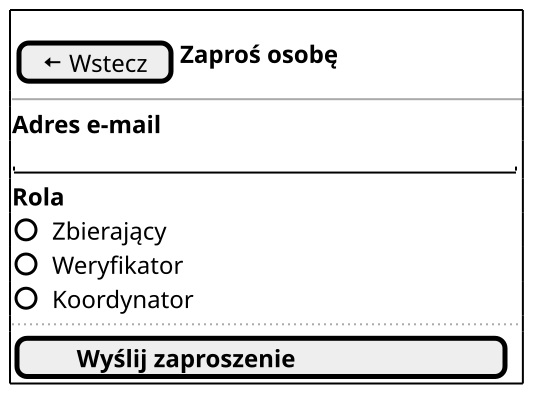

| Element | AC/BR/NFR |
| --- | --- |
| „Wstecz” i nagłówek „Zaproś osobę”, równy napisowi przycisku w L2 | NFR-15, PW-14 |
| Pole „Adres e-mail”, puste | US12.1 |
| „Rola”: „Zbierający”, „Weryfikator”, „Koordynator”, bez wartości na start | US12.1, BR-2 |
| „Wyślij zaproszenie”, pogrubiony, na pełną szerokość | US12.1, NFR-21 |

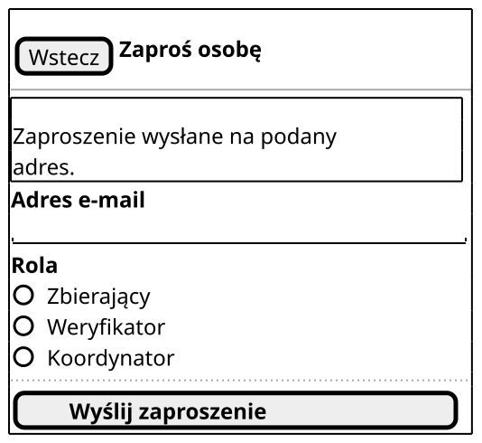

| Element | AC/BR/NFR |
| --- | --- |
| Komunikat „Zaproszenie wysłane na podany adres.” nad formularzem | US12.1 |
| Pusty formularz, gotowy do kolejnego zaproszenia | US12.1 |

| Stan bez osobnej makiety | Co widać |
| --- | --- |
| Sukces, konto istnieje | ten sam układ, komunikat „To konto już istnieje. Dodaliśmy mu rolę Weryfikatora, dotychczasowe role zostają.” (US12.2, BR-1) |
| Błąd walidacji | pod polem „Adres e-mail jest niepełny, np. brakuje znaku @…” albo pod wyborem roli „Wybierz rolę.”; wpisany adres zostaje (PW-10) |
| Brak sieci, błąd serwera, brak uprawnień | stany wspólne; błąd serwera obejmuje Usługę logowania |

## K3 Eksport

Czynność główna: „Pobierz plik”.

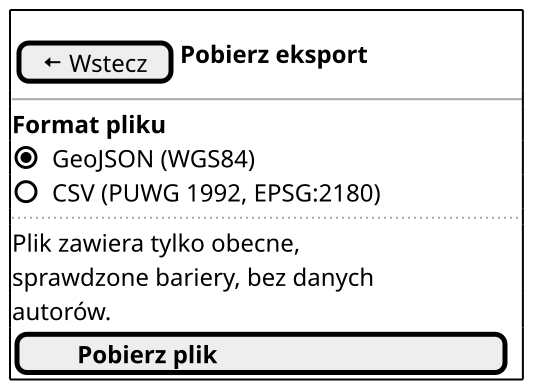

| Element | AC/BR/NFR |
| --- | --- |
| „Wstecz” i nagłówek „Pobierz eksport”, równy napisowi przycisku w L2 | NFR-15, PW-14 |
| „Format pliku”: „GeoJSON (WGS84)” wybrany na start albo „CSV (PUWG 1992, EPSG:2180)” | US13.1, US13.2, NFR-43 |
| „Plik zawiera tylko obecne, sprawdzone bariery, bez danych autorów.” | US13.3, BR-22, BR-6 |
| „Pobierz plik”, pogrubiony, na pełną szerokość | US13, NFR-21 |

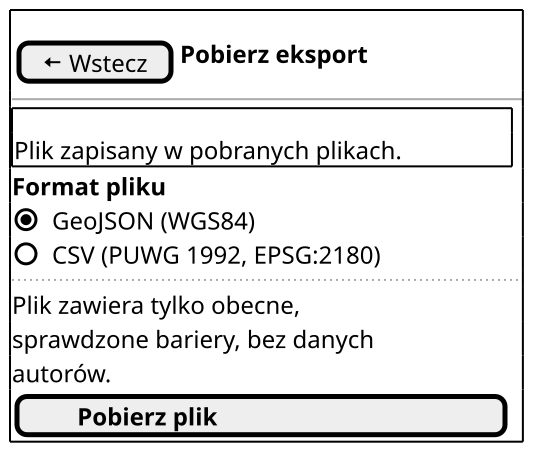

| Element | AC/BR/NFR |
| --- | --- |
| Komunikat „Plik zapisany w pobranych plikach.” nad formularzem | US13 |
| Formularz zostaje, więc drugi format to jedno dotknięcie | US13.1, US13.2 |

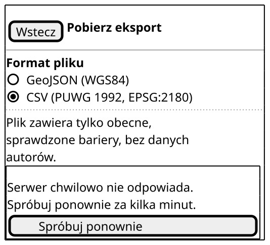

| Element | AC/BR/NFR |
| --- | --- |
| Wybrany format zostaje | NFR-50 |
| Komunikat „Serwer chwilowo nie odpowiada…” i „Spróbuj ponownie” w miejscu „Pobierz plik”, więc na ekranie jest jedna czynność | NFR-50, PW-10, NFR-21 |

| Stan bez osobnej makiety | Co widać |
| --- | --- |
| Ładowanie | w miejscu „Pobierz plik” napis „Przygotowujemy plik…” (PW-9) |
| Pusty | nad „Pobierz plik” napis „Nie ma jeszcze przyjętych barier. Pobrany plik będzie pusty.”; pobranie działa (UC17 2a) |
| Brak sieci, brak uprawnień | stany wspólne (UC17 1a) |

## Źródła

1. Deklaracja dostępności budynku A-1 (wejście główne ze schodami, wejście dostępne z tyłu budynku, bramą od strony K.C. Norwida): <https://dostepnosc.pwr.edu.pl/dostepnosc-architektoniczna/deklaracje-dostepnosci-budynkow/budynki-a/a1>

Dostęp do źródeł: 28.10.2026.
