# Makiety: zespół w terenie

Makiety ekranów C1–C7 dla roli Zbierającego (RO-ZBI), a na C5 także dla Koordynatora (RO-KOO). Elementy, czynności i stany pochodzą z [wymagań do ekranów](../wymagania-ekranow.md#zbierajacy), a napisy ze [słownika użytkownika](../slownik-uzytkownika.md). Konwencje i fragmenty wspólne opisuje strona [Makiety](index.md).

Zbierający pracuje w ruchu i często w słońcu. Dlatego każdy ekran ma jedną czynność główną na pełną szerokość, a wybór wartości to duże ramki zamiast małych pól. Przykłady dotyczą budynku A-1: wejście główne ma schody [1]. Nieznane dane są zastępnikami w nawiasach.

Fragmenty spoza `_wspolne.iuml` stoją w pliku `_zespol-w-terenie.iuml`: przyciski przesuwania punktu, blok zdjęcia, błąd przy polu, opcja wyboru i ramka pozycji na pełną szerokość.

## C1 Pomiar pozycji

### Pomiar trwa

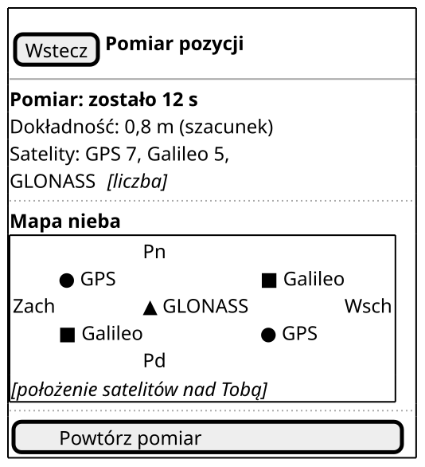

Czynność główna: brak w trakcie pomiaru; „Dalej” pojawia się po końcu pomiaru, razem z podpowiedzią budynku. Przerwanie i ponowny start to jedno dotknięcie „Powtórz pomiar” (UC8 2a, scenariusz przerwania `@US6.1`), a wyjście bez zapisu — „Wstecz”.

| Element | AC/BR/NFR |
| --- | --- |
| „Pomiar: zostało 12 s” | US6.1 |
| „Dokładność: 0,8 m (szacunek)” | US6.1, NFR-2 |
| „Satelity: GPS 7, Galileo 5, GLONASS…” tekstem, osobno dla każdego systemu | US6.1, NFR-2, NFR-18 |
| „Mapa nieba”: GPS to koło, Galileo kwadrat, GLONASS trójkąt, każdy znak z podpisem systemu | US6.5, NFR-21 |
| „Powtórz pomiar”: przerywa uśrednianie i zaczyna pełne 30 s od nowa, bez limitu | US6.1, UC8 2a, NFR-23 |

### Po pomiarze: podpowiedź budynku

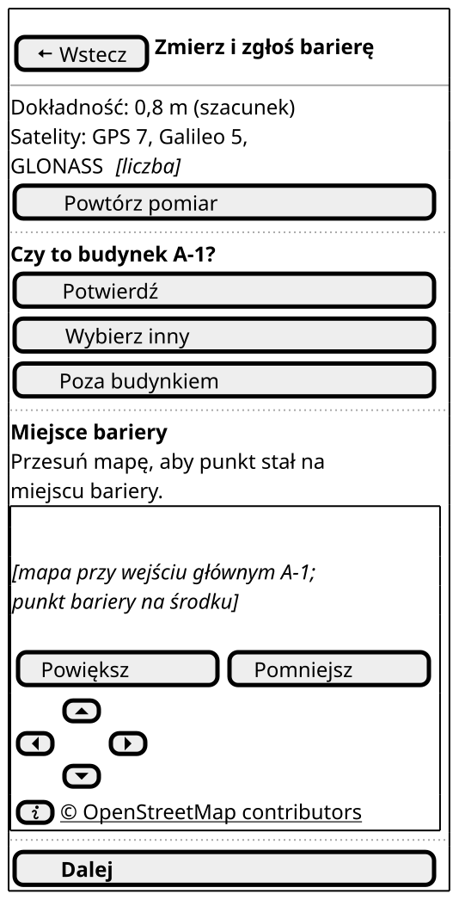

Czynność główna: „Dalej” — zatwierdzenie miejsca i przejście do C2.

| Element | AC/BR/NFR |
| --- | --- |
| „Czy to budynek A-1?” i „Potwierdź”, „Wybierz inny”, „Poza budynkiem” | US6.2, BR-G2 |
| Mapa z punktem bariery, „© OpenStreetMap contributors” | US6.4, NFR-37 |
| „Przesuń punkt na mapie:” i „W górę”, „W dół”, „W lewo”, „W prawo” zamiast przeciągania | US6.4, NFR-3, NFR-15 |
| „Dalej” pogrubione, na pełną szerokość | US6, NFR-21 |

### Korekta w budynku szczegółowym

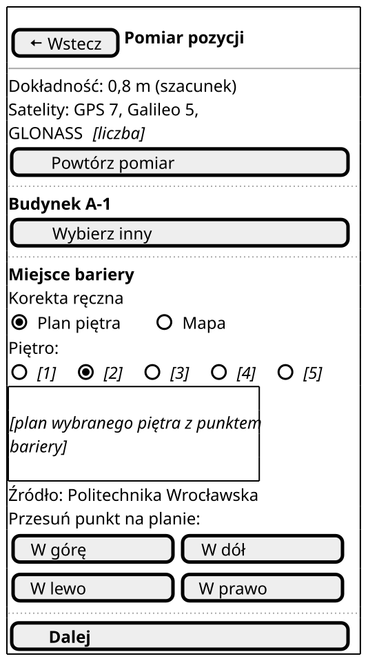

Czynność główna: „Dalej”.

| Element | AC/BR/NFR |
| --- | --- |
| „Budynek A-1” po potwierdzeniu i „Wybierz inny” | US6.2 |
| „Korekta ręczna” po przesunięciu punktu | US6.3, US6.4 |
| „Piętro:” i 5 etykiet z danych PWr, plan wybranego piętra | US6.3, US16.1 |
| „Źródło: Politechnika Wrocławska” pod planem | NFR-40 |
| „Przesuń punkt na planie:” z czterema przyciskami | US6.3, NFR-3, NFR-15 |
| Mapa z tym samym punktem i „Przesuń punkt na mapie:” | US6.4, NFR-3 |

### Szukanie satelitów

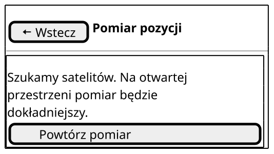

Czynność główna: „Powtórz pomiar”.

| Element | AC/BR/NFR |
| --- | --- |
| „Szukamy satelitów. Na otwartej przestrzeni pomiar będzie dokładniejszy.” | NFR-1, NFR-50, PW-9 |
| „Powtórz pomiar” | UC8 2a, NFR-23 |

### Daleko od budynków, bez internetu

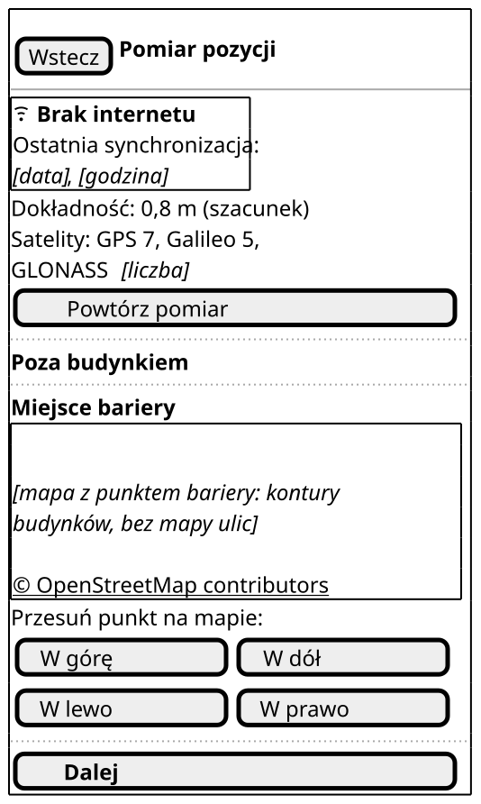

Czynność główna: „Dalej”.

| Element | AC/BR/NFR |
| --- | --- |
| „Brak internetu” z ikoną i „Ostatnia synchronizacja: …” | US9.1, NFR-10, NFR-21 |
| „Poza budynkiem” bez pytania o budynek i bez komunikatu o błędzie | BR-G4, NFR-49 |
| Mapa bez mapy ulic: kontury i punkt z danych aplikacji, bez podpisu OpenStreetMap | NFR-4, NFR-39 |
| Brak planu piętra; korekta tylko na mapie | US6.4, BR-G4 |

Budynek podstawowy wygląda tak samo, ale zamiast „Poza budynkiem” ma pytanie „Czy to budynek …?” z trzema przyciskami (US6.4, BR-G1). Zwykły stan bez internetu różni się od makiety po podpowiedzi tylko wskaźnikiem i mapą bez ulic.

### Brak zgody na lokalizację

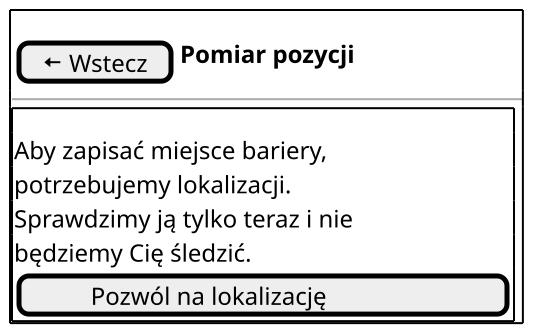

Czynność główna: przycisk w komunikacie. Rezygnacja przez „Wstecz” do L2, C2 albo C3, bez „Wróć do mapy” (NFR-15).

| Stan | Komunikat i przycisk | AC/BR/NFR |
| --- | --- | --- |
| Brak zgody (makieta) | „Aby zapisać miejsce bariery, potrzebujemy lokalizacji. Sprawdzimy ją tylko teraz i nie będziemy Cię śledzić.” „Pozwól na lokalizację” | NFR-27 |
| Odmowa zgody | „Bez lokalizacji nie zapiszesz miejsca bariery. Możesz ją włączyć w ustawieniach telefonu.” „Otwórz ustawienia” | NFR-27 |
| Zgoda tylko przybliżona | „Telefon podaje tylko przybliżone miejsce, a to za mało, by wskazać barierę. Pozwól na dokładną lokalizację.” „Pozwól na dokładną lokalizację” | NFR-27 |
| Lokalizacja wyłączona | „Lokalizacja w telefonie jest wyłączona. Włącz ją, aby zapisać miejsce bariery.” „Otwórz ustawienia” | NFR-27 |

Komunikaty powtarzają V4 z końcówką „aby zapisać miejsce bariery” i stoją w katalogu komunikatów.

## C2 Formularz zgłoszenia

### Nowe zgłoszenie w budynku szczegółowym

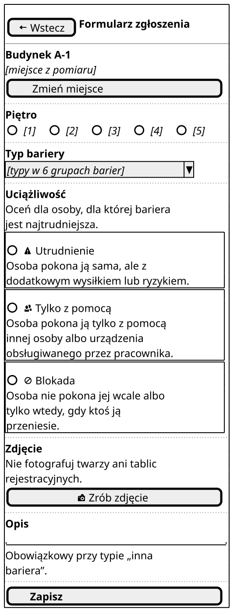

Czynność główna: „Zapisz”. Formularz nie ma paska dolnego.

| Element | AC/BR/NFR |
| --- | --- |
| „Budynek A-1”, miejsce z C1 i „Zmień miejsce” | US6.2 |
| „Piętro”: 5 etykiet z danych PWr, bez wpisywania ręcznie | US7.2, BR-7 |
| „Typ bariery”: lista z typami w 6 grupach barier | US7.1, BR-7 |
| „Uciążliwość”: „Utrudnienie”, „Tylko z pomocą”, „Blokada”, każda w ramce z ikoną i opisem kryterium skali | US7.1, NFR-17, NFR-21, PW-13 |
| „Nie fotografuj twarzy ani tablic rejestracyjnych.” i „Zrób zdjęcie” | US7.1, NFR-25, PW-8 |
| „Opis” z dopiskiem o typie „inna bariera” | US7.3 |
| „Zapisz” | BR-7 |

### Błąd walidacji

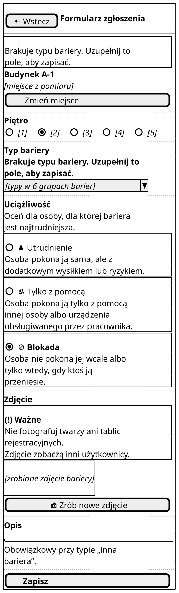

Czynność główna: „Zapisz”. Zapis nie wykona się, dopóki brakuje wymaganego pola.

| Element | AC/BR/NFR |
| --- | --- |
| Nad formularzem: „Brakuje typu bariery. Uzupełnij to pole, aby zapisać.” | US7.1, NFR-15, PW-10 |
| Ten sam tekst pogrubiony przy polu; fokus TalkBack na tym polu | NFR-15 (WCAG 3.3.1), NFR-18 |
| Po zdjęciu: zastępnik zdjęcia i „Zrób nowe zdjęcie” | US7.1, PW-8 |

Ten sam wzór dotyczy piętra, uciążliwości, zdjęcia i opisu przy typie „inna bariera” (BR-7, US7.3).

Gdy piętro wybrano już na C1 przy korekcie na planie, C2 ma je zaznaczone. Zbierający nie wybiera piętra drugi raz (US6.3, US7.2).

### Edycja w budynku podstawowym

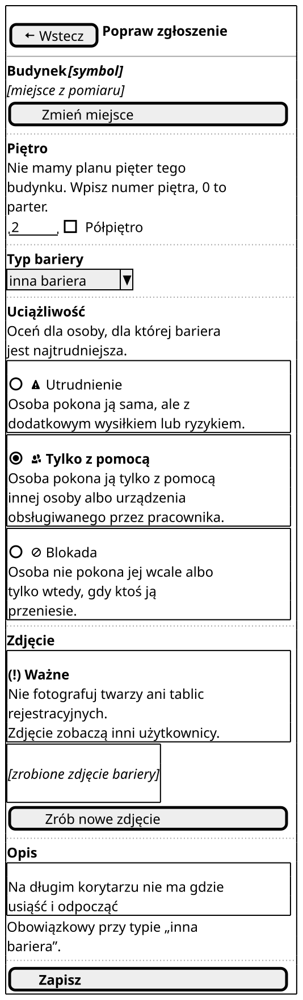

Czynność główna: „Zapisz”.

| Element | AC/BR/NFR |
| --- | --- |
| Pola z zapisanymi wartościami | US8.3 |
| Piętro jako liczba całkowita i pole „Półpiętro” | US7.2, BR-G1 |
| Typ „inna bariera” z opisem ze scenariusza `@US7.3` | US7.3 |

| Stan bez makiety | Co się zmienia | AC/BR/NFR |
| --- | --- | --- |
| Poza budynkiem | brak sekcji „Piętro” | BR-G4 |
| Zmiana zgłoszenia przyjętego | nad „Zapisz”: „Zapis utworzy nowe zgłoszenie, które znów sprawdzi Weryfikator.” | BR-18 |
| Brak internetu | wskaźnik pod nagłówkiem; zapis działa, a na C3 status „W telefonie” | US9.1, PW-12 |
| Błąd zapisu | nad formularzem: „Za mało miejsca w telefonie. Zwolnij miejsce i spróbuj ponownie.” i „Spróbuj ponownie” | NFR-7 |

## C3 Moje zgłoszenia

### Lista zgłoszeń

Czynność główna: otwarcie zgłoszenia do poprawy — dotknięcie całej pozycji albo „Popraw zgłoszenie” przy odrzuconym.

| Element | AC/BR/NFR |
| --- | --- |
| „Czeka na wysłanie: 2”, prowadzi do C4 | US9.1 |
| „Zmierz i zgłoś barierę”, prowadzi do C1 | US6, PW-12 |
| Status jako pierwsza linia pozycji, słowem i ikoną; sześć statusów | US8.1, US8.2, NFR-18, NFR-21 |
| Typ, budynek, piętro, data | US8.1 |
| „Powód odrzucenia:” z powodem ze scenariusza `@BR-16` | US8.1, BR-16 |
| „Popraw zgłoszenie” przy odrzuconym; prowadzi do C2 | US8.3, BR-3 |
| „Zmiana czeka na wysłanie” przy niewysłanej edycji | BR-9 |
| „Dwie wersje: wybierz jedną”, prowadzi do C4 | US9.3 |
| Rodzaj „Bariery już nie ma”, tu „W telefonie”; po przyjęciu byłby „Archiwalne”, nigdy „Przyjęte” | US8.4, BR-19, PW-12 |
| Rodzaj „Zmiana oznaczenia wejścia”: wejście główne A-1 „Niedostępne”, przyjęta zmiana staje się archiwalna | US17.2, BR-24 |

### Odrzucone jako „nieaktualne”

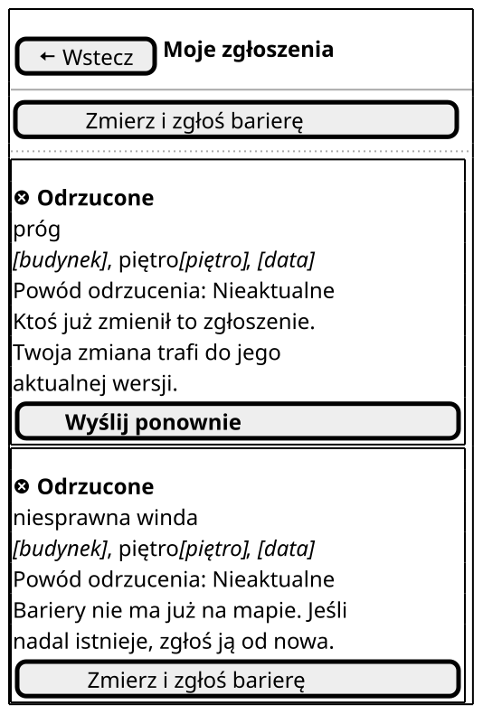

Czynność główna: „Wyślij ponownie”.

| Element | AC/BR/NFR |
| --- | --- |
| „Ktoś już zmienił to zgłoszenie. Twoja zmiana trafi do jego aktualnej wersji.”; przy zmianie oznaczenia wejścia: „Oznaczenie tego wejścia już się zmieniło. Sprawdź je i wyślij swoją zmianę ponownie.” | BR-23, BR-24, PW-14 |
| „Wyślij ponownie”; prowadzi do C2, a przy zmianie oznaczenia wejścia do C6 | BR-23, BR-24, PW-14 |
| „Bariery nie ma już na mapie. Jeśli nadal istnieje, zgłoś ją od nowa.” i „Zmierz i zgłoś barierę” | BR-23, PW-12 |

### Pusta lista

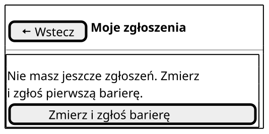

Czynność główna: „Zmierz i zgłoś barierę”.

| Stan bez makiety | Co się zmienia | AC/BR/NFR |
| --- | --- | --- |
| Ładowanie | lista z telefonu zostaje, nad nią „Sprawdzamy statusy…” | PW-9 |
| Brak internetu | wskaźnik z „Ostatnia synchronizacja: …”; statusy z dnia synchronizacji | US9.1, NFR-10 |
| Błąd | nad listą: „Nie udało się sprawdzić statusów, ale zgłoszenia są bezpieczne w telefonie. Spróbuj ponownie za chwilę.” i „Spróbuj ponownie” | NFR-5, NFR-50, PW-10 |

## C4 Synchronizacja

### Kolejka w telefonie

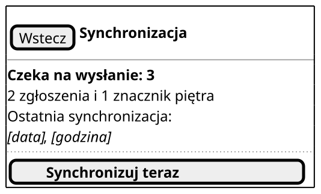

Czynność główna: „Synchronizuj teraz”; synchronizacja i tak rusza sama.

| Element | AC/BR/NFR |
| --- | --- |
| „Czeka na wysłanie: 3” i podział na zgłoszenia i znaczniki | US9.1, BR-9 |
| „Ostatnia synchronizacja: …” | NFR-10 |
| „Synchronizuj teraz” | UC10, US9.2 |

| Stan bez makiety | Co się zmienia | AC/BR/NFR |
| --- | --- | --- |
| Pusty | „Wszystko wysłane. Ostatnia synchronizacja: …” | US9.1 |
| Wysyłanie | „Wysyłamy 2 z 5…” | PW-9 |
| Brak internetu | „Brak internetu. Wyślemy wszystko sami, gdy internet wróci.” | US9.1, US9.2 |
| Błąd serwera | „Serwer chwilowo nie odpowiada. Zgłoszenia czekają w telefonie i wyślą się później.” | NFR-50 |
| Mało miejsca | nad liczbą: „W telefonie zostało mniej niż 100 MB. Zwolnij miejsce, aby dalej robić zdjęcia.” | NFR-7, PW-10 |

### Konflikt wersji

Czynność główna: wybór wersji — „Zostaw moją wersję” albo „Weź wersję z serwera”, oba przyciski tej samej wagi.

| Element | AC/BR/NFR |
| --- | --- |
| „Dwie wersje: wybierz jedną. Druga wersja zostanie usunięta.” | US9.3, BR-10, PW-12 |
| Obie wersje jedna pod drugą; uciążliwość 2 i 3 jak w scenariuszu `@US9.3` | US9.3, NFR-20, NFR-22 |
| „Inna wartość” przy polu, które się różni | US9.3, NFR-21 |
| Przycisk wyboru pod każdą wersją | US9.3, BR-10 |
| „Zdecyduję później”: zmiana czeka w telefonie | BR-10 |

Przy zgłoszeniu przyjętym komunikat ma drugie zdanie z katalogu komunikatów (UC11 3b). W orientacji poziomej wersje stoją obok siebie (NFR-22).

## C5 Obejrzane piętra

### Zbierający, budynek szczegółowy

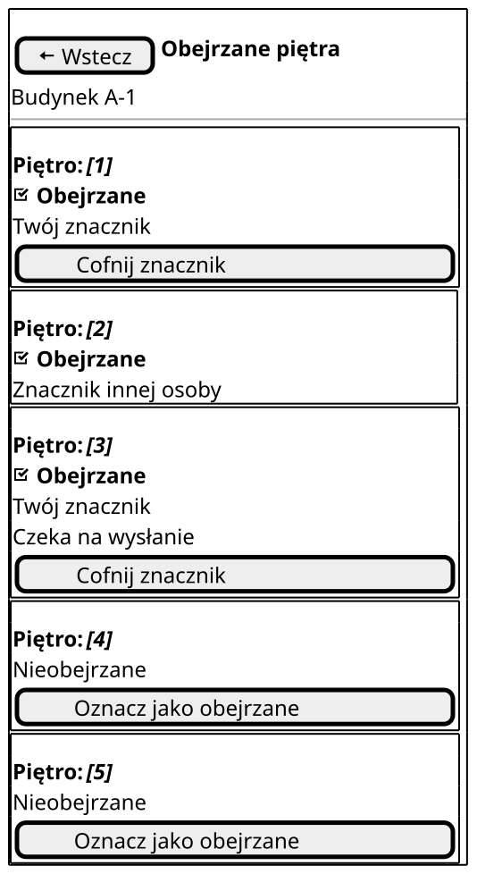

Czynność główna: „Oznacz jako obejrzane” przy piętrze bez znacznika.

| Element | AC/BR/NFR |
| --- | --- |
| Symbol budynku pod nagłówkiem | US15.1 |
| Lista pięter z etykietami z danych PWr | US15.1, US16.1 |
| „Obejrzane” z ikoną albo „Nieobejrzane” samym tekstem | US15.1, PW-11 |
| „Twój znacznik” albo „Znacznik innej osoby” | US15.2 |
| „Czeka na wysłanie” przy znaczniku w telefonie | US15.3 |
| „Cofnij znacznik” tylko przy własnym znaczniku | US15.2, PW-12 |

### Budynek podstawowy, bez internetu

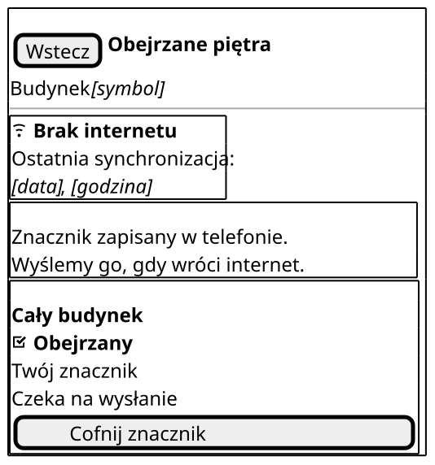

Czynność główna: „Oznacz jako obejrzane”, a po oznaczeniu „Cofnij znacznik” jako jedyny przycisk.

| Element | AC/BR/NFR |
| --- | --- |
| Jeden wiersz „Cały budynek” | US15.1, BR-20 |
| „Obejrzany”: forma dla budynku taka sama jak w K1 | US15.1, słownik użytkownika |
| „Znacznik zapisany w telefonie. Wyślemy go, gdy wróci internet.” | US15.3, BR-9 |
| Cofnięcie bez internetu działa tak samo | US15.3, BR-20 |

### Koordynator, potwierdzenie cofnięcia

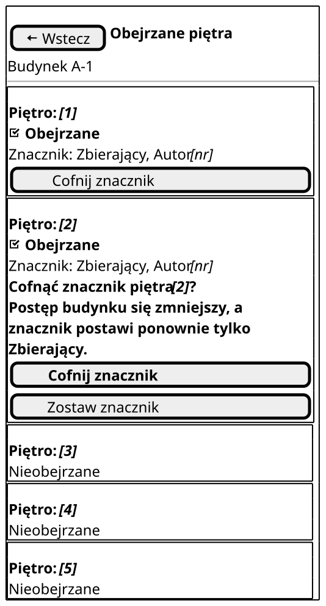

Czynność główna: „Cofnij znacznik” przy każdym znaczniku, z potwierdzeniem.

| Element | AC/BR/NFR |
| --- | --- |
| „Cofnij znacznik” przy każdym znaczniku | US11.3, BR-20 |
| „Cofnąć znacznik piętra [2]? Postęp budynku się zmniejszy, a znacznik postawi ponownie tylko Zbierający.” | BR-20, PW-12 |
| „Cofnij znacznik” i „Zostaw znacznik” | BR-20, PW-12 |
| Brak „Oznacz jako obejrzane” | BR-20 |

Pytanie stoi przy wierszu, którego dotyczy, więc osoba widzi piętro i skutek naraz. Błąd zapisu ma nad listą komunikat „Nie udało się zapisać znacznika w telefonie. Spróbuj ponownie, a jeśli to nie pomoże, zwolnij miejsce.” i „Spróbuj ponownie” (NFR-7).

## C6 Zmień oznaczenie wejścia

### Przed wyborem

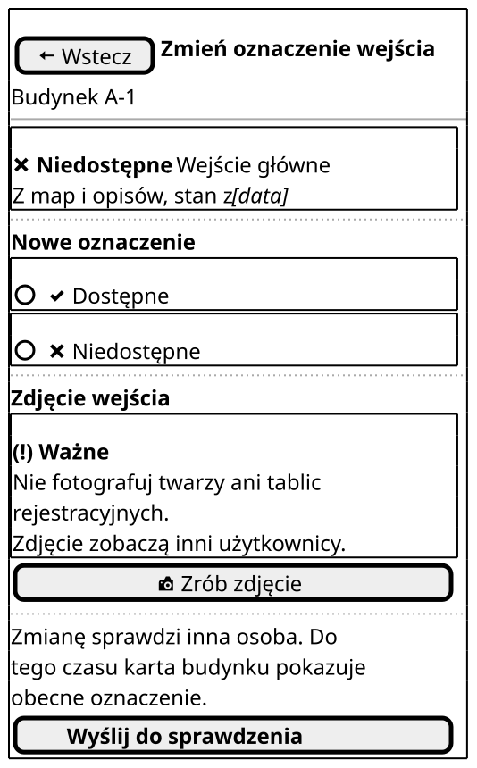

Czynność główna: „Wyślij do sprawdzenia”.

| Element | AC/BR/NFR |
| --- | --- |
| Budynek A-1 i „Wejście główne” | US17.2 |
| Obecne oznaczenie „Niedostępne” z ikoną, datą i źródłem jak na V2 [1] | US17.3, NFR-21, PW-3 |
| Dwie duże ramki „Dostępne” i „Niedostępne”, bez „Brak danych” | US17.2, BR-24, NFR-17 |
| Przypomnienie o twarzach i „Zrób zdjęcie”; zdjęcie obowiązkowe | US17.2, BR-24, NFR-25, PW-8 |
| „Zmianę sprawdzi inna osoba. Do tego czasu karta budynku pokazuje obecne oznaczenie.” | BR-4, BR-24 |

### Potwierdzenie obecnego oznaczenia

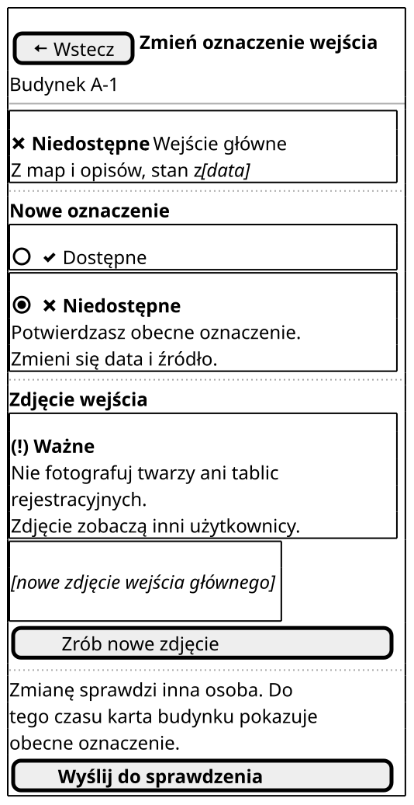

Czynność główna: „Wyślij do sprawdzenia”.

| Element | AC/BR/NFR |
| --- | --- |
| Wybrana ramka: znak wyboru i pogrubienie, nie kolor | NFR-21 |
| „Potwierdzasz obecne oznaczenie. Zmieni się data i źródło.” | BR-24, UC18 2a |
| Nowe zdjęcie i „Zrób nowe zdjęcie” | US17.2, PW-8 |

| Stan bez makiety | Co się zmienia | AC/BR/NFR |
| --- | --- | --- |
| Błąd walidacji | nad formularzem i przy polu: „Dodaj zdjęcie wejścia, aby wysłać zmianę.” albo „Wybierz: dostępne czy niedostępne.” | BR-24 |
| Brak internetu | po wysłaniu na C3: „Zmiana zapisana w telefonie. Wyślemy ją, gdy wróci internet.” i status „W telefonie” | US9.1 |
| Błąd zapisu | „Za mało miejsca w telefonie. Zwolnij miejsce i spróbuj ponownie.” | NFR-7 |

## C7 Zgłoś, że bariery nie ma

Czynność główna: „Wyślij do sprawdzenia”.

| Element | AC/BR/NFR |
| --- | --- |
| Zgłoszenie przyjęte: typ TB-9 ze scenariusza `@US8.4`, piętro, miejsce, zdjęcie, „Sprawdzone …”; bez edycji | BR-19 |
| „Nowe zdjęcie miejsca”, przypomnienie i „Zrób zdjęcie”; zdjęcie obowiązkowe | US8.4, BR-19, NFR-25, PW-8 |
| „Bariera zostanie na mapie, dopóki Weryfikator nie sprawdzi zgłoszenia.” | US8.4 |
| Brak typu i uciążliwości do wyboru | BR-19, BR-7 |

| Stan bez makiety | Co się zmienia | AC/BR/NFR |
| --- | --- | --- |
| Błąd walidacji | nad formularzem i przy zdjęciu: „Dodaj zdjęcie miejsca, aby wysłać zgłoszenie.” | BR-19 |
| Brak internetu | po wysłaniu na C3: „Zgłoszenie zapisane w telefonie. Wyślemy je, gdy wróci internet.” i status „W telefonie” | US8.4, US9.1 |
| Błąd zapisu | „Za mało miejsca w telefonie. Zwolnij miejsce i spróbuj ponownie.” | NFR-7 |

## Źródła

1. Deklaracja dostępności budynku A-1 (wejście główne ze schodami): <https://dostepnosc.pwr.edu.pl/dostepnosc-architektoniczna/deklaracje-dostepnosci-budynkow/budynki-a/a1>
2. PlantUML Salt: <https://plantuml.com/salt>

Dostęp do źródeł: 28.10.2026.
