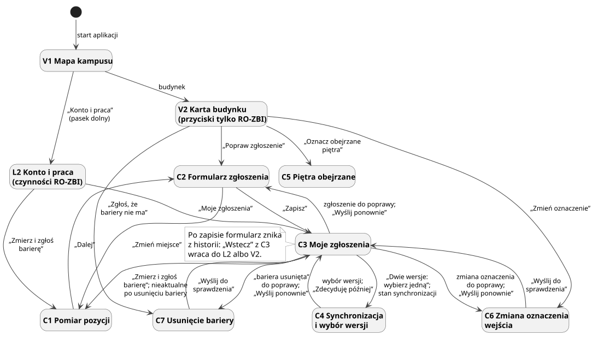
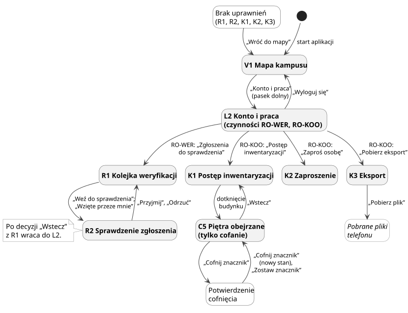

# Mapa nawigacji

Strona pokazuje, dokąd prowadzi każda czynność na ekranach z [wymagań do ekranów](wymagania-ekranow.md). Sprawdza też próg US3.2, dostęp ról według [macierzy uprawnień](../biznes/role.md#macierz-uprawnien), powroty i ślepe zaułki. Przejścia pochodzą wyłącznie z kolumn „Dokąd”, tabel stanów i tekstu przy ekranach.

## Jak czytać diagramy

| Znak | Znaczenie |
| --- | --- |
| Prostokąt pogrubiony | ekran z ID z listy ekranów |
| Prostokąt zwykły | stan ekranu, który zmienia dalszą drogę, np. brak zgody na lokalizację |
| Prostokąt kursywą | miejsce poza aplikacją: przeglądarka, ustawienia telefonu, pobrane pliki |
| Strzałka z podpisem | czynność, która prowadzi dalej; podpis w cudzysłowie to napis przycisku ze [słownika użytkownika](slownik-uzytkownika.md) |
| „Pasek dolny” | jeden węzeł zamiast czterech strzałek z każdego z ekranów V1, V2, V3, V5 i L2 |

„Wstecz” jest na każdym ekranie poza V1 i wraca do poprzedniego ekranu (wymagania wspólne, NFR-15). Wysłany formularz znika z historii „Wstecz” (P2). Diagramy pokazują „Wstecz” tylko tam, gdzie cel nie jest oczywisty. „Zalogowani” w tabelach to RO-ODW i role pracownicze (BR-1).

Czwarta pozycja paska dolnego to „Konto”, a osoby z rolą pracowniczą widzą na niej „Konto i praca” ([słownik użytkownika](slownik-uzytkownika.md#nazwa-wejscia)). Obie prowadzą do L2 (P1).

## Gość i Odwiedzający

Główna droga to V1, V2, V3 i z powrotem. Z V2 wraca się też na mapę z planem piętra albo wejściem. „Zgłoś barierę przy wejściu” na V2 i V3 otwiera V4 z wybranym wejściem.

Zgłoszenie szybkie V4 ma trzy kroki, a każdy stan błędu lokalizacji ma wyjście „Wróć do mapy”. Rezygnacja ze zrobionego zdjęcia wymaga potwierdzenia (heurystyki Nielsena 3 i 5 [1]).

Gość trafia do L1 zarówno ze „Zgłoś barierę”, jak i z „Konto”. Po zalogowaniu wraca do kroku 1 V4 albo trafia do L2 (P3).

## Zbierający

Zbierający zaczyna pracę w dwóch miejscach. Pomiar i listę zgłoszeń otwiera z L2 („Konto i praca”), a zmiany przy budynku (C2, C5, C6, C7) z karty budynku V2. Każdy zapis i wysłanie kończy się na C3, a „Wstecz” z C3 wraca tam, skąd zaczęła się praca (P2).

## Weryfikator i Koordynator

Weryfikator krąży między R1 i R2, a „Wstecz” z R1 po decyzji wraca do L2 (P2). Koordynator otwiera K1, K2 i K3 z L2, a z K1 przechodzi do C5, by cofnąć znacznik. Stan „brak uprawnień” na R1, R2 i K1–K3 prowadzi prosto do mapy.

## Tabela przejść

### Przejścia: start, pasek dolny i „Wstecz”

| Z ekranu | Czynność | Do ekranu | Rola | AC/BR |
| --- | --- | --- | --- | --- |
| start aplikacji, pierwsze uruchomienie | otwiera się samo | V5 | wszystkie | US5.1 |
| start aplikacji, kolejne uruchomienie | otwiera się samo | V1 | wszystkie | US1.2 |
| pasek dolny (V1, V2, V3, V5, L2) | „Mapa” | V1 | wszystkie | US1 |
| pasek dolny | „Zgłoś barierę” | V4 | zalogowani | US4 |
| pasek dolny | „Zgłoś barierę” | L1 | RO-GOS | US14.2 |
| pasek dolny | „Pomoc” | V5 | wszystkie | US5.1 |
| pasek dolny | „Konto” | L1 | RO-GOS | US14 |
| pasek dolny | „Konto” | L2 | RO-ODW | US14.1, US14.3 |
| pasek dolny | „Konto i praca” | L2, na górze sekcja „Twoja praca” | role pracownicze | US14.1, P1 |
| pasek dolny | ponowne dotknięcie wybranej pozycji | pierwszy ekran tej sekcji: V1 bez arkusza i wyniku wyszukiwania, V5 na kroku 1, L1 albo L2 jak po wejściu | wszystkie | NFR-15, decyzja 72 |
| V5 przy pierwszym uruchomieniu | wyjście z instrukcji dowolną drogą: „Wstecz”, pasek, „Pomiń instrukcję”, „Zacznij” | ekran docelowy tej czynności; instrukcja jest pokazana i nie otworzy się sama przy kolejnym uruchomieniu. Zamknięcie aplikacji w trakcie instrukcji jej nie kończy | wszystkie | US5.1, decyzja 73 |
| każdy ekran poza V1 | „Wstecz” | poprzedni ekran | wszystkie | NFR-15 |
| ekran po wysłaniu formularza: C3, R1, V4 potwierdzenie | „Wstecz” | ekran, z którego zaczęła się praca: L2, V2 albo ekran sprzed V4 | zalogowani | NFR-15, P2 |

### Przejścia: Gość i Odwiedzający

| Z ekranu | Czynność | Do ekranu | Rola | AC/BR |
| --- | --- | --- | --- | --- |
| V1 | wybór wyniku w polu „Wpisz symbol budynku, np. C-13” | V2 | wszystkie | US1.1 |
| V1 | dotknięcie konturu budynku | V2, arkusz na mapie do połowy ekranu | wszystkie | US2, US3.2, decyzja 48 |
| V1 | dotknięcie konturu wspólnego, np. „C-3/C-4”, albo dotknięcie w zasięgu dwóch konturów | V1, arkusz „Który budynek?” | wszystkie | US2, US3.2, decyzja 85 |
| V1, arkusz „Który budynek?” | przycisk budynku, np. „Budynek C-3”; „Zamknij” | V2 tego budynku; V1 | wszystkie | US2, NFR-53 |
| V1 | przełącznik „Mapa” i „Lista budynków” | V1, lista | wszystkie | NFR-19 |
| V1 | dotknięcie budynku na liście | V2 | wszystkie | US2, US3.2 |
| V1 | dotknięcie znaku bariery | V1, arkusz bariery | wszystkie | US1.3, US10.6 |
| V1, arkusz bariery | „Pokaż opis budynku”; „Zamknij” | V2 budynku bariery; V1 | wszystkie | US2 |
| V1 | napis „© OpenStreetMap contributors” | strona praw autorskich OSM | wszystkie | NFR-37 |
| V1 | „Powiększ”, „Pomniejsz” i strzałki „Przesuń mapę w górę”, „…w dół”, „…w lewo”, „…w prawo” | V1, mapa powiększona albo przesunięta | wszystkie | NFR-15, PW-8, PW-11 |
| V1 | „ⓘ” („Informacje o mapie”) | V1, arkusz ze źródłami mapy | wszystkie | NFR-37, NFR-40 |
| V1, stan „brak wyniku” | „Lista budynków” | V1, lista | wszystkie | UC1 3a |
| V1 | „Legenda” | V1, legenda rozwinięta | wszystkie | NFR-21 |
| V1 | wybór sali w wynikach pola, np. „A-1 329” | V1, stan „znaleziona sala”: plan piętra i kroki | wszystkie | BR-25, decyzja 44 |
| V1, stan „plan piętra” albo „znaleziona sala” | przełącznik pięter | V1, plan innego piętra | wszystkie | US16.1 |
| V1, stan „znaleziona sala”, „sala bez drogi” albo „brak sali” | „Pokaż opis budynku” | V2 | wszystkie | US2 |
| V1, stan „znaleziona sala” | „Zamknij” | V1 | wszystkie | decyzja 48 |
| V2 | „Pokaż na planie” przy piętrze | V1, plan tego piętra | wszystkie | US16.1, decyzja 44 |
| V2 | „Pokaż na mapie” w przypiętym pasie | V1 z zaznaczonym budynkiem | wszystkie | US2.1, US3.2 |
| V2 | „Pokaż wejście na mapie” przy wejściu zalecanym | V1 z zaznaczonym wejściem | wszystkie | US2.1, BR-25 |
| V2 | „Zgłoś barierę przy wejściu” | V4, krok 1, wejście wybrane | zalogowani | US4, decyzja 48 |
| V2 | „Zgłoś barierę przy wejściu” | L1, potem V4 z wybranym wejściem | RO-GOS | US14.2, decyzja 48 |
| V2, stan „brak zgłoszeń przyjętych” | „Zgłoś barierę” | V4; Gość: L1 | wszystkie | US4, US14.2 |
| V2 | „Sprawdź, którędy wejść” | V3 | wszystkie | US3, US3.2 |
| V2 | „Wstecz” | V1 z zaznaczonym budynkiem | wszystkie | US1.1 |
| V2, stan „budynku nie ma w telefonie” | „Spróbuj ponownie” | V2 | wszystkie | NFR-10 |
| V2, stan „błąd zdjęcia” | „Spróbuj ponownie” | V2 | wszystkie | NFR-50 |
| V3 | „Wstecz” | V2 | wszystkie | US3 |
| V3 | „Pokaż wejście na mapie” przy wejściu dostępnym | V1 z zaznaczonym wejściem | wszystkie | US2.1, US3 |
| V3 | „Zgłoś barierę przy wejściu” | V4, krok 1, wejście wybrane | zalogowani | US4, decyzja 54 |
| V3 | „Zgłoś barierę przy wejściu” | L1, potem V4 z wybranym wejściem | RO-GOS | US14.2, decyzja 54 |
| V4 | wejście na ekran | L1 zamiast aparatu | RO-GOS | US14.2 |
| V4, stan „brak zgody na lokalizację” | „Pozwól na lokalizację” | V4, krok 1 | zalogowani | UC7 2a, NFR-27 |
| V4, stan „brak zgody na lokalizację” | „Wróć do mapy” | V1 | zalogowani | UC7 2a |
| V4, stan „odmowa zgody” | „Otwórz ustawienia” | ustawienia telefonu | zalogowani | UC7 2a, BR-8 |
| V4, stan „odmowa zgody” | „Wróć do mapy” | V1 | zalogowani | UC7 2a |
| V4, stan „zgoda tylko przybliżona” | „Pozwól na dokładną lokalizację” | V4, krok 1 | zalogowani | BR-8, BR-14 |
| V4, stan „zgoda tylko przybliżona” | „Wróć do mapy” | V1 | zalogowani | BR-8 |
| V4, stan „lokalizacja wyłączona” | „Otwórz ustawienia” | ustawienia telefonu | zalogowani | UC7 4c |
| V4, stan „lokalizacja wyłączona” | „Wróć do mapy” | V1 | zalogowani | UC7 4c |
| V4, krok 1 | „Zrób zdjęcie”, „Zrób nowe zdjęcie” | aparat, potem krok 2 | zalogowani | US4.1, BR-8 |
| V4, krok 2 | wybór grupy barier: „Wejście i drzwi”, „Schody i windy”, „Przejścia i chodniki”, „Toalety”, „Napisy i oznaczenia”, „Coś innego” | V4, krok 3; w budynku przy każdej grupie poza „Coś innego” pytanie o piętro | zalogowani | US4.3, US4.5 |
| V4, krok 2, pytanie o piętro | przycisk piętra albo „Nie wiem” | V4, krok 3 | zalogowani | US4.5, BR-14 |
| V4, krok 2, pytanie o piętro | „Wstecz” | V4, krok 2, lista grup; zdjęcie zostaje | zalogowani | US4.5 |
| V4, krok 2 | „Wstecz” | V4, krok 1; zdjęcie zostaje | zalogowani | US4.1 |
| V4, krok 1, zdjęcie zrobione | „Dalej” | V4, krok 2; zdjęcie i grupa zostają | zalogowani | US4.1 |
| V4, krok 1, zdjęcie zrobione | „Wstecz” | V4, stan „potwierdzenie rezygnacji” | zalogowani | UC7 1b |
| V4, krok 3 | „Wstecz” | V4, krok 2: pytanie o piętro, jeśli było, inaczej lista grup; zdjęcie, grupa i piętro zostają | zalogowani | US4.1, US4.5 |
| V4, krok 3 | „Wyślij” | V4, potwierdzenie | zalogowani | US4.1, US4.4 |
| V4, krok 3, brak sieci | „Wyślij” | V4, potwierdzenie „Zapisaliśmy zdjęcie w telefonie” | zalogowani | US4.2, UC7 7a |
| V4, krok 3 | telefon nie ustalił pozycji | V4, stan „brak pozycji” | zalogowani | UC7 4c |
| V4, stan „brak pozycji” | „Spróbuj ponownie” | V4, krok 3 | zalogowani | UC7 4c |
| V4, stan „brak pozycji” | „Zrezygnuj” | V4, stan „potwierdzenie rezygnacji” | zalogowani | UC7 4c |
| V4, stan „potwierdzenie rezygnacji” | „Tak, zrezygnuj” | po „Zrezygnuj”: V1; po „Wstecz” z kroku 1: ekran sprzed V4; zdjęcie usunięte, zgłoszenie nie powstaje | zalogowani | UC7 1b |
| V4, stan „potwierdzenie rezygnacji” | „Wróć do zdjęcia” | stan „brak pozycji” albo krok 1, skąd osoba przyszła; zdjęcie i grupa zostają | zalogowani | UC7 4c |
| V4, potwierdzenie | „Wróć do mapy” | V1 | zalogowani | US4.4 |
| V5 | „Dalej” | następny krok V5 | wszystkie | US5.1 |
| V5, ostatni krok | „Zacznij” | V1 | wszystkie | US5.1 |
| V5 | „Pomiń instrukcję” | V1 | wszystkie | US5.1 |
| V5 | „Wstecz” | poprzedni krok V5; w pierwszym kroku przy pierwszym uruchomieniu V1, jak „Pomiń instrukcję” | wszystkie | US5.1, NFR-15 |

### Przejścia: logowanie i konto

| Z ekranu | Czynność | Do ekranu | Rola | AC/BR |
| --- | --- | --- | --- | --- |
| L1 | „Zaloguj się” | strona logowania w przeglądarce | RO-GOS | US14, NFR-31 |
| L1 | „Załóż konto” | rejestracja w przeglądarce z klauzulą | RO-GOS | US14.3, NFR-30 |
| strona logowania lub rejestracji, wejście z V4 | zalogowanie albo rejestracja | V4, krok 1; wejście wybrane na V2 zostaje | zalogowani | US14.2, UC7 1a |
| strona logowania lub rejestracji, wejście z „Konto” | zalogowanie albo rejestracja | L2 | zalogowani | UC6 krok 3, US12.1, P3 |
| L1 | „Nie teraz” | V1 | RO-GOS | UC7 1b |
| L1, stan „brak sieci” | „Wróć do mapy” | V1 | RO-GOS | UC6 1a |
| L1, stan „błąd” | „Spróbuj ponownie” | strona logowania w przeglądarce | RO-GOS | US14 |
| L1, stan „błąd” | „Nie teraz” | V1 | RO-GOS | UC7 1b |
| L2 | „Zmierz i zgłoś barierę” | C1 | RO-ZBI | US6, US14.1 |
| L2 | „Moje zgłoszenia” | C3 | RO-ZBI | US8, US14.1 |
| L2 | „Zgłoszenia do sprawdzenia” | R1 | RO-WER | US10, US14.1 |
| L2 | „Postęp inwentaryzacji” | K1 | RO-KOO | US11, US14.1 |
| L2 | „Zaproś osobę” | K2 | RO-KOO | US12, US14.1 |
| L2 | „Pobierz eksport” | K3 | RO-KOO | US13, US14.1 |
| L2 | „Informacja o danych osobowych” | L2, stan „Klauzula informacyjna” | zalogowani | NFR-30 |
| L2, stan „Klauzula informacyjna” | „Wstecz” | L2 | zalogowani | NFR-30 |
| L2 | „Wycofaj zgodę” | L2, potwierdzenie | zalogowani | NFR-29, NFR-30 |
| L2, potwierdzenie wycofania | „Wycofaj zgodę” | wylogowanie, V1 | zalogowani | NFR-29 |
| L2, potwierdzenie wycofania | „Zostaw zgodę” | L2 | zalogowani | NFR-29 |
| L2 | „Wyloguj się” | V1 | zalogowani | macierz: profil i wylogowanie |

### Przejścia: Zbierający

| Z ekranu | Czynność | Do ekranu | Rola | AC/BR |
| --- | --- | --- | --- | --- |
| V2 | „Zmień oznaczenie” przy wejściu | C6 | RO-ZBI | US17.2, BR-24 |
| V2 | „Zgłoś, że bariery nie ma” | C7 | RO-ZBI | US8.4, BR-19 |
| V2 | „Popraw zgłoszenie” | C2 | RO-ZBI | BR-3, BR-18 |
| V2 | „Oznacz obejrzane piętra” | C5 | RO-ZBI | US15.1 |
| C1 | „Powtórz pomiar” | C1, początek pomiaru | RO-ZBI | UC8 2a, NFR-23 |
| C1 | „Dalej” | C2 | RO-ZBI | US6 |
| C1 | „Potwierdź”, „Poza budynkiem” przy pytaniu „Czy to budynek C-13?” | C1 z wybranym budynkiem albo bez budynku | RO-ZBI | US6.2, BR-G2, BR-G4 |
| C1 | „Wybierz inny” przy pytaniu albo po potwierdzeniu | C1, lista budynków najbliżej punktu | RO-ZBI | US6.2, BR-G2 |
| C1, lista budynków | budynek z listy, np. „Budynek A-2”; „Poza budynkiem” | C1 z wybranym budynkiem albo bez budynku | RO-ZBI | US6.2, BR-G2, BR-G4 |
| C1, budynek szczegółowy | przełącznik „Plan piętra” i „Mapa” (domyślnie „Plan piętra”) | C1, ten sam ekran: plan wybranego piętra albo mapa z tym samym punktem | RO-ZBI | US6.3, US6.4 |
| C1 | „Powiększ”, „Pomniejsz” i strzałki „Przesuń mapę w górę”, „…w dół”, „…w lewo”, „…w prawo” | C1, mapa albo plan przesunięte, punkt na środku w nowym miejscu, napis „Korekta ręczna” | RO-ZBI | US6.3, US6.4, NFR-15 |
| C1 | „ⓘ” („Informacje o mapie”) | C1, panel ze źródłami mapy | RO-ZBI | NFR-37, NFR-40 |
| C1, stany „brak zgody” i „zgoda tylko przybliżona” | „Pozwól na lokalizację”, „Pozwól na dokładną lokalizację” | C1, pomiar | RO-ZBI | NFR-27, BR-8 |
| C1, stany zgody na lokalizację | jak w V4; po odmowie „Otwórz ustawienia” | ustawienia telefonu | RO-ZBI | NFR-27 |
| C1, stany zgody na lokalizację | „Wstecz” zamiast „Wróć do mapy” | ekran, z którego otwarto C1: L2, C2 albo C3 | RO-ZBI | NFR-15 |
| C2 | „Zmień miejsce” | C1 | RO-ZBI | US6.2 |
| C2 | „Zrób zdjęcie”, „Zrób nowe zdjęcie” | aparat, potem C2 ze zdjęciem | RO-ZBI | US7.1, NFR-25 |
| C2 | „Zapisz” | C3 | RO-ZBI | BR-7 |
| C2, błąd walidacji | „Zapisz” bez wymaganego pola | C2, komunikat przy polu | RO-ZBI | US7.1, US7.3 |
| C3 | znak „Dwie wersje: wybierz jedną” | C4 | RO-ZBI | US9.3 |
| C3 | stan synchronizacji, np. „Czeka na wysłanie: 3” | C4 | RO-ZBI | US9.1 |
| C3 | „Otwórz” przy zgłoszeniu przed decyzją albo odrzuconym | C2 | RO-ZBI | US8.1, US8.3, BR-3 |
| C3 | to samo przy zmianie oznaczenia wejścia | C6 | RO-ZBI | US17.2 |
| C3 | to samo przy „bariera usunięta” | C7 | RO-ZBI | US8.4 |
| C3 | „Wyślij ponownie” przy zmianie odrzuconej jako „nieaktualne” | C2 z aktualną wersją zgłoszenia | RO-ZBI | BR-23 |
| C3 | to samo przy zmianie oznaczenia wejścia | C6 z bieżącym oznaczeniem | RO-ZBI | BR-23, BR-24 |
| C3 | to samo przy „bariera usunięta” | C7 z aktualną wersją zgłoszenia | RO-ZBI | BR-23, US8.4 |
| C3 | przy „nieaktualne” po usunięciu bariery: „Zmierz i zgłoś barierę” | C1 | RO-ZBI | BR-23 |
| C3 | „Zmierz i zgłoś barierę”, także w stanie pustym | C1 | RO-ZBI | US6 |
| C3, stan „błąd” | „Spróbuj ponownie” | C3 | RO-ZBI | NFR-50 |
| C4 | „Synchronizuj teraz” | C4 | RO-ZBI | US9.2 |
| C4, konflikt | „Zostaw moją wersję”, „Weź wersję z serwera” | C3 | RO-ZBI | US9.3, BR-10 |
| C4, konflikt | „Zdecyduję później” | C3 | RO-ZBI | BR-10 |
| C5 | „Oznacz jako obejrzane” | C5, nowy stan | RO-ZBI | US15.1 |
| C5 | „Cofnij znacznik” przy własnym znaczniku | C5, potwierdzenie | RO-ZBI | US15.2 |
| C5, potwierdzenie | „Cofnij znacznik” | C5 z nowym stanem | RO-ZBI | US15.2 |
| C5, stan „błąd zapisu” | „Spróbuj ponownie” | C5 | RO-ZBI | NFR-7 |
| C6 | „Zrób zdjęcie”, „Zrób nowe zdjęcie” | aparat, potem C6 ze zdjęciem | RO-ZBI | US17.2, BR-24 |
| C6 | „Wyślij do sprawdzenia” | C3 | RO-ZBI | US17.2 |
| C7 | „Zrób zdjęcie”, „Zrób nowe zdjęcie” | aparat, potem C7 ze zdjęciem | RO-ZBI | US8.4, BR-19 |
| C7 | „Wyślij do sprawdzenia” | C3 | RO-ZBI | US8.4 |

### Przejścia: Weryfikator i Koordynator

| Z ekranu | Czynność | Do ekranu | Rola | AC/BR |
| --- | --- | --- | --- | --- |
| R1 | przełącznik „Mapa” i „Lista” (domyślnie „Lista”) | R1 | RO-WER | NFR-19 |
| R1, widok mapy | „Powiększ”, „Pomniejsz” i strzałki „Przesuń mapę w górę”, „…w dół”, „…w lewo”, „…w prawo” | R1, mapa powiększona albo przesunięta | RO-WER | NFR-15, PW-8 |
| R1, widok mapy | „ⓘ” („Informacje o mapie”) | R1, panel ze źródłami mapy | RO-WER | NFR-37, NFR-40 |
| R1 | „Weź do sprawdzenia” | R2 | RO-WER | US10.4, BR-11 |
| R1 | „Weź do sprawdzenia”, zgłoszenie już zajęte | R1, komunikat, zgłoszenie znika | RO-WER | UC14 2a, BR-11 |
| R1 | „Otwórz” przy zgłoszeniu z sekcji „Wzięte przeze mnie” | R2 | RO-WER | BR-11, UC14 2b |
| R2 | „Zasłoń twarz lub tablicę” | R2, zdjęcie z zasłoniętym miejscem | RO-WER | BR-15, NFR-25 |
| R2 | „Przyjmij” | R1 | RO-WER | US10, US10.6 |
| R2 | „Odrzuć” z powodem | R1 | RO-WER | US10.2, BR-16 |
| R2, błąd walidacji | „Przyjmij” albo „Odrzuć” bez wymaganych danych | R2, komunikat | RO-WER | US10.2, US10.3 |
| R2, brak sieci | „Przyjmij” albo „Odrzuć” | R2; zgłoszenie zostaje we „Wziętych przeze mnie” | RO-WER | BR-11 |
| K1 | „Otwórz” albo dotknięcie budynku | C5 | RO-KOO | US11.3 |
| K1 | „Odśwież” | K1 | RO-KOO | US11.2 |
| C5 | „Cofnij znacznik” | C5, potwierdzenie | RO-KOO | US11.3, BR-20 |
| C5, potwierdzenie | „Cofnij znacznik” | C5 z nowym stanem | RO-KOO | US11.3 |
| C5, potwierdzenie | „Zostaw znacznik” | C5 | RO-KOO | BR-20 |
| C5 | „Wstecz” | K1 | RO-KOO | US11.3 |
| K2 | „Wyślij zaproszenie” | K2, potwierdzenie | RO-KOO | US12.1, US12.2 |
| K3 | „Pobierz plik” | K3, stan „sukces”; plik w pobranych plikach telefonu | RO-KOO | US13 |
| R1, K1, K2, K3, stan „brak sieci” albo „błąd serwera” | „Spróbuj ponownie” | ten sam ekran | RO-WER, RO-KOO | NFR-50 |
| R1, R2, K1, K2, K3, stan „brak uprawnień” | „Wróć do mapy” | V1 | RO-WER, RO-KOO | US14.1 |

## Kontrole

| Kontrola | Wynik | Uwagi |
| --- | --- | --- |
| Najwyżej 3 dotknięcia od mapy do wejścia dostępnego (US3.2) | spełnione | najkrótsza droga: 1 dotknięcie do V2, 2 do V3; od otwarcia aplikacji przy pierwszym uruchomieniu do 4 |
| Ekran osiągalny dla roli z uprawnieniem | spełnione | 19 z 19 ekranów |
| Ekran nieosiągalny dla roli bez uprawnienia | spełnione | brak przejścia z ekranu innej roli |
| Powrót do punktu startu z każdego ekranu | spełnione | najwyżej 3 dotknięcia; po wysłaniu formularza dzięki P2. Wyjątek: kroki 2 i 3 V4 po zdjęciu, do 5 dotknięć, bo rezygnacja ze zdjęcia wymaga potwierdzenia |
| Brak ślepych zaułków | spełnione | każdy przycisk ma cel; rozbieżności 2–4 rozstrzygnięte |

### Liczba dotknięć do wejścia dostępnego

Liczymy dotknięcie, które uruchamia element; przy TalkBack to podwójne dotknięcie. Nie liczymy pisania liter, przesuwania mapy i listy ani ruchu fokusu TalkBack.

Wejście jest wskazane już na V2, bo karta podaje oznaczenie każdego wejścia (US2.1). V3 podaje odpowiedź pełnym zdaniem (US3.1).

| Ścieżka | Dotknięcia do V2 | Dotknięcia do V3 | Wynik |
| --- | --- | --- | --- |
| A. V1: kontur budynku, „Sprawdź, którędy wejść” | 1 | 2 | spełnione |
| B. V1: bariera na mapie, „Sprawdź, którędy wejść” | 1 | 2 | spełnione |
| C. V1: pole symbolu budynku, litery, wynik, „Sprawdź, którędy wejść” | 2 | 3 | spełnione, na progu |
| D. V1 z TalkBack: „Lista budynków”, budynek, „Sprawdź, którędy wejść” | 2 | 3 | spełnione, na progu |
| E. Pierwsze uruchomienie: V5 „Pomiń instrukcję”, potem A | 2 | 3 | spełnione |
| F. Pierwsze uruchomienie: V5 „Pomiń instrukcję”, potem C albo D | 3 | 4 | do V3 ponad próg |
| G. Brak wyniku: pole, litery, „Lista budynków”, budynek, „Sprawdź, którędy wejść” | 3 | 4 | droga po błędzie, ponad próg |
| H. V1: kontur wspólny, np. „C-3/C-4”, budynek w „Który budynek?”, „Sprawdź, którędy wejść” | 2 | 3 | spełnione, na progu |

Kryterium liczy dotknięcia od mapy, więc ścieżki E i F się w nim mieszczą. Jeśli liczyć od otwarcia aplikacji, ścieżka F przekracza próg tylko przy pierwszym uruchomieniu i tylko do V3.

Osoba z TalkBack ma zawsze drogę D, czyli dokładnie 3 dotknięcia. Test miary M-4 z [wizji](../biznes/wizja.md) zaczyna się na otwartej mapie, bo US3.2 liczy dotknięcia od mapy.

### Dostęp ról do ekranów

✔ — ekran osiągalny; ✖ — w aplikacji nie ma do niego drogi. Liczba w nawiasie to najmniejsza liczba dotknięć od V1. Przypisy odsyłają do przypisów macierzy uprawnień. Role pracownicze widzą czwartą pozycję paska jako „Konto i praca” (P1).

| Ekran | RO-GOS | RO-ODW | RO-ZBI | RO-WER | RO-KOO | Droga | Zgodne z macierzą |
| --- | --- | --- | --- | --- | --- | --- | --- |
| V1 | ✔ | ✔ | ✔ | ✔ | ✔ | start (0) | tak |
| V2 | ✔ | ✔ | ✔ | ✔ | ✔ | budynek (1) | tak |
| V3 | ✔ | ✔ | ✔ | ✔ | ✔ | budynek, „Sprawdź, którędy wejść” (2) | tak |
| V4 | ✖ | ✔ | ✔ | ✔ | ✔ | „Zgłoś barierę” (1); Gość trafia do L1 | tak, przypis 2 |
| V5 | ✔ | ✔ | ✔ | ✔ | ✔ | „Pomoc” (1) | tak |
| L1 | ✔ | ✖ | ✖ | ✖ | ✖ | „Konto” albo „Zgłoś barierę” (1) | tak, US14.2 |
| L2 | ✖ | ✔ | ✔ | ✔ | ✔ | „Konto” albo „Konto i praca” (1) | tak |
| C1 | ✖ | ✖ | ✔ | ✖ | ✖ | „Konto i praca”, „Zmierz i zgłoś barierę” (2) | tak |
| C2 | ✖ | ✖ | ✔ | ✖ | ✖ | budynek, „Popraw zgłoszenie” (2) | tak |
| C3 | ✖ | ✖ | ✔ | ✖ | ✖ | „Konto i praca”, „Moje zgłoszenia” (2) | tak, przypis 3 |
| C4 | ✖ | ✖ | ✔ | ✖ | ✖ | „Konto i praca”, „Moje zgłoszenia”, stan synchronizacji (3) | tak; „Wysyłka po powrocie sieci” innych ról działa w tle, bez C4 |
| C5 | ✖ | ✖ | ✔ | ✖ | ✔ | RO-ZBI: budynek, „Oznacz obejrzane piętra” (2); RO-KOO: „Konto i praca”, „Postęp inwentaryzacji”, budynek (3) | tak |
| C6 | ✖ | ✖ | ✔ | ✖ | ✖ | budynek, „Zmień oznaczenie” (2) | tak |
| C7 | ✖ | ✖ | ✔ | ✖ | ✖ | budynek, „Zgłoś, że bariery nie ma” (2) | tak |
| R1 | ✖ | ✖ | ✖ | ✔ | ✖ | „Konto i praca”, „Zgłoszenia do sprawdzenia” (2) | tak |
| R2 | ✖ | ✖ | ✖ | ✔ | ✖ | jak R1, „Weź do sprawdzenia” (3) | tak |
| K1 | ✖ | ✖ | ✖ | ✖ | ✔ | „Konto i praca”, „Postęp inwentaryzacji” (2) | tak |
| K2 | ✖ | ✖ | ✖ | ✖ | ✔ | „Konto i praca”, „Zaproś osobę” (2) | tak |
| K3 | ✖ | ✖ | ✖ | ✖ | ✔ | „Konto i praca”, „Pobierz eksport” (2) | tak |

Nieosiągalność wynika z tabeli przejść. Do ekranów C, R i K prowadzą tylko: czynności L2 według roli (US14.1), przyciski Zbierającego na V2 i przejścia w obrębie jednej roli.

Jedyny wyjątek, K1 do C5, należy do RO-KOO, który ma prawo cofania znaczników. Osoba z kilkoma rolami widzi sumę dróg (BR-1).

### Powrót do punktu startu

Punkt startu każdej roli to V1, bo od niej zaczyna się aplikacja. Pasek dolny daje powrót jednym dotknięciem z V1, V2, V3, V5 i L2. Na pozostałych ekranach wraca się przez „Wstecz”.

| Ekran | Droga do V1 | Dotknięcia |
| --- | --- | --- |
| V2, V5, L2 | „Mapa” albo „Wstecz” | 1 |
| V3 | „Mapa” | 1 |
| V4, stany zgody | „Wróć do mapy” | 1 |
| V4, krok 1 | „Wstecz” do ekranu wyjścia (po zdjęciu z „Tak, zrezygnuj”), potem „Mapa”, jeśli to nie V1 | 1–3 |
| V4, kroki 2 i 3 | „Wstecz” do kroku 1, potem jak z kroku 1 | 3–5 |
| V4, potwierdzenie | „Wróć do mapy” | 1 |
| V4, potwierdzenie rezygnacji | „Tak, zrezygnuj” | 1 |
| L1 | „Nie teraz” | 1 |
| C1, C3, R1, K1, K2, K3 | „Wstecz” do L2, „Mapa” | 2 |
| C5 (RO-ZBI), C6, C7, C2 z V2 | „Wstecz” do V2, „Mapa” | 2 |
| C4, R2, C2 z C1 albo z C3 | „Wstecz” dwa razy, „Mapa” | 3 |
| C5 (RO-KOO) | „Wstecz” do K1 i L2, „Mapa” | 3 |
| C3 po zapisie w C2, C6 albo C7; R1 po decyzji | „Wstecz” do L2 albo V2 (P2), „Mapa” | 2 |
| stan „brak uprawnień” | „Wróć do mapy” | 1 |

### Ślepe zaułki

Żaden ekran nie zostawia osoby bez wyjścia, bo „Wstecz” jest wszędzie poza V1. Lista poniżej zawiera miejsca celowo bez dalszej drogi i przyciski, których cel rozstrzygnięto w tej fazie.

| Miejsce | Ocena |
| --- | --- |
| V3 | celowy koniec drogi US3: odpowiedź na pytanie, dalej „Wstecz”, przyciski przy wejściach i pasek dolny |
| V4, potwierdzenie | celowy koniec zgłoszenia szybkiego (US4.4); wyjście „Wróć do mapy” |
| V1, stan „brak sieci przy pierwszym uruchomieniu” | nie zaułek: kontury, wejścia, wyszukiwanie i pasek działają; bariery i plany wczytają się same po powrocie sieci (NFR-10) |
| K2 i K3 po sukcesie | celowy koniec czynności; potwierdzenie na tym samym ekranie, dalej „Wstecz” |
| Przeglądarka, ustawienia telefonu, aparat, pobrane pliki | poza aplikacją; powrót przyciskiem „Wstecz” telefonu |
| V4, „Zrezygnuj” | po potwierdzeniu prowadzi do V1 (rozbieżność 2, rozstrzygnięta); „Wróć do zdjęcia” wraca do stanu „brak pozycji” |
| L2, potwierdzone „Wycofaj zgodę” | prowadzi do V1 (rozbieżność 3, rozstrzygnięta) |

## Rozbieżności w wymaganiach ekranów

Wszystkie rozbieżności są rozstrzygnięte i wpisane w [wymaganiach do ekranów](wymagania-ekranow.md), więc tabela przejść podaje już cele.

| Nr | Miejsce | Rozbieżność | Rozstrzygnięcie |
| --- | --- | --- | --- |
| 1 | V3 | Pole „Czynność główna” mówiło, że jedyna czynność to „Wstecz”, a wymagania wspólne dają V3 pasek dolny. | Pasek zostaje (WCAG 3.2.3); czynność główna: „Wstecz” i pasek dolny. |
| 2 | V4, stan „brak pozycji” | „Anuluj zgłoszenie” (dziś „Zrezygnuj”) nie miało ekranu docelowego. | V1 po potwierdzeniu; zgłoszenie nie powstaje, jak w UC7 1b. |
| 3 | L2, potwierdzenie wycofania zgody | Po „Wycofaj zgodę” osoba jest wylogowana, ale ekran docelowy nie był podany. | V1, jak po „Wyloguj się” (NFR-29). |
| 4 | L2 | „Informacja o danych osobowych” prowadziła do „treści klauzuli” bez ID ekranu i bez stanu L2. | Stan L2 „Klauzula informacyjna”, bez nowego ID, bo NFR-30 wymaga klauzuli w profilu. |
| 5 | C1, stany zgody | „Jak w V4” przenosiło też „Wróć do mapy”, choć C1 otwiera się z L2, C2 albo C3. | Bez „Wróć do mapy”; rezygnacja przez „Wstecz” (NFR-15). |
| 6 | V2, V3, V5, L2 | Tabele elementów nie miały wiersza „Pasek dolny”. | Wiersz dopisany na każdym z tych ekranów. |

## Propozycje do wymagań ekranów

Propozycje P1, P2 i P3 są przyjęte i wpisane w sekcji „Decyzje fazy B” [wymagań do ekranów](wymagania-ekranow.md). P4 weszła do tabeli rozbieżności.

### P1. Wejście do pracy zespołu (spór z recenzji wymagań do ekranów)

Dziś cała praca Zbierającego, Weryfikatora i Koordynatora poza kartą budynku zaczyna się w L2 „Konto”. Osoba szukająca „Moich zgłoszeń” nie skojarzy ich z kontem.

**Propozycja.** Czwarta pozycja paska dolnego zostaje w tym samym miejscu i dalej prowadzi do L2. Osoba z co najmniej jedną rolą pracowniczą widzi na niej nazwę mówiącą o pracy: „Konto i praca”.

L2 zaczyna się wtedy sekcją „Twoja praca”, a dane konta, klauzula i „Wyloguj się” są niżej. Gość i Odwiedzający widzą „Konto” bez zmian.

| Argument | Odwołanie |
| --- | --- |
| Etykieta mówi, co jest za pozycją; członek zespołu otwiera ją głównie po to, by pracować. | heurystyki Nielsena 2 i 6 [1] |
| Nie ma nowego ekranu ani nowego ID. Liczba dotknięć się nie zmienia: C1, C3, R1, K1–K3 są 2 dotknięcia od mapy. | decyzja 16, tabela dostępu ról |
| Klauzula zostaje 2 dotknięcia od mapy. | NFR-30 |
| Pasek ma nadal 4 pozycje, więc cele dotyku się nie zmniejszają i nie przybywa wyborów. | NFR-17, zasada jednej czynności głównej |
| Pozycja stoi w tym samym miejscu na każdym ekranie, a jedna osoba widzi zawsze tę samą nazwę. | WCAG 3.2.3 i 3.2.4 [2] |
| Odwiedzający, czyli grupa docelowa osób starszych, nie widzi żadnej zmiany. | US14.3 |
| Zmiany przy budynku dalej zaczynają się na V2, gdzie Zbierający już stoi. | US8.4, US15.1, US17.2 |

| Odrzucony wariant | Dlaczego |
| --- | --- |
| Piąta pozycja dla pracy obok „Konto” | dwie pozycje do jednego ekranu, mniejsze cele dotyku |
| Osobny ekran pracy wydzielony z L2 | nowe ID i podział L2 bez kryterium (decyzja 16) |
| Czynności ról na mapie V1 | mapa ma jedną czynność główną, a L2 celowo jest listą przycisków, nie kafelkami |

Nazwę wybrał [słownik użytkownika](slownik-uzytkownika.md#nazwa-wejscia) (B6). „Konto i praca” obejmuje też dane konta, bo L2 dalej je zawiera. Zmiana objęła wiersz „Pasek dolny” w wymaganiach wspólnych i kolejność elementów L2.

### P2. Wysłany formularz znika z historii „Wstecz”

Po „Zapisz” na C2 i „Wyślij do sprawdzenia” na C6 albo C7 aplikacja pokazuje C3. „Wstecz” z C3 powinno wtedy wracać do ekranu, z którego zaczęła się praca (L2 albo V2), a nie do wysłanego formularza. Tak samo „Wstecz” z R1 po decyzji na R2 powinno prowadzić do L2.

Bez tego powrót do mapy wymaga do 5 dotknięć, a osoba widzi formularz, który już wysłała. Ta sama zasada obejmuje potwierdzenie V4 i wybór wersji na C4.

### P3. Po zalogowaniu z „Konto” otwiera się L2

L1 po zalogowaniu wraca do „ekranu, z którego przyszła osoba”. Gdy Gość wszedł przez „Konto”, właściwym celem jest L2. Osoba zaproszona przez Koordynatora (US12.1) od razu widzi wtedy swoje role i czynności.

### P4. Cele przycisków z rozbieżności

Rozstrzygnięcia są w kolumnie „Rozstrzygnięcie” tabeli rozbieżności. Dla rozbieżności 4 wybrano stan L2, a nie nowy ekran.

## Źródła

1. Nielsen J., 10 Usability Heuristics for User Interface Design (Nielsen Norman Group): <https://www.nngroup.com/articles/ten-usability-heuristics/>
2. WCAG 2.1 (W3C), 3.2.3 „Consistent Navigation”, 3.2.4 „Consistent Identification”: <https://www.w3.org/TR/WCAG21/>

Wewnętrzne źródła: [Wymagania do ekranów](wymagania-ekranow.md), [Role i uprawnienia](../biznes/role.md), [Potrzeby i historyjki](../wymagania/potrzeby-i-historie.md), [Przypadki użycia](../wymagania/przypadki-uzycia.md), [Wizja](../biznes/wizja.md).

Dostęp do źródeł: 27.10.2026.
