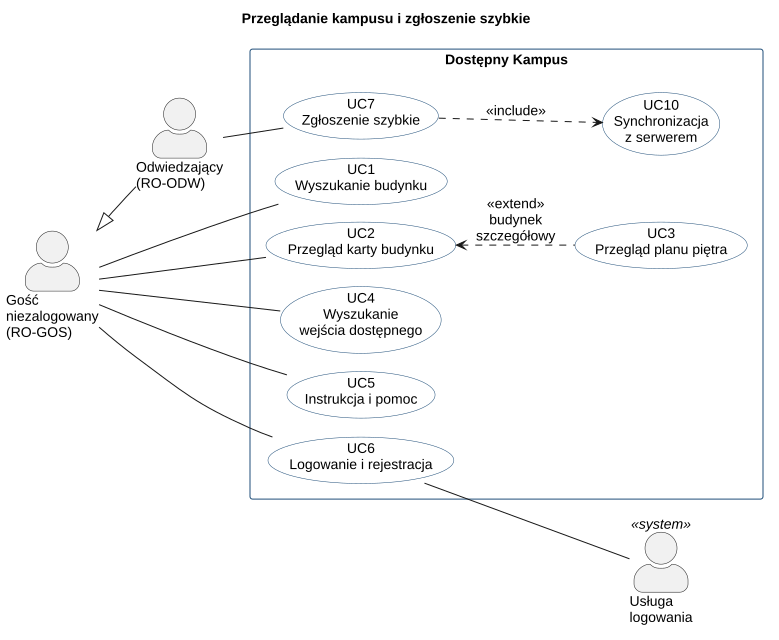
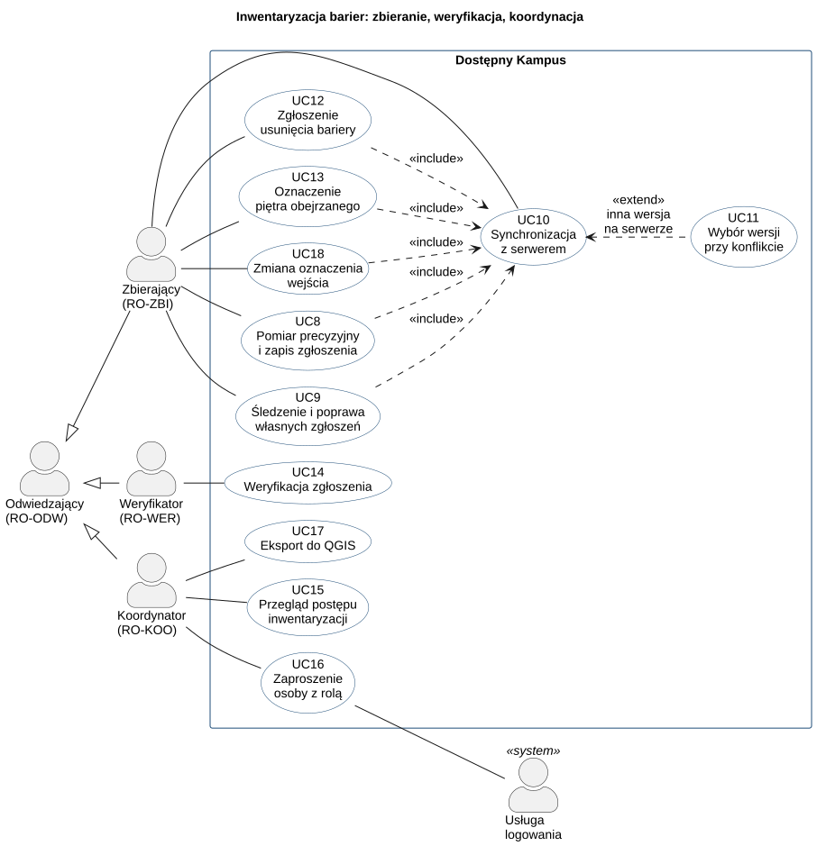

# Przypadki użycia

Strona pokazuje, co każda rola osiąga w systemie „Dostępny Kampus” i jak przebiega to krok po kroku. Aktorzy to role z [Role i uprawnienia](../biznes/role.md). Historyjki i kryteria są na stronie [Potrzeby i historyjki](potrzeby-i-historie.md), reguły na stronie [Reguły biznesowe](../biznes/reguly.md). Tutaj tylko się do nich odwołujemy.

## Diagramy

Przypadki użycia dzielimy na dwa diagramy, bo jeden byłby nieczytelny. Pierwszy obejmuje grupę docelową kursu UX: seniorów jako Gościa niezalogowanego albo Odwiedzającego.

### Przeglądanie kampusu i zgłoszenie szybkie

### Inwentaryzacja barier

Jak czytać diagramy:

- **Linia ciągła** łączy aktora z przypadkiem, w którym uczestniczy.
- **Strzałka z pustym grotem** to dziedziczenie ról. Odwiedzający może wszystko, co Gość niezalogowany. Role pracownicze mają też uprawnienia Odwiedzającego (BR-1).
- **«include»** — przypadek zawsze wykonuje dołączony przypadek. Każde zgłoszenie i znacznik piętra trafiają na serwer przez UC10.
- **«extend»** — przypadek rozszerza inny tylko pod warunkiem z etykiety. Plan piętra (UC3) jest tylko w budynku szczegółowym, a wybór wersji (UC11) tylko przy konflikcie wersji.
- **Usługa logowania** to system zewnętrzny. Przechowuje hasła i adresy e-mail, zakłada konta z zaproszenia (NFR-28, NFR-31).

QGIS nie jest aktorem. Koordynator otwiera w nim plik eksportu poza systemem, a QGIS nie wymienia danych z aplikacją (T29, [proces TO-BE](../biznes/procesy/to-be.md)).

## Przegląd

| UC | Nazwa | Aktor główny | US | Ekran | Priorytet |
| --- | --- | --- | --- | --- | --- |
| UC1 | Wyszukanie budynku | Gość niezalogowany | US1 | V1 | Musi być |
| UC2 | Przegląd karty budynku | Gość niezalogowany | US2 | V2 | Musi być |
| UC3 | Przegląd planu piętra | Gość niezalogowany | US16 | V2 | Powinno być |
| UC4 | Wyszukanie wejścia dostępnego | Gość niezalogowany | US3 | V3 | Powinno być |
| UC5 | Instrukcja i pomoc | Gość niezalogowany | US5 | V5 | Powinno być |
| UC6 | Logowanie i rejestracja | Gość niezalogowany | US14 | wspólny | Musi być |
| UC7 | Zgłoszenie szybkie | Odwiedzający | US4 | V4 | Musi być |
| UC8 | Pomiar precyzyjny i zapis zgłoszenia | Zbierający | US6, US7 | C1, C2 | Musi być; US6.3 i US6.5 — Powinno być |
| UC9 | Śledzenie i poprawa własnych zgłoszeń | Zbierający | US8.1, US8.2, US8.3 | C3 | Musi być |
| UC10 | Synchronizacja z serwerem | Zbierający | US9.1, US9.2, US4.2 | C4 | Musi być |
| UC11 | Wybór wersji przy konflikcie | Zbierający | US9.3 | C4 | Musi być |
| UC12 | Zgłoszenie usunięcia bariery | Zbierający | US8.4, US10.6 | V2, C3 | Musi być |
| UC13 | Oznaczenie piętra obejrzanego | Zbierający | US15 | C1 (do ustalenia w fazie B) | Musi być |
| UC14 | Weryfikacja zgłoszenia | Weryfikator | US10 | R1, R2 | Musi być; US10.1 — Powinno być |
| UC15 | Przegląd postępu inwentaryzacji | Koordynator | US11 | K1 | Musi być |
| UC16 | Zaproszenie osoby z rolą | Koordynator | US12 | K2 | Powinno być |
| UC17 | Eksport do QGIS | Koordynator | US13 | K3 | Musi być |

Kolumna „US” podaje całą historyjkę albo, gdy przypadek pokrywa jej część, konkretne kryteria. Priorytet pochodzi z historyjek. Każda historyjka US1…US16 ma co najmniej jeden przypadek użycia, także umożliwiająca US14.

## Scenariusz demo w budynku A-1

| Krok demo | Przypadek użycia | Co pokazuje |
| --- | --- | --- |
| 1–3 | UC8 | Pomiar precyzyjny przy wejściu głównym A-1, typ TB-1, uciążliwość 3, zdjęcie |
| 4 | UC10 | Zgłoszenie z piwnicy bez sieci wysyła się samo po powrocie sieci |
| 5 | UC14 | Podobne zgłoszenie 5 m dalej to nie duplikat; Weryfikator przyjmuje zgłoszenie |
| 6 | UC4 (z UC1, UC2) | Senior widzi, że wejście główne ma schody, a wejście dostępne to inne wejście [1], [2] |
| 7 | UC13, UC15, UC17 | 4 z 5 pięter obejrzanych (80 %) i eksport do QGIS |

## Kluczowe przypadki użycia

### Wyszukanie wejścia dostępnego (UC4)

| Pole | Opis |
| --- | --- |
| Cel | Osoba przed wyjściem z domu wie, którym wejściem dostanie się do budynku bez stopni. |
| Aktor | Gość niezalogowany; tak samo Odwiedzający i role pracownicze. |
| Warunki wstępne | Brak. Logowanie nie jest potrzebne (US1.2). |
| Wyzwalacz | Senior planuje wizytę w A-1, np. jako słuchacz Politechniki Trzeciego Wieku. |
| Warunki końcowe | Osoba zna wejście dostępne albo wie, że go nie ma. System niczego nie zapisuje. |
| Odwołania | US3.1, US3.2, US2.1, US2.2, BR-6, NFR-10, NFR-17…NFR-21, NFR-39, T20, T21, T23 |

#### Przepływ główny UC4

1. Senior otwiera aplikację; mapa kampusu pokazuje kontury budynków.
2. Senior wybiera budynek A-1 na mapie albo wyszukuje go po symbolu budynku (jak w UC1).
3. Senior wybiera „Zaplanuj wizytę”.
4. System pokazuje wejście dostępne i bariery przyjęte przy tym wejściu. Oznaczenie ma tekst i ikonę, nie tylko kolor (US2.1).
5. W A-1 senior czyta, że wejście główne ma schody, a wejście dostępne to inne wejście [1], [2].

Od mapy do wskazania wejścia są najwyżej 3 dotknięcia (US3.2). System nie prowadzi trasą do wejścia, bo nawigacja jest poza zakresem.

#### Przepływy alternatywne i wyjątki UC4

| Krok | Warunek | Przebieg |
| --- | --- | --- |
| 1a | Brak sieci | Aplikacja pokazuje ostatnio pobrane budynki i bariery z datą synchronizacji, bez podkładu OpenStreetMap (NFR-10, NFR-39). |
| 2a | Senior korzysta z czytnika ekranu | Wybiera budynek z listy zamiast z mapy (NFR-18, NFR-19). |
| 4a | Budynek nie ma wejścia dostępnego | Ekran mówi to wprost zdaniem, a nie pustym wynikiem (US3.1). |
| 4b | Brak danych o dostępności wejść, np. w budynku podstawowym | Ekran mówi, że danych brak, a nie że wejścia nie ma (do ustalenia w fazie B). |
| 4c | Przy wejściu dostępnym jest bariera przyjęta, np. niesprawny podnośnik | Ekran pokazuje ją przy wejściu ze zdjęciem i datą weryfikacji (US2.2). |

### Zgłoszenie szybkie (UC7)

| Pole | Opis |
| --- | --- |
| Cel | Odwiedzający przekazuje informację o nowej barierze w najwyżej 3 krokach, bez formularza. |
| Aktor | Odwiedzający; tak samo role pracownicze. |
| Warunki wstępne | Odwiedzający jest zalogowany (BR-8). Aplikacja ma zgodę na lokalizację przy otwartym ekranie (NFR-27). |
| Wyzwalacz | Odwiedzający widzi barierę, np. niesprawną windę, i wybiera zgłoszenie szybkie. |
| Warunki końcowe | Zgłoszenie czeka w telefonie ze statusem „lokalne” albo na serwerze ze statusem „wysłane”. Na mapie pojawi się dopiero po przyjęciu (BR-6). |
| Odwołania | US4.1…US4.4, US14.2, BR-6, BR-8, BR-9, BR-14, BR-G1, BR-G2, BR-G4, NFR-5, NFR-6, NFR-14, NFR-17, NFR-25, NFR-27, NFR-49, T7–T10 |

#### Przepływ główny UC7

1. Odwiedzający wybiera zgłoszenie szybkie.
2. Aplikacja otwiera aparat i przypomina, by nie fotografować twarzy ani tablic rejestracyjnych (NFR-25).
3. Odwiedzający robi zdjęcie bariery. To krok 1 z 3.
4. Aplikacja sama dołącza bieżącą pozycję telefonu, bez uśredniania (US4.1).
5. Odwiedzający wybiera jedną z 6 grup barier dużym przyciskiem. To krok 2 z 3 (US4.3).
6. Odwiedzający wysyła zgłoszenie. To krok 3 z 3.
7. Aplikacja zapisuje zgłoszenie w telefonie ze statusem „lokalne” i wysyła je przez UC10.
8. Aplikacja potwierdza, że zgłoszenie trafi do weryfikacji (US4.4).

Aplikacja nie pyta o typ bariery ani uciążliwość; ustala je Weryfikator w UC14 (BR-14). Odwiedzający nie widzi dalszego statusu zgłoszenia (US4.4).

#### Przepływy alternatywne i wyjątki UC7

| Krok | Warunek | Przebieg |
| --- | --- | --- |
| 1a | Gość niezalogowany wybiera zgłoszenie szybkie | Przed zdjęciem aplikacja prosi o logowanie albo rejestrację (US14.2, UC6). Po zalogowaniu wraca do kroku 2. |
| 1b | Gość rezygnuje z logowania | Zgłoszenie nie powstaje, a aplikacja wraca do mapy. |
| 4a | Pozycja poza konturem budynku | Zgłoszenie zapisuje się z pozycją, bez komunikatu o błędzie (BR-G2, BR-G4, NFR-49). |
| 4b | Budynek podstawowy | Zgłoszenie działa tak samo, jak w budynku szczegółowym (BR-G1). |
| 4c | Telefon nie ustala pozycji | Zachowanie do ustalenia w fazie B. |
| 5a | Żadna grupa nie pasuje | Odwiedzający wybiera grupę „inne”. Weryfikator ustali typ, także z innej grupy (BR-14). |
| 7a | Brak sieci | Zgłoszenie czeka w telefonie i wysyła się samo po powrocie sieci (US4.2, BR-9). Potwierdzenie mówi, że wysyłka nastąpi później. |
| 7b | Aplikacja zamknięta albo telefon zrestartowany przed wysyłką | Zgłoszenie i zdjęcie zostają w telefonie (NFR-5). |

### Pomiar precyzyjny i zapis zgłoszenia (UC8)

| Pole | Opis |
| --- | --- |
| Cel | Zbierający zapisuje barierę z miejscem dokładnym poniżej 1 m, budynkiem, piętrem i zdjęciem. |
| Aktor | Zbierający. |
| Warunki wstępne | Zbierający jest zalogowany z rolą RO-ZBI (US14.1). Stoi przy barierze. Sieć nie jest potrzebna (NFR-4). |
| Wyzwalacz | Zbierająca przy wejściu głównym A-1 widzi schody bez pochylni i wybiera „Nowe zgłoszenie”. |
| Warunki końcowe | Zgłoszenie jest w telefonie ze statusem „lokalne” albo na serwerze ze statusem „wysłane”. Widać je w UC9. |
| Odwołania | US6.1…US6.5, US7.1…US7.3, BR-7, BR-9, BR-G1…BR-G4, NFR-1…NFR-4, NFR-23, NFR-27, T1–T6, T10 |

#### Przepływ główny UC8

1. Zbierający wybiera „Nowe zgłoszenie”.
2. System przez 30 s uśrednia pozycję. Pokazuje dokładność pozycji i liczbę satelitów osobno dla każdego systemu GNSS (US6.1, NFR-2).
3. System podpowiada najbliższy budynek, także bez sieci (US6.2, NFR-4).
4. Zbierający potwierdza budynek, np. A-1.
5. Zbierający wybiera piętro z etykiet z danych PWr (US7.2).
6. Zbierający wybiera typ bariery i uciążliwość, robi zdjęcie i w razie potrzeby dopisuje opis. W demo: TB-1 „schody przy wejściu”, uciążliwość 3.
7. Zbierający zapisuje zgłoszenie. System sprawdza wymagane pola (BR-7).
8. System zapisuje zgłoszenie w telefonie ze statusem „lokalne” i wysyła je przez UC10.

Mapa nieba z położeniem satelitów (US6.5) uzupełnia krok 2 i ma priorytet „Powinno być”.

#### Przepływy alternatywne i wyjątki UC8

| Krok | Warunek | Przebieg |
| --- | --- | --- |
| 2a | Zbierający chce powtórzyć pomiar | Przerywa uśrednianie i zaczyna od nowa; aplikacja nie ma limitu czasu (NFR-23). |
| 3a | Punkt poza konturem budynku | Stan „poza budynkiem”, bez komunikatu o błędzie. System proponuje najbliższy budynek; Zbierający go wybiera albo odrzuca (BR-G2, US6.2). |
| 3b | Punkt daleko od budynków PWr | System nie proponuje budynku. Zgłoszenie zapisuje się jako „poza budynkiem”, bez piętra (BR-G4). |
| 3c | W pobliżu są zgłoszenia innych osób | Podpowiedź duplikatów pokazuje ich typ i położenie, więc Zbierający nie zapisuje drugi raz tej samej bariery. Moment pokazania do ustalenia w fazie B ([macierz uprawnień](../biznes/role.md#przypisy), przypis 7). |
| 4a | Podpowiedź wskazuje zły budynek | Zbierający wybiera inny budynek (US6.2). |
| 4b | Pozycja z GNSS jest niedokładna, np. przy ścianie | Zbierający przesuwa punkt na planie piętra (US6.3) albo na mapie (US6.4). Zgłoszenie dostaje oznaczenie „korekta ręczna” (NFR-3). |
| 5a | Budynek podstawowy, także po nieudanym imporcie planów | Przełącznika pięter nie ma, widać napis „Plan piętra niedostępny dla tego budynku”. Zbierający wpisuje liczbę, opcjonalnie z dopiskiem „półpiętro” (BR-G1, BR-G3). |
| 7a | Brak typu, uciążliwości albo zdjęcia | System wskazuje brakujące pole i nie zapisuje zgłoszenia (US7.1). |
| 7b | Typ TB-29 „inna bariera” bez opisu | System wymaga opisu (US7.3). |
| 8a | Brak sieci, np. w piwnicy A-1 | Wskaźnik pokazuje brak sieci, a zgłoszenie czeka ze statusem „lokalne” (US9.1, BR-9). |

### Weryfikacja zgłoszenia (UC14)

| Pole | Opis |
| --- | --- |
| Cel | Na mapę trafiają tylko sprawdzone bariery, bez błędów i duplikatów. |
| Aktor | Weryfikator. |
| Warunki wstępne | Weryfikator jest zalogowany z rolą RO-WER. W kolejce są zgłoszenia „wysłane”, których nie jest autorem (BR-4). Jest połączenie z serwerem. |
| Wyzwalacz | Weryfikator otwiera kolejkę weryfikacji. |
| Warunki końcowe | Zgłoszenie jest przyjęte i widoczne na mapie albo odrzucone z powodem. Po przyjęciu zmiany „bariera usunięta” oba zgłoszenia są archiwalne. |
| Odwołania | US10.1…US10.6, BR-3, BR-4, BR-5, BR-11, BR-13…BR-19, BR-23, NFR-25, T14–T19 |

#### Przepływ główny UC14

1. Weryfikator otwiera kolejkę jako listę i mapę. Nie widzi w niej własnych zgłoszeń ani własnych zmian „bariera usunięta” (US10.5).
2. Weryfikator bierze zgłoszenie.
3. System ustawia status „w weryfikacji” i usuwa zgłoszenie z kolejki innych Weryfikatorów (US10.4, BR-11).
4. System pokazuje dane, zdjęcie, rolę i pseudonim autora (BR-5). Pokazuje też podobne zgłoszenia w promieniu 10 m: typ, zdjęcie i odległość (US10.1, BR-13).
5. Weryfikator porównuje zgłoszenie z podobnymi. W demo podobne zgłoszenie 5 m dalej opisuje inną barierę, więc to nie duplikat.
6. Weryfikator zasłania na zdjęciu twarze i tablice rejestracyjne, jeśli są. To część przyjęcia i nie tworzy nowej wersji (BR-15, NFR-25).
7. Weryfikator przyjmuje zgłoszenie.
8. System ustawia status „przyjęte”. Bariera od razu pojawia się na mapie i karcie budynku ze zdjęciem i datą weryfikacji (BR-17, US2.2).

#### Przepływy alternatywne i wyjątki UC14

| Krok | Warunek | Przebieg |
| --- | --- | --- |
| 1a | Brak sieci albo awaria serwera | Kolejka się nie otwiera. Aplikacja mówi to bez żargonu technicznego (NFR-50). |
| 2a | Inny Weryfikator wziął zgłoszenie chwilę wcześniej | Zgłoszenie znika z kolejki; nie da się go wziąć drugi raz (BR-11). |
| 2b | Weryfikator przerywa pracę przed decyzją | Zgłoszenie zostaje „w weryfikacji” u tego Weryfikatora; zwolnienia nie ma (BR-11, [Reguły biznesowe](../biznes/reguly.md), „Poza MVP”). |
| 5a | Zgłoszenie szybkie | Weryfikator ustala typ bariery i uciążliwość. Bez nich przyjęcie jest niemożliwe (US10.3, BR-14). |
| 5b | Duplikat | Weryfikator odrzuca zgłoszenie i w powodzie odrzucenia wskazuje wcześniejsze zgłoszenie (BR-13). Dalej według wiersza 7a. |
| 5c | Błąd w zgłoszeniu z pomiaru precyzyjnego | Weryfikator nie poprawia typu, uciążliwości ani miejsca. Odrzuca zgłoszenie z powodem (BR-15). Dalej według wiersza 7a. |
| 5d | Zmiana dotyczy zgłoszenia, które już jest archiwalne | Inna równoległa zmiana została przyjęta wcześniej. Weryfikator odrzuca tę zmianę z powodem „nieaktualne” (BR-23). Dalej według wiersza 7a. |
| 5e | Autor w tym czasie edytuje zgłoszenie | Powstaje nowa wersja; Weryfikator decyduje o nowej, nie o starej (BR-3). |
| 7a | Odrzucenie | Weryfikator podaje powód odrzucenia; bez niego odrzucić się nie da (US10.2, BR-16). Status „odrzucone”, a autor widzi powód w UC9. |
| 7b | Zgłoszenie „bariera usunięta” | Po przyjęciu bariera znika z mapy i karty budynku, oba zgłoszenia stają się archiwalne (US10.6, BR-19). |
| 7c | Zmiana zgłoszenia przyjętego | Po przyjęciu poprzednie zgłoszenie staje się archiwalne i znika z mapy (BR-18). |

## Pozostałe przypadki użycia

### Wyszukanie budynku (UC1)

| Pole | Opis |
| --- | --- |
| Cel | Osoba wie, gdzie na kampusie stoi budynek. |
| Aktor | Gość niezalogowany. |
| Warunki wstępne | Brak; logowanie nie jest potrzebne (US1.2). |
| Wyzwalacz | Osoba zna symbol budynku z planu zajęć albo zaproszenia. |
| Przepływ główny | 1. Osoba otwiera mapę kampusu.   2. Wpisuje symbol budynku, np. „c13”.   3. System znajduje C-13 niezależnie od zapisu (US1.1).   4. System pokazuje budynek na mapie z barierami przyjętymi (US1.3). |
| Alternatywy i wyjątki | 1a. Brak sieci: dane z ostatniej synchronizacji z datą (NFR-10).   2a. Czytnik ekranu: osoba wybiera budynek z listy (NFR-19).   3a. Brak wyniku: system mówi to zdaniem (do ustalenia w fazie B). |
| Warunki końcowe | Budynek jest zaznaczony na mapie; dalej można otworzyć UC2. |
| Odwołania | US1.1…US1.3, BR-6, NFR-11, NFR-19, NFR-37, T20 |

### Przegląd karty budynku (UC2)

| Pole | Opis |
| --- | --- |
| Cel | Osoba widzi wejścia, windy i bariery budynku oraz wie, kiedy je sprawdzono. |
| Aktor | Gość niezalogowany. |
| Warunki wstępne | Osoba wybrała budynek (UC1 albo dotknięcie konturu na mapie). |
| Wyzwalacz | Osoba otwiera kartę budynku. |
| Przepływ główny | 1. System pokazuje wejścia z oznaczeniem „dostępne” albo „niedostępne” tekstem i ikoną (US2.1).   2. Pokazuje windy i zgłoszenia przyjęte ze zdjęciem i datą weryfikacji (US2.2, BR-17).   3. Tekst pojawia się od razu, zdjęcia doczytują się później (NFR-12). |
| Punkt rozszerzenia | „Budynek szczegółowy” — wybór piętra i plan piętra (UC3). |
| Alternatywy i wyjątki | 1a. Brak sieci: karta wcześniej otwartego budynku z datą synchronizacji (NFR-10).   1b. Budynek podstawowy: karta działa, planu piętra nie ma (BR-G1).   2a. Brak zgłoszeń przyjętych: nie znaczy to „brak barier”; sposób pokazania do ustalenia w fazie B. |
| Warunki końcowe | Osoba zna stan budynku; system niczego nie zapisuje. |
| Odwołania | US2.1, US2.2, BR-6, BR-17, BR-G1, NFR-10, NFR-12, NFR-21, T21 |

### Przegląd planu piętra (UC3)

| Pole | Opis |
| --- | --- |
| Cel | Osoba widzi na planie piętra windy, schody, toalety, wejścia i bariery. |
| Aktor | Gość niezalogowany. |
| Warunki wstępne | Otwarta karta budynku szczegółowego (rozszerza UC2). |
| Przepływ główny | 1. Osoba wybiera piętro w przełączniku z etykietami z danych PWr (US16.1).   2. System pokazuje plan piętra ze zgłoszeniami przyjętymi i podpisem źródła danych (NFR-40). |
| Alternatywy i wyjątki | 1a. Budynek podstawowy albo nieudany import planów: przełącznika nie ma, widać napis „Plan piętra niedostępny dla tego budynku” (US16.2, BR-G1, BR-G3). |
| Warunki końcowe | Osoba zna rozkład piętra; system niczego nie zapisuje. |
| Odwołania | US16.1, US16.2, BR-G1, BR-G3, NFR-40, NFR-48, T22 |

### Instrukcja i pomoc (UC5)

| Pole | Opis |
| --- | --- |
| Cel | Nowa osoba wie, jak korzystać z aplikacji, i się nie gubi. |
| Aktor | Gość niezalogowany. |
| Wyzwalacz | Pierwsze uruchomienie aplikacji albo wybór pomocy. |
| Przepływ główny | 1. Przy pierwszym uruchomieniu system pokazuje krótką instrukcję.   2. Osoba ją przegląda albo pomija.   3. Później otwiera ją ponownie z pomocy (US5.1). |
| Warunki końcowe | Instrukcja nie pokazuje się sama przy kolejnym uruchomieniu. |
| Odwołania | US5.1, NFR-18, NFR-20, NFR-23 |

### Logowanie i rejestracja (UC6)

| Pole | Opis |
| --- | --- |
| Cel | Osoba korzysta z czynności swojej roli. |
| Aktor | Gość niezalogowany; drugorzędny: Usługa logowania. |
| Warunki wstępne | Jest połączenie z siecią. |
| Wyzwalacz | Osoba wybiera logowanie albo aplikacja prosi o nie w UC7 (US14.2). |
| Przepływ główny | 1. Aplikacja przekazuje osobę do Usługi logowania; w aplikacji nie ma pola hasła (NFR-31).   2. Osoba podaje e-mail i hasło.   3. Aplikacja pokazuje czynności wszystkich ról osoby (BR-1, US14.1). |
| Alternatywy i wyjątki | 1a. Brak sieci: aplikacja mówi bez żargonu technicznego, że logowanie wymaga sieci. Mapa i karty budynków działają dalej (NFR-10, NFR-50).   2a. Rejestracja: przed założeniem konta osoba widzi klauzulę informacyjną (NFR-30). Nowe konto ma tylko uprawnienia Odwiedzającego (US14.3, BR-2).   2b. Osoba z zaproszenia loguje się i ma rolę nadaną przez Koordynatora (US12.1).   2c. Pięć błędnych haseł: czasowa blokada konta (NFR-32).   3a. Brak roli do czynności: aplikacja nie pokazuje ekranu, a serwer odrzuca próbę (US14.1, NFR-33). |
| Warunki końcowe | Osoba jest zalogowana z uprawnieniami swoich ról. |
| Odwołania | US14.1…US14.3, US12.1, BR-1, BR-2, NFR-10, NFR-15, NFR-28, NFR-30…NFR-33, NFR-50 |

### Śledzenie i poprawa własnych zgłoszeń (UC9)

| Pole | Opis |
| --- | --- |
| Cel | Zbierający wie, które zgłoszenia dotarły, a które trzeba poprawić. |
| Aktor | Zbierający. |
| Warunki wstępne | Zbierający ma co najmniej jedno własne zgłoszenie. |
| Wyzwalacz | Zbierający otwiera listę swoich zgłoszeń. |
| Przepływ główny | 1. System pokazuje każde własne zgłoszenie z jednym statusem: lokalne, wysłane, w weryfikacji, przyjęte albo odrzucone (US8.1, US8.2).   2. Zbierający otwiera zgłoszenie odrzucone i czyta powód odrzucenia (BR-16).   3. Poprawia zgłoszenie i wysyła je ponownie przez UC10 (US8.3, BR-3). |
| Alternatywy i wyjątki | 2a. Zgłoszenie przed decyzją Weryfikatora: Zbierający je edytuje; powstaje nowa wersja (BR-3).   2b. Serwer ma inną wersję: UC11.   2c. Zgłoszenie przyjęte: zmianę zaczyna się z karty budynku (do ustalenia w fazie B) i tworzy ona nowe zgłoszenie, które znów przechodzi weryfikację (BR-18). Usunięcie bariery opisuje UC12.   2d. Powód odrzucenia „nieaktualne”: ktoś wcześniej przyjął inną zmianę tego zgłoszenia. Zbierający wysyła zmianę ponownie do bieżącego zgłoszenia (BR-23). |
| Warunki końcowe | Poprawione zgłoszenie czeka w kolejce ze statusem „wysłane”. |
| Odwołania | US8.1…US8.3, BR-3, BR-16, BR-18, BR-23, NFR-21, T19 |

### Synchronizacja z serwerem (UC10)

| Pole | Opis |
| --- | --- |
| Cel | Zgłoszenia i znaczniki z telefonu docierają na serwer bez strat i bez powtórzeń. |
| Aktor | Zbierający; dołączany przez UC7, UC8, UC12 i UC13, więc działa też dla Odwiedzającego. |
| Warunki wstępne | W telefonie czekają zgłoszenia albo znaczniki pięter. |
| Wyzwalacz | Powrót sieci albo wybór „Synchronizuj”. |
| Przepływ główny | 1. Aplikacja wykrywa sieć i sama rusza z synchronizacją (US9.2, NFR-6).   2. Wysyła zgłoszenia i znaczniki z kolejki.   3. Po potwierdzeniu odbioru przez serwer zgłoszenie dostaje status „wysłane” (BR-9, US8.2).   4. Aplikacja pobiera zmiany z serwera. |
| Punkt rozszerzenia | „Inna wersja na serwerze” — wybór wersji (UC11). |
| Alternatywy i wyjątki | 1a. Brak sieci: wskaźnik braku sieci, zgłoszenie czeka ze statusem „lokalne” (US9.1).   1b. W telefonie zostaje mniej niż 100 MB: ostrzeżenie (NFR-7).   2a. Połączenie przerwane: ponowienie nie tworzy drugiego zgłoszenia (NFR-8).   2b. Awaria serwera: zgłoszenia czekają w kolejce (NFR-50). |
| Warunki końcowe | Kolejka w telefonie jest pusta albo czeka na sieć; nic nie zginęło. |
| Odwołania | US4.2, US9.1, US9.2, US8.2, US15.3, BR-9, BR-20, NFR-5…NFR-8, NFR-50, T10, T11, T13 |

### Wybór wersji przy konflikcie (UC11)

| Pole | Opis |
| --- | --- |
| Cel | Żadna zmiana zgłoszenia nie znika po cichu. |
| Aktor | Zbierający. |
| Warunki wstępne | Zbierający zmienił zgłoszenie, a serwer ma już inną jego wersję, np. z drugiego telefonu (rozszerza UC10). |
| Przepływ główny | 1. Aplikacja pokazuje obie wersje obok siebie (US9.3).   2. Zbierający wybiera wersję własną albo z serwera.   3. Wersja własna działa jak zwykła edycja w obecnym statusie na serwerze (BR-10). |
| Alternatywy i wyjątki | 2a. Zbierający odkłada wybór: zmiana czeka w telefonie (BR-10).   3a. Zgłoszenie było odrzucone: wersja własna wraca do kolejki ze statusem „wysłane” (BR-10).   3b. Zgłoszenie było przyjęte: wersja własna tworzy nowe zgłoszenie (BR-18). |
| Warunki końcowe | Na serwerze jest wersja wybrana przez Zbierającego. |
| Odwołania | US9.3, BR-3, BR-10, BR-18, NFR-9, T12 |

### Zgłoszenie usunięcia bariery (UC12)

| Pole | Opis |
| --- | --- |
| Cel | Naprawiona bariera, np. winda, znika z mapy po weryfikacji (N2). |
| Aktor | Dowolny Zbierający, nie tylko autor zgłoszenia (BR-19). |
| Warunki wstępne | Bariera ma zgłoszenie przyjęte. Zbierający na miejscu widzi, że jej już nie ma. |
| Przepływ główny | 1. Zbierający otwiera kartę budynku i wybiera zgłoszenie przyjęte (US8.4).   2. Wybiera „bariera usunięta” i robi nowe zdjęcie miejsca.   3. Typ, miejsce i piętro przechodzą z poprzedniego zgłoszenia (BR-19).   4. Nowe zgłoszenie przechodzi te same statusy co każde zgłoszenie: od „lokalne” przez UC10 do „wysłane” (US8.4).   5. Bariera zostaje na mapie do decyzji Weryfikatora (US8.4). |
| Alternatywy i wyjątki | 5a. Weryfikator, który nie złożył zgłoszenia, przyjmuje je (UC14): bariera znika z mapy, karty budynku i eksportu (US10.6, BR-22).   5b. Weryfikator odrzuca zgłoszenie: na mapie zostaje poprzednie zgłoszenie (BR-18).   5c. Ktoś wcześniej przyjął inną zmianę tego zgłoszenia: odrzucenie z powodem „nieaktualne”. Zbierający może wysłać zmianę ponownie do bieżącego zgłoszenia (BR-23). |
| Warunki końcowe | Po przyjęciu oba zgłoszenia są archiwalne i zostają w historii (BR-19). |
| Odwołania | US8.4, US10.5, US10.6, BR-3, BR-4, BR-18, BR-19, BR-22, BR-23, T6, T10–T17 |

Odwiedzający nie zgłasza usunięcia bariery, bo nie edytuje zgłoszeń ([Reguły biznesowe](../biznes/reguly.md), „Poza MVP”).

### Oznaczenie piętra obejrzanego (UC13)

| Pole | Opis |
| --- | --- |
| Cel | Postęp inwentaryzacji odpowiada temu, co zespół naprawdę obszedł. |
| Aktor | Zbierający. |
| Warunki wstępne | Zbierający obszedł całe piętro albo cały budynek podstawowy. |
| Przepływ główny | 1. W budynku szczegółowym Zbierający oznacza wybrane piętro jako obejrzane (US15.1).   2. Znacznik zapisuje się w telefonie, także bez sieci, i trafia na serwer przez UC10 (US15.3, BR-20).   3. Gdy znacznik dotrze na serwer, postęp budynku pokazuje nową wartość (US11.2, BR-21). |
| Alternatywy i wyjątki | 1a. Budynek podstawowy: Zbierający oznacza cały budynek jako „obejrzany” (US15.1).   1b. Błędny znacznik: cofa go Zbierający, który go postawił; inny Zbierający nie może (US15.2). Koordynator cofa znacznik w UC15.   1c. Brak sieci: znacznik i jego cofnięcie czekają w telefonie i wysyłają się same (US15.3). |
| Warunki końcowe | Postęp budynku pokazuje nową wartość, np. 4 z 5 pięter. |
| Odwołania | US15.1…US15.3, US11.2, BR-20, BR-21, T24, T25 |

### Przegląd postępu inwentaryzacji (UC15)

| Pole | Opis |
| --- | --- |
| Cel | Koordynator wie, gdzie zespół musi jeszcze pójść. |
| Aktor | Koordynator. |
| Warunki wstępne | Koordynator jest zalogowany z rolą RO-KOO; jest połączenie z serwerem. |
| Przepływ główny | 1. Koordynator otwiera postęp według budynków.   2. System pokazuje odsetek pięter obejrzanych (budynek szczegółowy) albo znacznik „obejrzany” (budynek podstawowy) (US11.1, BR-21).   3. Obok są liczby zgłoszeń czekających na weryfikację i przyjętych. W demo A-1: 4 z 5 pięter, 80 %. |
| Alternatywy i wyjątki | 2a. Znacznik jest błędny: Koordynator cofa go niezależnie od autora (US11.3, BR-20). Postęp pokazuje nową wartość (US11.2).   2b. Zgłoszenia lokalne i poza budynkiem nie wchodzą do postępu (BR-21).   1a. Awaria serwera: postęp czeka na powrót serwera (NFR-50). |
| Warunki końcowe | Koordynator zna postęp; po cofnięciu znacznika postęp jest przeliczony. |
| Odwołania | US11.1…US11.3, BR-20, BR-21, NFR-50, T26 |

### Zaproszenie osoby z rolą (UC16)

| Pole | Opis |
| --- | --- |
| Cel | Nowa osoba dołącza do inwentaryzacji bez pomocy administratora. |
| Aktor | Koordynator; drugorzędny: Usługa logowania. |
| Warunki wstępne | Koordynator jest zalogowany z rolą RO-KOO. Pierwszego Koordynatora nadaje administrator usługi logowania. |
| Przepływ główny | 1. Koordynator wpisuje adres e-mail i wybiera rolę.   2. System przekazuje zaproszenie do Usługi logowania.   3. Osoba loguje się (UC6) i ma wybraną rolę (US12.1, BR-2). |
| Alternatywy i wyjątki | 1a. Adres należy do istniejącego konta: konto dostaje nową rolę, dotychczasowe zostają (US12.2, BR-1). |
| Warunki końcowe | Osoba ma konto z wybraną rolą. |
| Odwołania | US12.1, US12.2, BR-1, BR-2 |

Gdy zaproszenie nie będzie gotowe na pokaz, rolę nada ręcznie administrator usługi logowania. To rozwiązanie zapasowe projektu z opisu produktu, a nie przebieg przypadku użycia.

### Eksport do QGIS (UC17)

| Pole | Opis |
| --- | --- |
| Cel | Koordynator przekazuje aktualny stan barier do analizy w QGIS. |
| Aktor | Koordynator. |
| Warunki wstępne | Koordynator jest zalogowany z rolą RO-KOO; jest połączenie z serwerem. |
| Przepływ główny | 1. Koordynator wybiera format: GeoJSON albo CSV.   2. System tworzy plik z bieżących zgłoszeń przyjętych, bez danych autora (US13.3, BR-22).   3. GeoJSON ma współrzędne w WGS84, CSV w PUWG 1992 (US13.1, US13.2).   4. Koordynator pobiera plik i otwiera go w QGIS poza systemem (T29). |
| Alternatywy i wyjątki | 1a. Awaria serwera: eksport czeka na powrót serwera (NFR-50).   2a. Brak zgłoszeń przyjętych: zachowanie do ustalenia w fazie B. |
| Warunki końcowe | Plik zawiera tylko bieżące bariery, z atrybucją OpenStreetMap, bez konturów budynków (NFR-37, NFR-38). |
| Odwołania | US13.1…US13.3, BR-6, BR-22, NFR-37, NFR-38, NFR-43, T27–T29 |

## Źródła

1. Stan dostosowania obiektów PWr na dzień 01.01.2025, kampus główny (A-1, dostosowane wejście: „Tak (inne)”): <https://dostepnosc.pwr.edu.pl/dostepnosc-architektoniczna/stan-dostosowania-obiektow-pwr-na-dzien-01-01-2025/kampus-glowny-pwr-na-dzien-01-01-2025>
2. Deklaracja dostępności budynku A-1 (wejście główne ze schodami, wejście dostępne z tyłu budynku): <https://dostepnosc.pwr.edu.pl/dostepnosc-architektoniczna/deklaracje-dostepnosci-budynkow/budynki-a/a1>
3. Notacja diagramu przypadków użycia, «include» i «extend» (UML 2.5.1, rozdział 18): <https://www.omg.org/spec/UML/2.5.1/PDF>
4. Szablon opisu przypadku użycia według Alistaira Cockburna: aktor główny, warunki wstępne, wyzwalacz, przepływ główny, rozszerzenia (Wikipedia, „Use case”, sekcja „Fully dressed”): <https://en.wikipedia.org/wiki/Use_case>

Wewnętrzne źródła: [Role i uprawnienia](../biznes/role.md), [Słownik pojęć](../biznes/slownik.md), [Proces TO-BE](../biznes/procesy/to-be.md), [Reguły biznesowe](../biznes/reguly.md), [Potrzeby i historyjki](potrzeby-i-historie.md), [Wymagania niefunkcjonalne](niefunkcjonalne.md).

Dostęp do źródeł: 27.10.2026.
